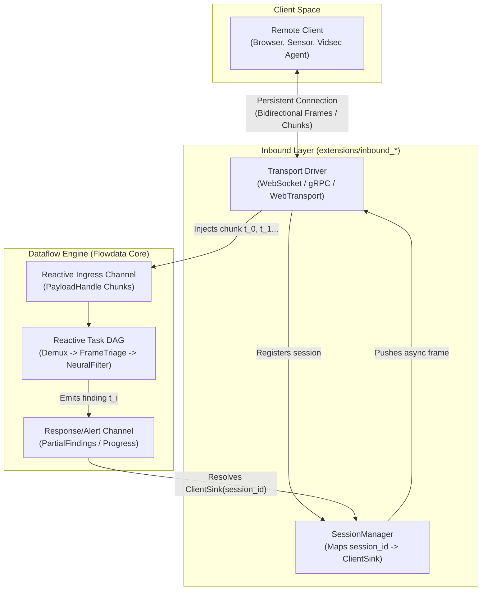

# Technical Analysis: Persistent Ingestion Sources and Bidirectional Client Communication

| Metadata | Value |
| :--- | :--- |
| **Document** | Architecture Analysis and Specification |
| **Domain** | `Flowdata v2 Inbound Transport` & `Reactive Dataflow Engine` |
| **Status** | `ANALYSIS & DESIGN` |
| **Location** | `docs/analysis/persistent_sources_and_bidirectional_transports.md` |

---

## 1. Executive Summary and Motivation

To date, the inbound transport layer (`src/transport/inbound/`) has been primarily structured around **discrete invocations (Request/Response RPC)**:
1. The client sends a self-contained payload (a file on disk or a complete HTTP buffer).
2. The pipeline executes synchronously from start to finish.
3. The engine outputs a final JSON/text response and terminates the connection (`Connection: close`).

This model is insufficient for two core requirements of modern analytical applications (such as `vidsec`):

1. **Persistent Temporal Sources (Streaming Ingestion)**:
   * **Continuous signals**: Live video feeds (RTSP, RTMP, WebRTC), real-time log ingestion, or promiscuous network traffic capture.
   * **Massive files**: 10 GB to 1 TB files that exceed available RAM, whose chunks must flow through the DAG as they arrive over the wire.
2. **Asynchronous Bidirectional Communication with the Calling Client**:
   * **Real-time partial findings**: Emitting forensic detections, security alerts, or percentage progress updates without waiting for full pipeline completion.
   * **Bidirectional Flow Control (Backpressure)**: The engine's ability to pause client ingress when internal buffers saturate, and the client's ability to throttle, pause, or cancel execution mid-stream.

This document reviews available streaming transport protocols (evaluating what **HTTP/2**, **HTTP/3**, and **WebTransport** introduced relative to **WebSockets**), and specifies how to integrate continuous sources into Flowdata's reactive dataflow algebra and extension ecosystem.

---

## 2. State of the Art: WebSockets vs. HTTP/2 vs. HTTP/3 vs. WebTransport

Historically, web browsers and backend services defaulted to **WebSockets** for persistent interactions. Subsequent evolutions of the HTTP standard attempted to address or replace this paradigm with varying degrees of success.

### 2.1. Server-Sent Events (SSE / EventSource)
* **Mechanism**: Unidirectional (Server $\to$ Client) over standard HTTP/1.1 or HTTP/2 (`text/event-stream`).
* **Advantages**: Extremely lightweight, native automatic reconnection, traverses middleboxes and firewalls seamlessly.
* **Limitation**: The client cannot send data back over the same channel (requires issuing separate HTTP `POST` requests).

### 2.2. The Promise and Reality of HTTP/2 (RFC 7540)
HTTP/2 introduced binary multiplexing via frames (`HEADERS`, `DATA`, `WINDOW_UPDATE`, `RST_STREAM`) across a single TCP connection.

1. **HTTP/2 Server Push (Practical Failure)**:
   * *The intention*: The server anticipated resource needs and pushed assets to the client before requested.
   * *The reality*: Designed primarily for preloading web assets (CSS/JS), not application data streaming. Most caching proxies and clients handled it poorly. By 2022, **Chrome and major browsers removed default support for Server Push**. In HTTP/3, Server Push was omitted entirely.
2. **Bidirectional Streaming in HTTP/2 (Success via gRPC)**:
   * HTTP/2 allows a client to open a stream with continuous `DATA` frames while the server concurrently responds with continuous `DATA` frames.
   * This is the exact mechanism powering **gRPC Streaming** (`client-streaming`, `server-streaming`, `bidirectional-streaming`).
3. **WebSockets over HTTP/2 (RFC 8441 - Extended CONNECT)**:
   * Allows multiplexing a WebSocket tunnel inside an existing HTTP/2 stream without opening a new TCP handshake.
4. **The Achilles Heel of HTTP/2**:
   * **TCP Head-of-Line Blocking**: Although HTTP/2 multiplexes dozens of streams, all traffic traverses a single TCP connection. If a single packet is lost in transit, **all streams are blocked** until TCP retransmits the missing segment. For real-time video on lossy networks (WiFi, 4G, 5G), this degrades latency significantly.

### 2.3. HTTP/3 and QUIC (RFC 9000, RFC 9114)
HTTP/3 shifts the transport foundation from TCP to **QUIC (over UDP)**:

1. **Zero Head-of-Line Blocking between streams**: Each QUIC stream is independent at the packet level. If packet loss affects one stream, other streams continue processing without added latency.
2. **Ultra-fast Connection Establishment (0-RTT Handshake)**: TLS 1.3 negotiation is directly embedded within the transport handshake.
3. **Connection Migration**: If a client transitions between WiFi and mobile data, the connection persists uninterrupted (using a 64-bit connection ID decoupled from IP:port tuples).

### 2.4. WebTransport: The True Successor to WebSockets (W3C / IETF)
Designed specifically on top of **HTTP/3 and QUIC** as the modern replacement for WebSockets:

* **Reliable Streams**: Unidirectional or bidirectional, ordered, lossless (ideal for control messages, metadata, JSON commands).
* **Unreliable Datagrams**: Lightweight UDP-style datagrams without mandatory retransmission (ideal for real-time video frames where dropping a stale frame is preferable to stalling the stream).
* **Session Multiplexing**: A single WebTransport session can carry video on one stream, audio on another, and telemetry across datagrams.

---

### 2.5. Protocol Comparison Matrix for Inbound Ingestion

| Feature | WebSockets (RFC 6455) | Server-Sent Events (SSE) | HTTP/2 Bidirectional (gRPC) | WebTransport (HTTP/3 + QUIC) |
| :--- | :---: | :---: | :---: | :---: |
| **Base Transport** | TCP | TCP / TLS | TCP / TLS | **UDP / QUIC** |
| **Directionality** | Full-Duplex | Unidirectional (S $\to$ C) | Full-Duplex | **Full-Duplex** |
| **Head-of-Line Blocking** | Yes (TCP) | Yes (TCP) | Yes (TCP) | **No (Independent QUIC Streams)** |
| **Datagram Support (UDP)** | No (Reliable only) | No | No | **Yes (`sendDatagram`)** |
| **Native Multiplexing** | No (1 connection = 1 stream) | No | Yes (HTTP/2 Streams) | **Yes (Streams + Datagrams)** |
| **Zig / Ecosystem Maturity** | **Very High (Simple RFC)** | **Very High (Pure HTTP)** | Moderate (H2 framing) | Low / Emerging (QUIC stacks) |
| **Kernel Complexity** | Low ($\sim$400 lines) | Minimal ($\sim$50 lines) | Moderate ($\sim$1200 lines) | High (QUIC cryptographic state) |
| **Vidsec v2 Suitability (Immediate)** | **Excellent** | Good (Alerts only) | **Excellent (Microservices)** | **Excellent (Medium-term Future)** |

---

## 3. Architecture in Flowdata: Modeling Persistent Sources in Dataflow Algebra

How do continuous streams fit into a reactive dataflow engine where nodes process discrete `PayloadHandle`s?

### 3.1. Ingestion Lifecycle: Connection $\to$ Session $\to$ Stream

In standard discrete execution, the pipeline lifecycle matches the request lifecycle. In continuous sources, they decouple:

1. **Session (`InboundSession`)**:
   Represents the underlying transport connection established by the client. Holds a unique `session_id: u64`, a root W3C `TraceId`, and a bidirectional feedback channel (`ClientSink`).
2. **Ingress Events (`StreamChunks`)**:
   Each frame, video chunk, or message is encapsulated in an ephemeral `PayloadHandle` that enters the pipeline as an individual event:
   $$\text{Client Data} \longrightarrow \text{InboundDriver} \longrightarrow \text{PayloadHandle}_n \longrightarrow \text{DAG Pipeline}$$
3. **Stream Termination (`EOS`)**:
   The client issues a close frame (QUIC `FIN` or WebSocket `Close` frame). The pipeline receives an `EndOfStream` sentinel, runs cleanup/aggregation passes, and releases session buffers.



---

### 3.2. Bidirectional Client Feedback Mechanism

To allow any pipeline task step (`TaskStep`) to communicate back to the requesting client without coupling to network sockets:

#### `ClientSink` Contract (Kernel / Dataflow)
```zig
pub const ClientSink = struct {
    ptr: *anyopaque,
    vtable: *const VTable,

    pub const VTable = struct {
        /// Sends a structured payload (JSON, Protobuf, or raw binary) back to the client.
        sendEvent: *const fn (ctx: *anyopaque, event_name: []const u8, payload: []const u8) anyerror!void,
        /// Informs transport to throttle or resume ingress from the client.
        setBackpressure: *const fn (ctx: *anyopaque, pause_ingress: bool) anyerror!void,
        /// Server-initiated connection termination.
        close: *const fn (ctx: *anyopaque, code: u16, reason: []const u8) void,
    };

    pub fn emit(self: ClientSink, event_name: []const u8, payload: []const u8) !void {
        return self.vtable.sendEvent(self.ptr, event_name, payload);
    }
};
```

#### Plugin `TaskContext` Injection
When a task executes within a persistent session pipeline, its `TaskContext` (via Guest C-ABI or Zig SDK) exposes an event emission helper:
```zig
// Inside an analysis plugin (e.g., apps/vidsec/analysis/triage.zig)
if (malicious_box_found) {
    try ctx.emitClientEvent("finding_alert", "{ \"box\": \"mdat\", \"threat\": \"heap_overflow\" }");
}
```
The engine automatically routes the payload to the `ClientSink` bound to the active `session_id`, streaming the frame immediately over the wire without interrupting the dataflow DAG.

---

### 3.3. End-to-End Reactive Backpressure

Persistent feeds carry inherent throughput risks: a client may upload video at 1 Gbps while downstream deep inspection runs at 100 Mbps. Without backpressure, server memory exhaustively inflates.

Flowdata applies **Cascading Backpressure**:

1. **Buffer Thresholds (`High-Water Mark`)**:
   Each session maintains a configured memory quota (e.g., `max_buffer_memory_mb = 64`).
2. **Transport-Level Throttling**:
   When buffers hit 80% capacity:
   * **WebSockets**: The driver halts invocations of `read()` on the POSIX socket. The kernel TCP receive window shrinks to zero, forcing the client's TCP stack to stall transmission.
   * **HTTP/2 / gRPC**: The driver withholds `WINDOW_UPDATE` frames on that specific stream without impacting adjacent streams.
   * **HTTP/3 / WebTransport**: QUIC stream-level flow control halts transmission via `MAX_STREAM_DATA` frame limits.
3. **Resumption (`Low-Water Mark`)**:
   When the pipeline drains pending chunks below 30% quota, socket reads resume and window updates are transmitted.

---

## 4. Supported Interaction Patterns

| Pattern | Description | Vidsec Use Case | Preferred Protocol |
| :--- | :--- | :--- | :--- |
| **Request-Stream** *(1 $\to$ N)* | Client issues an ID or search request; server returns an unbounded event stream. | Live forensic alert feeds, pipeline telemetry, real-time log tailing. | SSE or WebSocket |
| **Stream-Request** *(N $\to$ 1)* | Client streams consecutive chunks; server yields a single aggregated verdict upon EOF. | Ingesting large 4K/8K video archives, segmented file inspection. | HTTP/2 Chunked POST or WebSocket |
| **Bidirectional Stream** *(N $\to$ M)* | Interactive open channel; client and server exchange data and commands continuously. | Interactive video inspection, dynamic live quarantine, adaptive triage. | **WebSocket (Immediate)**<br/>**WebTransport (Long-term)** |

---

## 5. Declarative YAML Specification (`pipeline.yaml`)

Persistent sources can be configured declaratively within pipeline schemas:

```yaml
version: "2.0.0"

inbound:
  websocket:
    listen: "0.0.0.0:9001"
    timeouts:
      idle_connection_ms: 120000
      read_idle_ms: 15000
    backpressure:
      max_buffer_memory_mb: 64
    routes:
      - path: "/v1/live/triage"
        pipeline: live_video_pipeline
        # Reverse feedback channel where task steps can push real-time events to the caller
        client_sink_channel: "client_alerts"

pipelines:
  - name: live_video_pipeline
    steps:
      - id: demux_chunk
        module: vidsec_isobmff
        task: parse_box_stream
        outputs:
          - name: alert_events
            channel: client_alerts # Directly pushes outbound frames to the client WebSocket
          - name: parsed_frames
            datasource: mem_store
```

---

## 6. Phased Implementation Roadmap for Flowdata

To balance immediate utility with implementation complexity, a **3-phase rollout** is recommended:

### Phase 1: Inbound WebSocket Driver (`extensions/inbound_ws/`)
* **Rationale**: WebSockets (RFC 6455) is universally supported, compatible with 100% of browsers and CLI tools, and straightforward to implement in native Zig without external cryptographic runtimes (only SHA1 + Base64 handshake and binary bit framing).
* **Deliverables**:
  - `ws://` protocol support layered on POSIX sockets.
  - `ClientSink` implementation for streaming binary and text frames.
  - End-to-end integration test demonstrating bidirectional pipeline streaming.

### Phase 2: Unidirectional Server-Sent Events (`inbound_http`)
* **Rationale**: Extremely low overhead ($\approx$100 lines of code in `extensions/inbound_http`).
* **Deliverables**:
  - `GET /v1/events` endpoint preserving active connections via `Transfer-Encoding: chunked`.
  - Live pipeline telemetry broadcasting for the DAG visualizer (`dag_viz`) and OpenTelemetry monitors.

### Phase 3: WebTransport over HTTP/3 & QUIC (`extensions/inbound_webtransport/`)
* **Rationale**: Requires a full QUIC engine (UDP packet handling, internal TLS 1.3 records, and loss recovery).
* **Deliverables**:
  - Adoption once mature QUIC libraries land in Zig 0.14+ or via C-ABI bindings (e.g., `lsquic` / `msquic`).
  - Unreliable UDP datagram support for ultra-low latency live media feeds.

---

## 7. Conclusions

* **HTTP/2** solved multiplexing over a single connection, but suffers from TCP head-of-line blocking and deprecated Server Push.
* **HTTP/3 and WebTransport** represent the optimal modern target for low-latency bidirectional streaming due to QUIC's unblocked UDP architecture; however, implementation cost in pure Zig remains high today.
* **WebSockets**, decoupled via `InboundSession` and `ClientSink` in Flowdata's reactive core, provides the **ideal immediate solution**: enabling chunked video streaming, asynchronous client feedback, and cascading backpressure with minimal complexity and zero external dependencies.
