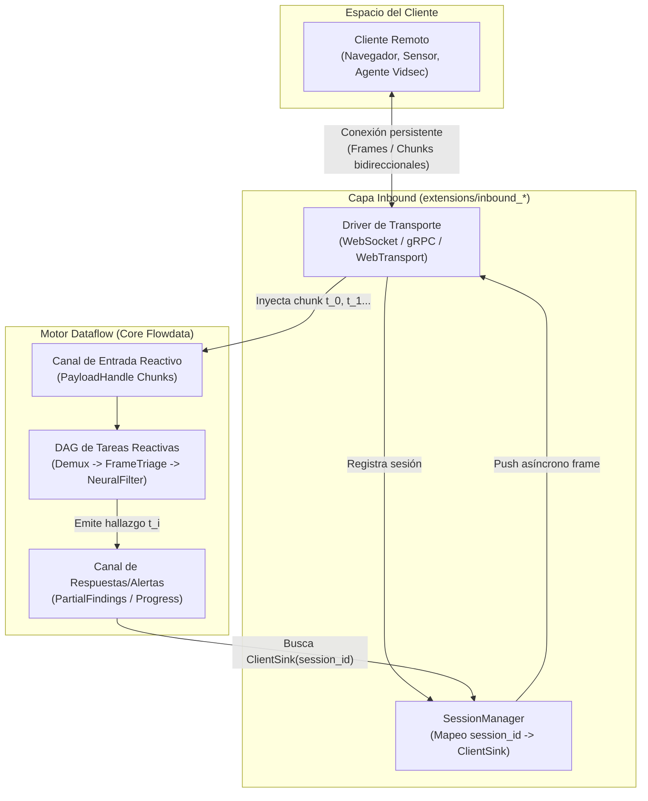

# Análisis Técnico: Fuentes Persistentes en el Tiempo y Comunicación Bidireccional con el Cliente

| Metadatos | Valor |
| :--- | :--- |
| **Documento** | Especificación y Análisis de Arquitectura |
| **Área** | `Flowdata v2 Inbound Transport` & `Reactive Dataflow Engine` |
| **Estado** | `ANALYSIS & DESIGN` |
| **Ubicación** | `docs/v2/development/persistent_sources_and_bidirectional_transports.md` |

---

## 1. Resumen Ejecutivo y Motivación

Hasta la fecha, el transporte de entrada (`src/transport/inbound/`) ha estado orientado a **invocaciones discretas (Request/Response RPC)**:
1. El cliente envía un lote cerrado de datos (un archivo en disco o un buffer HTTP completo).
2. El pipeline se ejecuta síncronamente de principio a fin.
3. El motor emite una respuesta JSON/texto final y la conexión se destruye (`Connection: close`).

Este modelo es insuficiente para dos necesidades nucleares de aplicaciones analíticas modernas (como `vidsec`):

1. **Fuentes persistentes en el tiempo (Streaming Ingestion)**:
   * **Señales continuas**: Feeds de vídeo en vivo (RTSP, RTMP, WebRTC), ingesta de logs en tiempo real o captura de tráfico de red en modo promiscuo.
   * **Archivos masivos**: Ficheros de 10 GB a 1 TB que no caben en RAM y cuyos chunks deben fluir por el DAG a medida que llegan por el cable.
2. **Comunicación asíncrona y bidireccional con el cliente solicitante**:
   * **Resultados parciales en tiempo real**: Emitir hallazgos forenses (*findings*), alertas de seguridad o progreso porcentual sin esperar a que concluya el análisis completo.
   * **Control de flujo bidireccional (Backpressure)**: Capacidad del motor para pausar el envío del cliente si el pipeline se satura, y capacidad del cliente para cancelar o pausar el pipeline sobre la marcha.

Este documento analiza los protocolos de transporte continuo disponibles (evaluando qué aportaron **HTTP/2**, **HTTP/3** y **WebTransport** frente a **WebSockets**), y define cómo integrar fuentes continuas dentro del álgebra reactiva de Flowdata y su sistema de extensiones.

---

## 2. Estado del Arte: WebSockets vs. HTTP/2 vs. HTTP/3 vs. WebTransport

Históricamente, los navegadores y servicios web recurrían a **WebSockets** para cualquier interacción persistente. Sin embargo, las evoluciones del protocolo HTTP intentaron abordar o sustituir este problema con diferentes grados de éxito.

### 2.1. Server-Sent Events (SSE / EventSource)
* **Mecanismo**: Unidireccional (Servidor $\to$ Cliente) sobre HTTP/1.1 o HTTP/2 (`text/event-stream`).
* **Ventajas**: Extremadamente simple, reconexión automática nativa, atraviesa firewalls sin problemas.
* **Limitación**: El cliente no puede enviar datos de vuelta por el mismo canal (debe abrir peticiones HTTP `POST` independientes).

### 2.2. La promesa y realidad de HTTP/2 (RFC 7540)
HTTP/2 introdujo multiplexación binaria mediante *frames* (`HEADERS`, `DATA`, `WINDOW_UPDATE`, `RST_STREAM`) sobre una única conexión TCP.

1. **HTTP/2 Server Push (Fracaso en la práctica)**:
   * *La idea*: El servidor anticipaba recursos y los empujaba al cliente sin que este los pidiera.
   * *La realidad*: Diseñado para precargar CSS/JS en webs, no para streaming de datos de aplicación. La mayoría de clientes y proxies lo gestionaban mal. En 2022, **Chrome y los navegadores principales eliminaron por defecto el soporte de Server Push**. En HTTP/3, Server Push fue directamente omitido.
2. **Streaming Bidireccional en HTTP/2 (Éxito vía gRPC)**:
   * HTTP/2 sí permite que un cliente abra un stream con `DATA` frames continuos y que el servidor responda con `DATA` frames continuos de forma concurrente.
   * Este es el mecanismo exacto que utiliza **gRPC Streaming** (`client-streaming`, `server-streaming`, `bidirectional-streaming`).
3. **WebSockets sobre HTTP/2 (RFC 8441 - Extended CONNECT)**:
   * Permite multiplexar un túnel WebSocket dentro de un único stream HTTP/2 sin abrir una nueva conexión TCP.
4. **El talón de Aquiles de HTTP/2**:
   * **Head-of-Line Blocking a nivel TCP**: Aunque HTTP/2 multiplexa 100 streams, todos viajan en un único stream TCP. Si se pierde un solo paquete en la red, **todos los streams se congelan** hasta que TCP retransmite el paquete perdido. Para vídeo en tiempo real en redes con pérdida (WiFi/4G/5G), esto degrada gravemente la latencia.

### 2.3. HTTP/3 y QUIC (RFC 9000, RFC 9114)
HTTP/3 traslada la capa de transporte de TCP a **QUIC (sobre UDP)**:

1. **Cero Head-of-Line Blocking entre streams**: Cada stream QUIC es independiente a nivel de paquete UDP. Si un stream pierde un paquete, los demás continúan entregando datos sin latencia añadida.
2. **Conexiones ultra-rápidas (0-RTT Handshake)**: Negociación TLS 1.3 integrada directamente en el handshake de transporte.
3. **Migración de conexión**: Si el cliente cambia de WiFi a 4G, la conexión no se rompe (identificador de conexión de 64 bits independiente de la IP:puerto).

### 2.4. WebTransport: El verdadero sucesor de WebSockets (W3C / IETF)
Diseñado específicamente sobre **HTTP/3 y QUIC** como la evolución moderna de WebSockets:

* **Streams Confiables (Streams Reliable)**: Unidireccionales o bidireccionales, ordenados y sin pérdida (ideal para metadatos, comandos, JSON).
* **Datagramas No Confiables (Datagrams Unreliable)**: Paquetes UDP ligeros sin retransmisión obligatoria (ideal para frames de vídeo en vivo donde perder un frame es preferible a retrasar toda la transmisión).
* **Multiplexación de múltiples streams en una sola sesión WebTransport**: Una sesión puede enviar vídeo en un stream, audio en otro y telemetría en datagramas.

---

### 2.5. Matriz Comparativa de Protocolos para Inbound

| Característica | WebSockets (RFC 6455) | Server-Sent Events (SSE) | HTTP/2 Bidirectional (gRPC) | WebTransport (HTTP/3 + QUIC) |
| :--- | :---: | :---: | :---: | :---: |
| **Transporte Base** | TCP | TCP / TLS | TCP / TLS | **UDP / QUIC** |
| **Direccionalidad** | Full-Duplex | Unidireccional (S $\to$ C) | Full-Duplex | **Full-Duplex** |
| **Head-of-Line Blocking** | Sí (TCP) | Sí (TCP) | Sí (TCP) | **No (Streams QUIC independientes)** |
| **Soporte Datagramas (UDP)** | No (Solo confiable) | No | No | **Sí (`sendDatagram`)** |
| **Multiplexación nativa** | No (1 conexión = 1 canal) | No | Sí (Streams HTTP/2) | **Sí (Streams + Datagramas)** |
| **Madurez en Zig / Ecosistema** | **Muy Alta (RFC simple)** | **Muy Alta (puro HTTP)** | Media (requiere H2 frames) | Baja / Emergente (librerías QUIC) |
| **Complejidad de Kernel** | Baja ($\sim$400 líneas) | Mínima ($\sim$50 líneas) | Media ($\sim$1200 líneas) | Alta (motor cripto QUIC) |
| **Idoneidad Vidsec v2 (Inmediata)**| **Excelente** | Buena (para alertas) | **Excelente (para microservicios)**| **Excelente (Futuro a medio plazo)** |

---

## 3. Arquitectura en Flowdata: La Fuente Persistente en el Álgebra Dataflow

¿Cómo modelar un flujo continuo en un motor reactivo donde los nodos procesan `PayloadHandle`s?

### 3.1. El Ciclo de Vida: Conexión $\to$ Sesión $\to$ Stream

En una petición estándar, el ciclo de vida del pipeline coincide con el ciclo de vida de la petición. En una fuente continua, se desacoplan:

1. **Sesión (`InboundSession`)**:
   Representa la conexión física abierta por el cliente. Posee un `session_id: u64` único, un `TraceId` W3C raíz, y un canal de respuesta bidireccional (`ClientSink`).
2. **Eventos de Ingesta (`StreamChunks`)**:
   Cada frame, chunk de vídeo o mensaje recibido se empaqueta en un `PayloadHandle` efímero que entra como un evento individual al pipeline:
   $$\text{Client Data} \longrightarrow \text{InboundDriver} \longrightarrow \text{PayloadHandle}_n \longrightarrow \text{DAG Pipeline}$$
3. **Cierre de Stream (`EOS`)**:
   El cliente envía un frame de cierre (`FIN` de QUIC o frame `Close` de WebSocket). El pipeline recibe una señal `EndOfStream`, ejecuta pases de consolidación/resumen y libera los buffers de la sesión.



---

### 3.2. Mecanismo de Comunicación de Retorno con el Cliente Solicitante

Para que cualquier paso del pipeline (`TaskStep`) pueda emitir mensajes al cliente que originó la petición sin acoplarse a sockets de red:

#### Contrato `ClientSink` (Kernel / Dataflow)
```zig
pub const ClientSink = struct {
    ptr: *anyopaque,
    vtable: *const VTable,

    pub const VTable = struct {
        /// Envía un mensaje estructurado (JSON, Protobuf o Binario) de vuelta al cliente.
        sendEvent: *const fn (ctx: *anyopaque, event_name: []const u8, payload: []const u8) anyerror!void,
        /// Solicita control de flujo (frenar o acelerar la ingesta del cliente).
        setBackpressure: *const fn (ctx: *anyopaque, pause_ingress: bool) anyerror!void,
        /// Cierra la conexión desde el servidor con un código de estado y motivo.
        close: *const fn (ctx: *anyopaque, code: u16, reason: []const u8) void,
    };

    pub fn emit(self: ClientSink, event_name: []const u8, payload: []const u8) !void {
        return self.vtable.sendEvent(self.ptr, event_name, payload);
    }
};
```

#### Inyección en el `TaskContext` del Plugin
Cuando una tarea se ejecuta dentro de un pipeline con origen en una sesión persistente, el `TaskContext` (vía Guest C-ABI o Zig SDK) expone una función de emisión:
```zig
// Dentro de un plugin de análisis (ej. apps/vidsec/analysis/triage.zig)
if (malicious_box_found) {
    try ctx.emitClientEvent("finding_alert", "{ \"box\": \"mdat\", \"threat\": \"heap_overflow\" }");
}
```
El motor enruta automáticamente ese evento al `ClientSink` asociado al `session_id` que procesa ese lote, transmitiéndose inmediatamente por el socket sin alterar el flujo del pipeline.

---

### 3.3. Control de Flujo Reactivo y Backpressure de Extremo a Extremo

Uno de los mayores peligros de las fuentes persistentes es la **asimetría de velocidad**: el cliente sube a 1 Gbps pero el análisis de vídeo mediante modelos IA solo procesa a 100 Mbps. Si no hay backpressure, la memoria RAM del servidor se agotará en segundos.

Flowdata debe aplicar **Backpressure en Cascada**:

1. **Nivel Buffer Interno (`High-Water Mark`)**:
   Cada sesión tiene un límite de memoria asignado (ej. `max_pending_mb = 32`).
2. **Pausa de Red**:
   Cuando el buffer alcanza el 80% de capacidad:
   * **En WebSockets**: El driver deja de invocar `c.recv()` / `read()` en el socket POSIX. La ventana TCP (`TCP Window`) se satura en el kernel, forzando a la pila TCP del cliente a dejar de transmitir.
   * **En HTTP/2 / gRPC**: El driver deja de enviar frames `WINDOW_UPDATE`, deteniendo el flujo del stream individual sin afectar a otros streams.
   * **En HTTP/3 / WebTransport**: QUIC aplica control de flujo a nivel de stream mediante frames `MAX_STREAM_DATA`.
3. **Reanudación (`Low-Water Mark`)**:
   Cuando el pipeline procesa los chunks y el buffer cae al 30%, el driver reactiva la lectura del socket.

---

## 4. Patrones de Interacción Soportados

| Patrón | Descripción | Caso de Uso en Vidsec | Protocolo Idóneo |
| :--- | :--- | :--- | :--- |
| **Request-Stream** *(1 $\to$ N)* | El cliente envía una petición o ID; el servidor devuelve un flujo inagotable de eventos. | Monitoreo de alertas forenses, telemetría de pipelines en ejecución, tailing de logs. | SSE o WebSocket |
| **Stream-Request** *(N $\to$ 1)* | El cliente sube un flujo continuo de chunks; al finalizar, el servidor responde un veredicto consolidado. | Subida de vídeos grandes (4K/8K), inspección de archivos fragmentados. | HTTP/2 Chunked POST o WebSocket |
| **Bidirectional Stream** *(N $\to$ M)* | Canal abierto interactivo; cliente y servidor intercambian datos y comandos en cualquier momento. | Inspección interactiva de vídeo, streaming en vivo con cuarentena dinámica bajo demanda. | **WebSocket (Hoy)**<br/>**WebTransport (Futuro)** |

---

## 5. Especificación Declarativa en `pipeline.yaml`

El diseño propuesto permite configurar fuentes persistentes directamente desde el YAML:

```yaml
version: "2.0.0"

inbound:
  websocket:
    listen: "0.0.0.0:9001"
    timeouts:
      idle_connection_ms: 120000
      read_idle_ms: 15000
    backpressure:
      max_buffer_memory_mb: 64
    routes:
      - path: "/v1/live/triage"
        pipeline: live_video_pipeline
        # El canal de retorno por donde los steps pueden empujar eventos al cliente
        client_sink_channel: "client_alerts"

pipelines:
  - name: live_video_pipeline
    steps:
      - id: demux_chunk
        module: vidsec_isobmff
        task: parse_box_stream
        outputs:
          - name: alert_events
            channel: client_alerts # Al estar conectado al sink, hace push directo al WS
          - name: parsed_frames
            datasource: mem_store
```

---

## 6. Estrategia de Implementación Progresiva para Flowdata

Para no introducir complejidad excesiva de inmediato, se recomienda una evolución en **3 fases**:

### Fase 1: Driver Inbound WebSocket (`extensions/inbound_ws/`)
* **Por qué primero**: WebSockets (RFC 6455) es un estándar universal, funciona en el 100% de clientes y navegadores, y puede implementarse en Zig nativo sin librerías externas de criptografía pesada (solo handshake SHA1 + Base64 y framing de bits).
* **Entregable**: 
  - Protocolo `ws://` sobre sockets POSIX existentes.
  - Implementación de `ClientSink` para emitir eventos de texto/binarios al cliente.
  - Test E2E de pipeline con streaming bidireccional.

### Fase 2: Streaming Unidireccional Server-Sent Events (`inbound_http`)
* **Por qué**: Extremadamente ligero ($\approx$100 líneas en `extensions/inbound_http`).
* **Entregable**:
  - Endpoint `GET /v1/events` que no cierra la conexión y mantiene `Transfer-Encoding: chunked`.
  - Canal para que el visualizador del DAG (`dag_viz`) o la telemetría OTel envíen eventos en vivo al navegador.

### Fase 3: WebTransport sobre HTTP/3 & QUIC (`extensions/inbound_webtransport/`)
* **Por qué más adelante**: Requiere un motor QUIC completo (manejando UDP, criptografía TLS 1.3 interna y ensamblado de paquetes sin TCP).
* **Entregable**:
  - Integración cuando existan librerías QUIC maduras en Zig 0.14+ o mediante una librería C probada (ej. `lsquic` o `msquic`).
  - Habilitación de datagramas UDP no confiables para vídeo en tiempo real ultra-rápido.

---

## 7. Conclusión

* **HTTP/2** resolvió la multiplexación pero arrastra el bloqueo de transporte de TCP y el fracaso de Server Push.
* **HTTP/3 y WebTransport** representan el futuro técnico absoluto del streaming bidireccional por su arquitectura UDP/QUIC sin bloqueo, pero su coste de implementación hoy en Zig puro es alto.
* **WebSockets**, respaldado por un modelo de sesión desacoplado y un `ClientSink` reactivo en el core de Flowdata, ofrece la **solución óptima inmediata**: permite streaming de vídeo chunk a chunk, comunicación bidireccional asíncrona con el cliente, y control de flujo reactivo (backpressure) con un footprint mínimo y sin dependencias externas.
