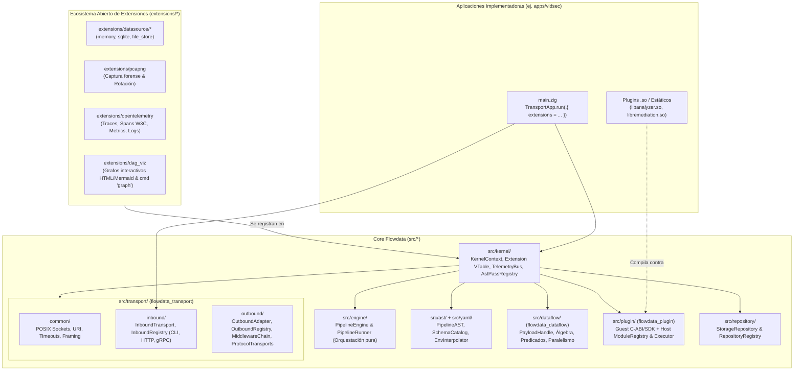
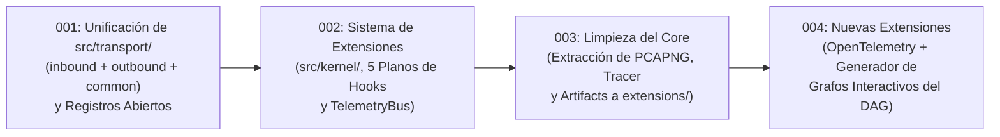

# 000 — Roadmap de Arquitectura: Microkernel Reactivo, Capa `transport` y Ecosistema de Extensiones

| Metadatos | Valor |
| :--- | :--- |
| **ID** | `ARCH-000` |
| **Tipo** | Índice Maestro / Epic Roadmap |
| **Estado** | `COMPLETED` |
| **Target Engine** | `Flowdata v2` (Raíz del repositorio) + `apps/vidsec` |
| **Tareas Hijas** | [`001`](./001-transport-layer-unification.md) → [`002`](./002-open-kernel-extension-system.md) → [`003`](./003-core-debloating-and-pcapng-extraction.md) → [`004`](./004-observability-otel-and-dag-visualizer.md) |

---

## 1. Propósito de esta Documentación

Esta carpeta (`docs/development/`) contiene las especificaciones técnicas completas (estilo *Bitbucket Epic/Task Specs* autocontenidas en el repositorio) para evolucionar **Flowdata** desde un motor con componentes acoplados hacia un **Microkernel de Dataflow Reactivo 100% Abierto y Extensible**.

El diseño en **múltiples archivos numerados (`001..004`) con este índice maestro (`000`)** está pensado específicamente para que un agente de IA (como Gemini) o un desarrollador pueda ejecutar cada fase de manera **atómica, secuencial y verificable**, manteniendo `zig build test` en verde al final de cada tarea sin perder el contexto global.

---

## 2. Visión Global de la Arquitectura Objetivo (To-Be)

El núcleo de **Flowdata** se divide en **librerías ortogonales con cero acoplamiento circular** y un **sistema de Extensiones de primera clase (`Extension`)** con acceso a los 5 planos internos del motor:

---

## 3. Grafo de Dependencias y Orden de Ejecución

Las tareas **deben ejecutarse en orden numérico estricto (`001` → `002` → `003` → `004`)**, verificando al término de cada una tanto la suite principal (`zig build test`) como la suite de la aplicación (`cd apps/vidsec && zig build test`).

| Orden | Archivo | Resumen del Entregable | Estado |
| :---: | :--- | :--- | :---: |
| **1** | [`001-transport-layer-unification.md`](./001-transport-layer-unification.md) | Unifica `src/host/` y `src/network/` bajo `src/transport/{common,inbound,outbound}`. Abre `InboundRegistry` y `OutboundRegistry` para permitir registrar protocolos, middlewares, sinks y estrategias externas. | `COMPLETED` |
| **2** | [`002-open-kernel-extension-system.md`](./002-open-kernel-extension-system.md) | Crea `src/kernel/` con `Extension`, `KernelContext` y `TelemetryBus`. Habilita los 5 planos de extensión: (1) Pases de AST/DAG, (2) Bus de Telemetría/Spans/WireTap, (3) Subcomandos del Dispatcher, (4) Hooks de DSL (`where:` y `${scheme:...}`), y (5) Registros de I/O. | `COMPLETED` |
| **3** | [`003-core-debloating-and-pcapng-extraction.md`](./003-core-debloating-and-pcapng-extraction.md) | Adelgaza `src/engine/` y `src/transport/outbound/` extrayendo `PcapngSink`, la rotación de archivos `.pcapng`, `tracer.zig` y `artifact.zig` hacia extensiones modulares en `extensions/` que operan vía `TelemetryBus` y `KernelContext`. | `COMPLETED` |
| **4** | [`004-observability-otel-and-dag-visualizer.md`](./004-observability-otel-and-dag-visualizer.md) | Construye las extensiones insignia del nuevo ecosistema: `extensions/opentelemetry/` (Spans jerárquicos, propagación `traceparent`, métricas y logs estructurados) y `extensions/dag_viz/` (generador de grafos interactivos del DAG + comando `graph` en CLI/HTTP/gRPC). | `COMPLETED` |

---

## 4. Invariantes Arquitectónicas Globales (Reglas para el Agente)

Cualquier cambio realizado durante las tareas `001..004` debe respetar las siguientes invariantes innegociables:

1. **Cero acoplamiento de dominio (`vidsec`) en `src/`**:
   * Ningún archivo bajo `src/` o `extensions/` genéricas puede mencionar `vidsec`. Todo el código de análisis de vídeo vive exclusivamente en `apps/vidsec/`.
2. **Independencia estricta de `flowdata_plugin` ([`src/plugin.zig`](../../src/plugin.zig)) y `flowdata_dataflow` ([`src/dataflow.zig`](../../src/dataflow.zig))**:
   * `flowdata_plugin` no debe importar ningún módulo del motor (`engine`, `ast`, `transport`, `dataflow`).
   * `flowdata_dataflow` no debe importar `flowdata_plugin` ni `transport` ni `engine`.
3. **Polimorfismo basado en `ptr: *anyopaque` + `vtable: *const VTable` con validación `comptime`**:
   * Todo contrato extensible (`InboundTransport`, `OutboundAdapter`, `NetMiddleware`, `ProtocolTransport`, `Extension`, `TelemetrySubscriber`, `AstPass`) debe seguir el patrón `assertImplements(@This())` en `comptime`.
4. **Cero coste en el camino crítico si no hay extensiones suscritas**:
   * En `TelemetryBus`, si el slice de suscriptores está vacío (`subscribers.items.len == 0`), emitir un evento debe reducirse a un `if` en línea sin asignaciones de memoria ni formateo de strings.
5. **Verificación obligatoria al cierre de cada tarea**:
   * Ejecutar `zig build test --summary all` en `/home/ubuntu/.gemini/antigravity/scratch/vidsec`.
   * Ejecutar `cd apps/vidsec && zig build && zig build test --summary all`.
