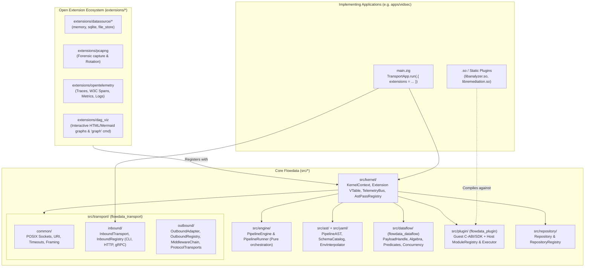
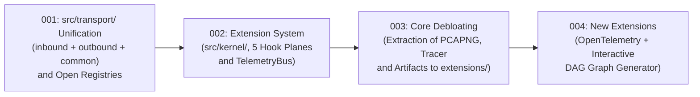

# 000 — Architecture Roadmap: Reactive Microkernel, `transport` Layer, and Extension Ecosystem

| Metadata | Value |
| :--- | :--- |
| **ID** | `ARCH-000` |
| **Type** | Master Index / Epic Roadmap |
| **Status** | `COMPLETED` |
| **Target Engine** | `Flowdata v2` (Repository root) + `apps/vidsec` |
| **Child Tasks** | [`001`](./001-transport-layer-unification.md) → [`002`](./002-open-kernel-extension-system.md) → [`003`](./003-core-debloating-and-pcapng-extraction.md) → [`004`](./004-observability-otel-and-dag-visualizer.md) → [`005`](./005-mangadex-client-library.md) → [`006`](./006-komga-client-library.md) → [`007`](./007-zip-archive-and-cbz-engine.md) → [`008`](./008-comicinfo-metadata-library.md) → [`009`](./009-unified-sqlite-storage-and-schema.md) → [`010`](./010-multisource-architecture-and-scrapers.md) → [`011`](./011-pipeline-yaml-specification-and-orchestration.md) → [`012`](./012-manga-framework-plugins-and-tasks.md) → [`013`](./013-engine-jobs-spec-app-aliases-and-yaml-modularization.md) → [`014`](./014-inbound-emitter-datasources-and-reactive-dispatch.md) → [`015`](./015-declarative-task-services-and-comptime-di.md) → [`016`](./016-reactive-bifurcation-parallel-expansion-and-join.md) → [`017`](./017-concurrent-dag-scheduler-and-host-concurrency-contract.md) |

---

## 1. Purpose of this Documentation

This directory (`docs/development/`) contains complete technical specifications (self-contained repository *Bitbucket Epic/Task Specs* style) to evolve **Flowdata** from an engine with coupled components into a **100% Open and Extensible Reactive Dataflow Microkernel**.

The multi-file numbered structure (`001..017`) accompanied by this master index (`000`) is specifically designed so an AI agent (such as Gemini) or a developer can execute each phase in an **atomic, sequential, and verifiable** manner, keeping `zig build test` green at the end of each task without losing the broader context.

---

## 2. Global Target Architecture Vision (To-Be)

The **Flowdata** core is split into **orthogonal libraries with zero circular coupling** and a **first-class Extension system (`Extension`)** with access to the 5 internal engine planes:

---

## 3. Dependency Graph and Execution Order

Tasks **must be executed in strict numerical order (`001` → `002` → `003` → `004`)**, verifying at the conclusion of each task both the main test suite (`zig build test`) and the application suite (`cd apps/vidsec && zig build test`).

| Order | File | Deliverable Summary | Status |
| :---: | :--- | :--- | :---: |
| **1** | [`001-transport-layer-unification.md`](./001-transport-layer-unification.md) | Unifies `src/host/` and `src/network/` under `src/transport/{common,inbound,outbound}`. Opens `InboundRegistry` and `OutboundRegistry` to allow registering external protocols, middlewares, sinks, and strategies. | `COMPLETED` |
| **2** | [`002-open-kernel-extension-system.md`](./002-open-kernel-extension-system.md) | Creates `src/kernel/` with `Extension`, `KernelContext`, and `TelemetryBus`. Enables the 5 extension planes: (1) AST/DAG Passes, (2) Telemetry/Spans/WireTap Bus, (3) Dispatcher Subcommands, (4) DSL Hooks (`where:` and `${scheme:...}`), and (5) I/O Registries. | `COMPLETED` |
| **3** | [`003-core-debloating-and-pcapng-extraction.md`](./003-core-debloating-and-pcapng-extraction.md) | Slims down `src/engine/` and `src/transport/outbound/` by extracting `PcapngSink`, `.pcapng` file rotation, `tracer.zig`, and `artifact.zig` into modular extensions in `extensions/` operating via `TelemetryBus` and `KernelContext`. | `COMPLETED` |
| **4** | [`004-observability-otel-and-dag-visualizer.md`](./004-observability-otel-and-dag-visualizer.md) | Builds flagship extensions for the new ecosystem: `extensions/opentelemetry/` (hierarchical spans, `traceparent` propagation, metrics, and structured logs) and `extensions/dag_viz/` (interactive DAG graph generator + `graph` command in CLI/HTTP/gRPC). | `COMPLETED` |
| **5** | [`005-mangadex-client-library.md`](./005-mangadex-client-library.md) | Builds `mangadex_sdk` in `apps/mangadex/lib/` (decoupled from Flowdata, with extensible OIDC/Personal Client/Static/Public authentication) and integrates it with `OutboundAdapter` and `.env` configuration in `apps/mangadex/src/`. | `COMPLETED` |
| **6** | [`006-komga-client-library.md`](./006-komga-client-library.md) | Builds `komga_sdk` in `apps/mangadex/lib/` based on `openapi.json` (API Key / Basic Auth, libraries, series, book import and scanning). | `COMPLETED` |
| **7** | [`007-zip-archive-and-cbz-engine.md`](./007-zip-archive-and-cbz-engine.md) | Designs the `zip_archive` engine with embedded `miniz` (evaluated against `std.zip`), `.cbz` packaging with `STORE` mode, and `ComicInfo.xml` generation. | `COMPLETED` |
| **8** | [`008-comicinfo-metadata-library.md`](./008-comicinfo-metadata-library.md) | Designs the `comicinfo` library in `apps/mangadex/lib/comicinfo/` inspired by the Anansi Project specification (ComicInfo XML v2.0/v2.1 metadata serialization and deserialization). | `COMPLETED` |
| **9** | [`009-unified-sqlite-storage-and-schema.md`](./009-unified-sqlite-storage-and-schema.md) | Designs unified SQLite storage (`manga_library.sqlite`), table DDL (`sources`, `series`, `chapters`, `pages`, `egress_history`), WAL mode, and atomic blob purging after CBZ packaging. | `READY` |
| **10** | [`010-multisource-architecture-and-scrapers.md`](./010-multisource-architecture-and-scrapers.md) | Specifies decoupled multi-source architecture: `MangaSource` contract (Tachiyomi/Mihon style), dynamic registration, direct HTML scrapers, and Cloudflare mitigation with sidecar. | `READY` |
| **11** | [`011-pipeline-yaml-specification-and-orchestration.md`](./011-pipeline-yaml-specification-and-orchestration.md) | High-level `pipeline.yaml` specification for `apps/mangadex`: network adapters, datasources (SQLite WAL), `sources`, `destinations` (Komga), `subscriptions`, and 4-stage DAG orchestration. | `READY` |
| **12** | [`012-manga-framework-plugins-and-tasks.md`](./012-manga-framework-plugins-and-tasks.md) | Plugin and task catalog for the manga framework: cataloging and synchronization, concurrent downloading, image processing, CBZ packager, and Komga/SFTP/webhook egress. | `READY` |
| **13** | [`013-engine-jobs-spec-app-aliases-and-yaml-modularization.md`](./013-engine-jobs-spec-app-aliases-and-yaml-modularization.md) | Flowdata engine refactoring: top-level `jobs:` node in the AST, domain alias registration in Kernel (`subscriptions` -> `jobs`), multi-file `include:` directive, and native `${file:path.yaml}` interpolation. | `READY` |
| **14** | [`014-inbound-emitter-datasources-and-reactive-dispatch.md`](./014-inbound-emitter-datasources-and-reactive-dispatch.md) | Unified datasources with reactive event emission (`RecordEmitter`), push reactor, and task-level `inputs:` dynamic dispatch. | `READY` |
| **15** | [`015-declarative-task-services-and-comptime-di.md`](./015-declarative-task-services-and-comptime-di.md) | Declarative task services (`defineTaskService`), comptime dependency injection (`DiContainer`), Logger decoupling, and modular packaging. | `COMPLETED` |
| **16** | [`016-reactive-bifurcation-parallel-expansion-and-join.md`](./016-reactive-bifurcation-parallel-expansion-and-join.md) | Typed payload contract (`Lowered(T)` + `schema_id`, hybrid with `DynamicRecord`), multi-channel I/O binding, and opt-in elemental auto-lifting (map/filter/expansion) with per-item error policy. | `COMPLETED` |
| **17** | [`017-concurrent-dag-scheduler-and-host-concurrency-contract.md`](./017-concurrent-dag-scheduler-and-host-concurrency-contract.md) | Concurrent DAG scheduler (plan compiler, single-thread coordinator, shared worker pool with help-while-waiting), channel lifecycle with refcounting and backpressure, and host services concurrency contract. | `COMPLETED (Phases 1-3 Verified)` |
| **18** | [`018-type-driven-inbound-router-and-service-catalog.md`](./018-type-driven-inbound-router-and-service-catalog.md) | Type-driven reactive inbound/outbound router, service catalog with `canHandle`, innate context merge, and unary input transformations. | `READY` |
| **19** | [`019-collectors-architecture-and-inbound-agents.md`](./019-collectors-architecture-and-inbound-agents.md) | Standalone collectors architecture (`/collectors/`), file system inotify watchers, and inbound collection agents. | `READY` |

---

## 4. Global Architectural Invariants (Agent Rules)

Any change made during tasks `001..004` (and subsequent phases) must comply with the following non-negotiable invariants:

1. **Zero domain coupling (`vidsec`) in `src/`**:
   * No file under `src/` or generic `extensions/` may mention `vidsec`. All video analysis code lives exclusively in `apps/vidsec/`.
2. **Strict independence of `flowdata_plugin` ([`src/plugin.zig`](../../src/plugin.zig)) and `flowdata_dataflow` ([`src/dataflow.zig`](../../src/dataflow.zig))**:
   * `flowdata_plugin` must not import any engine modules (`engine`, `ast`, `transport`, `dataflow`).
   * `flowdata_dataflow` must not import `flowdata_plugin`, `transport`, or `engine`.
3. **Polymorphism based on `ptr: *anyopaque` + `vtable: *const VTable` with `comptime` validation**:
   * Every extensible contract (`InboundTransport`, `OutboundAdapter`, `NetMiddleware`, `ProtocolTransport`, `Extension`, `TelemetrySubscriber`, `AstPass`) must adhere to the `assertImplements(@This())` pattern at `comptime`.
4. **Zero critical-path overhead if no extensions are subscribed**:
   * In `TelemetryBus`, if the subscriber slice is empty (`subscribers.items.len == 0`), emitting an event must collapse to an inline `if` without memory allocations or string formatting.
5. **Mandatory verification upon completion of each task**:
   * Run `zig build test --summary all` in `/home/ubuntu/.gemini/antigravity/scratch/vidsec`.
   * Run `cd apps/vidsec && zig build && zig build test --summary all`.
