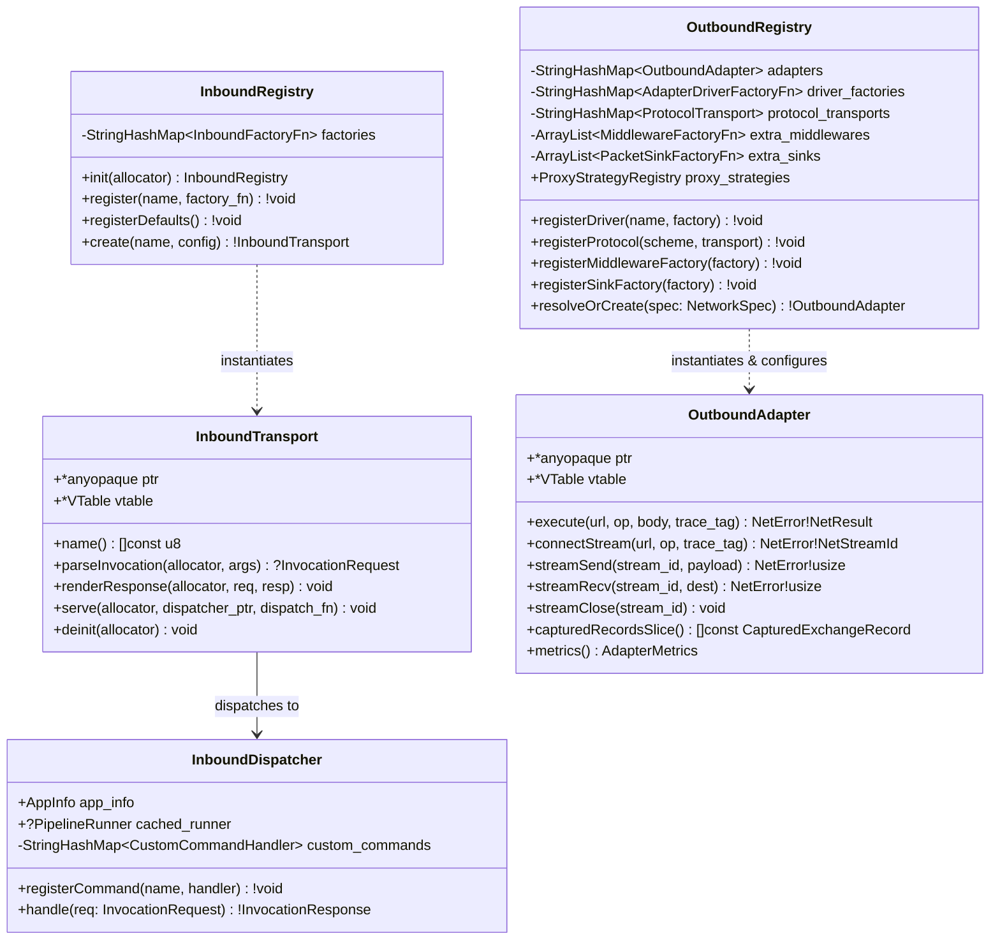
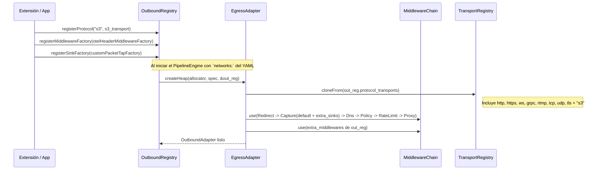

# 001 — Unificación de la Capa de Transporte (`src/transport/{common,inbound,outbound}`) y Apertura de Registros

| Metadatos | Valor |
| :--- | :--- |
| **ID** | `ARCH-001` |
| **Depende de** | Ninguna (Primera tarea del roadmap) |
| **Bloquea a** | [`ARCH-002`](./002-open-kernel-extension-system.md), [`ARCH-003`](./003-core-debloating-and-pcapng-extraction.md) |
| **Módulos afectados** | `src/host/`, `src/host.zig`, `src/network/`, `src/network.zig`, `src/engine/network.zig`, `src/root.zig`, `build.zig` |

---

## 1. Contexto y Problema Actual (As-Is)

Actualmente la comunicación de entrada y salida del motor está fragmentada en dos carpetas con nombres dispares y con cuellos de botella de extensibilidad:

1. **Asimetría conceptual (`src/host/` vs `src/network/`)**:
   * `src/host/` implementa los transportes **entrantes** (`CLI`, `HTTP`, `gRPC`) que reciben peticiones del exterior y las envían al `HostDispatcher` / `PipelineRunner`.
   * `src/network/` implementa los transportes **salientes** (`http`, `https`, `ws`, `grpc`, `rtmp`, `tcp`, `udp`, `tls`) que usan las tareas del pipeline para comunicarse con el exterior.
   * Ambos duplican lógica de sockets POSIX (`src/host/transports/http_transport.zig` vs `src/network/transports/posix_socket.zig`).
2. **Cierre a la extensibilidad en `src/network/` (`outbound`)**:
   * En `src/network/drivers/egress_adapter.zig` (`EgressAdapter.createHeap`), el adaptador crea un `TransportRegistry` privado local y llama a `transports.registerDefaultTransports(&transport_reg)`.
   * `NetworkRegistry` (`src/network/registry.zig`) solo almacena `driver_factories` y `proxy_strategies`. Es imposible registrar desde fuera:
     * Un nuevo `ProtocolTransport` por esquema URI (ej. `s3://`, `ftp://`, `mqtt://`).
     * Un nuevo `NetMiddleware` en la tubería de salida (ej. inyección de cabeceras OTel, OAuth2, caché).
     * Un nuevo `PacketSink` o factorías de `DnsResolver` / `RateLimitStrategy`.
   * Además, `IsolatedAdapter`, `IngressOnlyAdapter`, `SinkholeAdapter` y `EgressAdapter` son 4 structs separados cuando en realidad `Sinkhole` y `Egress` comparten exactamente la misma cadena de middlewares y solo difieren en el transporte final.
3. **Cierre a la extensibilidad en `src/host/` (`inbound`)**:
   * `src/host/app.zig` (`HostApp.runWithArgs`) tiene un `switch (serve_cfg.kind)` estático entre `.http` y `.grpc`. No existe un `InboundRegistry` donde registrar transportes de entrada adicionales (`"unix_socket"`, `"amqp"`, `"kafka"`, `"mcp"`).

---

## 2. Arquitectura Objetivo (To-Be)

Se unifican ambos subsistemas bajo **`src/transport/`** (exportado como módulo `flowdata_transport` en `src/transport.zig`), dividido en tres subdominios claros:

1. **`src/transport/common/`**: Primitivos compartidos de bajo nivel (`posix_socket.zig`, `uri.zig`, `timeouts.zig`).
2. **`src/transport/inbound/`**: Capa de transporte entrante (*Mundo Exterior → Motor*).
3. **`src/transport/outbound/`**: Capa de transporte saliente (*Tarea del Pipeline → Mundo Exterior*).

### 2.1. Diagrama UML de Componentes y Paquetes


---

### 2.2. Diagrama UML de Clases (`inbound` y `outbound`)



---

### 2.3. Diagrama de Secuencia: Resolución Abierta en `OutboundRegistry`



---

## 3. Contratos e Interfaces en Zig a Implementar

### 3.1. `src/transport/inbound/registry.zig` (`InboundRegistry`)

En lugar de que `ServeConfig.TransportKind` sea un `enum { http, grpc }` cerrado:
* `ServeConfig` en `src/transport/inbound/contracts/envelope.zig` cambia `kind` a `transport_name: []const u8 = "http"` (manteniendo compatibilidad con `--transport http`, `--transport grpc` o cualquier transporte registrado como `--transport unix_socket`).
* `InboundRegistry` permite registrar factorías por nombre:

```zig
pub const InboundTransportConfig = struct {
    listen_address: []const u8 = "127.0.0.1:8080",
    max_requests: ?usize = null,
};

pub const InboundFactoryFn = *const fn (
    allocator: Allocator,
    config: InboundTransportConfig,
) anyerror!InboundTransport;

pub const InboundRegistry = struct {
    allocator: Allocator,
    factories: std.StringHashMapUnmanaged(InboundFactoryFn) = .empty,

    pub fn init(allocator: Allocator) !InboundRegistry { ... }
    pub fn deinit(self: *InboundRegistry) void { ... }
    pub fn register(self: *InboundRegistry, name: []const u8, factory: InboundFactoryFn) !void { ... }
    pub fn registerDefaults(self: *InboundRegistry) !void {
        try self.register("http", &HttpTransport.createDaemon);
        try self.register("grpc", &GrpcTransport.createDaemon);
    }
    pub fn create(self: *const InboundRegistry, name: []const u8, cfg: InboundTransportConfig) !InboundTransport { ... }
};
```

### 3.2. `src/transport/outbound/registry.zig` (`OutboundRegistry` / alias `NetworkRegistry`)

`OutboundRegistry` amplía el actual `NetworkRegistry` para que los protocolos (`ProtocolTransport`), middlewares adicionales (`MiddlewareFactoryFn`) y sinks (`SinkFactoryFn`) estén registrados a nivel del registro y se inyecten automáticamente en `EgressAdapter` y `SinkholeAdapter`:

```zig
pub const MiddlewareFactoryFn = *const fn (
    allocator: Allocator,
    config: AdapterConfig,
) anyerror!?NetMiddleware;

pub const SinkFactoryFn = *const fn (
    allocator: Allocator,
    config: AdapterConfig,
) anyerror!?PacketSink;

pub const AdapterDriverContext = struct {
    proxy_strategies: *const ProxyStrategyRegistry,
    base_transports: *const TransportRegistry,
    extra_middlewares: []const MiddlewareFactoryFn,
    extra_sinks: []const SinkFactoryFn,
};

pub const AdapterDriverFactoryFn = *const fn (
    allocator: Allocator,
    config: AdapterConfig,
    ctx: AdapterDriverContext,
) anyerror!NetworkAdapter;
```

Cuando `EgressAdapter.createHeap(allocator, config, ctx)` construye su `TransportRegistry` y su `MiddlewareChain`:
1. Clona todos los esquemas registrados en `ctx.base_transports` (que incluye los protocolos por defecto más cualquier protocolo registrado vía `outbound_registry.registerProtocol("s3", ...)`).
2. Instancia los `PacketSink` adicionales de `ctx.extra_sinks` y los añade a `CaptureMiddleware`.
3. Instancia los `NetMiddleware` adicionales de `ctx.extra_middlewares` y los añade a la `MiddlewareChain`.

---

## 4. Mapa de Migración de Archivos

| Origen (Actual) | Destino (Nuevo) | Acción |
| :--- | :--- | :--- |
| `src/network/contracts/uri.zig` | `src/transport/common/uri.zig` | Mover y re-exportar en `outbound/contracts/mod.zig` |
| `src/network/transports/posix_socket.zig` | `src/transport/common/posix_socket.zig` | Mover y compartir entre `inbound` y `outbound` |
| `src/host/contracts/*` | `src/transport/inbound/contracts/*` | Mover (`InboundTransport` + alias `HostTransport`) |
| `src/host/transports/*` | `src/transport/inbound/drivers/*` | Mover (`cli_transport.zig`, `http_transport.zig`, `grpc_transport.zig`) |
| *(Nuevo)* | `src/transport/inbound/registry.zig` | Crear `InboundRegistry` |
| `src/host/dispatcher.zig` | `src/transport/inbound/dispatcher.zig` | Mover y añadir soporte para registro de comandos `.custom` |
| `src/host/app.zig` | `src/transport/inbound/app.zig` | Mover y usar `InboundRegistry` para `--transport <name>` |
| *(Nuevo)* | `src/transport/inbound/mod.zig` | Crear punto de entrada de `transport.inbound` |
| `src/network/contracts/*` | `src/transport/outbound/contracts/*` | Mover (`OutboundAdapter` + alias `NetworkAdapter`) |
| `src/network/strategies/*` | `src/transport/outbound/strategies/*` | Mover |
| `src/network/middleware/*` | `src/transport/outbound/middleware/*` | Mover |
| `src/network/sinks/*` | `src/transport/outbound/sinks/*` | Mover |
| `src/network/transports/*` | `src/transport/outbound/protocols/*` | Mover |
| `src/network/drivers/*` | `src/transport/outbound/drivers/*` | Mover y actualizar firma `AdapterDriverFactoryFn` con `AdapterDriverContext` |
| `src/network/registry.zig` | `src/transport/outbound/registry.zig` | Mover y añadir `registerProtocol`, `registerMiddlewareFactory`, `registerSinkFactory` |
| `src/network/mod.zig` | `src/transport/outbound/mod.zig` | Mover |
| *(Nuevo)* | `src/transport/mod.zig` y `src/transport.zig` | Crear raíz de `flowdata_transport` (`common`, `inbound`, `outbound`) |
| `src/host/`, `src/host.zig`, `src/network/`, `src/network.zig` | *(Eliminados)* | Eliminar directorios antiguos; mantener alias `pub const host = transport.inbound;` y `pub const network = transport.outbound;` en `src/root.zig` |

---

## 5. Criterios de Aceptación y Verificación

1. **Estructura**: Ya no existen las carpetas `src/host/` ni `src/network/`; todo vive bajo `src/transport/{common,inbound,outbound}` y `src/transport.zig`.
2. **Extensibilidad Outbound**: Un test unitario en `tests/core/network_test.zig` registra un protocolo personalizado (ej. `"customproto"`) y un middleware personalizado directamente en `OutboundRegistry`, ejecuta un pipeline con `driver: egress` hacia `customproto://test/item` y verifica que ambos se invocan.
3. **Extensibilidad Inbound**: Un test unitario en `tests/core/host_transport_test.zig` registra un transporte inbound personalizado en `InboundRegistry` y un comando `.custom` en `InboundDispatcher`, verificando su resolución dinámica.
4. **Compatibilidad total**:
   * `zig build test --summary all` pasa al 100% en la raíz.
   * `cd apps/vidsec && zig build && zig build test --summary all` pasa al 100%.
