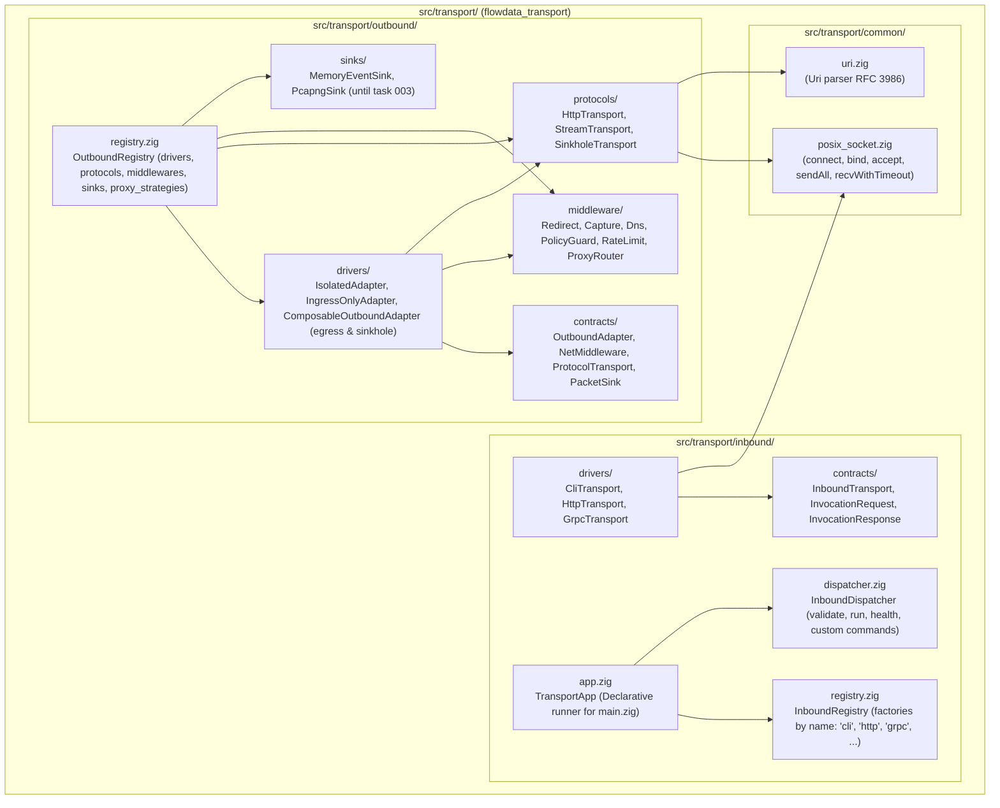
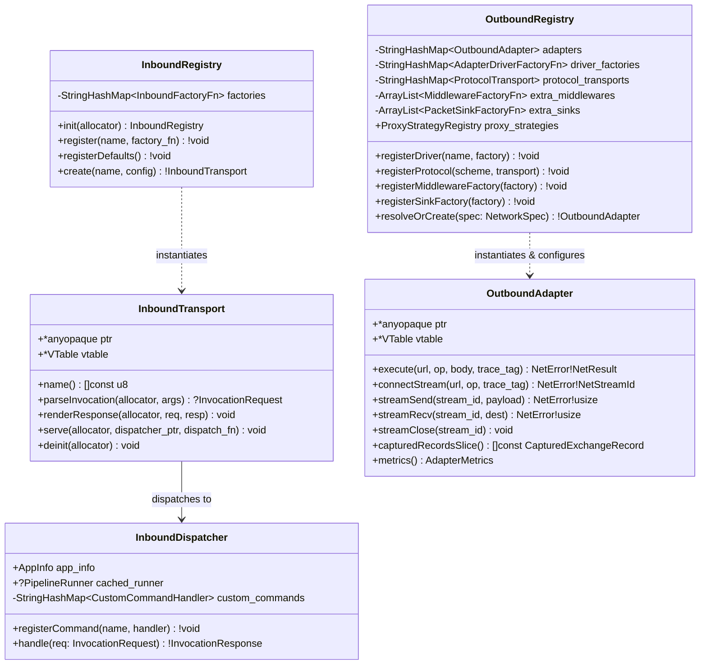
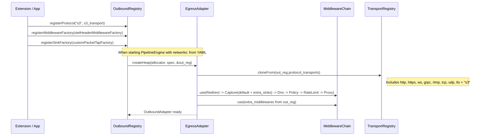

# 001 — Transport Layer Unification (`src/transport/{common,inbound,outbound}`) and Open Registries

| Metadata | Value |
| :--- | :--- |
| **ID** | `ARCH-001` |
| **Depends On** | None (First roadmap task) |
| **Blocks** | [`ARCH-002`](./002-open-kernel-extension-system.md), [`ARCH-003`](./003-core-debloating-and-pcapng-extraction.md) |
| **Affected Modules** | `src/host/`, `src/host.zig`, `src/network/`, `src/network.zig`, `src/engine/network.zig`, `src/root.zig`, `build.zig` |

---

## 1. Context and Current Problem (As-Is)

Engine inbound and outbound communication is currently fragmented across two directories with disparate names and extensibility bottlenecks:

1. **Conceptual asymmetry (`src/host/` vs `src/network/`)**:
   * `src/host/` implements **inbound** transports (`CLI`, `HTTP`, `gRPC`) that receive external requests and forward them to `HostDispatcher` / `PipelineRunner`.
   * `src/network/` implements **outbound** transports (`http`, `https`, `ws`, `grpc`, `rtmp`, `tcp`, `udp`, `tls`) used by pipeline tasks to communicate with external targets.
   * Both duplicate POSIX socket logic (`src/host/transports/http_transport.zig` vs `src/network/transports/posix_socket.zig`).
2. **Extensibility closure in `src/network/` (`outbound`)**:
   * In `src/network/drivers/egress_adapter.zig` (`EgressAdapter.createHeap`), the adapter instantiates a private local `TransportRegistry` and calls `transports.registerDefaultTransports(&transport_reg)`.
   * `NetworkRegistry` (`src/network/registry.zig`) only stores `driver_factories` and `proxy_strategies`. It is impossible to register externally:
     * A new `ProtocolTransport` by URI scheme (e.g., `s3://`, `ftp://`, `mqtt://`).
     * A new `NetMiddleware` in the egress pipeline (e.g., OTel header injection, OAuth2, caching).
     * A new `PacketSink` or `DnsResolver` / `RateLimitStrategy` factories.
   * Furthermore, `IsolatedAdapter`, `IngressOnlyAdapter`, `SinkholeAdapter`, and `EgressAdapter` are 4 separate structs, when in reality `Sinkhole` and `Egress` share the exact same middleware chain and differ only in the terminal transport.
3. **Extensibility closure in `src/host/` (`inbound`)**:
   * `src/host/app.zig` (`HostApp.runWithArgs`) features a static `switch (serve_cfg.kind)` between `.http` and `.grpc`. There is no `InboundRegistry` to register additional inbound transports (`"unix_socket"`, `"amqp"`, `"kafka"`, `"mcp"`).

---

## 2. Target Architecture (To-Be)

Both subsystems are unified under **`src/transport/`** (exported as the `flowdata_transport` module in `src/transport.zig`), divided into three clear subdomains:

1. **`src/transport/common/`**: Shared low-level primitives (`posix_socket.zig`, `uri.zig`, `timeouts.zig`).
2. **`src/transport/inbound/`**: Inbound transport layer (*Outside World → Engine*).
3. **`src/transport/outbound/`**: Outbound transport layer (*Pipeline Task → Outside World*).

### 2.1. UML Component and Package Diagram



---

### 2.2. UML Class Diagram (`inbound` and `outbound`)



---

### 2.3. Sequence Diagram: Open Resolution in `OutboundRegistry`



---

## 3. Zig Contracts and Interfaces to Implement

### 3.1. `src/transport/inbound/registry.zig` (`InboundRegistry`)

Instead of `ServeConfig.TransportKind` being a closed `enum { http, grpc }`:
* `ServeConfig` in `src/transport/inbound/contracts/envelope.zig` replaces `kind` with `transport_name: []const u8 = "http"` (maintaining compatibility with `--transport http`, `--transport grpc`, or any registered transport such as `--transport unix_socket`).
* `InboundRegistry` allows registering factories by name:

```zig
pub const InboundTransportConfig = struct {
    listen_address: []const u8 = "127.0.0.1:8080",
    max_requests: ?usize = null,
};

pub const InboundFactoryFn = *const fn (
    allocator: Allocator,
    config: InboundTransportConfig,
) anyerror!InboundTransport;

pub const InboundRegistry = struct {
    allocator: Allocator,
    factories: std.StringHashMapUnmanaged(InboundFactoryFn) = .empty,

    pub fn init(allocator: Allocator) !InboundRegistry { ... }
    pub fn deinit(self: *InboundRegistry) void { ... }
    pub fn register(self: *InboundRegistry, name: []const u8, factory: InboundFactoryFn) !void { ... }
    pub fn registerDefaults(self: *InboundRegistry) !void {
        try self.register("http", &HttpTransport.createDaemon);
        try self.register("grpc", &GrpcTransport.createDaemon);
    }
    pub fn create(self: *const InboundRegistry, name: []const u8, cfg: InboundTransportConfig) !InboundTransport { ... }
};
```

### 3.2. `src/transport/outbound/registry.zig` (`OutboundRegistry` / alias `NetworkRegistry`)

`OutboundRegistry` expands the current `NetworkRegistry` so that protocols (`ProtocolTransport`), additional middlewares (`MiddlewareFactoryFn`), and sinks (`SinkFactoryFn`) are registered at the registry level and injected automatically into `EgressAdapter` and `SinkholeAdapter`:

```zig
pub const MiddlewareFactoryFn = *const fn (
    allocator: Allocator,
    config: AdapterConfig,
) anyerror!?NetMiddleware;

pub const SinkFactoryFn = *const fn (
    allocator: Allocator,
    config: AdapterConfig,
) anyerror!?PacketSink;

pub const AdapterDriverContext = struct {
    proxy_strategies: *const ProxyStrategyRegistry,
    base_transports: *const TransportRegistry,
    extra_middlewares: []const MiddlewareFactoryFn,
    extra_sinks: []const SinkFactoryFn,
};

pub const AdapterDriverFactoryFn = *const fn (
    allocator: Allocator,
    config: AdapterConfig,
    ctx: AdapterDriverContext,
) anyerror!NetworkAdapter;
```

When `EgressAdapter.createHeap(allocator, config, ctx)` constructs its `TransportRegistry` and its `MiddlewareChain`:
1. It clones all schemes registered in `ctx.base_transports` (including default protocols plus any protocol registered via `outbound_registry.registerProtocol("s3", ...)`).
2. It instantiates additional `PacketSink` instances from `ctx.extra_sinks` and appends them to `CaptureMiddleware`.
3. It instantiates additional `NetMiddleware` instances from `ctx.extra_middlewares` and appends them to `MiddlewareChain`.

---

## 4. File Migration Map

| Origin (Current) | Destination (New) | Action |
| :--- | :--- | :--- |
| `src/network/contracts/uri.zig` | `src/transport/common/uri.zig` | Move and re-export in `outbound/contracts/mod.zig` |
| `src/network/transports/posix_socket.zig` | `src/transport/common/posix_socket.zig` | Move and share between `inbound` and `outbound` |
| `src/host/contracts/*` | `src/transport/inbound/contracts/*` | Move (`InboundTransport` + alias `HostTransport`) |
| `src/host/transports/*` | `src/transport/inbound/drivers/*` | Move (`cli_transport.zig`, `http_transport.zig`, `grpc_transport.zig`) |
| *(New)* | `src/transport/inbound/registry.zig` | Create `InboundRegistry` |
| `src/host/dispatcher.zig` | `src/transport/inbound/dispatcher.zig` | Move and add support for registering `.custom` commands |
| `src/host/app.zig` | `src/transport/inbound/app.zig` | Move and use `InboundRegistry` for `--transport <name>` |
| *(New)* | `src/transport/inbound/mod.zig` | Create entry point for `transport.inbound` |
| `src/network/contracts/*` | `src/transport/outbound/contracts/*` | Move (`OutboundAdapter` + alias `NetworkAdapter`) |
| `src/network/strategies/*` | `src/transport/outbound/strategies/*` | Move |
| `src/network/middleware/*` | `src/transport/outbound/middleware/*` | Move |
| `src/network/sinks/*` | `src/transport/outbound/sinks/*` | Move |
| `src/network/transports/*` | `src/transport/outbound/protocols/*` | Move |
| `src/network/drivers/*` | `src/transport/outbound/drivers/*` | Move and update `AdapterDriverFactoryFn` signature with `AdapterDriverContext` |
| `src/network/registry.zig` | `src/transport/outbound/registry.zig` | Move and add `registerProtocol`, `registerMiddlewareFactory`, `registerSinkFactory` |
| `src/network/mod.zig` | `src/transport/outbound/mod.zig` | Move |
| *(New)* | `src/transport/mod.zig` and `src/transport.zig` | Create root of `flowdata_transport` (`common`, `inbound`, `outbound`) |
| `src/host/`, `src/host.zig`, `src/network/`, `src/network.zig` | *(Deleted)* | Remove legacy directories; maintain aliases `pub const host = transport.inbound;` and `pub const network = transport.outbound;` in `src/root.zig` |

---

## 5. Acceptance Criteria and Verification

1. **Structure**: Folders `src/host/` and `src/network/` no longer exist; everything lives under `src/transport/{common,inbound,outbound}` and `src/transport.zig`.
2. **Outbound Extensibility**: A unit test in `tests/core/network_test.zig` registers a custom protocol (e.g., `"customproto"`) and custom middleware directly in `OutboundRegistry`, executes a pipeline with `driver: egress` targeting `customproto://test/item`, and verifies that both are invoked.
3. **Inbound Extensibility**: A unit test in `tests/core/host_transport_test.zig` registers a custom inbound transport in `InboundRegistry` and a `.custom` command in `InboundDispatcher`, verifying dynamic resolution.
4. **Full Compatibility**:
   * `zig build test --summary all` passes 100% at the root.
   * `cd apps/vidsec && zig build && zig build test --summary all` passes 100%.
