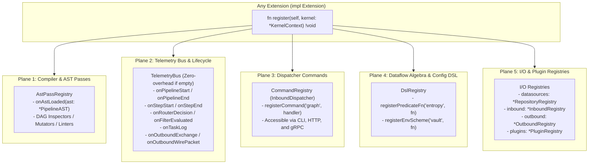
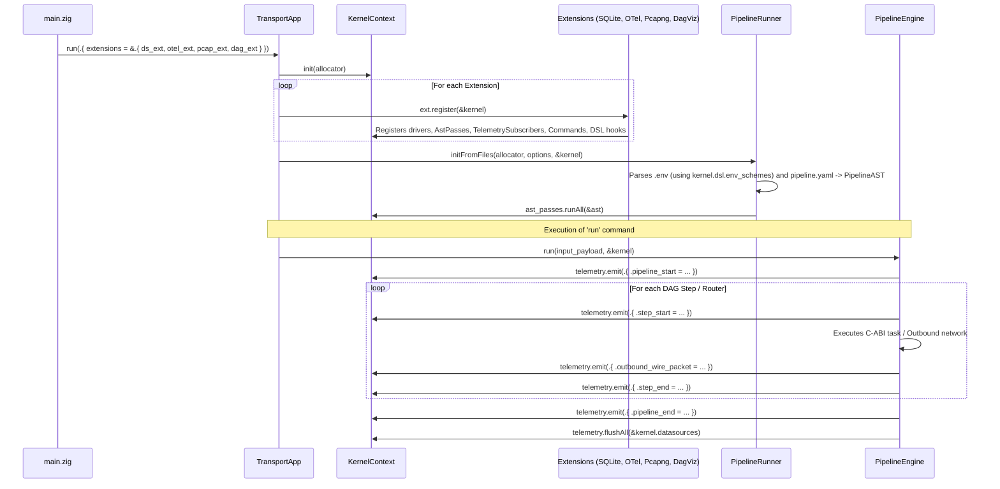

# 002 — Open Reactive Microkernel Design (`src/kernel/`) and 5-Plane Extension System

| Metadata | Value |
| :--- | :--- |
| **ID** | `ARCH-002` |
| **Depends On** | [`ARCH-001`](./001-transport-layer-unification.md) (`src/transport/{inbound,outbound}`) |
| **Blocks** | [`ARCH-003`](./003-core-debloating-and-pcapng-extraction.md), [`ARCH-004`](./004-observability-otel-and-dag-visualizer.md) |
| **Affected Modules** | `src/kernel/` *(new)*, `src/engine/`, `src/dataflow/predicate.zig`, `src/yaml/env.zig`, `src/transport/`, `extensions/` |

---

## 1. Context and Current Problem (As-Is)

Currently, Flowdata's "extension" mechanism is extremely limited:
1. In `src/engine/runner.zig` (`RunnerOptions`) and `src/transport/inbound/app.zig` (`AppConfig`), there is only a function pointer `driver_initializer: ?*const fn (registry: *RepositoryRegistry) anyerror!void`.
2. This means an extension today **can only register storage drivers (`StorageRepository`)**.
3. There is no formal `Extension` interface, nor a `KernelContext` object granting controlled access to the rest of the engine's subsystems:
   * An extension **cannot** inspect or transform the `PipelineAST` after YAML loading (necessary for generating DAG graphs, linters, or step injectors).
   * An extension **cannot** subscribe to the execution lifecycle or network traffic (necessary for OpenTelemetry, decoupled PCAPNG capture, or live debuggers).
   * An extension **cannot** add new subcommands to the Dispatcher (such as `graph` or `trace`).
   * An extension **cannot** add custom functions to the predicate evaluator (`where:`) or secret resolution schemes (`${vault:...}`) to the YAML interpolator.

---

## 2. Target Architecture (To-Be): The 5-Plane Open Kernel

The **`src/kernel/`** package is introduced, defining the polymorphic **`Extension`** contract and the **`KernelContext`** that the engine delivers to each extension during startup.

### 2.1. The 5 Kernel Extensibility Planes



---

### 2.2. UML Class Diagram for `src/kernel/`


---

### 2.3. Sequence Diagram: Full Lifecycle with `KernelContext`



---

## 3. Zig Contracts and Interfaces to Implement

### 3.1. `src/kernel/extension.zig` (`Extension` Contract)

```zig
const std = @import("std");
const Allocator = std.mem.Allocator;
const KernelContext = @import("context.zig").KernelContext;

pub const Extension = struct {
    ptr: *anyopaque,
    vtable: *const VTable,

    pub const VTable = struct {
        name: *const fn (ptr: *const anyopaque) []const u8,
        register: *const fn (ptr: *anyopaque, kernel: *KernelContext) anyerror!void,
        deinit: ?*const fn (ptr: *anyopaque, allocator: Allocator) void = null,
    };

    pub fn assertImplements(comptime T: type) void {
        if (!@hasDecl(T, "name") or !@hasDecl(T, "register")) {
            @compileError(@typeName(T) ++ " must implement name() and register(*KernelContext)");
        }
    }

    pub fn name(self: Extension) []const u8 {
        return self.vtable.name(self.ptr);
    }

    pub fn register(self: Extension, kernel: *KernelContext) anyerror!void {
        return self.vtable.register(self.ptr, kernel);
    }

    pub fn deinit(self: Extension, allocator: Allocator) void {
        if (self.vtable.deinit) |df| df(self.ptr, allocator);
    }

    /// Helper for stateless module extensions.
    pub fn fromStateless(
        comptime ext_name: []const u8,
        comptime register_fn: *const fn (kernel: *KernelContext) anyerror!void,
    ) Extension {
        const S = struct {
            var dummy: u8 = 0;
            fn getName(_: *const anyopaque) []const u8 {
                return ext_name;
            }
            fn doRegister(_: *anyopaque, k: *KernelContext) anyerror!void {
                return register_fn(k);
            }
            const vtable = VTable{
                .name = &getName,
                .register = &doRegister,
                .deinit = null,
            };
        };
        return .{ .ptr = @ptrCast(&S.dummy), .vtable = &S.vtable };
    }
};
```

### 3.2. `src/kernel/telemetry.zig` (`TelemetryEvent`, `SpanContext`, and `TelemetryBus`)

Designed with **OpenTelemetry** compatible semantics (`trace_id: [16]u8`, `span_id: [8]u8`, `parent_span_id: [8]u8`, `timestamp_ns: u64`) and with a raw packet tap so that `pcapng` functions outside the core:

```zig
pub const TraceId = [16]u8;
pub const SpanId = [8]u8;

pub const PacketDirection = enum(u8) {
    tx,
    rx,
};

pub const TelemetryEvent = union(enum) {
    pipeline_start: struct {
        trace_id: TraceId,
        span_id: SpanId,
        timestamp_ns: u64,
        ast: *const ast_mod.PipelineAST,
        input_bytes_len: usize,
    },
    pipeline_end: struct {
        trace_id: TraceId,
        span_id: SpanId,
        timestamp_ns: u64,
        duration_ns: u64,
        steps_executed: usize,
        routers_evaluated: usize,
        halted_early: bool,
        final_pipeline: []const u8,
    },
    step_start: struct {
        trace_id: TraceId,
        span_id: SpanId,
        parent_span_id: SpanId,
        timestamp_ns: u64,
        pipeline_name: []const u8,
        step_id: []const u8,
        module_name: []const u8,
        task_name: []const u8,
        input_count: usize,
    },
    step_end: struct {
        trace_id: TraceId,
        span_id: SpanId,
        timestamp_ns: u64,
        duration_ns: u64,
        pipeline_name: []const u8,
        step_id: []const u8,
        status: []const u8,
        output_count: usize,
    },
    filter_evaluated: struct {
        trace_id: TraceId,
        span_id: SpanId,
        step_id: []const u8,
        expression: []const u8,
        items_in: usize,
        items_out: usize,
    },
    router_decision: struct {
        trace_id: TraceId,
        span_id: SpanId,
        timestamp_ns: u64,
        pipeline_name: []const u8,
        router_id: []const u8,
        matched_expression: ?[]const u8,
        target_pipeline: ?[]const u8,
    },
    task_log: struct {
        trace_id: TraceId,
        span_id: SpanId,
        timestamp_ns: u64,
        step_id: []const u8,
        level: u32,
        message: []const u8,
    },
    outbound_exchange: struct {
        trace_id: TraceId,
        span_id: SpanId,
        timestamp_ns: u64,
        step_id: []const u8,
        adapter_id: []const u8,
        record: outbound_mod.CapturedExchangeRecord,
    },
    outbound_wire_packet: struct {
        trace_id: TraceId,
        span_id: SpanId,
        timestamp_ns: u64,
        step_id: []const u8,
        adapter_id: []const u8,
        direction: PacketDirection,
        src_ip: [4]u8,
        dst_ip: [4]u8,
        src_port: u16,
        dst_port: u16,
        payload: []const u8,
        comment: []const u8,
        include_tls_keys: bool,
        snaplen: u32,
    },
};
```

### 3.3. `src/kernel/ast_pass.zig` (`AstPassRegistry`)

Allows any extension to analyze, validate, or transform the freshly loaded `PipelineAST`:

```zig
pub const AstPassFn = *const fn (
    ctx: ?*anyopaque,
    allocator: Allocator,
    ast: *ast_mod.PipelineAST,
) anyerror!void;
```

### 3.4. `src/kernel/dsl.zig` (`DslRegistry`)

1. **Custom predicates in `dataflow/predicate.zig`**:
   * Allows registering functions `CustomPredicateFn = *const fn (arg: ReflectedValue, param_literal: []const u8) bool`.
   * Syntax supported in `where:` / `when:`: `fn_name(field_name, 'arg')` (e.g., `cidr_match(dst_host, '10.0.0.0/8')`).
2. **Interpolation schemes in `yaml/env.zig`**:
   * Allows registering resolvers `EnvSchemeResolverFn = *const fn (allocator: Allocator, key: []const u8) ?[]const u8`.
   * When `EnvInterpolator` encounters `${scheme:key}` (and it is not `${VAR:-default}`), it searches for `scheme` among registered resolvers.

---

## 4. Adapting `extensions/datasource/` to the New `Extension` Contract

In `extensions/datasource/mod.zig`, in addition to maintaining `registerDefaultDrivers(&repos)` for backward compatibility, an official `Extension` is exposed:

```zig
pub const extension = flowdata.kernel.Extension.fromStateless(
    "flowdata.datasources.default",
    &registerExtension,
);

pub fn registerExtension(kernel: *flowdata.kernel.KernelContext) !void {
    try registerDefaultDrivers(&kernel.datasources);
}
```

And in `apps/vidsec/src/main.zig`, the application can register its extensions declaratively:

```zig
pub fn main() !u8 {
    return vidsec.flowdata.transport.inbound.TransportApp.run(.{
        .app_name = "vidsec",
        .description = "Zero-Copy Declarative Video Security & Forensics Engine",
        .version = build_options.version_string,
        .extensions = &.{
            vidsec.extensions.datasource.extension,
        },
    });
}
```

---

## 5. Acceptance Criteria and Verification

1. **Creation of `src/kernel/`**: `src/kernel/{mod.zig,context.zig,extension.zig,telemetry.zig,ast_pass.zig,dsl.zig,commands.zig}` exist and are exported in `src/root.zig` (`flowdata.kernel`).
2. **5-Plane Test (`tests/core/kernel_extension_test.zig`)**:
   * **Plane 1**: A test extension registers an `AstPass` that counts `PipelineAST` nodes upon YAML loading.
   * **Plane 2**: A test extension subscribes to `TelemetryBus` and verifies that it receives in order `pipeline_start` → `step_start` → `step_end` → `router_decision` → `pipeline_end` with the same `trace_id`.
   * **Plane 3**: A test extension registers a `custom_ping` command in `kernel.commands` and invokes it through `InboundDispatcher`.
   * **Plane 4**: A test extension registers a `${mock_secret:api_token}` scheme and verifies its interpolation in YAML.
   * **Plane 5**: `extensions/datasource/mod.zig` registers via `extensions = &.{ ... }`.
3. **Green Test Suites**: `zig build test` in root and `apps/vidsec` pass 100%.
