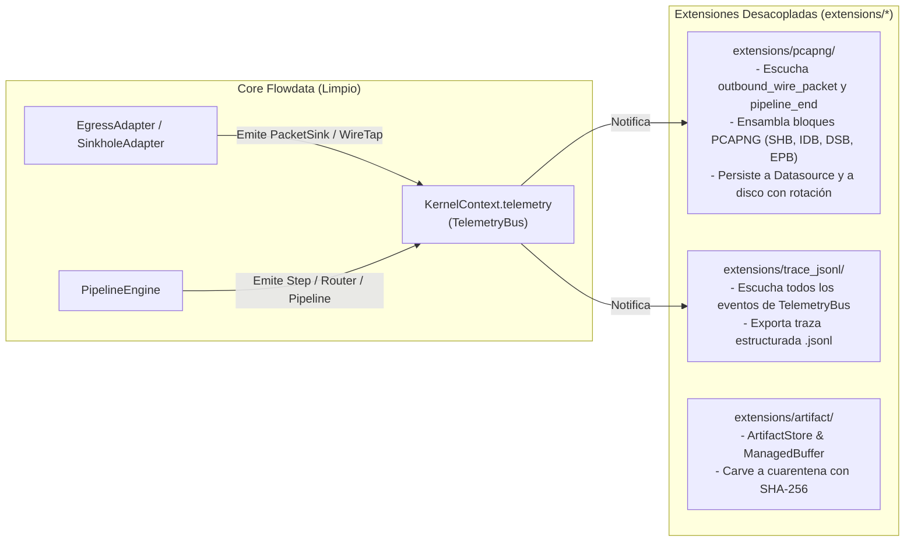
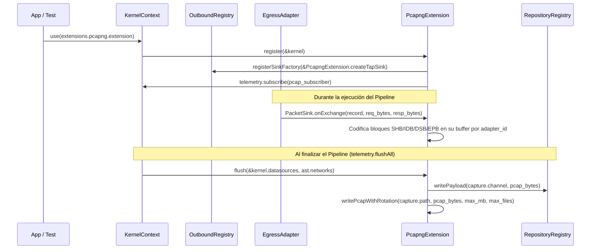
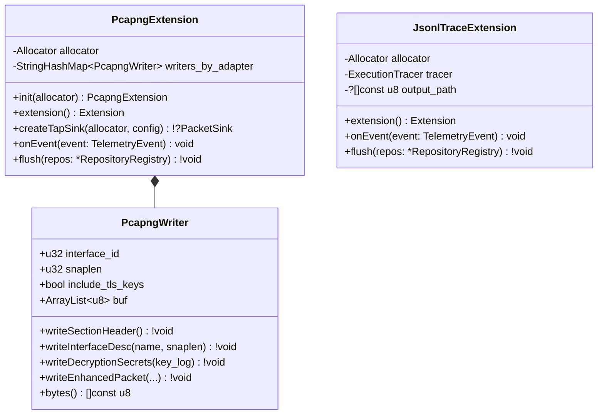

# 003 — Limpieza del Core y Extracción de PCAPNG, Tracer y Artifacts hacia Extensiones

| Metadatos | Valor |
| :--- | :--- |
| **ID** | `ARCH-003` |
| **Depende de** | [`ARCH-001`](./001-transport-layer-unification.md), [`ARCH-002`](./002-open-kernel-extension-system.md) |
| **Bloquea a** | [`ARCH-004`](./004-observability-otel-and-dag-visualizer.md) |
| **Módulos afectados** | `src/engine/`, `src/transport/outbound/`, `extensions/pcapng/` *(nuevo)*, `extensions/trace_jsonl/` *(nuevo)*, `extensions/artifact/` *(nuevo)* |

---

## 1. Contexto y Problema Actual (As-Is)

Tras haber introducido `src/transport/` (`001`) y el `KernelContext` con `TelemetryBus` (`002`), todavía quedan dentro del core de Flowdata tres piezas que no pertenecen a un motor puro de dataflow reactivo:

1. **Generación de binarios `.pcapng` y rotación de archivos en el Core**:
   * `src/transport/outbound/sinks/pcapng_sink.zig` (`PcapngSink`) está incrustado directamente en `EgressAdapter` y `SinkholeAdapter`.
   * `src/engine/network.zig` contiene `flushCaptures` y `writePcapWithRotation`, acoplando al motor con el formato binario IETF PCAPNG (bloques SHB, IDB, DSB, EPB) y con la escritura de ficheros rotados `.0`, `.1` en disco.
2. **Tracer JSONL ad-hoc en `src/engine/tracer.zig`**:
   * `ExecutionTracer` serializa manualmente eventos a JSONL dentro de `src/engine/`, duplicando la responsabilidad que ahora tiene el `TelemetryBus` de `src/kernel/telemetry.zig`.
3. **Almacén de Artefactos y Cuarentena SHA-256 en `src/engine/artifact.zig`**:
   * `ArtifactStore` (`ManagedBuffer`, `carveToQuarantine` con hash SHA-256) vive dentro de `src/engine/`, a pesar de ser una utilidad específica para pipelines de inspección/remediación binaria.

---

## 2. Arquitectura Objetivo (To-Be)

El Core (`src/engine/` y `src/transport/outbound/`) queda completamente limpio de formatos forenses y de serializadores de trazas:

---

### 2.1. Cómo funciona ahora la captura PCAPNG como Extensión (`extensions/pcapng/`)

---

### 2.2. Diagrama UML de Clases de las Extensiones Extraídas

---

## 3. Cambios Detallados en el Core y en `extensions/`

### 3.1. Extracción de `extensions/pcapng/`
1. Mover `src/transport/outbound/sinks/pcapng_sink.zig` → `extensions/pcapng/src/pcapng_writer.zig`.
2. Mover `writePcapWithRotation` y la lógica de `flushCaptures` de `src/engine/network.zig` → `extensions/pcapng/src/root.zig`.
3. En `EgressAdapter` y `SinkholeAdapter`:
   * Eliminar el campo `pcap_sink: ?PcapngSink = null`.
   * En su lugar, `EgressAdapter` y `SinkholeAdapter` simplemente delegan en los `PacketSink` registrados en `OutboundRegistry` (`ctx.extra_sinks`).
   * Cuando `extensions/pcapng` está registrada en el `KernelContext`, su `SinkFactoryFn` comprueba `if (config.capture.enabled)` e inyecta automáticamente el `PacketSink` de PCAPNG en el adaptador.
   * Al terminar el pipeline, `PcapngExtension.flush` vuelca los bytes `.pcapng` al `capture.datasource` y al `capture.path` con rotación ring-buffer.

### 3.2. Extracción de `extensions/trace_jsonl/`
1. Mover `src/engine/tracer.zig` → `extensions/trace_jsonl/src/root.zig`.
2. Implementar `TelemetrySubscriber` sobre `ExecutionTracer` para que traduzca automáticamente `TelemetryEvent` (`step_start`, `task_log`, `step_end`, `router_decision`) a líneas `.jsonl` y, si `--trace-out <path>` está presente en `RunnerOptions`, escriba el fichero al finalizar.

### 3.3. Extracción de `extensions/artifact/`
1. Mover `src/engine/artifact.zig` → `extensions/artifact/src/root.zig`.
2. Re-exportar en `extensions/mod.zig` (`extensions.artifact.ArtifactStore`, `extensions.artifact.ManagedBuffer`).

---

## 4. Mapa de Migración de Archivos

| Origen (Core) | Destino (`extensions/`) | Acción |
| :--- | :--- | :--- |
| `src/transport/outbound/sinks/pcapng_sink.zig` | `extensions/pcapng/src/pcapng_writer.zig` | Mover fuera del core |
| `src/engine/network.zig` (`flushCaptures` / `writePcapWithRotation`) | `extensions/pcapng/src/root.zig` | Convertir en `Extension` suscrita a `OutboundRegistry` y `TelemetryBus` |
| `src/engine/tracer.zig` | `extensions/trace_jsonl/src/root.zig` | Mover fuera de `src/engine/` y conectar a `TelemetryBus` |
| `src/engine/artifact.zig` | `extensions/artifact/src/root.zig` | Mover fuera de `src/engine/` a `extensions/artifact/` |
| `extensions/mod.zig` | `extensions/mod.zig` | Exportar `datasource`, `pcapng`, `trace_jsonl`, `artifact` y un `registerDefaultExtensions(kernel)` |

---

## 5. Criterios de Aceptación y Verificación

1. **Pureza del Core**:
   * `grep -rn -i "pcapng" src/engine/ src/transport/` devuelve **0 coincidencias** (con la única excepción de la configuración declarativa `CaptureSpec` en `ast` / `contracts`).
   * `src/engine/` contiene únicamente `engine.zig`, `network.zig` (coordinación de adaptadores y eventos `NetworkEvent` sin PCAPNG) y `runner.zig`.
2. **Paridad Funcional**:
   * Todos los tests de captura `.pcapng` en `tests/core/network_test.zig` (magic bytes `0x0A0D0D0A`, bloque TLS `0x0000000A`, persistencia en datasource `egress_pcap_dump` y rotación de ficheros en disco) siguen pasando al 100% usando la extensión `extensions.pcapng`.
   * Todos los tests de `ArtifactStore` en `tests/core/artifact_test.zig` pasan al 100% usando `extensions.artifact`.
3. **Suites en verde**:
   * `zig build test --summary all` en raíz pasa al 100%.
   * `cd apps/vidsec && zig build && zig build test --summary all` pasa al 100%.
