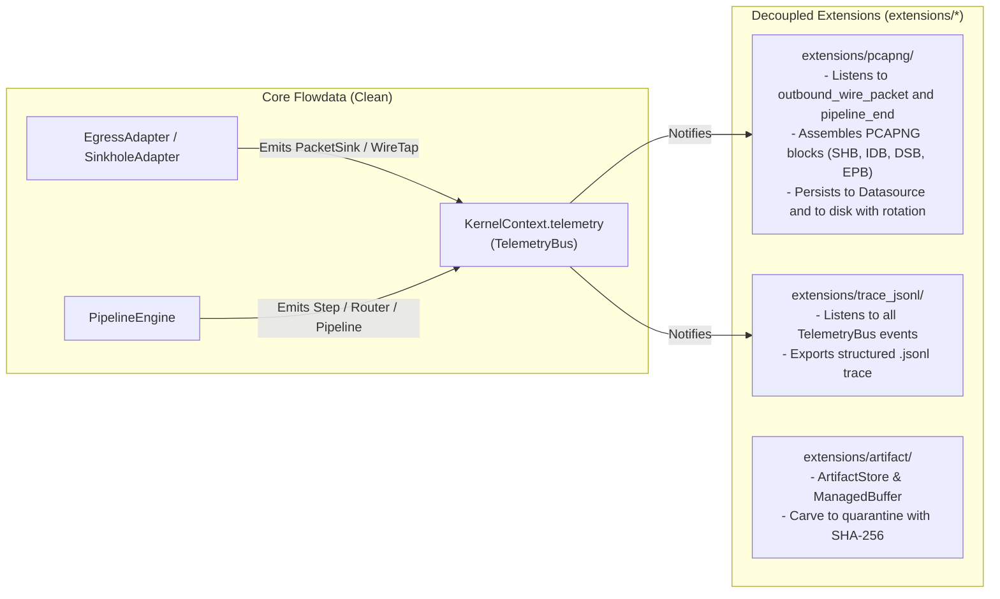
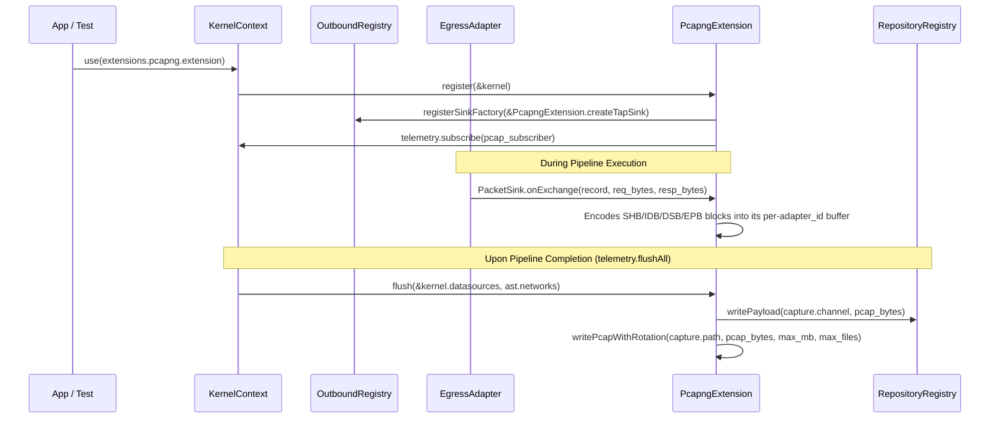
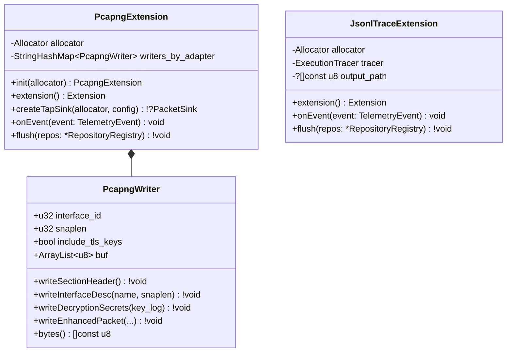

# 003 — Core Debloating and Extraction of PCAPNG, Tracer, and Artifacts to Extensions

| Metadata | Value |
| :--- | :--- |
| **ID** | `ARCH-003` |
| **Depends On** | [`ARCH-001`](./001-transport-layer-unification.md), [`ARCH-002`](./002-open-kernel-extension-system.md) |
| **Blocks** | [`ARCH-004`](./004-observability-otel-and-dag-visualizer.md) |
| **Affected Modules** | `src/engine/`, `src/transport/outbound/`, `extensions/pcapng/` *(new)*, `extensions/trace_jsonl/` *(new)*, `extensions/artifact/` *(new)* |

---

## 1. Context and Current Problem (As-Is)

Following the introduction of `src/transport/` (`001`) and `KernelContext` with `TelemetryBus` (`002`), three pieces remain within the Flowdata core that do not belong inside a pure reactive dataflow engine:

1. **PCAPNG binary generation and file rotation in the Core**:
   * `src/transport/outbound/sinks/pcapng_sink.zig` (`PcapngSink`) is embedded directly within `EgressAdapter` and `SinkholeAdapter`.
   * `src/engine/network.zig` contains `flushCaptures` and `writePcapWithRotation`, coupling the engine directly to the IETF PCAPNG binary format (SHB, IDB, DSB, EPB blocks) and writing rotated `.0`, `.1` files to disk.
2. **Ad-hoc JSONL tracer in `src/engine/tracer.zig`**:
   * `ExecutionTracer` manually serializes events to JSONL inside `src/engine/`, duplicating the responsibility now handled by `TelemetryBus` in `src/kernel/telemetry.zig`.
3. **Artifact Store and SHA-256 Quarantine in `src/engine/artifact.zig`**:
   * `ArtifactStore` (`ManagedBuffer`, `carveToQuarantine` with SHA-256 hash) resides inside `src/engine/`, despite being a utility specific to binary inspection/remediation pipelines.

---

## 2. Target Architecture (To-Be)

The Core (`src/engine/` and `src/transport/outbound/`) is left completely clean of forensic formats and trace serializers:

---

### 2.1. How PCAPNG Capture Operates as an Extension (`extensions/pcapng/`)

---

### 2.2. UML Class Diagram for Extracted Extensions

---

## 3. Detailed Changes in Core and in `extensions/`

### 3.1. Extraction of `extensions/pcapng/`
1. Move `src/transport/outbound/sinks/pcapng_sink.zig` → `extensions/pcapng/src/pcapng_writer.zig`.
2. Move `writePcapWithRotation` and `flushCaptures` logic from `src/engine/network.zig` → `extensions/pcapng/src/root.zig`.
3. In `EgressAdapter` and `SinkholeAdapter`:
   * Remove the field `pcap_sink: ?PcapngSink = null`.
   * Instead, `EgressAdapter` and `SinkholeAdapter` simply delegate to `PacketSink` instances registered in `OutboundRegistry` (`ctx.extra_sinks`).
   * When `extensions/pcapng` is registered in `KernelContext`, its `SinkFactoryFn` inspects `if (config.capture.enabled)` and automatically injects the PCAPNG `PacketSink` into the adapter.
   * Upon pipeline completion, `PcapngExtension.flush` writes `.pcapng` bytes to `capture.datasource` and to `capture.path` with ring-buffer rotation.

### 3.2. Extraction of `extensions/trace_jsonl/`
1. Move `src/engine/tracer.zig` → `extensions/trace_jsonl/src/root.zig`.
2. Implement `TelemetrySubscriber` on `ExecutionTracer` so that it automatically translates `TelemetryEvent` (`step_start`, `task_log`, `step_end`, `router_decision`) into `.jsonl` lines, and if `--trace-out <path>` is supplied in `RunnerOptions`, writes the file on completion.

### 3.3. Extraction of `extensions/artifact/`
1. Move `src/engine/artifact.zig` → `extensions/artifact/src/root.zig`.
2. Re-export in `extensions/mod.zig` (`extensions.artifact.ArtifactStore`, `extensions.artifact.ManagedBuffer`).

---

## 4. File Migration Map

| Origin (Core) | Destination (`extensions/`) | Action |
| :--- | :--- | :--- |
| `src/transport/outbound/sinks/pcapng_sink.zig` | `extensions/pcapng/src/pcapng_writer.zig` | Move outside core |
| `src/engine/network.zig` (`flushCaptures` / `writePcapWithRotation`) | `extensions/pcapng/src/root.zig` | Convert to `Extension` subscribed to `OutboundRegistry` and `TelemetryBus` |
| `src/engine/tracer.zig` | `extensions/trace_jsonl/src/root.zig` | Move outside `src/engine/` and connect to `TelemetryBus` |
| `src/engine/artifact.zig` | `extensions/artifact/src/root.zig` | Move outside `src/engine/` to `extensions/artifact/` |
| `extensions/mod.zig` | `extensions/mod.zig` | Export `datasource`, `pcapng`, `trace_jsonl`, `artifact`, and `registerDefaultExtensions(kernel)` |

---

## 5. Acceptance Criteria and Verification

1. **Core Purity**:
   * `grep -rn -i "pcapng" src/engine/ src/transport/` returns **0 matches** (with the sole exception of the declarative `CaptureSpec` configuration in `ast` / `contracts`).
   * `src/engine/` contains solely `engine.zig`, `network.zig` (adapter coordination and `NetworkEvent` events without PCAPNG), and `runner.zig`.
2. **Functional Parity**:
   * All `.pcapng` capture tests in `tests/core/network_test.zig` (magic bytes `0x0A0D0D0A`, TLS block `0x0000000A`, persistence in datasource `egress_pcap_dump`, and disk file rotation) continue to pass 100% using `extensions.pcapng`.
   * All `ArtifactStore` tests in `tests/core/artifact_test.zig` pass 100% using `extensions.artifact`.
3. **Green Test Suites**:
   * `zig build test --summary all` passes 100% at the root.
   * `cd apps/vidsec && zig build && zig build test --summary all` passes 100%.
