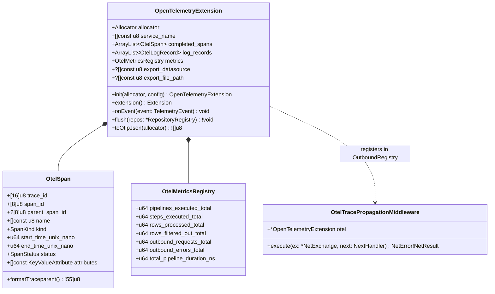
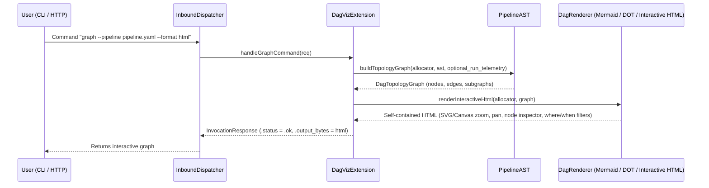

# 004 — New Observability Extensions (`OpenTelemetry`) and Interactive DAG Visualizer (`dag_viz`)

| Metadata | Value |
| :--- | :--- |
| **ID** | `ARCH-004` |
| **Depends On** | [`ARCH-001`](./001-transport-layer-unification.md), [`ARCH-002`](./002-open-kernel-extension-system.md), [`ARCH-003`](./003-core-debloating-and-pcapng-extraction.md) |
| **Blocks** | None (Closes the architecture cycle) |
| **Affected Modules** | `extensions/opentelemetry/` *(new)*, `extensions/dag_viz/` *(new)*, `extensions/mod.zig`, `build.zig`, `tests/core/` |

---

## 1. Context and Objective

With the **Reactive Microkernel (`src/kernel/`)** and the **`src/transport/`** layer now operational and decoupled (`001..003`), this task demonstrates the full potential of the new ecosystem by constructing two high-value extensions that interface with the **5 Kernel Planes** without modifying internal engine logic:

1. **`extensions/opentelemetry/` (`ext-otel`)**:
   * Production-grade unified observability (**Traces**, **Metrics**, and **Logs**) based on the OpenTelemetry standard and W3C context propagation (`traceparent`).
2. **`extensions/dag_viz/` (`ext-dag-viz`)**:
   * Topological inspector for `PipelineAST` and execution telemetry capable of exporting the pipeline graph in **Mermaid**, **Graphviz DOT**, and **Standalone Interactive HTML** formats (with rows/s and latency metrics per node/edge), in addition to registering the `graph` subcommand in `InboundDispatcher` (accessible via CLI, HTTP, and gRPC).

---

## 2. Part A: `extensions/opentelemetry/` Extension

### 2.1. Architecture and Utilized Kernel Planes

`OpenTelemetryExtension` hooks into **3 planes of `KernelContext`**:
1. **Plane 2 (`TelemetryBus`)**: Listens to `pipeline_start/end`, `step_start/end`, `router_decision`, `filter_evaluated`, `task_log`, and `outbound_exchange` to construct the tree of **Spans** (`OtelSpan`), accumulate **Metrics** (`OtelCounter`, `OtelHistogram`), and correlate **Logs** (`OtelLogRecord`) with their `trace_id` and `span_id`.
2. **Plane 5 (`OutboundRegistry.registerMiddlewareFactory`)**: Registers an `OtelTracePropagationMiddleware` into the `outbound` transport chain that injects the standard W3C TraceContext header (`traceparent: 00-<trace_id>-<span_id>-01`) and attaches semantic OTel attributes (`http.request.method`, `url.full`, `server.address`, `server.port`, `http.response.status_code`).
3. **Plane 5 (`RepositoryRegistry`) / OTLP JSON Export**: Upon completion (`flush`), exports the OTLP JSON batch to a configured datasource (`"otel_telemetry"` channel), to a file, or to an OTLP/HTTP collector.

### 2.2. UML Class Diagram for `extensions/opentelemetry/`



---

## 3. Part B: `extensions/dag_viz/` Extension (Interactive DAG Graph Generator)

### 3.1. Architecture and Utilized Kernel Planes

`DagVizExtension` demonstrates how an extension can combine static compiler structure (`PipelineAST`) with dynamic telemetry (`TelemetryBus`) and expose new endpoints to the user (`CommandRegistry`):

1. **Plane 1 (`AstPassRegistry`)**: Registers an inspection pass that constructs the `DagTopologyGraph` topological model from the `PipelineAST`:
   * **Nodes**: Sub-pipelines (`main`, `deep_mp4_inspection`, ...), task steps (`TaskStepSpec` with its `module/task`, `concurrency`, `where_filter`), routers (`RouterStepSpec` with its `when:` and `default` conditions), `datasources`, and `networks` adapters.
   * **Typed Edges**:
     * Implicit sequential flow (`step[i] -> step[i+1]`).
     * Explicit channel injection (`inputs: [{ source: ... }]`).
     * Outputs toward datasources (`outputs: [{ channel, datasource, where }]`).
     * Router conditional jumps (`when: expr -> goto: sub_pipeline`).
     * Network links (`step -> network_adapter` and `from: network.captured_events`).
2. **Plane 2 (`TelemetryBus`)**: If the pipeline is executed (`run`), `DagVizExtension` annotates each node and edge of the `DagTopologyGraph` with real execution telemetry:
   * Duration in microseconds per step (`duration_ns`).
   * Input/output row volume (`input_count` → `output_count`).
   * Which router branches were activated (`taken = true`) and which remained dormant.
3. **Plane 3 (`CommandRegistry` in `InboundDispatcher`)**: Registers the custom command **`graph`** (`InvocationCommand{ .custom = "graph" }`), such that:
   * Via **CLI**: `<app> graph --pipeline pipeline.yaml [--format html|mermaid|dot|json]` immediately renders the graph without executing heavy tasks.
   * Via **HTTP**: `GET /v1/graph?format=html` or `POST /v1/graph` returns the interactive graph.

### 3.2. Sequence Diagram for `extensions/dag_viz/`



### 3.3. Output Formats of `extensions/dag_viz/`

1. **`mermaid`**: Generates a `flowchart TD` block with `subgraph` for each pipeline (`main`, sub-pipelines), distinct shapes for tasks (`[...]`), routers (`{...}`), datasources (`[(...)]`), and networks (`((...))`), with edge labels displaying `where:` / `when:` predicates.
2. **`dot` (Graphviz)**: Generates a `digraph FlowdataDAG { ... }` with clusters and styling ready for `dot -Tsvg`.
3. **`html` (Standalone Interactive Graph)**: Generates a self-contained HTML5 document (zero mandatory external dependencies, with interactive SVG/Canvas rendering, zoom/pan, node search, and a side panel that shows YAML configuration, `where:` filter, assigned network, and runtime latency/row counts upon node click).

---

## 4. Directory Structure to Create

```text
extensions/
├── mod.zig                           # Exports datasource, pcapng, trace_jsonl, artifact, opentelemetry, dag_viz
├── opentelemetry/
│   └── src/
│       ├── root.zig                  # OpenTelemetryExtension (impl Extension + TelemetrySubscriber)
│       ├── span.zig                  # OtelSpan, TraceId, SpanId, W3C traceparent formatter/parser
│       ├── metrics.zig               # OtelMetricsRegistry (counters and histograms per step/pipeline)
│       ├── propagation_mw.zig        # OtelTracePropagationMiddleware (impl NetMiddleware)
│       └── otlp_json.zig             # Zero-dependency serializer to standard OTLP/JSON format
└── dag_viz/
    └── src/
        ├── root.zig                  # DagVizExtension (impl Extension + AstPass + TelemetrySubscriber + Command)
        ├── topology.zig              # Extractor PipelineAST -> DagTopologyGraph (Nodes, Edges, Subgraphs)
        ├── render_mermaid.zig        # Exporter to Mermaid flowchart TD
        ├── render_dot.zig            # Exporter to Graphviz DOT
        └── render_html.zig           # Standalone interactive HTML5 viewer generator with superimposed metrics
```

---

## 5. Acceptance Criteria and Verification

1. **Tests for `extensions/opentelemetry/` (`tests/core/otel_extension_test.zig`)**:
   * When executing a multi-stage pipeline with router and `outbound` network requests, `OpenTelemetryExtension` captures the `root_span` of the pipeline, child spans for each step and network request (all sharing the same 16-byte `trace_id` and linked via `parent_span_id`).
   * The `OtelTracePropagationMiddleware` generates a valid W3C `traceparent` header (`00-<32-hex>-<16-hex>-01`).
   * `toOtlpJson()` produces a valid JSON payload containing `resourceSpans`, `scopeSpans`, `metrics`, and `logs`.
2. **Tests for `extensions/dag_viz/` (`tests/core/dag_viz_extension_test.zig`)**:
   * Given a `pipeline.yaml` with multiple sub-pipelines, `inputs`, `outputs`, `routers`, `datasources`, and `networks`, `DagVizExtension` constructs the exact `DagTopologyGraph`.
   * Verifies that the Mermaid renderer (`renderMermaid`), DOT (`renderDot`), and interactive HTML (`renderHtml`) include all nodes, conditional edges (`when:`), filters (`where:`), and execution metrics when combined with `TelemetryBus`.
   * Verifies that invoking the `graph` command via `InboundDispatcher` yields `exit_code == 0` and the rendered graph.
3. **Green Test Suites**:
   * `zig build test --summary all` passes 100% at the root.
   * `cd apps/vidsec && zig build && zig build test --summary all` passes 100%.
