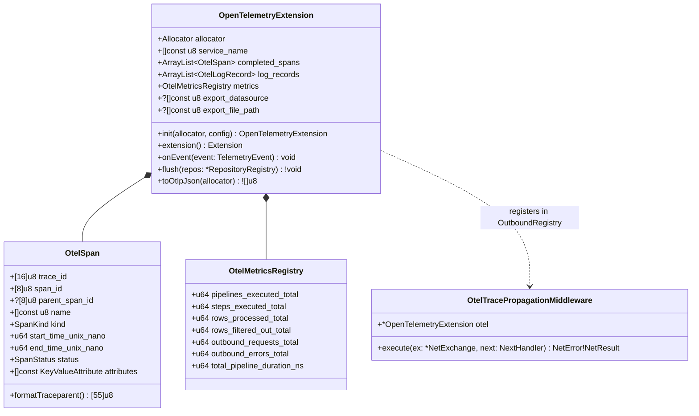
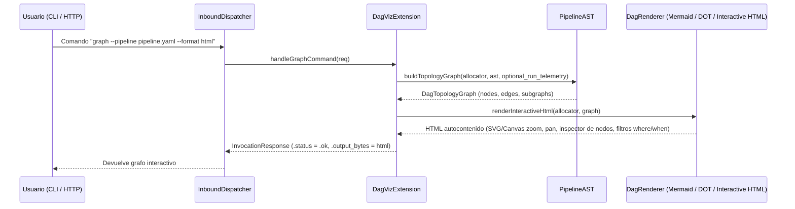

# 004 — Nuevas Extensiones de Observabilidad (`OpenTelemetry`) y Visualización Interactiva del DAG (`dag_viz`)

| Metadatos | Valor |
| :--- | :--- |
| **ID** | `ARCH-004` |
| **Depende de** | [`ARCH-001`](./001-transport-layer-unification.md), [`ARCH-002`](./002-open-kernel-extension-system.md), [`ARCH-003`](./003-core-debloating-and-pcapng-extraction.md) |
| **Bloquea a** | Ninguna (Cierra el ciclo de arquitectura) |
| **Módulos afectados** | `extensions/opentelemetry/` *(nuevo)*, `extensions/dag_viz/` *(nuevo)*, `extensions/mod.zig`, `build.zig`, `tests/core/` |

---

## 1. Contexto y Objetivo

Con el **Microkernel Reactivo (`src/kernel/`)** y la capa **`src/transport/`** ya operativos y limpios (`001..003`), esta tarea demuestra el potencial del nuevo ecosistema construyendo dos extensiones de alto valor que se conectan a los **5 Planos del Kernel** sin modificar la lógica interna del motor:

1. **`extensions/opentelemetry/` (`ext-otel`)**:
   * Observabilidad unificada de nivel producción (**Traces**, **Metrics** y **Logs**) basada en el estándar OpenTelemetry y propagación de contexto W3C (`traceparent`).
2. **`extensions/dag_viz/` (`ext-dag-viz`)**:
   * Inspector topológico del `PipelineAST` y telemetría de ejecución capaz de exportar el grafo del pipeline en formatos **Mermaid**, **Graphviz DOT** y **HTML Interactivo Standalone** (con métricas de filas/s y latencia por nodo/arista), además de registrar el subcomando `graph` en el `InboundDispatcher` (accesible por CLI, HTTP y gRPC).

---

## 2. Parte A: Extensión `extensions/opentelemetry/`

### 2.1. Arquitectura y Planos del Kernel que Utiliza

`OpenTelemetryExtension` se engancha a **3 planos del `KernelContext`**:
1. **Plano 2 (`TelemetryBus`)**: Escucha `pipeline_start/end`, `step_start/end`, `router_decision`, `filter_evaluated`, `task_log` y `outbound_exchange` para construir el árbol de **Spans** (`OtelSpan`), acumular **Métricas** (`OtelCounter`, `OtelHistogram`) y correlacionar **Logs** (`OtelLogRecord`) con su `trace_id` y `span_id`.
2. **Plano 5 (`OutboundRegistry.registerMiddlewareFactory`)**: Registra un `OtelTracePropagationMiddleware` en la cadena de transporte `outbound` que inyecta el header estándar W3C TraceContext (`traceparent: 00-<trace_id>-<span_id>-01`) y añade atributos semánticos OTel (`http.request.method`, `url.full`, `server.address`, `server.port`, `http.response.status_code`).
3. **Plano 5 (`RepositoryRegistry`) / Exportación OTLP JSON**: Al finalizar (`flush`), exporta el lote OTLP JSON a un datasource configurado (canal `"otel_telemetry"`), a un archivo o a un colector OTLP/HTTP.

### 2.2. Diagrama UML de Clases de `extensions/opentelemetry/`



---

## 3. Parte B: Extensión `extensions/dag_viz/` (Generador de Grafos Interactivos del DAG)

### 3.1. Arquitectura y Planos del Kernel que Utiliza

`DagVizExtension` demuestra cómo una extensión puede combinar la estructura estática del compilador (`PipelineAST`) con la telemetría dinámica (`TelemetryBus`) y exponer nuevos endpoints al usuario (`CommandRegistry`):

1. **Plano 1 (`AstPassRegistry`)**: Registra un pase de inspección que construye el modelo topológico `DagTopologyGraph` a partir del `PipelineAST`:
   * **Nodos**: Sub-pipelines (`main`, `deep_mp4_inspection`, ...), pasos de tarea (`TaskStepSpec` con su `module/task`, `concurrency`, `where_filter`), routers (`RouterStepSpec` con sus condiciones `when:` y `default`), `datasources` y adaptadores `networks`.
   * **Aristas Tipadas**:
     * Flujo implícito secuencial (`step[i] -> step[i+1]`).
     * Inyección explícita de canales (`inputs: [{ source: ... }]`).
     * Salidas hacia datasources (`outputs: [{ channel, datasource, where }]`).
     * Saltos condicionales de routers (`when: expr -> goto: sub_pipeline`).
     * Vínculos de red (`step -> network_adapter` y `from: network.captured_events`).
2. **Plano 2 (`TelemetryBus`)**: Si el pipeline se ejecuta (`run`), `DagVizExtension` anota cada nodo y cada arista del `DagTopologyGraph` con telemetría real de la ejecución:
   * Duración en microsegundos por paso (`duration_ns`).
   * Volumen de filas de entrada/salida (`input_count` → `output_count`).
   * Qué ramas del router se activaron (`taken = true`) y cuáles quedaron inactivas.
3. **Plano 3 (`CommandRegistry` en `InboundDispatcher`)**: Registra el comando personalizado **`graph`** (`InvocationCommand{ .custom = "graph" }`), de modo que:
   * Por **CLI**: `<app> graph --pipeline pipeline.yaml [--format html|mermaid|dot|json]` genera inmediatamente el grafo sin necesidad de ejecutar las tareas pesadas.
   * Por **HTTP**: `GET /v1/graph?format=html` o `POST /v1/graph` devuelve el grafo interactivo.

### 3.2. Diagrama de Secuencia de `extensions/dag_viz/`



### 3.3. Formatos de Salida de `extensions/dag_viz/`

1. **`mermaid`**: Genera un bloque `flowchart TD` con `subgraph` por cada pipeline (`main`, sub-pipelines), formas diferenciadas para tareas (`[...]`), routers (`{...}`), datasources (`[(...)]`) y redes (`((...))`), y etiquetas en las aristas con los predicados `where:` / `when:`.
2. **`dot` (Graphviz)**: Genera un grafo `digraph FlowdataDAG { ... }` con clusters y estilos listos para `dot -Tsvg`.
3. **`html` (Grafo Interactivo Standalone)**: Genera un documento HTML5 autocontenido (sin dependencias externas obligatorias, con renderizado SVG/Canvas interactivo, zoom/pan, buscador de nodos y panel lateral que al hacer clic en cualquier nodo muestra su configuración YAML, su filtro `where:`, su red asignada y, si hubo ejecución, sus métricas de tiempo y filas procesadas).

---

## 4. Estructura de Archivos a Crear

```text
extensions/
├── mod.zig                           # Exporta datasource, pcapng, trace_jsonl, artifact, opentelemetry, dag_viz
├── opentelemetry/
│   └── src/
│       ├── root.zig                  # OpenTelemetryExtension (impl Extension + TelemetrySubscriber)
│       ├── span.zig                  # OtelSpan, TraceId, SpanId, W3C traceparent formatter/parser
│       ├── metrics.zig               # OtelMetricsRegistry (contadores e histogramas por step/pipeline)
│       ├── propagation_mw.zig        # OtelTracePropagationMiddleware (impl NetMiddleware)
│       └── otlp_json.zig             # Serializador zero-dependency a formato estándar OTLP/JSON
└── dag_viz/
    └── src/
        ├── root.zig                  # DagVizExtension (impl Extension + AstPass + TelemetrySubscriber + Command)
        ├── topology.zig              # Extractor PipelineAST -> DagTopologyGraph (Nodes, Edges, Subgraphs)
        ├── render_mermaid.zig        # Exportador a Mermaid flowchart TD
        ├── render_dot.zig            # Exportador a Graphviz DOT
        └── render_html.zig           # Generador de visor HTML5 interactivo standalone con métricas superpuestas
```

---

## 5. Criterios de Aceptación y Verificación

1. **Tests de `extensions/opentelemetry/` (`tests/core/otel_extension_test.zig`)**:
   * Al ejecutar un pipeline multi-etapa con router y peticiones de red `outbound`, `OpenTelemetryExtension` captura el `root_span` del pipeline, los `child_spans` de cada paso y petición de red (todos compartiendo el mismo `trace_id` de 16 bytes y enlazados por `parent_span_id`).
   * El middleware `OtelTracePropagationMiddleware` genera un header `traceparent` W3C válido (`00-<32-hex>-<16-hex>-01`).
   * `toOtlpJson()` produce un payload JSON válido con `resourceSpans`, `scopeSpans`, `metrics` y `logs`.
2. **Tests de `extensions/dag_viz/` (`tests/core/dag_viz_extension_test.zig`)**:
   * Dado un `pipeline.yaml` con múltiples sub-pipelines, `inputs`, `outputs`, `routers`, `datasources` y `networks`, `DagVizExtension` construye el `DagTopologyGraph` exacto.
   * Verifica que el renderizador Mermaid (`renderMermaid`), DOT (`renderDot`) y HTML interactivo (`renderHtml`) incluyen todos los nodos, aristas condicionales (`when:`), filtros (`where:`) y métricas de ejecución cuando se combina con `TelemetryBus`.
   * Verifica que invocar el comando `graph` a través del `InboundDispatcher` devuelve `exit_code == 0` y el grafo renderizado.
3. **Suites en verde**:
   * `zig build test --summary all` en raíz pasa al 100%.
   * `cd apps/vidsec && zig build && zig build test --summary all` pasa al 100%.
