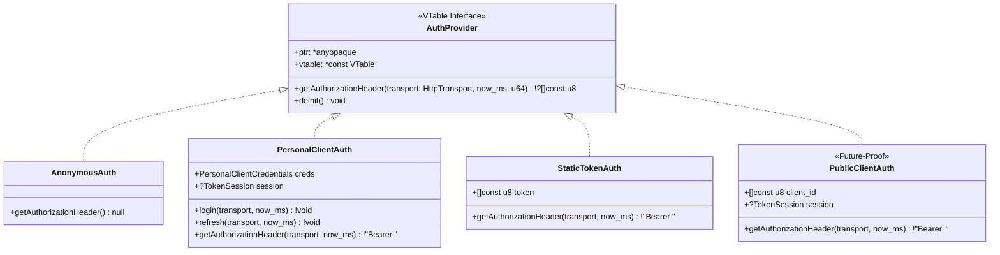

# 005 — MangaDex Client Library (`mangadex_sdk`), Flowdata Network Adapter, and `apps/mangadex` Scaffolding

| Metadata | Value |
| :--- | :--- |
| **ID** | `ARCH-005` |
| **Depends On** | [`ARCH-001`](./001-transport-layer-unification.md), [`ARCH-002`](./002-open-kernel-extension-system.md) |
| **Base Specifications** | [`api.yaml`](../../api.yaml) (MangaDex OpenAPI 3.0.3 `v5.13.1`) + [MangaDex Personal Clients Auth (OIDC)](https://api.mangadex.org/docs/02-authentication/personal-clients/) |
| **Affected Modules** | `apps/mangadex/build.zig` *(new)*, `apps/mangadex/build.zig.zon` *(new)*, `apps/mangadex/lib/mangadex_sdk/` *(new)*, `apps/mangadex/plugin/` *(new)*, `apps/mangadex/src/` *(new)*, `apps/mangadex/tests/` *(new)* |

---

## 1. Context and `apps/mangadex` Architecture

The goal of this task is to construct the `apps/mangadex` application and the `mangadex_sdk` client library by adhering to the **Ports & Adapters (Hexagonal Architecture)** pattern, featuring an **Extensible Authentication System** and native support in `src/` for **`.env` parameters and environment variables**:

1. **`apps/mangadex/lib/mangadex_sdk/` (Port / Domain Core)**:
   * Pure, standalone MangaDex client library with **zero dependencies on Flowdata** (isolated in its own `build.zig` declarations).
   * Has no awareness of the pipeline engine, `KernelContext`, or `OutboundAdapter`.
   * Defines an abstract transport contract (`HttpTransport`) that acts as the HTTP "port" required to operate.
   * Defines a polymorphic authentication contract (`AuthProvider`) supporting anonymous access, confidential personal clients (OAuth2 OIDC), future public clients (PKCE / Device Authorization Grant), or static Bearer tokens.
2. **`apps/mangadex/src/` (Network Adapter, `.env` Config & App Glue)**:
   * **`src/adapters/flowdata_http_adapter.zig`**: Implements `HttpTransport` by delegating directly to Flowdata's [`OutboundAdapter`](../../src/transport/outbound/contracts/adapter.zig) (gaining reactive rate-limiting via `Retry-After`, SOCKS5/HTTP CONNECT proxies, `NetworkTimeouts`, OpenTelemetry spans, and PCAPNG traffic capture).
   * **`src/config.zig`**: Configuration loader that resolves credentials and tokens from process environment variables and `.env` files (leveraging `flowdata.yaml.EnvInterpolator`). Automatically instantiates the appropriate `AuthProvider` (Static token, Personal Client, or Anonymous).
3. **`apps/mangadex/plugin/`**:
   * Plugins exported by the application (compiled against `flowdata_abi`) to execute pipeline tasks.
4. **`apps/mangadex/tests/`**:
   * Application and library test suite.

### Directory Tree

```text
apps/mangadex/
├── build.zig                     # Build graph (lib/, src/, plugin/, and tests/ modules)
├── build.zig.zon                 # Dependency on `flowdata` (../../)
├── .env.example                  # Environment variable template for tokens and credentials
├── lib/                          # Pure, standalone libraries (ZERO imports of Flowdata)
│   └── mangadex_sdk/             # MangaDex v5.13.1 client SDK + Extensible Auth
│       ├── mod.zig               # Public entrypoint for `mangadex_sdk` module
│       ├── http.zig              # Abstract `HttpTransport` contract (port) + FormUrlEncoded + QueryBuilder
│       ├── auth/                 # Extensible Authentication System
│       │   ├── mod.zig           # `AuthProvider` contract
│       │   ├── personal.zig      # `PersonalClientAuth` strategy (current Keycloak OIDC)
│       │   ├── static_token.zig  # `StaticTokenAuth` strategy (static Bearer token)
│       │   └── public.zig        # `PublicClientAuth` strategy (extensible stub for future PKCE/Device flows)
│       ├── types/                # Strongly-typed data models from `api.yaml`
│       │   ├── mod.zig
│       │   ├── common.zig        # Uuid, LocalizedString, Relationship, ErrorResponse, PagedResponse
│       │   ├── manga.zig         # Manga, MangaAttributes, MangaFeedParams, MangaSearchParams, Tag
│       │   ├── chapter.zig       # Chapter, ChapterAttributes, AggregateResponse
│       │   ├── at_home.zig       # AtHomeServerResponse + page URL builders
│       │   └── cover.zig         # Cover, CoverAttributes + cover image URL builders
│       └── client.zig            # `MangaDexClient` (high-level facade decoupled from concrete auth)
├── plugin/                       # Plugins exported by the app for the dataflow pipeline
├── src/                          # App infrastructure (middlewares, configs, adapters)
│   ├── config.zig                # Token and credential loading from .env and environment
│   ├── adapters/
│   │   ├── mod.zig
│   │   └── flowdata_http_adapter.zig # Bridge adapter: OutboundAdapter -> HttpTransport
│   ├── main.zig                  # Entrypoint with `TransportApp.run` and registered extensions
│   └── root.zig                  # App re-exports and bridge between Flowdata and SDK
└── tests/                        # Unit and integration test suite
    ├── main.zig
    ├── env_config_test.zig       # Tests for token and credential resolution from .env
    ├── auth_test.zig             # Tests for AuthProvider (Personal Client OIDC, Auto-Refresh & Static)
    ├── query_and_types_test.zig  # Tests for query serialization and `api.yaml` JSON parsing
    ├── adapter_integration_test.zig # Test for FlowdataHttpAdapter bridge with OutboundAdapter
    └── client_endpoints_test.zig # Endpoint tests (`/ping`, `/manga`, `/chapter`, `/at-home`)
```

---

## 2. Extensible Authentication System (`lib/mangadex_sdk/auth/`)

MangaDex uses Keycloak OpenID Connect. Currently, the documented flow is for **Personal Clients** (confidential clients with `client_secret` and user credentials). However, the platform is preparing support for **Public Clients** (secretless clients for native/SPA apps, typically utilizing PKCE or Device Authorization Grants) alongside scenarios where users provide pre-acquired static tokens or browse anonymously.

To support all these use cases cleanly, authentication is abstracted through a polymorphic **`AuthProvider`** interface.



### 2.1. `AuthProvider` Contract (`lib/mangadex_sdk/auth/mod.zig`)

```zig
pub const AuthError = error{
    AuthenticationFailed,
    InvalidCredentials,
    TokenRefreshFailed,
    NetworkFailure,
    OutOfMemory,
};

pub const AuthProvider = struct {
    ptr: *anyopaque,
    vtable: *const VTable,

    pub const VTable = struct {
        /// Returns the authorization header value (e.g., "Bearer eyJhbGciOi...")
        /// or `null` if the request should be anonymous.
        /// If the access token is expiring, the implementation must automatically refresh it
        /// using the supplied `transport`.
        getAuthorizationHeader: *const fn (
            ctx: *anyopaque,
            transport: HttpTransport,
            now_ms: u64,
        ) AuthError!?[]const u8,

        deinit: *const fn (ctx: *anyopaque) void,
    };

    pub fn getAuthorizationHeader(
        self: AuthProvider,
        transport: HttpTransport,
        now_ms: u64,
    ) AuthError!?[]const u8 {
        return self.vtable.getAuthorizationHeader(self.ptr, transport, now_ms);
    }

    pub fn deinit(self: AuthProvider) void {
        self.vtable.deinit(self.ptr);
    }

    pub fn assertImplements(comptime T: type) void {
        comptime {
            if (!@hasDecl(T, "authProvider")) {
                @compileError("Type '" ++ @typeName(T) ++ "' must declare 'pub fn authProvider(*" ++ @typeName(T) ++ ") AuthProvider'");
            }
        }
    }
};
```

---

### 2.2. Implementation: `PersonalClientAuth` (`lib/mangadex_sdk/auth/personal.zig`)

> [!IMPORTANT]
> **Notice regarding `api.yaml`**:
> Endpoints `/auth/login`, `/auth/check`, `/auth/logout`, and `/auth/refresh` in `api.yaml` (lines 605–720) are **deprecated**.
> `PersonalClientAuth` must target the official Keycloak OIDC endpoint:
> `POST https://auth.mangadex.org/realms/mangadex/protocol/openid-connect/token` with `Content-Type: application/x-www-form-urlencoded`.

1. **`password` Grant Flow**: Sends `grant_type=password&username=...&password=...&client_id=...&client_secret=...` (RFC 3986 percent-encoded).
2. **`refresh_token` Grant Flow**: The `access_token` expires after **15 minutes** (`expires_in: 900`). If fewer than 60 seconds remain before expiration, `getAuthorizationHeader` automatically refreshes the token by issuing `grant_type=refresh_token&refresh_token=...&client_id=...&client_secret=...`.
3. **Header Formatting**: Returns the formatted header `Bearer <access_token>`.

---

### 2.3. Additional Implementations: `StaticTokenAuth` and `PublicClientAuth`

* **`StaticTokenAuth` (`auth/static_token.zig`)**:
  * For CLI utilities, scripts, or integration tests where the user supplies a pre-generated access token (e.g., via `MANGADEX_ACCESS_TOKEN` or `MANGADEX_TOKEN` in their `.env`). Always yields `Bearer <token>`.
* **`PublicClientAuth` (`auth/public.zig`)**:
  * Designed to support public clients as soon as MangaDex publishes the specification (PKCE or Device Authorization Grant).
  * Stores `client_id` (without `client_secret`) and `TokenSession`, allowing seamless drop-in integration without modifying the client facade.

---

## 3. Application Configuration & `.env` Support (`apps/mangadex/src/config.zig`)

To decouple credentials from source code and enable injection via CLI and pipeline configuration:

### 3.1. Recognized Environment Variables

| Variable | Auth Strategy | Description |
| :--- | :--- | :--- |
| `MANGADEX_ACCESS_TOKEN` / `MANGADEX_TOKEN` | `StaticTokenAuth` | Pre-acquired JWT Bearer token. |
| `MANGADEX_CLIENT_ID` | `PersonalClientAuth` | Personal Client ID (`personal-client-...`). |
| `MANGADEX_CLIENT_SECRET` | `PersonalClientAuth` | Personal Client secret. |
| `MANGADEX_USERNAME` | `PersonalClientAuth` | MangaDex user account username. |
| `MANGADEX_PASSWORD` | `PersonalClientAuth` | MangaDex user account password. |
| `MANGADEX_API_URL` | Global | Optional, defaults to `https://api.mangadex.org`. |
| `MANGADEX_AUTH_URL` | Global | Optional, defaults to `https://auth.mangadex.org/realms/mangadex/protocol/openid-connect/token`. |

### 3.2. Implementation of `AppConfig` (`src/config.zig`)

```zig
const std = @import("std");
const Allocator = std.mem.Allocator;
const flowdata = @import("flowdata");
const EnvInterpolator = flowdata.yaml.EnvInterpolator;
const sdk = @import("mangadex_sdk");

pub const AppConfig = struct {
    api_url: []const u8 = "https://api.mangadex.org",
    auth_url: []const u8 = "https://auth.mangadex.org/realms/mangadex/protocol/openid-connect/token",
    user_agent: []const u8 = "flowdata-mangadex-app/0.1.0",

    /// Loads configuration by resolving environment variables and/or parsing an optional `.env` file.
    pub fn load(allocator: Allocator, dot_env_path: ?[]const u8) !AppConfig {
        var interp = EnvInterpolator.init(true);
        defer interp.deinit(allocator);

        if (dot_env_path) |path| {
            if (std.fs.cwd().readFileAlloc(allocator, path, 64 * 1024)) |content| {
                defer allocator.free(content);
                interp.parseDotEnv(allocator, content) catch {};
            } else |_| {}
        }

        // Resolves api_url and auth_url with fallback to defaults
        ...
    }

    /// Builds the appropriate `AuthProvider` based on present variables:
    /// 1. If MANGADEX_ACCESS_TOKEN / MANGADEX_TOKEN is set -> StaticTokenAuth
    /// 2. If Personal Client credentials are set -> PersonalClientAuth
    /// 3. Otherwise -> null (anonymous mode for public browsing)
    pub fn resolveAuthProvider(self: AppConfig, allocator: Allocator, interp: *const EnvInterpolator) !?sdk.AuthProvider {
        if (interp.get("MANGADEX_ACCESS_TOKEN") orelse interp.get("MANGADEX_TOKEN")) |token| {
            return sdk.StaticTokenAuth.create(allocator, token);
        }

        const client_id = interp.get("MANGADEX_CLIENT_ID");
        const client_secret = interp.get("MANGADEX_CLIENT_SECRET");
        const username = interp.get("MANGADEX_USERNAME");
        const password = interp.get("MANGADEX_PASSWORD");

        if (client_id != null and client_secret != null and username != null and password != null) {
            return sdk.PersonalClientAuth.create(allocator, .{
                .auth_url = self.auth_url,
                .client_id = client_id.?,
                .client_secret = client_secret.?,
                .username = username.?,
                .password = password.?,
            });
        }

        return null;
    }
};
```

---

## 4. Network Adapter & SDK Components

### 4.1. Transport Contract in the Library (`lib/mangadex_sdk/http.zig`)

```zig
pub const HttpMethod = enum {
    GET, POST, PUT, DELETE,
    pub fn asText(self: HttpMethod) []const u8 { return @tagName(self); }
};

pub const HttpHeader = struct {
    name: []const u8,
    value: []const u8,
};

pub const HttpResponse = struct {
    status_code: u16,
    body: []const u8,
    retry_after_ms: u64 = 0,
};

pub const HttpTransportError = error{
    NetworkFailure,
    Timeout,
    RateLimited,
    InvalidUrl,
    OutOfMemory,
};

pub const HttpTransport = struct {
    ptr: *anyopaque,
    vtable: *const VTable,

    pub const VTable = struct {
        execute: *const fn (
            ctx: *anyopaque,
            allocator: std.mem.Allocator,
            method: HttpMethod,
            url: []const u8,
            headers: []const HttpHeader,
            body: []const u8,
        ) HttpTransportError!HttpResponse,
    };

    pub fn execute(
        self: HttpTransport,
        allocator: std.mem.Allocator,
        method: HttpMethod,
        url: []const u8,
        headers: []const HttpHeader,
        body: []const u8,
    ) HttpTransportError!HttpResponse {
        return self.vtable.execute(self.ptr, allocator, method, url, headers, body);
    }

    pub fn assertImplements(comptime T: type) void {
        comptime {
            if (!@hasDecl(T, "httpTransport")) {
                @compileError("Type '" ++ @typeName(T) ++ "' must declare 'pub fn httpTransport(*" ++ @typeName(T) ++ ") HttpTransport'");
            }
        }
    }
};
```

### 4.2. Flowdata Network Adapter in the App (`apps/mangadex/src/adapters/flowdata_http_adapter.zig`)

```zig
const std = @import("std");
const Allocator = std.mem.Allocator;
const flowdata = @import("flowdata");
const OutboundAdapter = flowdata.transport.outbound.OutboundAdapter;
const sdk = @import("mangadex_sdk");

pub const FlowdataHttpAdapter = struct {
    adapter: OutboundAdapter,

    comptime {
        sdk.HttpTransport.assertImplements(@This());
    }

    pub fn init(adapter: OutboundAdapter) FlowdataHttpAdapter {
        return .{ .adapter = adapter };
    }

    pub fn httpTransport(self: *FlowdataHttpAdapter) sdk.HttpTransport {
        return .{
            .ptr = self,
            .vtable = &.{ .execute = executeBridge },
        };
    }

    fn executeBridge(
        ctx: *anyopaque,
        allocator: Allocator,
        method: sdk.HttpMethod,
        url: []const u8,
        headers: []const sdk.HttpHeader,
        body: []const u8,
    ) sdk.HttpTransportError!sdk.HttpResponse {
        const self: *FlowdataHttpAdapter = @ptrCast(@alignCast(ctx));
        _ = allocator;
        _ = headers; // OutboundAdapter manages wire headers, proxies, and middlewares

        const res = self.adapter.execute(
            url,
            method.asText(),
            body,
            "mangadex.request",
        ) catch |err| return switch (err) {
            error.NetworkRateLimited => error.RateLimited,
            error.NetworkAcquireTimeout => error.Timeout,
            error.InvalidUri => error.InvalidUrl,
            error.OutOfMemory => error.OutOfMemory,
            else => error.NetworkFailure,
        };

        return .{
            .status_code = res.status_code,
            .body = res.body,
            .retry_after_ms = res.retry_after_ms,
        };
    }
};
```

### 4.3. Client Facade `MangaDexClient` (`lib/mangadex_sdk/client.zig`)

```zig
pub const MangaDexClient = struct {
    allocator: Allocator,
    config: ClientConfig,
    transport: HttpTransport,
    auth: ?AuthProvider = null,

    pub fn init(allocator: Allocator, config: ClientConfig, transport: HttpTransport, auth: ?AuthProvider) MangaDexClient;
    pub fn ping(self: *MangaDexClient) !bool;
    pub fn searchManga(self: *MangaDexClient, params: MangaSearchParams) !PagedResponse(Manga);
    pub fn getManga(self: *MangaDexClient, manga_id: []const u8, includes: []const ReferenceType) !EntityResponse(Manga);
    pub fn getMangaFeed(self: *MangaDexClient, manga_id: []const u8, params: MangaFeedParams) !PagedResponse(Chapter);
    pub fn getMangaAggregate(self: *MangaDexClient, manga_id: []const u8, langs: []const []const u8) !EntityResponse([]const AggregateVolume);
    pub fn getChapter(self: *MangaDexClient, chapter_id: []const u8, includes: []const ReferenceType) !EntityResponse(Chapter);
    pub fn getAtHomeServer(self: *MangaDexClient, chapter_id: []const u8, force_port_443: bool) !EntityResponse(AtHomeServerResponse);
    pub fn getCover(self: *MangaDexClient, cover_id: []const u8) !EntityResponse(Cover);
    
    /// Authenticated endpoint: Automatically injects the header returned by `self.auth` (if configured).
    pub fn getUserFollowedMangaFeed(self: *MangaDexClient, params: MangaFeedParams, now_ms: u64) !PagedResponse(Chapter);
    pub fn markChapterRead(self: *MangaDexClient, manga_id: []const u8, read_ids: []const []const u8, unread_ids: []const []const u8, now_ms: u64) !void;
};
```

### 4.4. `MangaSource` Contract Adaptation (for `ARCH-010`)

To integrate with the Multi-Source architecture specified in [`ARCH-010`](./010-multisource-architecture-and-scrapers.md), the library provides `MangaDexSource`, a bridge that maps `MangaDexClient` methods to the unified `MangaSource` VTable:

```zig
pub const MangaDexSource = struct {
    client: *MangaDexClient,

    pub fn init(client: *MangaDexClient) MangaDexSource {
        return .{ .client = client };
    }

    pub fn mangaSource(self: *MangaDexSource) sources.MangaSource {
        return .{
            .ptr = self,
            .vtable = &.{
                .getSourceId = getSourceIdBridge,
                .search = searchBridge,
                .getDetails = getDetailsBridge,
                .getChapters = getChaptersBridge,
                .getPageUrls = getPageUrlsBridge,
            },
        };
    }

    fn getSourceIdBridge(_: *anyopaque) []const u8 {
        return "mangadex";
    }

    fn searchBridge(ctx: *anyopaque, allocator: Allocator, query: []const u8) anyerror![]sources.SourceMangaSummary {
        const self: *MangaDexSource = @ptrCast(@alignCast(ctx));
        var res = try self.client.searchManga(.{ .title = query, .limit = 20 });
        defer res.deinit();

        var list = try allocator.alloc(sources.SourceMangaSummary, res.items.len);
        for (res.items, 0..) |item, idx| {
            list[idx] = .{
                .source_id = "mangadex",
                .source_series_id = try allocator.dupe(u8, item.id),
                .title = try allocator.dupe(u8, item.attributes.title.getPreferred("en") orelse "Untitled"),
                .cover_url = null,
            };
        }
        return list;
    }

    // Maps getManga -> SourceSeriesDetails, getMangaFeed -> SourceChapter, and getAtHomeServer -> SourcePageUrl
};
```
This guarantees pipeline tasks depend strictly on the polymorphic `MangaSource` interface, treating MangaDex as a pluggable source provider.

---

## 5. Test Plan & Acceptance Criteria (`apps/mangadex/tests/`)

Tests run deterministically without requiring external network connectivity:

1. **`tests/env_config_test.zig`**:
   * Verifies that `AppConfig.resolveAuthProvider` instantiates `StaticTokenAuth` when `MANGADEX_ACCESS_TOKEN` is present.
   * Verifies that `PersonalClientAuth` is instantiated when the four credentials (`CLIENT_ID`, `CLIENT_SECRET`, `USERNAME`, `PASSWORD`) are provided.
   * Verifies that `null` (anonymous mode) is returned when no credentials are configured.
2. **`tests/auth_test.zig`**:
   * **Personal Client Test**: Verifies `application/x-www-form-urlencoded` encoding with special characters in passwords.
   * **Auto-Refresh Test**: Verifies proactive renewal of `access_token` when fewer than 60s remain before expiration.
   * **Static Token Test**: Verifies that `StaticTokenAuth` correctly returns the configured `Bearer <token>`.
3. **`tests/adapter_integration_test.zig`**:
   * Verifies `FlowdataHttpAdapter` integration: bridges Flowdata's `OutboundAdapter` (via `setTransportHandler` or offline virtual mode) to the SDK's `HttpTransport`, ensuring proper propagation of status codes, bodies, and network errors.
4. **`tests/query_and_types_test.zig`**:
   * Verifies query string serialization with bracketed arrays (`includes[]=author&includes[]=cover_art`, `contentRating[]=safe`).
   * Verifies memory-safe parsing of actual `api.yaml` payloads (`LocalizedString`, Reference Expansion in `Relationship`).
5. **`tests/client_endpoints_test.zig`**:
   * Verifies reading flow: `searchManga` -> `getMangaFeed` -> `getAtHomeServer` -> `buildPageUrl`.
   * Verifies automatic injection of `Authorization: Bearer <token>` when an `AuthProvider` is active.
6. **`tests/source_adaptation_test.zig`**:
   * Verifies that `MangaDexSource` conforms to the `MangaSource` VTable (`ARCH-010`), ensuring `getSourceId() == "mangadex"` and methods translate to the client without memory leaks.

---

## 6. Mandatory Verification Commands

```bash
# 1. Flowdata core engine test suite
zig build test --summary all

# 2. Existing vidsec application test suite
(cd apps/vidsec && zig build test --summary all)

# 3. New mangadex suite (SDK + App + Flowdata Adapter + Config)
(cd apps/mangadex && zig build test --summary all)

# 4. Domain isolation invariant: Zero mangadex coupling in core
grep -rn -i "mangadex" src/ extensions/  # Must yield 0 results
```
