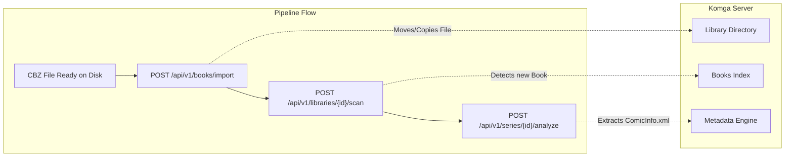

# 006 — Komga Client Library (`komga_sdk`) and Egress Integration

| Metadata | Value |
| :--- | :--- |
| **ID** | `ARCH-006` |
| **Depends On** | [`ARCH-001`](./001-transport-layer-unification.md), [`ARCH-005`](./005-mangadex-client-library.md) |
| **Base Specification** | [`openapi.json`](../../openapi.json) (Komga REST API `v1.30.0` / OpenAPI 3.1.0) |
| **Affected Modules** | `apps/mangadex/lib/komga_sdk/` *(new)*, `apps/mangadex/src/config.zig`, `apps/mangadex/tests/komga_test.zig` |
| **Status** | `COMPLETED` |

---

## 1. Context and Architectural Scope

Following the **Ports & Adapters (Hexagonal)** design established in [`ARCH-005`](./005-mangadex-client-library.md), `komga_sdk` must be implemented as a **pure, standalone Zig library** in `apps/mangadex/lib/komga_sdk/`:

* **Zero dependencies on Flowdata**: Does not import `flowdata` or `flowdata_extensions`.
* **Zero domain coupling with MangaDex**: Independent library that can be used standalone for any Komga management task.
* **Pluggable Transport**: Reuses the abstract `HttpTransport` port so that in production it runs over Flowdata's `OutboundAdapter` (leveraging timeouts, rate limiting, and telemetry), while in tests it can run with mock responses without network access.
* **Role in Pipeline**: Acts as the egress control plane, verifying series existence, submitting books for import, and triggering immediate library scans and metadata analysis when new CBZ files are published.

---

## 2. Authentication Specifications (from `openapi.json`)

Komga supports two primary authentication mechanisms along with optional session tokens. Both must be supported in `komga_sdk`:

### 2.1. API Key Authentication (Recommended for Automation)
* **Mechanism**: Every HTTP request includes the header:
  ```http
  X-API-Key: <api_key_value>
  ```
* **Advantages**: Stateless, does not create server-side sessions, ideal for automated pipeline workers and CI/CD egress tasks.

### 2.2. HTTP Basic Authentication
* **Mechanism**: Standard HTTP Basic Auth:
  ```http
  Authorization: Basic <base64(username:password)>
  ```
* **Session Cookie / Token Support**:
  * Upon initial Basic Auth, Komga returns a `Set-Cookie: KOMGA-SESSION=...` header.
  * If the client supplies `X-Auth-Token: true` in the initial login request, Komga returns the session identifier in the `X-Auth-Token` response header, which can subsequently be attached to all requests to avoid repeated Base64 password parsing.

### 2.3. Polymorphic Authentication Strategy in `komga_sdk`

```zig
pub const KomgaAuth = union(enum) {
    none,
    api_key: []const u8,
    basic_auth: struct {
        username: []const u8,
        password: []const u8,
    },
    session_token: []const u8,

    pub fn applyHeaders(self: KomgaAuth, allocator: std.mem.Allocator, headers_list: *std.ArrayList(HttpHeader)) !void {
        switch (self) {
            .none => {},
            .api_key => |key| {
                try headers_list.append(.{ .name = "X-API-Key", .value = key });
            },
            .basic_auth => |b| {
                var raw_creds: [512]u8 = undefined;
                const creds = try std.fmt.bufPrint(&raw_creds, "{s}:{s}", .{ b.username, b.password });
                const b64_len = std.base64.standard.Encoder.calcSize(creds.len);
                const b64_buf = try allocator.alloc(u8, b64_len);
                _ = std.base64.standard.Encoder.encode(b64_buf, creds);

                const auth_val = try std.fmt.allocPrint(allocator, "Basic {s}", .{b64_buf});
                try headers_list.append(.{ .name = "Authorization", .value = auth_val });
            },
            .session_token => |token| {
                try headers_list.append(.{ .name = "X-Auth-Token", .value = token });
            },
        }
    }
};
```

---

## 3. Targeted Endpoints & Data Transfer Objects (DTOs)

The SDK implements the essential subset of Komga's API required for comic pipeline integration:



### 3.1. Libraries (`/api/v1/libraries`)
* **`getLibraries()`**: `GET /api/v1/libraries`
  * Lists configured libraries (`id`, `name`, `root`, `importComicInfoBook`, `scanInterval`).
  * Used by the pipeline to map a manga category to a specific Komga `libraryId`.
* **`scanLibrary(library_id: []const u8, deep: bool)`**: `POST /api/v1/libraries/{libraryId}/scan?deep={deep}`
  * Triggers an immediate asynchronous background scan of the target library folder without waiting for the scheduled scan interval.
* **`emptyTrash(library_id: []const u8)`**: `POST /api/v1/libraries/{libraryId}/empty-trash`
  * Cleans missing book references.

### 3.2. Series (`/api/v1/series`)
* **`searchSeries(search_query: []const u8, library_id: ?[]const u8)`**: `GET /api/v1/series?search={query}&library_id={id}`
  * Checks if a series corresponding to the MangaDex title already exists in Komga and retrieves its `seriesId`.
* **`getSeries(series_id: []const u8)`**: `GET /api/v1/series/{seriesId}`
  * Fetches series metadata (`title`, `booksCount`, `status`, `deleted`).
* **`analyzeSeries(series_id: []const u8)`**: `POST /api/v1/series/{seriesId}/analyze`
  * Forces Komga to parse and refresh `ComicInfo.xml` and page count for all books in the series.

### 3.3. Book Import Batch (`/api/v1/books/import`)
For setups where Komga has filesystem access to the pipeline output directory (e.g., shared mount, NAS, or Docker volume):

* **`POST /api/v1/books/import`**:
  * Request Body: `BookImportBatchDto`
  ```json
  {
    "copyMode": "MOVE",
    "books": [
      {
        "seriesId": "06R1YDFP3B06C",
        "sourceFile": "/data/pipeline/out/One Piece - c1100.cbz",
        "destinationName": "One Piece - c1100 (v108).cbz"
      }
    ]
  }
  ```
  * `copyMode` options: `MOVE`, `COPY`, `HARDLINK`.
  * Status code: `202 Accepted`.

---

## 4. `KomgaClient` Module Interface (`lib/komga_sdk/client.zig`)

```zig
pub const ClientConfig = struct {
    base_url: []const u8 = "http://localhost:25600",
    auth: KomgaAuth = .none,
    user_agent: []const u8 = "flowdata-komga-sdk/0.1.0",
};

pub const KomgaClient = struct {
    allocator: std.mem.Allocator,
    config: ClientConfig,
    transport: HttpTransport,

    pub fn init(allocator: std.mem.Allocator, config: ClientConfig, transport: HttpTransport) KomgaClient;

    // Health / Identity
    pub fn getMe(self: *KomgaClient) !UserDto;

    // Libraries
    pub fn listLibraries(self: *KomgaClient) ![]const LibraryDto;
    pub fn scanLibrary(self: *KomgaClient, library_id: []const u8, deep: bool) !void;

    // Series
    pub fn searchSeries(self: *KomgaClient, title: []const u8, library_id: ?[]const u8) !PageDto(SeriesDto);
    pub fn getSeries(self: *KomgaClient, series_id: []const u8) !SeriesDto;
    pub fn analyzeSeries(self: *KomgaClient, series_id: []const u8) !void;

    // Books & Ingestion
    pub fn importBooks(self: *KomgaClient, batch: BookImportBatchDto) !void;
    pub fn getBook(self: *KomgaClient, book_id: []const u8) !BookDto;
};
```

---

## 5. Environment & Pipeline Configuration (`apps/mangadex/src/config.zig`)

The application config loader maps environment variables and `.env` parameters to `KomgaClient`:

| Environment Variable | Description | Default |
| :--- | :--- | :--- |
| `KOMGA_URL` / `KOMGA_BASE_URL` | Komga instance base URL | `http://localhost:25600` |
| `KOMGA_API_KEY` | Komga API Key (sets `KomgaAuth.api_key`) | `null` |
| `KOMGA_USERNAME` | Komga user account for Basic Auth | `null` |
| `KOMGA_PASSWORD` | Komga password for Basic Auth | `null` |
| `KOMGA_LIBRARY_ID` | Default library ID to target for scans and imports | `null` |

---

## 6. Verification and Testing Plan (`apps/mangadex/tests/komga_test.zig`)

1. **Authentication Header Verification**:
   * Asserts `X-API-Key` is populated correctly.
   * Asserts Basic Auth Base64 computation matches RFC 7617.
2. **Library Scan Trigger Verification**:
   * Asserts `POST /api/v1/libraries/{id}/scan?deep=false` issues the expected request without network dependencies.
3. **Book Import Batch Serialization**:
   * Asserts `BookImportBatchDto` serializes correctly with `copyMode: "MOVE"` and multiple `BookImportDto` entries.
