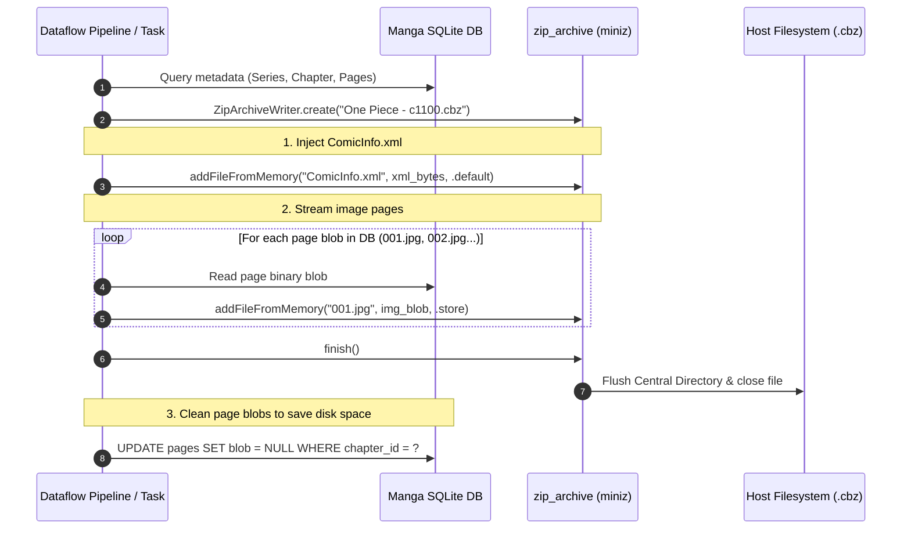

# 007 — ZIP Archive & CBZ Packaging Engine (`miniz` vs. `std.zip`)

| Metadata | Value |
| :--- | :--- |
| **ID** | `ARCH-007` |
| **Depends On** | [`ARCH-005`](./005-mangadex-client-library.md) |
| **Area** | `apps/mangadex/lib/zip_archive/` |
| **Status** | `COMPLETED` |

---

## 1. Technical Evaluation: `miniz` vs. `std.zip` / `std.compress` in Zig

Creating `.cbz` (Comic Book Zip) files requires generating valid PKZIP archives containing ordered image files (`001.jpg`, `002.jpg`) and a root `ComicInfo.xml` metadata descriptor.

We evaluated the two technical paths available in Zig:

### 1.1. In-Depth Comparison

| Evaluation Metric | `miniz` (Embedded Single-File C) | `std.zip` / `std.compress.flate` (Zig Standard Library) |
| :--- | :--- | :--- |
| **ZIP Writing Capability** | **Native & Complete** (`mz_zip_writer_*`). Handles Local File Headers, Central Directory, and End of Central Directory (EOCD) out-of-the-box. | **Limited / Read-Biased**. In Zig 0.13/0.14-dev, `std.zip` focuses primarily on extraction (`std.zip.Iterator`). Writing a full ZIP requires manually implementing the PKZIP binary framing or building custom container serializers. |
| **Selective Compression (`STORE` vs. `DEFLATE`)** | **Built-in**. Supports `MZ_NO_COMPRESSION` (level 0) for pre-compressed images (`.jpg`, `.webp`) and `MZ_DEFAULT_COMPRESSION` for text files (`ComicInfo.xml`). | Supported via `std.compress.flate`, but framing header management and CRC32 bookkeeping must be maintained by custom code. |
| **Memory Efficiency & Streaming** | Direct streaming to disk file descriptor (`mz_zip_writer_init_file`). Minimal heap allocation. | Requires custom buffering streams or in-memory ArrayLists. |
| **Ecosystem Maturity & Bugs** | **Battle-tested in thousands of production applications** (games, emulators, embedded systems). Public domain / MIT. | `std.zip` writing APIs frequently change across Zig compiler master releases. |
| **Integration Complexity in `build.zig`** | Zero external system dependencies. Added via a single C file: `b.addCSourceFile(.{ .file = b.path("lib/zip_archive/c/miniz.c") })`. | Pure Zig, zero C compilation step. |

---

### 1.2. Architectural Verdict: Why `miniz` is the Superior Choice for `zip_archive`

> [!TIP]
> **Verdict**:
> **`miniz` is selected as the core engine for `lib/zip_archive/`**, wrapped in an idiomatic, safe Zig interface (`ZipArchiveWriter`).
>
> **Rationale**:
> 1. Comic images downloaded from MangaDex are **already compressed** JPEG or WebP files. Compressing them again with Deflate wastes considerable CPU cycles and yields 0% size reduction. `miniz` allows instant `MZ_NO_COMPRESSION` (Store mode) writes for pages and compressed Deflate for `ComicInfo.xml`.
> 2. Re-implementing the PKZIP format specification in pure Zig (handling 32-bit CRC checksums, data descriptors, local file headers, and central directory directory tables) would introduce unnecessary surface area and maintenance burden. `miniz` is a self-contained, single-file C library that compiles in <50ms without linking libc.

---

## 2. Directory Layout of `apps/mangadex/lib/zip_archive/`

Consistent with all other internal libraries in `apps/mangadex/lib/`, the module exposes `mod.zig` directly at its root and is registered centrally in `apps/mangadex/build.zig`:

```text
apps/mangadex/lib/zip_archive/
├── c/
│   ├── miniz.c                   # Single-file ANSI C ZIP implementation
│   └── miniz.h                   # Public header
├── c.zig                         # @cImport bridge for miniz.h
├── mod.zig                       # Public module entrypoint
├── reader.zig                    # Archive inspection & extraction helper
└── writer.zig                    # Idiomatic Zig wrapper around mz_zip_writer
```

All test cases are centralized alongside the application suite in:
* `apps/mangadex/tests/zip_archive_test.zig` (run with `zig build test` from `apps/mangadex/`)

---

## 3. Idiomatic Zig Interface Specification

### 3.1. `ZipArchiveWriter` (`writer.zig`)

```zig
const std = @import("std");

pub const CompressionLevel = enum(u32) {
    store = 0,    // No compression (fastest, ideal for JPG/PNG/WebP)
    fast = 1,
    default = 6,  // Ideal for ComicInfo.xml
    best = 9,
};

pub const ZipError = error{
    FileCreateFailed,
    ArchiveInitFailed,
    EntryAddFailed,
    FinalizationFailed,
    OutOfMemory,
};

pub const ZipArchiveWriter = struct {
    // Internal opaque pointer to miniz mz_zip_archive
    ctx: *anyopaque,
    output_path: []const u8,

    pub fn create(allocator: std.mem.Allocator, output_file_path: []const u8) ZipError!ZipArchiveWriter;

    /// Appends an in-memory buffer as a file entry inside the ZIP archive.
    pub fn addFileFromMemory(
        self: *ZipArchiveWriter,
        entry_name: []const u8,
        data: []const u8,
        level: CompressionLevel,
    ) ZipError!void;

    /// Appends a file from the host filesystem into the ZIP archive.
    pub fn addFileFromDisk(
        self: *ZipArchiveWriter,
        entry_name: []const u8,
        disk_path: []const u8,
        level: CompressionLevel,
    ) ZipError!void;

    /// Finalizes the central directory and closes the file descriptor.
    pub fn finish(self: *ZipArchiveWriter) ZipError!void;
};
```

---

## 4. `ComicInfo.xml` Generator (`src/comic_info.zig`)

`ComicInfo.xml` is the de facto standard metadata specification supported by **Komga, Kavita, Mihon, and ComicRack**. The module serializes MangaDex chapter metadata into clean XML:

### 4.1. Metadata Data Model
```zig
pub const ComicInfoMetadata = struct {
    series: []const u8,
    title: ?[]const u8 = null,
    chapter_number: []const u8,
    volume_number: ?[]const u8 = null,
    summary: ?[]const u8 = null,
    writer: ?[]const u8 = null,
    penciller: ?[]const u8 = null,
    genre: ?[]const u8 = null,
    web_url: ?[]const u8 = null,
    language_iso: []const u8 = "en",
    page_count: u32,
    manga: bool = true,
};
```

### 4.2. XML Serialization Specification
```xml
<?xml version="1.0" encoding="utf-8"?>
<ComicInfo xmlns:xsd="http://www.w3.org/2001/XMLSchema" xmlns:xsi="http://www.w3.org/2001/XMLSchema-instance">
  <Title>Chapter 1100</Title>
  <Series>One Piece</Series>
  <Number>1100</Number>
  <Volume>108</Volume>
  <Summary>Kuma's past and origin revealed...</Summary>
  <Writer>Eiichiro Oda</Writer>
  <Penciller>Eiichiro Oda</Penciller>
  <Genre>Action, Adventure, Fantasy</Genre>
  <Web>https://mangadex.org/chapter/uuid-xyz</Web>
  <LanguageISO>en</LanguageISO>
  <PageCount>19</PageCount>
  <Manga>YesAndRightToLeft</Manga>
</ComicInfo>
```

---

## 5. End-to-End CBZ Packaging Workflow



---

## 6. Verification and Testing Plan (`tests/zip_archive_test.zig`)

1. **Archive Integrity Test**:
   * Creates an archive with 3 files (1 text file with `level = .default` and 2 binary blocks with `level = .store`).
   * Finalizes the file and re-reads it using standard ZIP verification tools, verifying headers and CRC32 match.
2. **`ComicInfo.xml` Escaping Test**:
   * Validates that XML special characters (`<`, `>`, `&`, `"`, `'`) in synopsis or series titles are escaped properly.
3. **Store Mode Performance**:
   * Measures that writing 50 pre-compressed image buffers completes in <20ms without performing redundant Deflate compression passes.
