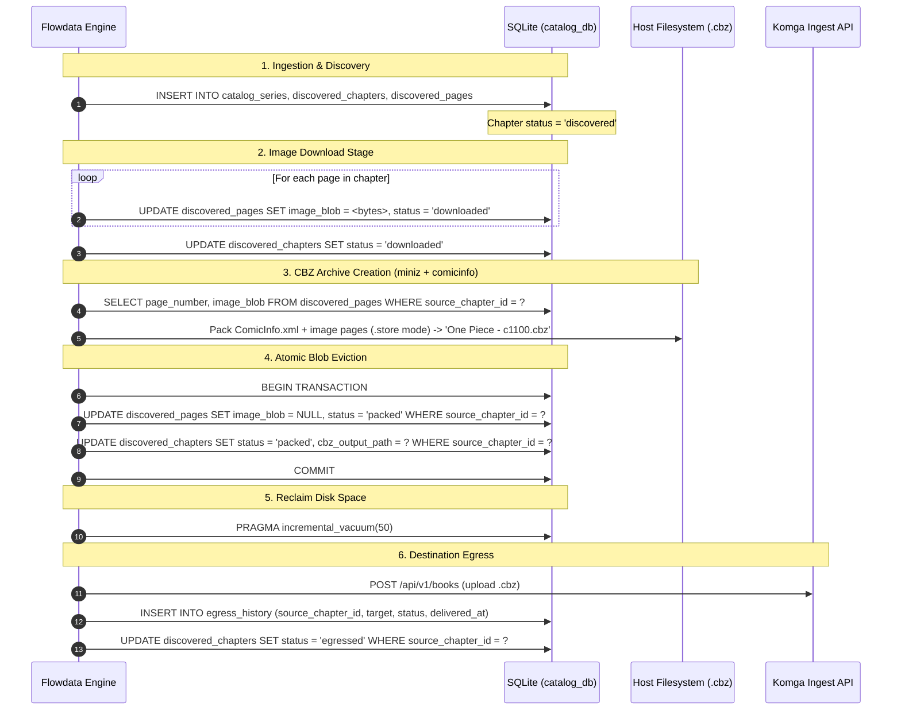

# 009 — Unified SQLite Storage & Declarative Schema Architecture

| Metadata | Value |
| :--- | :--- |
| **ID** | `ARCH-009` |
| **Depends On** | [`ARCH-005`](./005-mangadex-client-library.md), [`ARCH-007`](./007-zip-archive-and-cbz-engine.md), [`ARCH-008`](./008-comicinfo-metadata-library.md) |
| **Area** | `apps/mangadex/configs/schemas.yaml`, `extensions/datasource/sqlite/` |
| **Status** | `COMPLETED & ALIGNED` |

---

## 1. Architectural Evolution: Native Datasource vs. Monolithic Storage Library

During early design, two paradigms for SQLite persistence were evaluated:

1. **Ad-hoc Custom Library (`manga_storage/`)**:
   * Writing handwritten SQL query strings and transaction helpers in a dedicated Zig struct wrapping SQLite C pointers (`*anyopaque`).
   * *Critical Shortcomings*: Tightly couples business plugins to a specific database engine; bypasses Flowdata's zero-copy stream router; introduces redundant boilerplate and schema drift between YAML specifications and Zig code.

2. **Declarative Flowdata Schema & Native SQLite Datasource (`driver: sqlite`) — (SELECTED & IMPLEMENTED)**:
   * **Single Source of Truth (SSOT)**: Relational tables, columns, constraints, foreign keys (`ON DELETE CASCADE`), and indexes are defined declaratively in [`configs/schemas.yaml`](file:///home/ubuntu/.gemini/antigravity/scratch/vidsec/apps/mangadex/configs/schemas.yaml).
   * **Automatic DDL Provisioning**: The SQLite extension engine (`extensions/datasource/sqlite/src/schema_provisioner.zig`) automatically translates the `SchemaCatalog` AST into strict SQLite DDL upon initialization.
   * **Declarative Pipeline Routing**: Output channels from analytics tasks (e.g. `catalog_series`, `discovered_chapters`, `discovered_pages` in `manga_catalog.so`) are bound directly to `catalog_db` in [`configs/pipeline.yaml`](file:///home/ubuntu/.gemini/antigravity/scratch/vidsec/apps/mangadex/configs/pipeline.yaml). The engine executes type reflection and batched `INSERT OR REPLACE` operations without handwritten SQL.

> [!TIP]
> **Decision**: We adopt the **Unified SQLite Datasource** architecture (`mangadex.db`). Metadata, series tracking, and chapter statuses remain permanent, while image blobs are ephemeral buffers purged after `.cbz` archive creation.

---

## 2. SQLite Engine Configuration & Production Pragmas

The database connection in `extensions/datasource/sqlite/src/sqlite_repository.zig` is configured with high-performance concurrency pragmas:

```sql
PRAGMA journal_mode = WAL;            -- Concurrent reader threads while active pipeline tasks write
PRAGMA synchronous = NORMAL;          -- Optimal throughput without risking database corruption
PRAGMA foreign_keys = ON;             -- Enforces referential integrity (e.g. cascade series deletion)
PRAGMA auto_vacuum = INCREMENTAL;     -- Reclaims unallocated disk pages without full DB write-locks
PRAGMA busy_timeout = 5000;           -- 5000ms busy queueing timeout to prevent SQLITE_BUSY under load
```

* When running under `:memory:` (unit tests), `journal_mode` and file sync pragmas are skipped to optimize RAM execution.
* On file-backed instances, `PRAGMA auto_vacuum = INCREMENTAL` ensures page deletion frees space incrementally via periodic `PRAGMA incremental_vacuum(N);` calls.

---

## 3. Canonical Declarative Relational Schema (`configs/schemas.yaml`)

The canonical schema is declared in `apps/mangadex/configs/schemas.yaml`:

```yaml
version: 2

schemas:
  catalog:
    # 1. Tracked Manga Series Metadata
    catalog_series:
      columns:
        series_id:           { type: text, pk: true }
        source_id:           { type: text, default: "'mangadex'" }
        title:               { type: text }
        author:              { type: text, nullable: true }
        artist:              { type: text, nullable: true }
        status:              { type: text, default: "'ongoing'" }
        year:                { type: int64, nullable: true }
        cover_url:           { type: text, nullable: true }
        available_languages: { type: text, default: "''" }
        summary:             { type: text, nullable: true }
        alt_titles_json:     { type: text, nullable: true }
        genres_json:         { type: text, nullable: true }
        last_synced_at:      { type: int64, nullable: true }

    # 2. Manga Chapters with Foreign Key referencing Series
    discovered_chapters:
      columns:
        source_chapter_id:   { type: text, pk: true }
        series_id:           { type: text, ref: catalog_series.series_id, on_delete: cascade }
        chapter_number:      { type: text }
        volume_number:       { type: text, nullable: true }
        title:               { type: text, nullable: true }
        language:            { type: text }
        scanlation_group:    { type: text, nullable: true }
        page_count:          { type: int64, default: 0 }
        status:              { type: text, default: "'discovered'" }
        cbz_output_path:     { type: text, nullable: true }
        retry_count:         { type: int64, default: 0 }
        error_message:       { type: text, nullable: true }
        updated_at:          { type: int64, nullable: true }
      indexes:
        - series_id
        - status

    # 3. Ephemeral Chapter Pages with Foreign Key referencing Chapters
    discovered_pages:
      columns:
        source_chapter_id:   { type: text, ref: discovered_chapters.source_chapter_id, on_delete: cascade }
        page_number:         { type: int64 }
        url:                 { type: text }
        image_blob:          { type: blob, nullable: true }
        byte_size:           { type: int64, default: 0 }
        status:              { type: text, default: "'pending'" }
        downloaded_at:       { type: int64, nullable: true }
      primary_key:
        - source_chapter_id
        - page_number
      indexes:
        - source_chapter_id

    # 4. Egress / Destination Delivery History (e.g. Komga, Kavita)
    egress_history:
      columns:
        id:                  { type: text, pk: true }
        source_chapter_id:   { type: text, ref: discovered_chapters.source_chapter_id, on_delete: cascade }
        target:              { type: text }
        external_book_id:    { type: text, nullable: true }
        delivered_at:        { type: int64 }
        status:              { type: text, default: "'success'" }
        details:             { type: text, nullable: true }
      indexes:
        - source_chapter_id
        - target
```

### 3.1. Generated DDL Mapping Reference

The Flowdata provisioner parses the YAML types and executes equivalent SQLite DDL:

| YAML Schema Column Type | SQLite Storage Class | Constraint Mapping |
| :--- | :--- | :--- |
| `type: text` | `TEXT` | `NOT NULL` by default unless `nullable: true` |
| `type: int64` | `INTEGER` | Stored as 64-bit integer |
| `type: blob` | `BLOB` | Dynamic binary data |
| `pk: true` | `PRIMARY KEY` | Single-column primary key |
| `primary_key: [col1, col2]` | `PRIMARY KEY (col1, col2)` | Composite primary key |
| `ref: table.col, on_delete: cascade` | `REFERENCES table(col) ON DELETE CASCADE` | Enforced foreign key constraint |
| `indexes: [col]` | `CREATE INDEX idx_... ON table(col)` | Automatic secondary index creation |

---

## 4. Chapter Lifecycle & Ephemeral Blob Eviction Workflow



---

## 5. Pipeline Declarative Configuration (`configs/pipeline.yaml`)

The database sink is bound declaratively as a first-class repository in the application pipeline:

```yaml
datasources:
  # Fast RAM repository for transient step chaining
  pipeline_memory:
    driver: memory

  # Relational sink for persistent catalog and chapter state
  catalog_db:
    driver: sqlite
    path: "${MANGADEX_DB_PATH:-./mangadex.db}"
    schema: "${MANGADEX_SCHEMA_PATH:-./configs/schemas.yaml}"

pipelines:
  main:
    steps:
      - id: fetch_details
        uses: manga_catalog/fetch_series_details
        inputs:
          input: tracked_targets
        outputs:
          series_details:
            datasource: pipeline_memory
          catalog_series:
            datasource: catalog_db

      - id: fetch_chapters
        uses: manga_catalog/fetch_chapters
        inputs:
          input: series_details
        outputs:
          discovered_chapters:
            datasource: catalog_db

      - id: fetch_pages
        uses: manga_catalog/fetch_chapter_pages
        inputs:
          input: "slice(discovered_chapters, 0, 1)"
        outputs:
          discovered_pages:
            datasource: catalog_db
```

---

## 6. Verification and Test Suite

Persistence is verified through automated test suites:

1. **AST & Schema Validation** ([`pipeline_config_test.zig`](file:///home/ubuntu/.gemini/antigravity/scratch/vidsec/apps/mangadex/tests/pipeline_config_test.zig)):
   * Confirms `pipeline.yaml` parses into `PipelineAST` with `catalog_db` driver correctly identified as `sqlite`.
   * Verifies output channels route to their corresponding tables.
2. **Catalog Task Execution** ([`catalog_plugin_test.zig`](file:///home/ubuntu/.gemini/antigravity/scratch/vidsec/apps/mangadex/tests/catalog_plugin_test.zig)):
   * Verifies that `fetch_series_details`, `fetch_chapters`, and `fetch_chapter_pages` emit schema-compliant typed rows.
3. **Engine Pragmas & Referential Integrity**:
   * Evaluated through `zig build test` in both root Flowdata and `apps/mangadex/` test runners.
