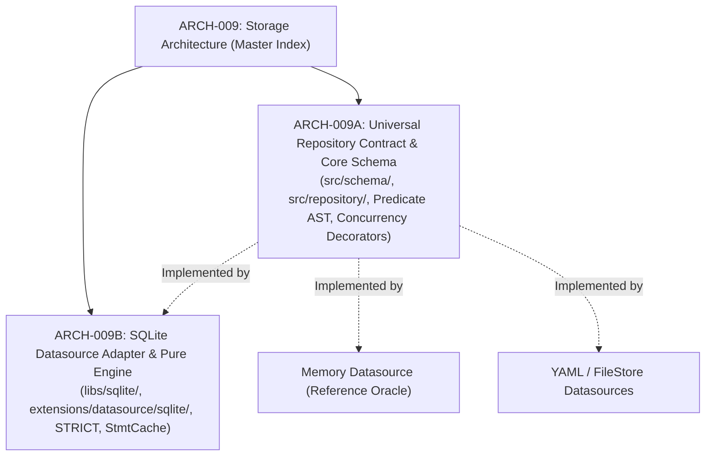

# 009 — Storage Architecture, Universal Repository Contract & SQLite Engine (Master Index)

| Metadata | Value |
| :--- | :--- |
| **ID** | `ARCH-009` |
| **Type** | Master Architecture Specification |
| **Depends On** | [`ARCH-002`](./002-open-kernel-extension-system.md), [`ARCH-016`](./016-reactive-bifurcation-parallel-expansion-and-join.md), [`ARCH-025`](./025-datasource-roles-and-batch-emission-decoupling.md) |
| **Area** | `src/schema/`, `src/repository/`, `src/dataflow/`, `libs/sqlite/`, `extensions/datasource/` |
| **Status** | `PARTIALLY IMPLEMENTED (009A, 009B & 009D IMPLEMENTED, 009C OPTIONAL)` |
| **Sub-Specs** | [`009A (Core Contracts)`](./009a-universal-repository-contract-and-core-schema.md) → [`009B (SQLite Driver)`](./009b-sqlite-datasource-and-engine.md) → [`009C (Optional SQLite Extensions)`](./009c-sqlite-optional-extensions.md) → [`009D (Portable SQL AST)`](./009d-portable-sql-ast-and-query-builder.md) |

---

## 1. Purpose & Architectural Decomposition

Flowdata separates **what** data looks like and **how** pipeline steps wire inputs/outputs from **where** and **how** it is stored. Binding a step output or input to a datasource in `pipeline.yaml` must transparently drive inserts, partial updates, deletes, and reads without task code embedding SQL or engine-specific logic.

To preserve strict separation of concerns, eliminate SQL leakage into the microkernel, and keep the core decoupled from storage engine quirks, `ARCH-009` is decomposed into two dedicated child specifications:

1. [**`ARCH-009A` — Universal Repository Contract, Core Schema & Concurrency Decorators**](./009a-universal-repository-contract-and-core-schema.md):
   * Focuses exclusively on the **Engine Core / Microkernel** (`src/schema/`, `src/repository/`, `src/dataflow/predicate.zig`).
   * 100% engine-agnostic: zero SQL, zero SQLite imports.
   * Universal `Repository` contract with `Capabilities`, `WriteSpec`, `ReadSpec`, and streaming iterators (`readStream`).
   * Dual-payload support via `RecordMap`: contiguous `Lowered(T)` C-ABI fast-path and `DynamicRecord` runtime fallback.
   * Thread-agnostic storage drivers wrapped transparently by composable Decorators (`SynchronizedRepository` for DAG mutexes and `AsyncBatchRepository` for MPSC queues).
   * Shared Driver Conformance Suite tested against `extensions/datasource/memory/` as the behavioral oracle.

2. [**`ARCH-009B` — Pure SQLite Library & SQLite Datasource Adapter**](./009b-sqlite-datasource-and-engine.md):
   * Focuses exclusively on **SQLite Integration** (`libs/sqlite/`, `extensions/datasource/sqlite/`).
   * Extracts a standalone, zero-dependency `libs/sqlite/` pure library.
   * SQLite quirks: `CREATE TABLE ... STRICT`, `StmtCache`, `PRAGMA` configuration (WAL, busy timeout), explicit transactions (`BEGIN IMMEDIATE`), and `SAVEPOINT` hooks for task checkpointing (`ARCH-020`).
   * Safe operations: enforces `ON CONFLICT (...) DO UPDATE SET` touching only specified columns; strictly forbids `INSERT OR REPLACE` to prevent foreign key cascade loss.
   * Non-destructive schema migrations (additive) with loud failure on destructive schema drift.

---

## 2. Global Design Principles

1. **Engine-Agnostic Core:** The microkernel contracts (`src/schema/`, `src/repository/`) and declarative definitions (`schemas.yaml`) are universal and valid for relational DBs, document/NoSQL stores, object stores (S3), and files (`yaml_file`, `json`).
2. **Schema is Authoritative:** Tables and collections are never inferred from runtime payloads unless `schemaless: true` is configured.
3. **Struct Shape = Projection:** What the struct declares is what is touched. Omitted fields are untouched on write and excluded on read.
4. **Streaming-First with Backpressure:** Primary reads occur through chunked iterators (`readStream`), consuming $O(1)$ memory and pausing database cursors when downstream queues fill (`max_inflight_bytes: 512MiB`).
5. **Decoupled Concurrency:** Drivers do not contain ad-hoc lock logic; multi-thread synchronization is layered via `SynchronizedRepository` (Mutex) or `AsyncBatchRepository` (MPSC Queue).
6. **Pipeline-Driven Universal Schema Evolution:** Complex schema transformations across versions are modeled as native Flowdata transformation pipelines ([see documentation in `docs/learning/pipeline-driven-universal-schema-evolution.md`](../learning/pipeline-driven-universal-schema-evolution.md)), supporting Eager, Lazy (in-flight upcasting), and Hybrid modes.

---

## 3. Related Datasource ADRs & Extensions

Following this decomposition, individual datasources retain dedicated driver specifications to isolate their specific behavior:
* **`extensions/datasource/memory`:** Reference oracle for ephemeral channels vs schema-backed in-memory tables.
* **`extensions/datasource/yaml_file`:** Human-editable configuration store and Git-friendly synchronization.
* **`apps/mangadex` (External REST Datasource):** Encapsulates external API contracts, rate limiting, and upstream API changelogs without polluting engine storage contracts.

---

## 4. Sequential Execution Order

Implementation proceeds in strict **Core-First** order:
1. **Core Contracts (`ARCH-009A`):** `src/schema/`, `src/repository/`, Predicate AST, `RecordMap`, and Concurrency Decorators.
2. **Reference Driver (`ARCH-009A`):** Hardening `extensions/datasource/memory/` and verifying the `Driver Conformance Suite`.
3. **Pure SQLite Library (`ARCH-009B`):** Extracting and hardening `libs/sqlite/`.
4. **SQLite Adapter (`ARCH-009B`):** Thin adapter `extensions/datasource/sqlite/` connected to the Conformance Suite and `PipelineEngine`.
