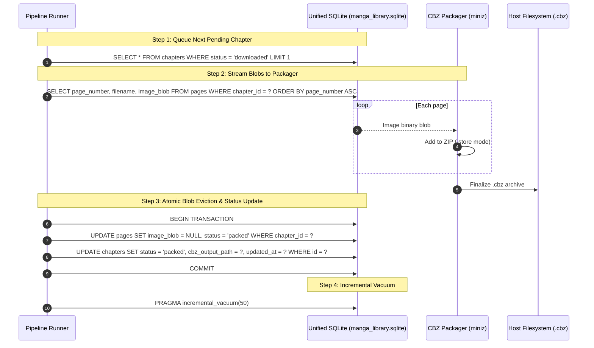

# 009 — Unified SQLite Storage & Database Schema Design

| Metadata | Value |
| :--- | :--- |
| **ID** | `ARCH-009` |
| **Depends On** | [`ARCH-005`](./005-mangadex-client-library.md), [`ARCH-007`](./007-zip-archive-and-cbz-engine.md) |
| **Area** | `apps/mangadex/lib/manga_storage/` |
| **Status** | `SPECIFICATION & DESIGN` |

---

## 1. Architectural Decision: Unified Database vs. Distributed Databases

We evaluated two architectural strategies for local state and content storage:

1. **Option A: Distributed Databases (One SQLite database per manga series)**
   * *Strengths*: Total isolation; deleting a manga folder deletes its entire database.
   * *Critical Flaws*: The dataflow pipeline cannot issue global orchestration queries (*"give me the next 10 pending chapters across all active subscriptions"*); opening and maintaining connections to dozens of independent database files degrades performance; relational foreign keys cannot enforce cross-series consistency; complex and dynamic configuration in `pipeline.yaml`.
2. **Option B: Unified Database (`manga_library.sqlite`) — (SELECTED)**
   * *Strengths*: Single datasource configuration in `pipeline.yaml`; instantaneous global queue queries; strict relational integrity; seamless transaction management with Write-Ahead Logging (WAL).
   * *Mitigation for Disk Growth*: Large binary image blobs are stored ephemerally in the `pages` table during download and are **cleared (`blob = NULL`) immediately upon packaging into `.cbz`**. SQLite space is reclaimed automatically via `PRAGMA auto_vacuum = INCREMENTAL;`.

> [!TIP]
> **Decision**: We adopt the **Unified SQLite Database** architecture (`manga_library.sqlite`). Metadata and synchronization tracking remain permanent, while image blobs are ephemeral buffers purged after archive creation.

---

## 2. SQLite Configuration & Pragmas

The database connection must be initialized with the following pragmas for maximum throughput, crash resilience, and space management:

```sql
PRAGMA journal_mode = WAL;            -- Concurrent reads during active pipeline writes
PRAGMA synchronous = NORMAL;          -- Optimal balance between durability and write throughput
PRAGMA foreign_keys = ON;             -- Strict relational integrity
PRAGMA auto_vacuum = INCREMENTAL;     -- Reclaims unallocated disk pages without full DB lock
PRAGMA busy_timeout = 5000;           -- 5s queueing timeout to prevent locked database errors
```

---

## 3. Database Schema DDL (Data Definition Language)

```sql
-- 1. Source Providers (MangaDex, HTML Scrapers, etc.)
CREATE TABLE IF NOT EXISTS sources (
    id TEXT PRIMARY KEY,                       -- e.g. 'mangadex', 'tmo', 'asura'
    name TEXT NOT NULL,
    base_url TEXT NOT NULL,
    rate_limit_rps INTEGER NOT NULL DEFAULT 5,
    is_active INTEGER NOT NULL DEFAULT 1,
    created_at INTEGER NOT NULL                -- Unix epoch milliseconds
);

-- 2. Tracked Manga Series
CREATE TABLE IF NOT EXISTS series (
    id TEXT PRIMARY KEY,                       -- Internal canonical UUID
    source_id TEXT NOT NULL REFERENCES sources(id) ON DELETE RESTRICT,
    source_series_id TEXT NOT NULL,            -- Remote ID or URL slug in source
    title TEXT NOT NULL,
    alt_titles_json TEXT,                      -- JSON array of alternate titles
    summary TEXT,
    author TEXT,
    artist TEXT,
    status TEXT NOT NULL DEFAULT 'ongoing',    -- 'ongoing', 'completed', 'hiatus', 'cancelled'
    year INTEGER,
    genres_json TEXT,                          -- JSON array of tags/genres
    cover_url TEXT,
    last_synced_at INTEGER,
    created_at INTEGER NOT NULL,
    UNIQUE(source_id, source_series_id)
);

-- 3. Manga Chapters
CREATE TABLE IF NOT EXISTS chapters (
    id TEXT PRIMARY KEY,                       -- Internal canonical UUID
    series_id TEXT NOT NULL REFERENCES series(id) ON DELETE CASCADE,
    source_id TEXT NOT NULL REFERENCES sources(id) ON DELETE RESTRICT,
    source_chapter_id TEXT NOT NULL,           -- Remote chapter ID in source
    volume_number TEXT,                        -- e.g. '108' or NULL
    chapter_number TEXT NOT NULL,              -- e.g. '1100.5'
    title TEXT,                                -- Chapter title if available
    language_iso TEXT NOT NULL DEFAULT 'en',   -- ISO 639-1 ('en', 'es', etc.)
    scanlation_group TEXT,
    page_count INTEGER NOT NULL DEFAULT 0,
    status TEXT NOT NULL DEFAULT 'discovered', -- 'discovered', 'downloading', 'downloaded', 'packed', 'egressed', 'failed'
    cbz_output_path TEXT,                      -- Final path of generated .cbz file
    retry_count INTEGER NOT NULL DEFAULT 0,
    error_message TEXT,
    updated_at INTEGER NOT NULL,
    UNIQUE(source_id, source_chapter_id)
);

-- 4. Ephemeral Chapter Pages (Image Blobs)
CREATE TABLE IF NOT EXISTS pages (
    id TEXT PRIMARY KEY,                       -- Internal UUID
    chapter_id TEXT NOT NULL REFERENCES chapters(id) ON DELETE CASCADE,
    page_number INTEGER NOT NULL,              -- 1-based index (1, 2, 3...)
    filename TEXT NOT NULL,                    -- e.g. '001.jpg'
    remote_url TEXT NOT NULL,
    image_blob BLOB,                           -- Cleared (SET NULL) once chapter is packed
    byte_size INTEGER NOT NULL DEFAULT 0,
    status TEXT NOT NULL DEFAULT 'pending',    -- 'pending', 'downloaded', 'packed'
    downloaded_at INTEGER,
    UNIQUE(chapter_id, page_number)
);

-- 5. Egress / Destination Delivery History
CREATE TABLE IF NOT EXISTS egress_history (
    id TEXT PRIMARY KEY,
    chapter_id TEXT NOT NULL REFERENCES chapters(id) ON DELETE CASCADE,
    target TEXT NOT NULL,                      -- 'komga', 'local_fs', 'sftp'
    external_book_id TEXT,                     -- Identifier returned by Komga
    delivered_at INTEGER NOT NULL,
    status TEXT NOT NULL DEFAULT 'success',    -- 'success', 'failed'
    details TEXT
);

-- Indexes for Optimal Pipeline Queue Ingestion
CREATE INDEX IF NOT EXISTS idx_chapters_queue 
    ON chapters(status, updated_at);

CREATE INDEX IF NOT EXISTS idx_chapters_series 
    ON chapters(series_id, chapter_number);

CREATE INDEX IF NOT EXISTS idx_pages_chapter 
    ON pages(chapter_id, page_number);
```

---

## 4. Lifecycle & Blob Eviction Workflow



---

## 5. Storage Library Interface (`apps/mangadex/lib/manga_storage/`)

The module exposes strongly-typed Zig methods wrapping SQLite operations:

```zig
pub const MangaStorage = struct {
    db_handle: *anyopaque, // sqlite3* pointer
    allocator: std.mem.Allocator,

    pub fn open(allocator: std.mem.Allocator, db_path: []const u8) !MangaStorage;
    pub fn close(self: *MangaStorage) void;

    // Series Operations
    pub fn upsertSeries(self: *MangaStorage, series: SeriesRecord) !void;
    pub fn getSeries(self: *MangaStorage, source_id: []const u8, source_series_id: []const u8) !?SeriesRecord;

    // Chapter Queue Operations
    pub fn upsertChapters(self: *MangaStorage, chapters: []const ChapterRecord) !void;
    pub fn claimPendingChapters(self: *MangaStorage, limit: u32) ![]ChapterRecord;
    pub fn markChapterStatus(self: *MangaStorage, chapter_id: []const u8, status: []const u8, err_msg: ?[]const u8) !void;

    // Page Blob Staging & Purging
    pub fn savePageBlob(self: *MangaStorage, chapter_id: []const u8, page_num: u32, filename: []const u8, blob: []const u8) !void;
    pub fn getChapterPages(self: *MangaStorage, chapter_id: []const u8) ![]PageRecord;
    pub fn purgeChapterBlobs(self: *MangaStorage, chapter_id: []const u8, cbz_path: []const u8) !void;

    // Maintenance
    pub fn incrementalVacuum(self: *MangaStorage, pages_to_free: u32) !void;
};
```
