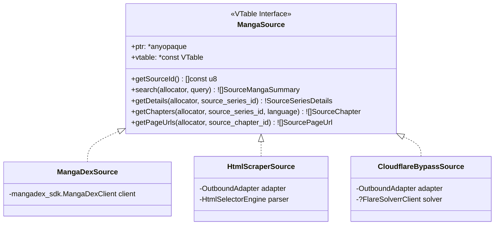

# 010 — Multi-Source Manga Architecture & Web Scraping Strategy

| Metadata | Value |
| :--- | :--- |
| **ID** | `ARCH-010` |
| **Depends On** | [`ARCH-005`](./005-mangadex-client-library.md), [`ARCH-009`](./009-unified-sqlite-storage-and-schema.md) |
| **Area** | `apps/mangadex/lib/sources/` |
| **Status** | `SPECIFICATION & DESIGN` |

---

## 1. Problem Statement and Rationale

While **MangaDex** provides an official, clean REST API, it possesses notable catalog limitations:
1. Publishers frequently request removals of licensed titles.
2. Many popular scanlation groups host translations exclusively on their own web portals (e.g., TMO, AsuraScans, FlameScans, MangaReader).
3. Certain localized languages (Spanish, French, Portuguese) have fragmented community coverage across different websites.

To make the application resilient and versatile, we adopt a **Multi-Source Provider Architecture** (modeled after the proven extension designs of **Tachiyomi, Mihon, and Keiyoushi**). The core pipeline (SQLite persistence, CBZ packaging, and Komga egress) remains 100% source-agnostic.

---

## 2. Core Abstraction: The `MangaSource` Contract

Every content provider implements the polymorphic `MangaSource` interface:



### 2.1. Contract Definition (`apps/mangadex/lib/sources/contract.zig`)

```zig
pub const SourceMangaSummary = struct {
    source_id: []const u8,
    source_series_id: []const u8,
    title: []const u8,
    cover_url: ?[]const u8 = null,
};

pub const SourceSeriesDetails = struct {
    title: []const u8,
    alt_titles: []const []const u8 = &.{},
    summary: ?[]const u8 = null,
    author: ?[]const u8 = null,
    artist: ?[]const u8 = null,
    status: []const u8 = "ongoing",
    year: ?u16 = null,
    genres: []const []const u8 = &.{},
    cover_url: ?[]const u8 = null,
};

pub const SourceChapter = struct {
    source_chapter_id: []const u8,
    chapter_number: []const u8,
    volume_number: ?[]const u8 = null,
    title: ?[]const u8 = null,
    language_iso: []const u8,
    scanlation_group: ?[]const u8 = null,
};

pub const SourcePageUrl = struct {
    page_number: u32,
    url: []const u8,
    headers: []const [2][]const u8 = &.{}, // e.g. custom Referer or User-Agent if required
};

pub const MangaSource = struct {
    ptr: *anyopaque,
    vtable: *const VTable,

    pub const VTable = struct {
        getSourceId: *const fn (ctx: *anyopaque) []const u8,
        search: *const fn (ctx: *anyopaque, allocator: std.mem.Allocator, query: []const u8) anyerror![]SourceMangaSummary,
        getDetails: *const fn (ctx: *anyopaque, allocator: std.mem.Allocator, source_series_id: []const u8) anyerror!SourceSeriesDetails,
        getChapters: *const fn (ctx: *anyopaque, allocator: std.mem.Allocator, source_series_id: []const u8, lang: []const u8) anyerror![]SourceChapter,
        getPageUrls: *const fn (ctx: *anyopaque, allocator: std.mem.Allocator, source_chapter_id: []const u8) anyerror![]SourcePageUrl,
    };

    pub fn getSourceId(self: MangaSource) []const u8 {
        return self.vtable.getSourceId(self.ptr);
    }

    pub fn search(self: MangaSource, allocator: std.mem.Allocator, query: []const u8) ![]SourceMangaSummary {
        return self.vtable.search(self.ptr, allocator, query);
    }

    pub fn getDetails(self: MangaSource, allocator: std.mem.Allocator, source_series_id: []const u8) !SourceSeriesDetails {
        return self.vtable.getDetails(self.ptr, allocator, source_series_id);
    }

    pub fn getChapters(self: MangaSource, allocator: std.mem.Allocator, source_series_id: []const u8, lang: []const u8) ![]SourceChapter {
        return self.vtable.getChapters(self.ptr, allocator, source_series_id, lang);
    }

    pub fn getPageUrls(self: MangaSource, allocator: std.mem.Allocator, source_chapter_id: []const u8) ![]SourcePageUrl {
        return self.vtable.getPageUrls(self.ptr, allocator, source_chapter_id);
    }
};
```

---

## 3. Scraper Archetypes & Anti-Scraping Mitigations

Web scrapers fall into three technical tiers based on server defenses:

### 3.1. Tier 1: Static HTML Scrapers (Direct HTTP)
* **Mechanics**: The source serves standard HTML without client-side rendering.
* **Extraction**:
  1. Requests HTML over Flowdata's `OutboundAdapter` (automatically inheriting proxies and rate limits).
  2. Extracts data using lightweight tokenizers or CSS/regex matchers (avoiding heavy external DOM parsers).
  3. Extracts image URLs from `` elements or embedded JavaScript arrays (e.g., `var pages = [...]`).

### 3.2. Tier 2: Protected Scrapers (Cloudflare Turnstile & DDoS Guard)
* **Problem**: Many popular sites block raw HTTP clients with HTTP 403 or 503 challenge pages.
* **Mitigation Strategy (No heavy headless browser inside core)**:
  1. **Session Cookie Emulation**: If the user provides a valid browser session (`cf_clearance` cookie + matching `User-Agent`), the request succeeds directly via `OutboundAdapter`.
  2. **FlareSolverr / Headless Sidecar Bridge**:
     * An external headless browser container (e.g., [FlareSolverr](https://github.com/FlareSolverr/FlareSolverr)) runs alongside the application.
     * When a Tier 2 scraper encounters a Cloudflare challenge, it delegates the URL to FlareSolverr via HTTP POST (`http://localhost:8191/v1`).
     * FlareSolverr solves the challenge using Chromium and returns the decrypted HTML, clearance cookies, and User-Agent.

---

## 4. Source Registry & Dynamic Dispatching

The `SourceRegistry` manages active source drivers and resolves them dynamically at runtime:

```zig
pub const SourceRegistry = struct {
    sources: std.StringHashMapUnmanaged(MangaSource) = .empty,
    allocator: std.mem.Allocator,

    pub fn init(allocator: std.mem.Allocator) SourceRegistry {
        return .{ .allocator = allocator };
    }

    pub fn register(self: *SourceRegistry, source: MangaSource) !void {
        try self.sources.put(self.allocator, source.getSourceId(), source);
    }

    pub fn get(self: *const SourceRegistry, source_id: []const u8) ?MangaSource {
        return self.sources.get(source_id);
    }
};
```

---

## 5. Declarative Multi-Source Configuration in `pipeline.yaml`

Users can track different manga series from different sources within the same configuration file without code changes:

```yaml
version: "2.0.0"

# Source configurations & Rate Limiting
sources:
  - id: mangadex
    type: official_api
    rate_limit_rps: 5
    timeouts:
      connect_ms: 5000
      read_idle_ms: 15000

  - id: tmo_scraper
    type: html_scraper
    base_url: "https://visortmo.com"
    rate_limit_rps: 2
    headers:
      User-Agent: "Mozilla/5.0 (X11; Linux x86_64) AppleWebKit/537.36"

# Subscribed series with explicit source bindings
subscriptions:
  - title: "One Piece"
    source: mangadex
    source_series_id: "a1c7d817-0e59-4555-b52e-322e2365879e"
    languages: ["es-la", "en"]
    chapters: "latest:3"

  - title: "Kingdom"
    source: tmo_scraper
    source_series_id: "manga-kingdom-spanish"
    languages: ["es"]
    chapters: "all"
```

---

## 6. Module Directory Layout

```text
apps/mangadex/lib/sources/
├── mod.zig                       # Re-exports MangaSource, SourceRegistry, and contracts
├── contract.zig                  # VTable and DTOs (SourceMangaSummary, SourceChapter, etc.)
├── registry.zig                  # SourceRegistry implementation
└── drivers/
    ├── mangadex_driver.zig       # Implements MangaSource using mangadex_sdk
    ├── tmo_driver.zig            # Example Tier 1 HTML scraper
    └── sidecar_client.zig        # Optional FlareSolverr bridge client for Cloudflare bypass
```
