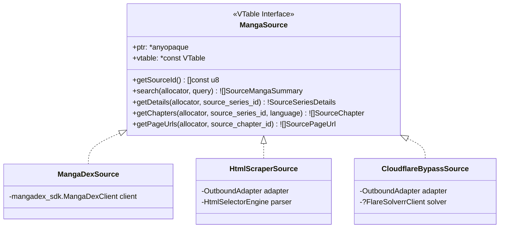
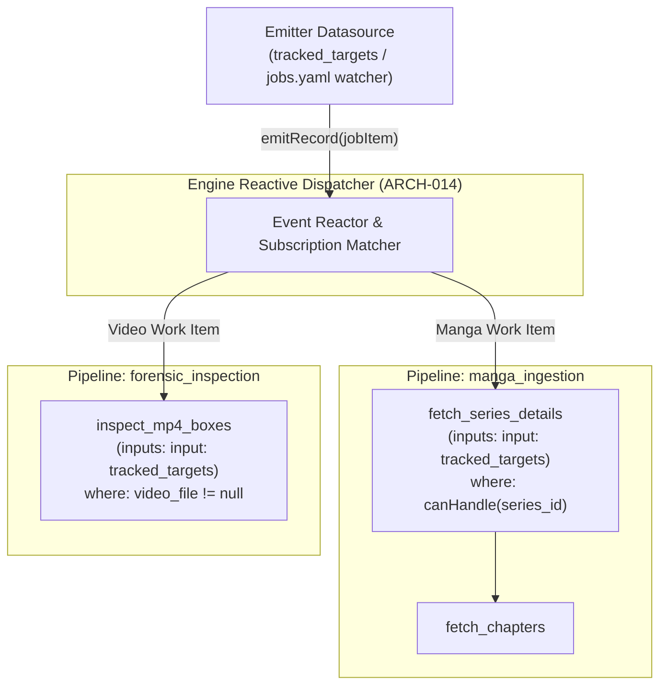

# 010 — Multi-Source Manga Architecture & Web Scraping Strategy

| Metadata | Value |
| :--- | :--- |
| **ID** | `ARCH-010` |
| **Depends On** | [`ARCH-005`](./005-mangadex-client-library.md), [`ARCH-009`](./009-unified-sqlite-storage-and-schema.md), [`ARCH-011`](./011-pipeline-yaml-specification-and-orchestration.md) |
| **Area** | `apps/mangadex/lib/sources/` & `apps/mangadex/plugin/catalog.zig` |
| **Status** | `IMPLEMENTED (Contract, Registry & MangaDex Driver) / DESIGN (Scrapers & Sidecar)` |

---

## 1. Problem Statement and Rationale

While **MangaDex** provides an official, clean REST API, it possesses notable catalog limitations:
1. Publishers frequently request removals of licensed titles.
2. Many popular scanlation groups host translations exclusively on their own web portals (e.g., TMO, AsuraScans, FlameScans, MangaReader).
3. Certain localized languages (Spanish, French, Portuguese) have fragmented community coverage across different websites.

To make the application resilient and versatile, we adopt a **Multi-Source Provider Architecture** (modeled after the proven extension designs of **Tachiyomi, Mihon, and Keiyoushi**). The core pipeline (SQLite persistence, CBZ packaging, and Komga egress) remains 100% source-agnostic.

---

## 2. Core Abstraction: The `MangaSource` Contract

Every content provider implements the polymorphic `MangaSource` interface:



### 2.1. Contract Definition (`apps/mangadex/lib/sources/contract.zig`)

```zig
pub const SourceMangaSummary = struct {
    source_id: []const u8,
    source_series_id: []const u8,
    title: []const u8,
    cover_url: ?[]const u8 = null,
};

pub const SourceSeriesDetails = struct {
    title: []const u8,
    alt_titles: []const []const u8 = &.{},
    summary: ?[]const u8 = null,
    author: ?[]const u8 = null,
    artist: ?[]const u8 = null,
    status: []const u8 = "ongoing",
    year: ?u16 = null,
    genres: []const []const u8 = &.{},
    cover_url: ?[]const u8 = null,
};

pub const SourceChapter = struct {
    source_chapter_id: []const u8,
    chapter_number: []const u8,
    volume_number: ?[]const u8 = null,
    title: ?[]const u8 = null,
    language_iso: []const u8,
    scanlation_group: ?[]const u8 = null,
};

pub const SourcePageUrl = struct {
    page_number: u32,
    url: []const u8,
    headers: []const [2][]const u8 = &.{}, // e.g. custom Referer or User-Agent if required
};

pub const MangaSource = struct {
    ptr: *anyopaque,
    vtable: *const VTable,

    pub const VTable = struct {
        getSourceId: *const fn (ctx: *anyopaque) []const u8,
        search: *const fn (ctx: *anyopaque, allocator: std.mem.Allocator, query: []const u8) anyerror![]SourceMangaSummary,
        getDetails: *const fn (ctx: *anyopaque, allocator: std.mem.Allocator, source_series_id: []const u8) anyerror!SourceSeriesDetails,
        getChapters: *const fn (ctx: *anyopaque, allocator: std.mem.Allocator, source_series_id: []const u8, lang: []const u8) anyerror![]SourceChapter,
        getPageUrls: *const fn (ctx: *anyopaque, allocator: std.mem.Allocator, source_chapter_id: []const u8) anyerror![]SourcePageUrl,
        canHandle: ?*const fn (ctx: *anyopaque, identifier: []const u8) bool = null,
    };

    pub fn getSourceId(self: MangaSource) []const u8 {
        return self.vtable.getSourceId(self.ptr);
    }

    pub fn canHandle(self: MangaSource, identifier: []const u8) bool {
        if (self.vtable.canHandle) |ch_fn| {
            return ch_fn(self.ptr, identifier);
        }
        return false;
    }

    pub fn search(self: MangaSource, allocator: std.mem.Allocator, query: []const u8) ![]SourceMangaSummary {
        return self.vtable.search(self.ptr, allocator, query);
    }

    pub fn getDetails(self: MangaSource, allocator: std.mem.Allocator, source_series_id: []const u8) !SourceSeriesDetails {
        return self.vtable.getDetails(self.ptr, allocator, source_series_id);
    }

    pub fn getChapters(self: MangaSource, allocator: std.mem.Allocator, source_series_id: []const u8, lang: []const u8) ![]SourceChapter {
        return self.vtable.getChapters(self.ptr, allocator, source_series_id, lang);
    }

    pub fn getPageUrls(self: MangaSource, allocator: std.mem.Allocator, source_chapter_id: []const u8) ![]SourcePageUrl {
        return self.vtable.getPageUrls(self.ptr, allocator, source_chapter_id);
    }
};
```

---

## 3. Scraper Archetypes & Anti-Scraping Mitigations

Web scrapers fall into three technical tiers based on server defenses:

### 3.1. Tier 1: Static HTML Scrapers (Direct HTTP)
* **Mechanics**: The source serves standard HTML without client-side rendering.
* **Extraction**:
  1. Requests HTML over Flowdata's `OutboundAdapter` (automatically inheriting proxies and rate limits).
  2. Extracts data using lightweight tokenizers or CSS/regex matchers (avoiding heavy external DOM parsers).
  3. Extracts image URLs from `` elements or embedded JavaScript arrays (e.g., `var pages = [...]`).

### 3.2. Tier 2: Protected Scrapers (Cloudflare Turnstile & DDoS Guard)
* **Problem**: Many popular sites block raw HTTP clients with HTTP 403 or 503 challenge pages.
* **Mitigation Strategy (No heavy headless browser inside core)**:
  1. **Session Cookie Emulation**: If the user provides a valid browser session (`cf_clearance` cookie + matching `User-Agent`), the request succeeds directly via `OutboundAdapter`.
  2. **FlareSolverr / Headless Sidecar Bridge**:
     * An external headless browser container (e.g., [FlareSolverr](https://github.com/FlareSolverr/FlareSolverr)) runs alongside the application.
     * When a Tier 2 scraper encounters a Cloudflare challenge, it delegates the URL to FlareSolverr via HTTP POST (`http://localhost:8191/v1`).
     * FlareSolverr solves the challenge using Chromium and returns the decrypted HTML, clearance cookies, and User-Agent.

---

## 4. Source Registry & Dynamic Capability Validation

The `SourceRegistry` manages active source drivers and resolves them dynamically at runtime (`apps/mangadex/lib/sources/registry.zig`):

```zig
pub const SourceRegistry = struct {
    sources: std.StringHashMapUnmanaged(MangaSource) = .empty,
    allocator: Allocator,

    pub fn init(allocator: Allocator) SourceRegistry {
        return .{ .allocator = allocator };
    }

    pub fn deinit(self: *SourceRegistry) void {
        self.sources.deinit(self.allocator);
    }

    pub fn register(self: *SourceRegistry, source: MangaSource) !void {
        try self.sources.put(self.allocator, source.getSourceId(), source);
    }

    pub fn get(self: *const SourceRegistry, source_id: []const u8) ?MangaSource {
        return self.sources.get(source_id);
    }

    pub fn has(self: *const SourceRegistry, source_id: []const u8) bool {
        return self.sources.contains(source_id);
    }

    /// Finds the first registered provider whose `canHandle` recognizes the series identifier or URL.
    pub fn findByCanHandle(self: *const SourceRegistry, identifier: []const u8) ?MangaSource {
        var it = self.sources.iterator();
        while (it.next()) |entry| {
            if (entry.value_ptr.*.canHandle(identifier)) {
                return entry.value_ptr.*;
            }
        }
        return null;
    }

    pub fn count(self: *const SourceRegistry) usize {
        return self.sources.count();
    }
};
```

In the pipeline plugin (`apps/mangadex/plugin/catalog.zig`), tasks instantiate a `RegisteredSources` context that registers all enabled drivers and resolves the target driver per-job dynamically without requiring explicit source binding in the work item:

```zig
// Dynamic driver resolution:
// 1. If job.datasource is explicitly provided -> use that driver.
// 2. If omitted -> consult drivers via canHandle(job.series_id) (UUID v4 vs. URL pattern).
// 3. Fallback to default "mangadex" or reject unsupported items.
const m_source = try reg_sources.resolve(job.datasource, job.series_id);
const details = try m_source.getDetails(alloc, job.series_id);
```

---

## 5. Reactive Inbound Datasource Emitters & Heterogeneous Jobs

Aligned with [`ARCH-014`](./014-inbound-emitter-datasources-and-reactive-dispatch.md), **datasources act as reactive event emitters**, and pipelines subscribe to them via task-level `inputs:`.

### 5.1. Decoupling Pipeline & Datasource from Work Items

Work items describe *what* they are, not *who* processes them. Therefore:
1. **No `pipeline:` field**: Work items never reference internal pipeline names.
2. **Optional `datasource:` field**: The target driver is either:
   * **Inferred from the emitting datasource** (e.g. an inbound RSS feed or MangaDex webhook emitter).
   * **Inferred via `canHandle(identifier)`** (a UUID string resolves `mangadex`; a full HTTP/HTTPS URL resolves `html_generic` or specific scrapers).
   * **Filtered declaratively at step level** using Flowdata's `where:` expressions (`where: "series_id != null"`).



### 5.2. Heterogeneous Work Item Definitions (`configs/jobs.yaml`)

A single watched datasource can emit heterogeneous items consumed by completely different pipelines or sub-pipelines:

```yaml
# configs/jobs.yaml - Heterogeneous items, NO pipeline name, optional datasource
# 1. MangaDex series by UUID (auto-detected via canHandle UUID signature)
- title: "Chainsaw Man"
  series_id: "a1c7d817-0e59-4555-b52e-322e2365879e"
  languages: ["es-la", "en"]
  chapters: "latest:3"

# 2. Scraped series by canonical Web URL (auto-detected via canHandle URL pattern)
- title: "Kingdom"
  series_id: "https://visortmo.com/library/manga/manga-kingdom-spanish"
  languages: ["es"]
  chapters: "all"

# 3. Explicit datasource override (optional)
- title: "Custom Feed Manga"
  datasource: html_generic
  series_id: "custom-slug-456"
  languages: ["en"]

# 4. Completely different domain item (consumed by security forensics pipeline)
- title: "Airport Security Cam Dump"
  video_file: "./samples/test_dump.mp4"
  inspection_depth: "deep"
```

### 5.3. Declarative Configuration in `pipeline.yaml`

```yaml
version: 2

# 1. Layer 7 Network Policies & Anti-Bot Rate Limiting
networks:
  mangadex_api:
    driver: egress
    rate_limit:
      requests_per_second: 5
      burst: 10
    headers:
      User-Agent: "${MANGADEX_USER_AGENT:-FlowdataMangaDex/1.0.0}"

  scraper_net:
    driver: egress
    rate_limit:
      requests_per_second: 2
      burst: 4
    headers:
      User-Agent: "Mozilla/5.0 (X11; Linux x86_64) AppleWebKit/537.36 (KHTML, like Gecko) Chrome/120.0.0.0 Safari/537.36"

# 2. Storage, Emitters & Remote Provider Datasources
datasources:
  # Reactive Inbound Emitter (watches jobs.yaml via inotify)
  tracked_targets:
    driver: yaml_file
    path: "./configs/jobs.yaml"
    watch: true

  # RAM buffer for pipeline coordination
  pipeline_memory:
    driver: memory

  # Long-term SQLite Sink
  catalog_db:
    driver: sqlite
    path: "${MANGADEX_DB_PATH:-./mangadex.db}"
    schema: "./configs/schemas.yaml"

  # Registered Remote Content Providers
  mangadex:
    driver: mangadex
    network: mangadex_api
    api_url: "${MANGADEX_API_URL:-https://api.mangadex.org}"

  html_generic:
    driver: html_generic
    network: scraper_net

# 3. Pipelines Subscribed to Emitter Datasource
pipelines:
  main:
    steps:
      - id: fetch_details
        uses: manga_catalog/fetch_series_details
        inputs:
          input: tracked_targets
        where: "series_id != null"
        outputs:
          series_details:
            datasource: pipeline_memory

---

## 6. Module Directory Layout

Drivers are cleanly decoupled into dedicated subdirectories under `apps/mangadex/lib/sources/drivers/`:

```text
apps/mangadex/lib/sources/
├── mod.zig                                 # Re-exports MangaSource, SourceRegistry, contracts, and drivers
├── contract.zig                            # VTable and DTOs (SourceMangaSummary, SourceChapter, etc.)
├── registry.zig                            # SourceRegistry implementation
├── mangadex_source.zig                     # Backward-compatibility alias
└── drivers/
    ├── mangadex/
    │   └── mangadex_driver.zig             # Official MangaDex driver using mangadex_sdk
    ├── html_generic/
    │   └── html_generic_driver.zig         # Generic HTML scraper skeleton / placeholder
    └── sidecar/                            # (Postponed) FlareSolverr bridge client for Cloudflare bypass
```
