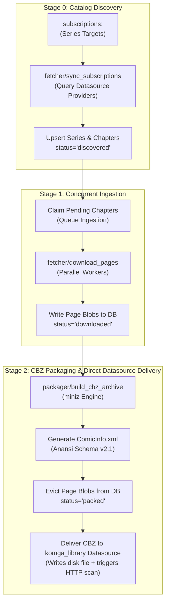

# 011 — Declarative Pipeline YAML Specification & End-to-End Orchestration

| Metadata | Value |
| :--- | :--- |
| **ID** | `ARCH-011` |
| **Depends On** | [`ARCH-005`](./005-mangadex-client-library.md) through [`ARCH-010`](./010-multisource-architecture-and-scrapers.md) |
| **Area** | `apps/mangadex/configs/pipeline.yaml` & `apps/mangadex/src/config.zig` |
| **Status** | `SPECIFICATION & DESIGN` |

---

## 1. High-Level Vision & Orchestration Lifecycle

The `apps/mangadex` application operates as an autonomous, dataflow-driven content pipeline powered by **Flowdata v2**. Rather than hardcoding sync loops or CLI scripts, the entire synchronization, ingestion, transformation, and distribution process is defined declaratively in `pipeline.yaml`.

### 1.1. End-to-End Orchestration Stages



---

## 2. Complete Reference `pipeline.yaml`

```yaml
version: 2

# =============================================================================
# RUNTIME & THREAD POOL CONFIGURATION
# =============================================================================
runtime:
  workers: auto                     # Detects CPU cores; dedicated workers for download & packaging
  memory_limit_mb: 2048             # Pipeline backpressure limit

# =============================================================================
# VIRTUAL NETWORK ADAPTERS (Egress, Timeouts, Rate-Limiting, Proxies)
# =============================================================================
networks:
  # Ingress/Egress adapter for MangaDex API and MangaDex@Home CDNs
  mangadex_net:
    type: egress
    timeouts:
      connect_ms: 5000
      read_idle_ms: 15000
      pool_acquire_ms: 2000
    rate_limit:
      requests_per_sec: 5           # Strictly enforces MangaDex API rate limit rules
      burst: 10
    headers:
      User-Agent: "flowdata-mangadex-app/0.1.0"

  # Ingress/Egress adapter for HTML scrapers (browser impersonation)
  scraper_net:
    type: egress
    timeouts:
      connect_ms: 8000
      read_idle_ms: 20000
    rate_limit:
      requests_per_sec: 2
    headers:
      User-Agent: "Mozilla/5.0 (X11; Linux x86_64) AppleWebKit/537.36 (KHTML, like Gecko) Chrome/120.0.0.0 Safari/537.36"
      Accept-Language: "en-US,en;q=0.9,es;q=0.8"

  # Internal/Local network adapter for Komga REST API communication
  komga_net:
    type: egress
    timeouts:
      connect_ms: 3000
      read_idle_ms: 30000

# =============================================================================
# DATASOURCES (Memory, SQLite, Providers & Sinks Unified)
# =============================================================================
datasources:
  # Fast RAM buffer for inter-task communication and routing logic
  pipeline_memory:
    type: memory

  # Unified relational SQLite database for tracking, queues, and metadata
  library_db:
    type: sqlite
    path: "${MANGADEX_DB_PATH:-./data/manga_library.sqlite}"
    options:
      journal_mode: "WAL"
      auto_vacuum: "INCREMENTAL"
      busy_timeout_ms: 5000

  # MangaDex Official API Provider Datasource
  mangadex:
    type: mangadex
    network: mangadex_net
    api_url: "${MANGADEX_API_URL:-https://api.mangadex.org}"
    auth:
      type: oidc_personal
      client_id: "${MANGADEX_CLIENT_ID}"
      client_secret: "${MANGADEX_CLIENT_SECRET}"
      username: "${MANGADEX_USERNAME}"
      password: "${MANGADEX_PASSWORD}"
      token: "${MANGADEX_ACCESS_TOKEN:-}"

  # Web Scraper Provider Datasource
  tmo_scraper:
    type: html_scraper
    network: scraper_net
    base_url: "https://visortmo.com"

  # Komga Output Persistence Strategy (Library Disk Directory + HTTP Scan Trigger)
  komga_library:
    type: komga
    network: komga_net
    directory: "${KOMGA_LIBRARY_DIR:-/data/comics/manga/}"
    url: "${KOMGA_URL:-http://localhost:25600}"
    auth:
      api_key: "${KOMGA_API_KEY}"
      username: "${KOMGA_USERNAME:-}"
      password: "${KOMGA_PASSWORD:-}"
    default_library_id: "${KOMGA_LIBRARY_ID}"
    trigger_scan: true

# =============================================================================
# SUBSCRIPTIONS (Manga Tracking Targets)
# =============================================================================
subscriptions:
  - title: "One Piece"
    datasource: mangadex
    series_id: "a1c7d817-0e59-4555-b52e-322e2365879e"
    languages: ["es-la", "es", "en"]
    chapters: "latest:5"            # Options: 'all', 'latest:N', or 'start..end'

  - title: "Kingdom"
    datasource: tmo_scraper
    series_id: "manga-kingdom-spanish"
    languages: ["es"]
    chapters: "all"
    enabled: false                  # Paused: completely skipped by sync workers

# =============================================================================
# DATAFLOW PLUGINS (C-ABI .so / Static Tasks)
# =============================================================================
modules:
  fetcher:
    path: "./zig-out/lib/libmangadex_fetcher.so"
  packager:
    path: "./zig-out/lib/libcbz_packager.so"

# =============================================================================
# DATAFLOW PIPELINES (DAG Orchestration)
# =============================================================================
pipelines:
  main:
    steps:
      # Step 1: Query source providers & discover new un-downloaded chapters
      - id: stage1_sync_catalogs
        uses: fetcher/sync_subscriptions
        params:
          subscriptions_ref: subscriptions
        outputs:
          discovered_chapters:
            datasource: library_db

      # Step 2: Concurrently fetch page images for chapters marked 'discovered'
      - id: stage2_download_pages
        uses: fetcher/download_chapter_pages
        concurrency: 4
        inputs:
          chapter_id: stage1_sync_catalogs.discovered_chapters.id
        outputs:
          completed_chapter:
            datasource: pipeline_memory

      # Step 3: Compile CBZ archive with ComicInfo.xml, evict blobs, and deliver directly to Komga
      - id: stage3_package_cbz
        uses: packager/build_cbz_archive
        inputs:
          chapter_id: stage2_download_pages.completed_chapter.id
        outputs:
          published_chapter:
            datasource: komga_library
```

---

## 3. High-Level Schema Mapping & AST Alignment

By unifying all providers, databases, and sinks under **`datasources:`**, Flowdata requires **zero custom top-level parser hacks** for providers or sinks.

1. **`datasources` AST Node (Existing Flowdata Standard)**:
   * Drivers (`mangadex`, `komga`, `html_scraper`) are registered via `kernel.datasources.registerDriver("name", factory)`.
   * The YAML parser naturally parses their parameters and automatically resolves the `network:` binding via `KernelContext.outbound`.
2. **`subscriptions` AST Node (Single New Domain Node)**:
   * Parsed into `[]SubscriptionTargetNode`:
     * `title: []const u8`
     * `datasource: []const u8` (Foreign key to a provider declared in `datasources:`)
     * `series_id: []const u8` (Identifier or slug in the remote provider)
     * `languages: []const []const u8`
     * `chapters: []const u8` (Selector expression: `"all"`, `"latest:N"`, or `"start..end"`)
     * `enabled: bool = true` (If `false`, skipped during synchronization)

---

## 4. Verification and Acceptance Criteria

1. **AST Parsing Test**:
   * Validates that `apps/mangadex/configs/pipeline.yaml` parses completely via `flowdata.yaml.ast_loader` without unknown node warnings.
2. **Environment Variable Expansion**:
   * Asserts that secrets (`${MANGADEX_CLIENT_SECRET}`, `${KOMGA_API_KEY}`) interpolate properly from process env and `.env` files via `EnvInterpolator`.
3. **DAG Validation**:
   * Verifies all step input/output bindings resolve cleanly across memory, SQLite, and file store repositories without broken references.
