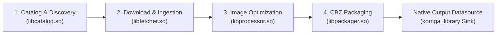

# 012 — Manga Framework Plugin Catalog & Task Breakdown

| Metadata | Value |
| :--- | :--- |
| **ID** | `ARCH-012` |
| **Depends On** | [`ARCH-005`](./005-mangadex-client-library.md) through [`ARCH-011`](./011-pipeline-yaml-specification-and-orchestration.md) |
| **Area** | `apps/mangadex/plugin/` |
| **Status** | `DESIGN & REFERENCE` |

---

## 1. Overview

In the Flowdata architecture, business logic is encapsulated into self-contained plugins (compiled as `.so` shared libraries or static C-ABI modules). This document outlines the desirable plugin boundaries and discrete tasks for an enterprise-grade manga processing framework.

---

## 2. Plugin & Task Catalog

---

### Plugin 1: `manga_catalog` (`libcatalog.so`)
Responsible for metadata synchronization, catalog tracking, and chapter discovery against configured `MangaSource` providers.

* **`catalog/sync_subscriptions`**:
  * Reads active `subscriptions:` from `pipeline.yaml`.
  * Queries source drivers (`mangadex`, scrapers) for newly published chapters.
  * Filters out chapters already registered in SQLite.
  * Emits pending chapters to SQLite (`status = 'discovered'`).
* **`catalog/fetch_series_details`**:
  * Retrieves and refreshes title, description, cover image URL, author, artist, and genres.
* **`catalog/search_series`**:
  * Interactive or CLI search across registered sources to assist in discovering series IDs.

---

### Plugin 2: `manga_fetcher` (`libfetcher.so`)
Responsible for concurrent HTTP retrieval of comic pages with backpressure and rate-limit compliance.

* **`fetcher/resolve_page_urls`**:
  * Resolves chapter ID into concrete CDN image URLs (e.g. MangaDex@Home base URL negotiation).
* **`fetcher/download_chapter_pages`**:
  * Downloads image chunks concurrently (e.g. 4–8 workers).
  * Validates magic bytes (detects corrupt or partial images).
  * Saves image bytes as binary blobs into the SQLite `pages` table (`status = 'downloaded'`).
  * Emits completion event once all chapter pages are verified.

---

### Plugin 3: `manga_processor` (`libprocessor.so`) — *(Optional Transformation Gate)*
Performs image normalization and cleanup prior to archive creation.

* **`processor/split_double_pages`**:
  * Identifies landscape double-page spreads (aspect ratio > 1.3) and optionally slices them into two portrait pages for mobile reading.
* **`processor/optimize_images`**:
  * Converts uncompressed or oversized PNGs to WebP/JPEG to save storage space without quality loss.
* **`processor/sanitize_page_order`**:
  * Ensures zero-padded numbering (`001.jpg`, `002.jpg` instead of `1.jpg`, `10.jpg`) to prevent reader sorting bugs.

---

### Plugin 4: `cbz_packager` (`libpackager.so`)
Responsible for compiling immutable, metadata-rich `.cbz` archives and reclaiming storage.

* **`packager/generate_comicinfo`**:
  * Reads series and chapter metadata from SQLite and formats a standard Anansi `ComicInfo.xml` v2.1 buffer using `comicinfo`.
* **`packager/build_cbz_archive`**:
  * Uses `zip_archive` (`miniz`) in `STORE` mode (zero CPU re-compression) to bundle image blobs and `ComicInfo.xml`.
  * Flushes and verifies the `.cbz` archive to `cbz_store`.
  * **Atomic Blob Eviction (built-in)**: In the same transaction upon successful archive creation, sets `pages.image_blob = NULL`, marks `chapters.status = 'packed'`, and runs `incremental_vacuum` to reclaim disk pages. Prevents orphaned blobs and eliminates the need for separate cleanup tasks.

---

### Architectural Note: Egress Handled Directly via Datasources (`KomgaRepository`)
Following the architectural decision in [`ARCH-011`](./011-pipeline-yaml-specification-and-orchestration.md), **no custom egress plugin (`libegress.so`) is required**.

Destination delivery is modeled as a native Flowdata **`StorageRepository` (Datasource Sink)**:
* `packager/build_cbz_archive` outputs directly to `datasource: komga_library`.
* `KomgaRepository` atomically writes the `.cbz` to the library directory in disk, and sequentially executes the HTTP re-scan call via `komga_sdk` over its injected `komga_net` adapter.
* Eliminates pipeline task boilerplate, prevents file-write concurrency race conditions, and decouples distribution from the processing DAG.
