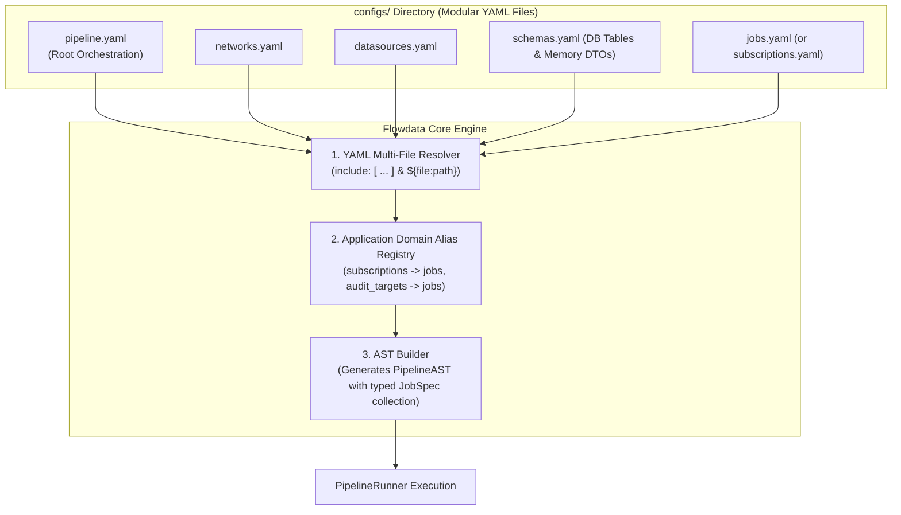

# 013 — Engine Refactoring: First-Class `jobs:` Spec, Application Aliases, and Modular YAML Composition

| Metadata | Value |
| :--- | :--- |
| **ID** | `ARCH-013` |
| **Depends On** | [`ARCH-002`](./002-open-kernel-extension-system.md), [`ARCH-011`](./011-pipeline-yaml-specification-and-orchestration.md) |
| **Area** | `src/yaml/`, `src/ast/`, `src/kernel/` |
| **Status** | `ENGINE REFACTORING SPECIFICATION` |

---

## 1. Problem Statement & Motivation

As applications built on Flowdata grow, maintaining all configuration within a single `pipeline.yaml` introduces significant architectural pain:

1. **Configuration Monolith**:
   A single file that mixes virtual networks (`networks:`), persistent storage engines (`datasources:`), DAG task steps (`pipelines:`), data schemas, and dozens of user-managed targets (mangas, video targets, audit rules) quickly exceeds 1,000+ lines (as already observed in `apps/vidsec/configs/pipeline.yaml`).
2. **Role Confusion & Git Conflicts**:
   * **Developers/Engineers** maintain pipeline logic, task concurrency, and network timeouts.
   * **End-users/Operators** simply want to add, pause, or remove work targets (manga subscriptions, forensic target URLs). Mixing both in one file leads to accidental syntax breaks and constant merge conflicts.
3. **Domain Vocabulary Mismatch**:
   Different applications have different natural vocabularies for their workload units:
   * In `apps/mangadex`: users think of `subscriptions:` or `series:`.
   * In `apps/vidsec`: analysts think of `audit_targets:` or `scenarios:`.
   * In the core engine: both are fundamentally **declarative batch/reconciliation jobs** (`jobs:`).

---

## 2. Solution Architecture

We introduce three orthogonal enhancements to the Flowdata v2 engine:



---

## 3. Detailed Technical Design

### 3.1. First-Class `jobs:` in Core AST (`src/ast/ast.zig`)

We elevate work targets to a first-class collection in `PipelineAST`:

```zig
pub const JobSpec = struct {
    id: []const u8,
    datasource: ?[]const u8 = null,           // Target datasource provider
    enabled: bool = true,                     // Active vs. paused
    params: std.StringHashMapUnmanaged([]const u8) = .empty,
    tags: []const []const u8 = &.{},
};

pub const PipelineAST = struct {
    version: u32,
    runtime: RuntimeSpec,
    networks: std.StringHashMapUnmanaged(NetworkSpec),
    datasources: std.StringHashMapUnmanaged(DatasourceConfig),
    jobs: std.StringHashMapUnmanaged(JobSpec), // <-- First-class jobs collection
    pipelines: std.StringHashMapUnmanaged(PipelineSpec),
    // ...
};
```

---

### 3.2. Application Domain Aliases (`KernelContext` & `src/yaml/ast_loader.zig`)

Applications can register domain-specific aliases for the `jobs:` root node during bootstrap. This keeps user-facing YAML natural without engine forks:

#### Registration in Application (`apps/mangadex/src/main.zig`):
```zig
// In apps/mangadex: map "subscriptions" -> "jobs"
kernel.dsl.registerNodeAlias("subscriptions", "jobs");

// In apps/vidsec: map "audit_targets" -> "jobs"
kernel.dsl.registerNodeAlias("audit_targets", "jobs");
```

#### Resolution in AST Loader (`src/yaml/ast_loader.zig`):
When the loader encounters a root node not in the standard grammar, it queries `kernel.dsl.resolveNodeAlias(node_name)`. If `"subscriptions"` maps to `"jobs"`, it parses the node directly into the `ast.jobs` collection without warnings.

---

### 3.3. Multi-File YAML Composition & Interpolation

We support two complementary mechanisms for splitting large configurations:

#### Mechanism A: Top-Level `include:` Directive (`src/yaml/ast_loader.zig`)
The root `pipeline.yaml` can import external relative files:

```yaml
version: 2

include:
  - "networks.yaml"
  - "datasources.yaml"
  - "schemas.yaml"
  - "jobs.yaml"

pipelines:
  main:
    steps:
      # ...
```

* **Loader Implementation**:
  When `ast_loader.load()` encounters `include:`, it resolves paths relative to the root YAML file directory, parses each sub-file into an intermediate YAML AST, and merges the maps (`networks`, `datasources`, `schemas`, `jobs`, `pipelines`) into the root tree before schema validation.

#### Mechanism B: Native Kernel Interpolation `${file:relative_path}` (`src/kernel/dsl.zig`)
Leveraging the `DslRegistry` scheme resolver created in `ARCH-002`:

```yaml
version: 2

networks: "${file:networks.yaml}"
datasources: "${file:datasources.yaml}"
schemas: "${file:schemas.yaml}"
jobs: "${file:jobs.yaml}"
```

* **Resolver Implementation**:
  A built-in scheme resolver registered as `file`:
  ```zig
  pub fn resolveFileScheme(allocator: Allocator, base_dir: []const u8, file_path: []const u8) ![]const u8 {
      const full_path = try std.fs.path.join(allocator, &.{ base_dir, file_path });
      defer allocator.free(full_path);
      return std.fs.cwd().readFileAlloc(allocator, full_path, 1024 * 1024);
  }
  ```

---

### 3.4. Interpolating `schemas.yaml`: DB Tables and In-Memory DTOs

Extracting data definitions into `configs/schemas.yaml` allows declaring both persistent storage tables and ephemeral channel DTOs cleanly:

```yaml
# configs/schemas.yaml
version: 2

schemas:
  # Relational Database Schemas (SQLite library_db)
  storage:
    sources:
      columns: { id: { type: text, pk: true }, name: { type: text }, base_url: { type: text } }
    series:
      columns: { id: { type: text, pk: true }, title: { type: text }, summary: { type: text, nullable: true }, author: { type: text, nullable: true } }
    chapters:
      columns: { id: { type: text, pk: true }, series_id: { type: text }, chapter_number: { type: text }, status: { type: text, default: "discovered" } }
    pages:
      columns: { id: { type: text, pk: true }, chapter_id: { type: text }, page_number: { type: int64 }, image_blob: { type: blob, nullable: true } }

  # In-Memory Channel DTOs (pipeline_memory)
  memory_dtos:
    discovered_chapter_dto:
      columns: { chapter_id: { type: text }, series_id: { type: text }, chapter_number: { type: text }, language_iso: { type: text } }
    completed_chapter_dto:
      columns: { chapter_id: { type: text }, series_id: { type: text }, page_count: { type: int64 } }
    packed_cbz_dto:
      columns: { chapter_id: { type: text }, series_id: { type: text }, file_path: { type: text }, file_size_bytes: { type: int64 } }
```

---

## 4. Resulting User Experience in `apps/mangadex`

With this refactoring implemented, the configuration is split cleanly:

```text
apps/mangadex/configs/
├── pipeline.yaml         # Flowdata pipeline definition & DAG steps (Engineers only)
├── networks.yaml         # Timeouts & rate limits for MangaDex, Komga, and Scrapers
├── datasources.yaml      # SQLite WAL, Komga persistence sink, memory buffers
├── schemas.yaml          # Relational tables & in-memory step channel DTOs
└── jobs.yaml             # User-facing list: adding/pausing manga requires touching only this file
```

### The Clean `jobs.yaml` File:
```yaml
# configs/jobs.yaml - Managed by end-users or automated tools
subscriptions:
  - title: "One Piece"
    datasource: mangadex
    series_id: "a1c7d817-0e59-4555-b52e-322e2365879e"
    languages: ["es-la", "es", "en"]
    chapters: "latest:5"

  - title: "Chainsaw Man"
    datasource: mangadex
    series_id: "a7774250-3785-4bda-ac68-6d4fb245ab5f"
    languages: ["es"]
    chapters: "latest:3"

  - title: "Kingdom"
    datasource: tmo_scraper
    series_id: "manga-kingdom-spanish"
    languages: ["es"]
    chapters: "all"
    enabled: false         # Paused: skipped during execution
```

---

## 5. Implementation Roadmap & Verification Plan

1. **AST & Grammar Expansion (`src/ast/ast.zig`)**:
   * Add `jobs: std.StringHashMapUnmanaged(JobSpec)` to `PipelineAST`.
2. **DSL Alias Support (`src/kernel/dsl.zig`)**:
   * Add `node_aliases: std.StringHashMapUnmanaged([]const u8)` and `registerNodeAlias()` to `DslRegistry`.
3. **YAML Multi-File Merge (`src/yaml/ast_loader.zig`)**:
   * Implement `include:` array processing with recursive directory path resolution.
4. **Kernel File Interpolation (`src/kernel/dsl.zig`)**:
   * Register default `${file:...}` resolver.
5. **Acceptance Tests (`tests/core/modular_yaml_test.zig`)**:
   * Verify loading of split configs (`include: [...]`).
   * Verify domain alias mapping (`"subscriptions"` -> `ast.jobs`).
   * Verify `${file:path}` scalar and map expansion.
   * Verify backward compatibility: ensure existing `apps/vidsec` tests continue to pass 100%.
