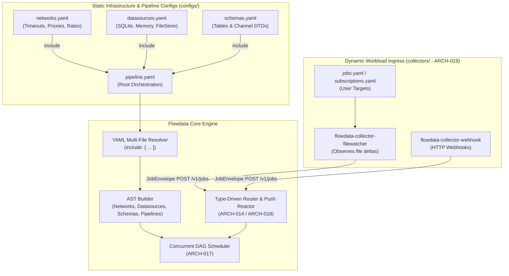

# 013 — Engine Refactoring: Modular YAML Composition and Dynamic Ingress Decoupling

| Metadata | Value |
| :--- | :--- |
| **ID** | `ARCH-013` |
| **Depends On** | [`ARCH-002`](./002-open-kernel-extension-system.md), [`ARCH-011`](./011-pipeline-yaml-specification-and-orchestration.md) |
| **Area** | `src/yaml/`, `src/ast/`, `src/kernel/` |
| **Status** | `ENGINE REFACTORING SPECIFICATION (MODERNIZED)` |

---

## 1. Problem Statement & Evolution

### 1.1. The Legacy Configuration Monolith
In early designs, `pipeline.yaml` grew into a monolith mixing:
1. **Virtual Networks & Protocols** (`networks:`): Timeouts, rate limits, retry policies.
2. **Persistent Storage Engines** (`datasources:`): SQLite paths, WAL configuration, file stores.
3. **Data Schemas** (`schemas:`): Relational tables and in-memory channel DTOs.
4. **Execution Steps** (`pipelines:`): Reactive DAG orchestration and dependencies.
5. **Static Workload Targets** (`jobs:` / `subscriptions:`): Static lists of series or URLs.

Mixing all five concerns in a single file quickly exceeded 1,000+ lines (as seen in `apps/vidsec/configs/pipeline.yaml`), causing severe git merge conflicts between pipeline engineers and operators.

### 1.2. The Architectural Shift: Static Pipeline vs. Dynamic Ingress
With the delivery of **ARCH-014 (Inbound Emitter & Push Reactor)**, **ARCH-018 (Reactive Router)**, and **ARCH-019 (Standalone Collectors)**, the boundary is now strictly decoupled:

* **Workload items (`jobs.yaml` / `subscriptions.yaml`) are NOT static pipeline configuration**:
  They are dynamic, inbound runtime events. They are monitored by autonomous collectors (`flowdata-collector-filewatcher --watch configs/jobs.yaml`) or received via HTTP webhooks (`flowdata-collector-webhook`), converted to universal `JobEnvelope` records, and streamed into the engine via `POST /v1/jobs` or `emit()`.
* **No Native File Interpolation for Jobs**:
  Because jobs are ingested dynamically at runtime, the engine does not need `${file:jobs.yaml}` interpolators or static `jobs:` parsing inside `pipeline.yaml`.
* **No Engine-Level Domain Aliases for Jobs**:
  The engine core no longer needs to map `subscriptions -> jobs` in YAML. Instead, the standalone collector maps domain records directly into `JobEnvelope.topic` (e.g. `topic: "manga_subscription"` or `topic: "audit_target"`), and the Type-Driven Router (`ARCH-018`) dispatches them to matching tasks.

---

## 2. Modern Solution Architecture

ARCH-013 now focuses purely on **Modular YAML Composition (`include: [...]`)** for the static infrastructure and pipeline definitions:



---

## 3. Detailed Technical Design

### 3.1. Top-Level `include:` Directive (`src/yaml/ast_loader.zig`)

The root `pipeline.yaml` imports modular configuration files relative to its parent directory:

```yaml
version: 2

# Modular imports for infrastructure & schemas
include:
  - "networks.yaml"
  - "datasources.yaml"
  - "schemas.yaml"

pipelines:
  main:
    steps:
      - id: catalog_sync
        task: manga_framework.catalog_sync
        # ...
```

#### Loader Implementation Rules:
1. **Relative Path Resolution**: Paths in `include:` are resolved relative to the directory containing the root YAML file.
2. **Map Merging**:
   - `networks:` in sub-files are merged into root `ast.networks`.
   - `datasources:` in sub-files are merged into root `ast.datasources`.
   - `schemas:` in sub-files are registered in `SchemaCatalog`.
3. **Collision Detection**: If the same network ID or datasource ID is defined in multiple files, the loader raises a descriptive validation error: `error.DuplicateConfigIdentifier`.

---

### 3.2. Modular Infrastructure Files

#### `configs/networks.yaml`
```yaml
networks:
  mangadex_api:
    base_url: "https://api.mangadex.org"
    timeout_ms: 10000
    rate_limit:
      requests_per_second: 5
      burst: 10

  komga_api:
    base_url: "http://localhost:25600"
    timeout_ms: 30000
```

#### `configs/datasources.yaml`
```yaml
datasources:
  pipeline_memory:
    driver: memory
    capacity_bytes: 67108864 # 64MB

  manga_library:
    driver: sqlite
    path: "./data/manga_library.sqlite"
    wal_mode: true
```

#### `configs/schemas.yaml`
```yaml
schemas:
  storage:
    series:
      columns:
        id: { type: text, pk: true }
        title: { type: text }
        author: { type: text, nullable: true }
    chapters:
      columns:
        id: { type: text, pk: true }
        series_id: { type: text }
        chapter_number: { type: text }

  memory_dtos:
    discovered_chapter_dto:
      columns:
        chapter_id: { type: text }
        series_id: { type: text }
        chapter_number: { type: text }
```

---

### 3.3. Dynamic Workload Separation (`jobs.yaml`)

Because work items are handled by autonomous collectors (`ARCH-019`), `jobs.yaml` lives outside the pipeline compilation path:

```text
apps/mangadex/configs/
├── pipeline.yaml         # Root orchestration (Engineer-owned)
├── networks.yaml         # Included virtual networks
├── datasources.yaml      # Included datasource drivers
├── schemas.yaml          # Included database tables & DTOs
└── jobs.yaml             # Standalone workload file (User/Operator-owned)
```

#### How `jobs.yaml` is executed at runtime:
1. Operator edits `configs/jobs.yaml` (e.g. adding a new manga series or updating targets).
2. The standalone collector observes the modification via `inotify`:
   ```bash
   flowdata-collector-filewatcher --watch configs/jobs.yaml --topic manga_subscription
   ```
3. The collector reads the file, generates `JobEnvelope` records with `topic = "manga_subscription"` and unique ULIDs (`wh_01JB...`), and delivers them to Flowdata (`POST /v1/jobs`).
4. Flowdata's Type-Driven Router (`ARCH-018`) matches `topic: manga_subscription` to the pipeline's reactive entry step, executing the DAG without any engine reload or restart.

---

## 4. Architecture Boundary Summary

| Domain | Responsibility | Owner / Artifact |
| :--- | :--- | :--- |
| **Static Pipeline Config** | Defining DAG steps, dependencies, concurrency, and engine settings. | `pipeline.yaml` via `include: [networks.yaml, datasources.yaml, schemas.yaml]` |
| **Dynamic Ingress** | Monitoring files, receiving webhooks, scraping APIs, and spooling offline events. | `collectors/` (`flowdata-collector-filewatcher`, `flowdata-collector-webhook`) |
| **Ingress Contract** | Universal event transport from collectors into the reactive router. | `JobEnvelope` (`POST /v1/jobs` or `emit()`) |

---

## 5. Implementation Roadmap & Verification Plan

1. **YAML Multi-File Merge (`src/yaml/ast_loader.zig`)**:
   * Implement `include:` array processing with path resolution relative to the root file.
   * Merge `networks:`, `datasources:`, and `schemas:` into the single canonical AST tree.
   * Provide descriptive syntax/duplicate key diagnostics.
2. **Deprecation of Static `jobs:` inside Pipeline AST**:
   * Retain `ast.jobs` solely as an optional backward-compatible fallback for legacy static tests, marking dynamic `JobEnvelope` as the canonical production ingress.
3. **Unit & Integration Tests (`tests/core/modular_yaml_test.zig`)**:
   * Test multi-file `include:` with valid nested files.
   * Test error reporting on missing included files or duplicate keys.
   * Verify that existing applications (`apps/vidsec`, `apps/mangadex`) continue to pass 100% of their test suites.
