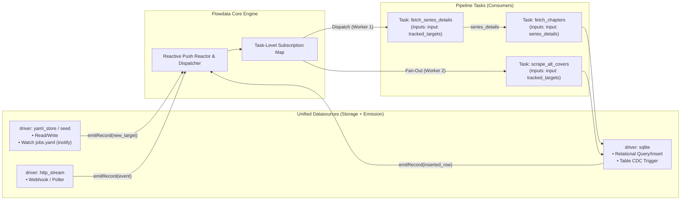
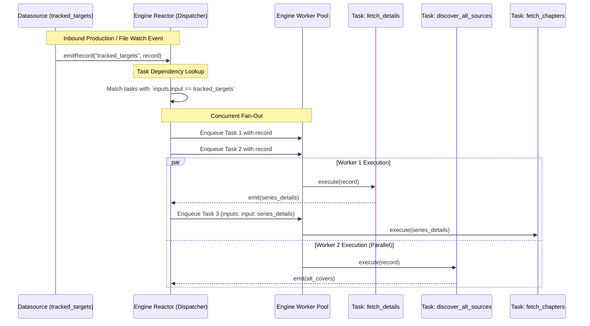

# 014 — Unified Datasources with Event Emission (`emitRecord`), Reactive Reactor, and Task-Level `inputs:` Dispatch

| Metadata | Value |
| :--- | :--- |
| **ID** | `ARCH-014` |
| **Depends On** | [`ARCH-011`](./011-pipeline-yaml-specification-and-orchestration.md), [`ARCH-013`](./013-engine-jobs-spec-app-aliases-and-yaml-modularization.md) |
| **Area** | `src/dataflow/`, `src/engine/`, `src/yaml/`, `src/ast/`, `src/plugin/` |
| **Status** | `DESIGN & ARCHITECTURE SPECIFICATION` |

---

## 1. Context & Motivation

In previous iterations (`ARCH-011` and `ARCH-013`), work items were represented as a static collection in `pipeline.yaml` (`jobs:` or aliased as `subscriptions:`). While functional for static batch loops, this model faces architectural limitations:

1. **Pull-Based Batch Bottleneck**:
   The engine pulls items sequentially from an AST array. This makes it awkward to handle continuous, asynchronous, or event-driven sources (webhooks, message queues, RSS feeds, filesystem watchers, RTSP camera frame streams).
2. **Coupling Data to Execution Topology**:
   Specifying `pipeline: name` inside individual work items violates the separation of data and control. Data items describe *what* they are, not *who* processes them. External producers (APIs, message brokers) will never know the internal pipeline names of our application.
3. **Lack of Concurrency / Fan-Out**:
   A single work item often needs to trigger multiple pipelines or tasks concurrently. For example:
   * **Branch A**: Synchronize official series metadata from `api.mangadex.org`.
   * **Branch B**: Scrape alternative community covers or raw scans simultaneously.
   * **Branch C**: Dispatch notifications if a new chapter is released.
   A pull-based loop either forces redundant executions or creates cross-pipeline synchronization locks.

To address these challenges, we eliminate artificial distinctions between "storage" and "emitter" datasources and elevate event emission (`emitRecord`) as a first-class, optional capability of any `Datasource`.

---

## 2. Conceptual Model: A Unified `Datasource` Abstraction

Rather than creating separate types for "storage" vs. "emitter" datasources, Flowdata treats all datasources under **one single unified interface**.

A datasource is simply a data provider and/or sink. It can:
1. Provide persistence methods (`readPayload`, `writePayload`, `query`).
2. **Optionally override/implement event emission (`listen` / `emitRecord`)**:



### The Killer Feature: Live File Watching (`jobs.yaml` Hot-Reloading)
Because a file-based datasource can implement `listen()`, it can watch `jobs.yaml` using OS filesystem notifications (`inotify` on Linux):
* The user edits `jobs.yaml` to add a new manga:
  ```yaml
  - title: "Dandadan"
    series_id: "e4d41334-..."
  ```
* The running datasource detects the append, parses the new item, and immediately calls `engine.emitRecord("tracked_targets", new_item)`.
* The running engine dispatches the new item to the active pipeline **without restarting the engine or stopping running workloads**.

---

## 3. Detailed Architecture

### 3.1. Work Item Specification & Identification

To preserve pure domain-agnosticism in `src/ast/ast.zig`:
* Domain metadata like `title`, `series_id`, `languages`, or `camera_id` are stored in `params: []const KeyValueParam`.
* Identity (`id`) is a simple identifier (index/sequence number `0`, `1`, `2`... or explicit user-provided key).

```zig
pub const JobSpec = struct {
    id: []const u8,
    datasource: ?[]const u8 = null,
    enabled: bool = true,
    params: []const KeyValueParam = &.{},

    pub fn getParam(self: JobSpec, key: []const u8) ?[]const u8 {
        if (std.mem.eql(u8, key, "id")) return self.id;
        if (self.datasource) |ds| {
            if (std.mem.eql(u8, key, "datasource")) return ds;
        }
        if (std.mem.eql(u8, key, "enabled")) {
            return if (self.enabled) "true" else "false";
        }
        for (self.params) |p| {
            if (std.mem.eql(u8, p.key, key)) return p.value;
        }
        return null;
    }
};
```

---

### 3.2. Task-Level Input Resolution (`inputs:`)

Data binding belongs strictly at the **Task Step level**, not the Pipeline level. According to `ARCH-011`, the canonical schema uses named input mappings:

```yaml
datasources:
  # Unified datasource providing targets from a watched file
  tracked_targets:
    driver: yaml_file
    path: "./configs/jobs.yaml"
    watch: true                          # Inotify live updates

  # Storage sinks
  pipeline_memory:
    driver: memory

  catalog_db:
    driver: sqlite
    path: "./mangadex.db"

pipelines:
  main:
    steps:
      # Branch A: Official MangaDex metadata ingestion
      - id: fetch_details
        uses: manga_catalog/fetch_series_details
        inputs:
          input: tracked_targets            # <-- Named binding: param 'input' binds to 'tracked_targets'
        outputs:
          series_details:
            datasource: pipeline_memory

      - id: fetch_chapters
        uses: manga_catalog/fetch_chapters
        inputs:
          input: series_details             # <-- Named binding: param 'input' binds to 'series_details'
        outputs:
          discovered_chapters:
            datasource: catalog_db

      # Branch B: Concurrent alternative source scraper
      # Dispatched in parallel for the EXACT SAME emitted item
      - id: discover_alt_sources
        uses: alternate_scrapers/search_alternative_covers
        inputs:
          input: tracked_targets            # <-- Named binding to the SAME datasource
        outputs:
          alt_covers:
            datasource: catalog_db
```

#### Advantages of Task-Level Binding (`inputs:`):
1. **Arbitrary Graph Topologies (DAG)**:
   Supports forks (multiple tasks consuming `tracked_targets`), joins (`inputs: { left: a, right: b }`), and diamonds.
2. **Side-Input & Enrichment**:
   A task can consume upstream data while looking up reference data from a static datasource.
3. **No Artificial Pipeline Fragmentation**:
   Independent tasks consuming the same stream can live cleanly in the same pipeline or across separate pipelines.

---

### 3.3. Engine Reactor & Dispatch Lifecycle

When any datasource emits a record:



#### Execution Rules:
1. **Root Tasks**: Any task whose `inputs:` references a datasource is a Root Subscriber.
2. **Downstream Tasks**: Any task whose `inputs:` references another task's output channel waits for that task's completion.
3. **Zero-Lock Concurrency**: Multiple root tasks subscribed to the same datasource run concurrently without blocking each other.

---

## 4. Formalization of the Unified Datasource Contract

In the Flowdata kernel / dataflow layer, the unified datasource contract incorporates optional listening/emission into the main VTable:

```zig
pub const RecordEmitter = struct {
    opaque_ctx: *anyopaque,
    emit_fn: *const fn (ctx: *anyopaque, source_id: []const u8, record: dataflow.DynamicRecord) void,

    pub fn emit(self: RecordEmitter, source_id: []const u8, record: dataflow.DynamicRecord) void {
        self.emit_fn(self.opaque_ctx, source_id, record);
    }
};

pub const DatasourceVTable = struct {
    // 1. Persistence & Query (optional overrides)
    read_payload: ?*const fn (ctx: *anyopaque, key: []const u8) ?dataflow.PayloadHandle = null,
    write_payload: ?*const fn (ctx: *anyopaque, key: []const u8, payload: dataflow.PayloadHandle) anyerror!void = null,
    
    // 2. Reactive Emission / File Watching (optional overrides)
    start_listening: ?*const fn (ctx: *anyopaque, emitter: RecordEmitter) anyerror!void = null,
    stop_listening: ?*const fn (ctx: *anyopaque) void = null,
};

pub const IDatasource = struct {
    ptr: *anyopaque,
    vtable: *const DatasourceVTable,
};
```

* **Default / Pure Sink**: `start_listening = null`.
* **Static File / Seed**: `start_listening` emits all configured records once and returns.
* **Live Watched File (`jobs.yaml`)**: `start_listening` emits initial records, then keeps an `inotify` watcher running in the background to emit delta additions on file save.

---

## 5. Summary & Key Takeaways

| Component | Responsibility |
| :--- | :--- |
| **Unified `IDatasource`** | Single interface supporting persistence and/or reactive emission (`start_listening`). |
| **`tracked_targets` (Datasource)** | Generates work items as `DynamicRecord`s without knowing who processes them. |
| **Engine Push Reactor** | Manages the task subscription graph and fans out records to worker threads. |
| **Task-Level `inputs:`** | Declaratively binds named parameters to streams (`inputs: input: <stream>`). |
| **Plugin Tasks (`defineTask`)** | Strongly typed consumers (`job: MangaJob`) returning native Zig structs. |
