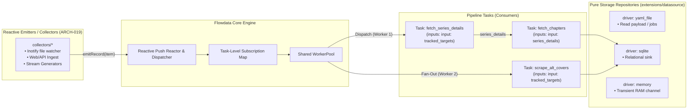
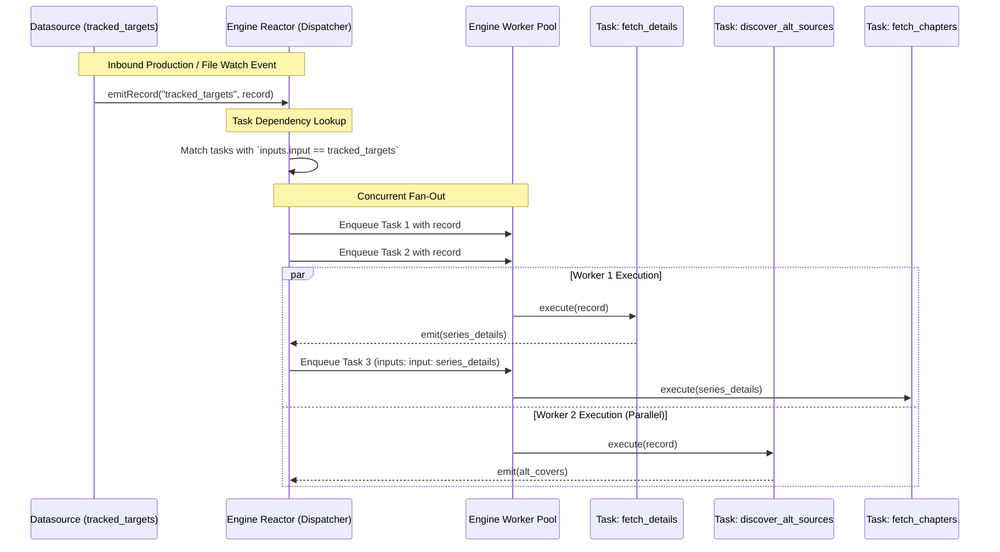

# 014 — Unified Datasources with Event Emission (`emitRecord`), Reactive Reactor, and Task-Level `inputs:` Dispatch

| Metadata | Value |
| :--- | :--- |
| **ID** | `ARCH-014` |
| **Depends On** | [`ARCH-011`](./011-pipeline-yaml-specification-and-orchestration.md), [`ARCH-013`](./013-engine-jobs-spec-app-aliases-and-yaml-modularization.md) |
| **Area** | `src/dataflow/`, `src/engine/`, `src/yaml/`, `src/ast/`, `src/plugin/` |
| **Status** | `COMPLETED` |

---

## 1. Context & Motivation

In previous iterations (`ARCH-011` and `ARCH-013`), work items were represented as a static collection in `pipeline.yaml` (`jobs:` or aliased as `subscriptions:`). While functional for static batch loops, this model faces architectural limitations:

1. **Pull-Based Batch Bottleneck**:
   The engine pulls items sequentially from an AST array. This makes it awkward to handle continuous, asynchronous, or event-driven sources (webhooks, message queues, RSS feeds, filesystem watchers, RTSP camera frame streams).
2. **Coupling Data to Execution Topology**:
   Specifying `pipeline: name` inside individual work items violates the separation of data and control. Data items describe *what* they are, not *who* processes them. External producers (APIs, message brokers) will never know the internal pipeline names of our application.
3. **Lack of Concurrency / Fan-Out**:
   A single work item often needs to trigger multiple pipelines or tasks concurrently. For example:
   * **Branch A**: Synchronize official series metadata from `api.mangadex.org`.
   * **Branch B**: Scrape alternative community covers or raw scans simultaneously.
   * **Branch C**: Dispatch notifications if a new chapter is released.
   A pull-based loop either forces redundant executions or creates cross-pipeline synchronization locks.

To address these challenges, we eliminate artificial distinctions between "storage" and "emitter" datasources and elevate event emission (`emitRecord`) as a first-class, optional capability of any `Datasource`.

> [!NOTE]
> **Architectural Boundary Note**:
> `ARCH-014` delivers the unified datasource contract (`RecordEmitter`), optional datasource tagging on work items, and core Push Reactor fan-out across worker threads.
> Advanced content/type-driven routing and the `IService.canHandle` service catalog are formally specified in [`ARCH-018`](./018-type-driven-inbound-router-and-service-catalog.md).
> Standalone OS-level collectors (including file watchers using `inotify` or web pollers) live in `/collectors/` and are specified in [`ARCH-019`](./019-collectors-architecture-and-inbound-agents.md).

---

## 2. Conceptual Model: Push Reactor & Decoupled Ingress

Rather than forcing storage repositories to run background listener threads, Flowdata cleanly separates **Repositories** (`Repository` for persistence and sinks, aliased as `StorageRepository`) from **Reactive Ingestion** (`PushReactor` and `RecordEmitter`):

1. **`Repository` (Pure Persistence)**: Unchanged and decoupled (`readPayload`, `writePayload`, `recordCount`, `deinit`). No background threads or listener stubs.
2. **`PushReactor` (Core Engine Ingress)**: Manages subscriptions and dynamic task dispatch when events are pushed via `RecordEmitter`.
3. **Producers / Collectors (`ARCH-019`)**: Autonomous agents, collectors, or test harnesses push items into the engine via `engine.emitRecord(source_id, record)`.



### Reactive Ingestion via `PushReactor.emitRecord`
Any external producer, collector, or script pushes items directly into the engine:
* The caller invokes `engine.emitRecord("tracked_targets", new_item)`.
* The running engine dispatches the new item to active pipeline tasks **without restarting the engine or stopping running workloads**.
* Standalone OS-level watchers (such as Linux `inotify` watching `jobs.yaml`) live in `/collectors/file_watcher` ([`ARCH-019`](./019-collectors-architecture-and-inbound-agents.md)), ensuring the core engine remains 100% debloated and storage repositories remain pure.

---

## 3. Detailed Architecture

### 3.1. Work Item Specification & Identification

To preserve pure domain-agnosticism in `src/ast/ast.zig`:
* Domain metadata like `title`, `series_id`, `languages`, or `camera_id` are stored in `params: []const KeyValueParam`.
* Identity (`id`) is a simple identifier (index/sequence number `0`, `1`, `2`... or explicit user-provided key).

```zig
pub const JobSpec = struct {
    id: []const u8,
    datasource: ?[]const u8 = null,
    enabled: bool = true,
    params: []const KeyValueParam = &.{},

    pub fn getParam(self: JobSpec, key: []const u8) ?[]const u8 {
        if (std.mem.eql(u8, key, "id")) return self.id;
        if (self.datasource) |ds| {
            if (std.mem.eql(u8, key, "datasource")) return ds;
        }
        if (std.mem.eql(u8, key, "enabled")) {
            return if (self.enabled) "true" else "false";
        }
        for (self.params) |p| {
            if (std.mem.eql(u8, p.key, key)) return p.value;
        }
        return null;
    }
};
```

---

### 3.2. Task-Level Input Resolution (`inputs:`)

Data binding belongs strictly at the **Task Step level**, not the Pipeline level. According to `ARCH-011`, the canonical schema uses named input mappings:

```yaml
datasources:
  # Unified datasource providing targets from a watched file
  tracked_targets:
    driver: yaml_file
    path: "./configs/jobs.yaml"
    watch: true                          # Inotify live updates

  # Storage sinks
  pipeline_memory:
    driver: memory

  catalog_db:
    driver: sqlite
    path: "./mangadex.db"

pipelines:
  main:
    steps:
      # Branch A: Official MangaDex metadata ingestion
      - id: fetch_details
        uses: manga_catalog/fetch_series_details
        inputs:
          input: tracked_targets            # <-- Named binding: param 'input' binds to 'tracked_targets'
        outputs:
          series_details:
            datasource: pipeline_memory

      - id: fetch_chapters
        uses: manga_catalog/fetch_chapters
        inputs:
          input: series_details             # <-- Named binding: param 'input' binds to 'series_details'
        outputs:
          discovered_chapters:
            datasource: catalog_db

      # Branch B: Concurrent alternative source scraper
      # Dispatched in parallel for the EXACT SAME emitted item
      - id: discover_alt_sources
        uses: alternate_scrapers/search_alternative_covers
        inputs:
          input: tracked_targets            # <-- Named binding to the SAME datasource
        outputs:
          alt_covers:
            datasource: catalog_db
```

#### Advantages of Task-Level Binding (`inputs:`):
1. **Arbitrary Graph Topologies (DAG)**:
   Supports forks (multiple tasks consuming `tracked_targets`), joins (`inputs: { left: a, right: b }`), and diamonds.
2. **Side-Input & Enrichment**:
   A task can consume upstream data while looking up reference data from a static datasource.
3. **No Artificial Pipeline Fragmentation**:
   Independent tasks consuming the same stream can live cleanly in the same pipeline or across separate pipelines.

---

### 3.3. Engine Reactor & Dispatch Lifecycle

When any datasource emits a record:



#### Execution Rules:
1. **Root Tasks**: Any task whose `inputs:` references a datasource is a Root Subscriber.
2. **Downstream Tasks**: Any task whose `inputs:` references another task's output channel waits for that task's completion.
3. **Zero-Lock Concurrency**: Multiple root tasks subscribed to the same datasource run concurrently without blocking each other.

---

## 4. Formalization of the Push Reactor & Ingress Contract

In the Flowdata engine, event emission is exposed via `RecordEmitter`, while `Repository` remains a pure, untouched persistence abstraction:

```zig
pub const RecordEmitter = struct {
    opaque_ctx: *anyopaque,
    emit_fn: *const fn (ctx: *anyopaque, source_id: []const u8, record: dataflow.PayloadHandle) void,

    pub fn emit(self: RecordEmitter, source_id: []const u8, record: dataflow.PayloadHandle) void {
        self.emit_fn(self.opaque_ctx, source_id, record);
    }

    pub fn emitRecord(self: RecordEmitter, source_id: []const u8, record: anytype) void {
        const T = @TypeOf(record);
        if (T == dataflow.PayloadHandle) {
            self.emit(source_id, record);
        } else if (@typeInfo(T) == .pointer and @typeInfo(T).pointer.size == .slice) {
            self.emit(source_id, dataflow.PayloadHandle.fromSlice(@typeInfo(T).pointer.child, record));
        } else {
            self.emit(source_id, dataflow.PayloadHandle.fromScalar(T, &record));
        }
    }
};

/// Pure Repository (Spring Data / DDD pattern, aliased as StorageRepository)
pub const Repository = struct {
    ptr: *anyopaque,
    vtable: *const VTable,

    pub const VTable = struct {
        writePayload: *const fn (ctx: *anyopaque, channel_or_table: []const u8, payload: PayloadHandle) anyerror!void,
        readPayload: *const fn (ctx: *anyopaque, channel_or_table: []const u8) ?PayloadHandle,
        recordCount: *const fn (ctx: *anyopaque, channel_or_table: []const u8) usize,
        deinit: *const fn (ctx: *anyopaque) void,
    };
};

pub const StorageRepository = Repository;
```

* **Core Engine Ingress**: `engine.emitRecord(source_id, record)` or `engine.reactor.emit(source_id, payload)`.
* **Producers & Collectors (`ARCH-019`)**: External agents simply call `emitRecord()` without requiring background loops inside repositories.

---

## 5. Summary & Key Takeaways

| Component | Responsibility |
| :--- | :--- |
| **`Repository`** | Pure persistence interface (`readPayload`, `writePayload`, `recordCount`, `deinit`), aliased as `StorageRepository`. Untouched by reactive logic. |
| **`RecordEmitter`** | Agnostic callback mechanism (`emit` / `emitRecord`) for pushing items into the engine. |
| **Engine Push Reactor** | Manages the task subscription graph and fans out records to worker threads concurrently. |
| **Task-Level `inputs:`** | Declaratively binds named parameters to streams (`inputs: input: <stream>`). |
| **Evolution to `ARCH-018`** | Type-driven routing, `canHandle` service catalog, and unary input transformations are delegated to `ARCH-018`. |
| **Evolution to `ARCH-019`** | Standalone collectors and OS filesystem watchers (`inotify`) are delegated to `ARCH-019`. |
