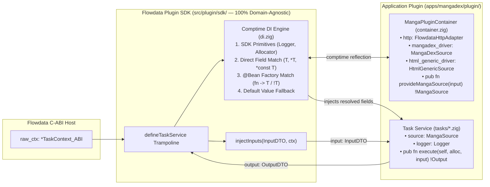

# 015 — Declarative Task Services & Comptime Dependency Injection (`defineTaskService`)

| Metadata | Value |
| :--- | :--- |
| **ID** | `ARCH-015` |
| **Depends On** | [`ARCH-002`](./002-open-kernel-extension-system.md), [`ARCH-010`](./010-multisource-architecture-and-scrapers.md), [`ARCH-012`](./012-manga-framework-plugins-and-tasks.md) |
| **Area** | `src/plugin/sdk/` & `apps/mangadex/plugin/` |
| **Status** | `COMPLETED` |

---

## 1. Context & Problem Statement

In earlier iterations of `apps/mangadex/plugin/catalog.zig`, multiple pipeline tasks (`fetch_series_details`, `fetch_chapters`, `fetch_chapter_pages`) were co-located inside a single monolithic file and implemented as procedural functions bound to `abi.TaskContext`:

```zig
pub fn runFetchSeriesDetails(alloc: Allocator, ctx: TaskContext, job: MangaJob) !SeriesDetails {
    var http_bridge = FlowdataHttpAdapter.fromTaskContext(ctx);
    var reg_sources: RegisteredSources = undefined;
    try reg_sources.init(alloc, ctx, &http_bridge);
    defer reg_sources.deinit();

    const m_source = try reg_sources.resolve(job.datasource, job.series_id);
    ...
}
```

While functional, this pattern introduces four structural issues as the task catalog grows:

1. **Framework Leakage into Domain Logic**:
   Business functions must accept `abi.TaskContext`, construct transport adapters (`FlowdataHttpAdapter`), parse `.env` configuration, and manage lifecycle cleanup before executing a single line of domain logic.
2. **Boilerplate Repetition Across Tasks**:
   Every task repeats identical setup and teardown code (`FlowdataHttpAdapter`, `MangaDexClient`, source resolution).
3. **Redundant Runtime Registries**:
   Maintaining a heap-allocated `SourceRegistry` (`std.StringHashMapUnmanaged`) alongside a dependency container duplicates responsibility: drivers are already statically known fields of the plugin's environment, and every task is forced to manually call `sources.resolve(input.datasource, input.series_id)` instead of receiving the resolved `MangaSource` interface directly.
4. **Heavyweight Unit Testing**:
   Testing a task function requires instantiating a full C-ABI mock host (`MockPluginHost` with a 12-method `HostApiVTable_ABI`) rather than passing plain Zig mocks to a domain struct.

---

## 2. Architectural Vision: Comptime Dependency Injection

We adopt a **Declarative Service & Comptime Dependency Injection** architecture inspired by Spring Boot's `@Service` and `@Configuration` / `@Bean` model, engineered idiomatically for Zig with **zero runtime reflection, zero heap overhead, and strict compile-time verification**:

1. **One File Per Task Service (`plugin/tasks/*.zig`)**:
   Each task lives in its own dedicated module containing its `Input` DTO, `Output` DTO, a pure `Service` struct, and a `defineTaskService` descriptor.
2. **Pure Domain `execute` Signature**:
   `Service.execute` accepts **only** the parameters required for business execution (`(self, alloc, input)` or `(self, input)`), with zero reference to `TaskContext_ABI` or C-ABI primitives.
3. **Strict Boundary Between Flowdata SDK and Application Containers**:
   * **Flowdata SDK (`src/plugin/sdk/`)**: Provides the **100% domain-agnostic** comptime DI engine (`di.zig`) and C-ABI trampoline generator (`define_task_service.zig`). It knows nothing about manga, `MangaSource`, `canHandle`, or `datasource`.
   * **Application Container (`apps/*/plugin/container.zig`)**: A plain Zig struct holding application-specific clients/drivers and optional `@Bean`-style factory methods (discovered automatically by return type at `comptime`).



---

## 3. Core SDK Specification (`src/plugin/sdk/`)

### 3.1. Polymorphic `VTable`-Based `Logger` (`src/plugin/sdk/logger.zig`)

In compliance with Global Invariant #3 (`ptr + vtable` polymorphism), `Logger` is decoupled from `TaskContext_ABI` via a lightweight `VTable`. This enables multiple backends using the exact same type:
1. **Production Host Logger (`Logger.fromTaskContext` / `Logger.init`)**: Forwards log events across the C-ABI boundary to `TaskContext_ABI.host.log_event`.
2. **No-Op Logger (`Logger.noop` / default `Logger{}`)**: Zero-overhead silent logger for fast unit tests.
3. **Stderr Logger (`Logger.stderr`)**: Writes formatted log lines to standard error when running services standalone in CLI utilities outside the Flowdata engine.
4. **Custom Capturing Logger**: Allows test suites to capture emitted log messages in memory and assert on them.

```zig
pub const Logger = struct {
    ptr: ?*anyopaque = null,
    vtable: *const VTable = &noop_vtable,

    pub const VTable = struct {
        log: *const fn (ctx: ?*anyopaque, level: LogLevel_ABI, msg: []const u8) void,
    };

    const noop_vtable = VTable{
        .log = &noopLogBridge,
    };

    fn noopLogBridge(_: ?*anyopaque, _: LogLevel_ABI, _: []const u8) void {}

    const host_vtable = VTable{
        .log = &hostLogBridge,
    };

    fn hostLogBridge(ctx: ?*anyopaque, level: LogLevel_ABI, msg: []const u8) void {
        const raw: *TaskContext_ABI = @ptrCast(@alignCast(ctx.?));
        raw.host.log_event(raw, level, msg.ptr, msg.len);
    }

    /// Production constructor binding to the Flowdata C-ABI host.
    pub fn init(raw: *TaskContext_ABI) Logger {
        return .{ .ptr = raw, .vtable = &host_vtable };
    }

    /// Silent no-op logger for unit testing.
    pub fn noop() Logger {
        return .{ .ptr = null, .vtable = &noop_vtable };
    }

    pub fn info(self: Logger, comptime fmt: []const u8, args: anytype) void {
        var buf: [512]u8 = undefined;
        const msg = std.fmt.bufPrint(&buf, fmt, args) catch "log_event_truncated";
        self.vtable.log(self.ptr, .info, msg);
    }

    pub fn warn(self: Logger, comptime fmt: []const u8, args: anytype) void {
        var buf: [512]u8 = undefined;
        const msg = std.fmt.bufPrint(&buf, fmt, args) catch "log_event_truncated";
        self.vtable.log(self.ptr, .warn, msg);
    }

    pub fn err(self: Logger, comptime fmt: []const u8, args: anytype) void {
        var buf: [512]u8 = undefined;
        const msg = std.fmt.bufPrint(&buf, fmt, args) catch "log_event_truncated";
        self.vtable.log(self.ptr, .err, msg);
    }
};
```

---

### 3.2. Domain-Agnostic Comptime DI Engine (`src/plugin/sdk/di.zig`)

In Zig, class inheritance (`class MangaPluginContainer extends DiContainer`) is expressed via **Comptime Generic Composition (`DiContainer(ContextImpl)`)** paired with **strict compile-time contract validation (`assertValidContext` & `assertValidService`)**.

#### Strict Comptime Contract Validation
Rather than silently ignoring missing lifecycle methods via loose `if (@hasDecl(...))` checks (which could leave a container's fields as uninitialized `undefined` memory if `init` is misspelled), `DiContainer(ContextImpl)` enforces at `comptime`:
1. **`assertValidContext(ContextImpl)`**:
   * `ContextImpl` must be a `struct`.
   * If `ContextImpl` contains any field without a default value, it **must** declare `pub fn init(self: *ContextImpl, alloc: Allocator, ctx: TaskContext) !void` (or `void`).
   * If `ContextImpl` declares `deinit`, its first parameter must be `*ContextImpl`.
2. **`assertValidService(ContextImpl, Service)`**:
   * `Service` must be a `struct` declaring `pub fn execute(...)`.
   * Every field in `Service` must be satisfiable at `comptime` by one of the four resolution rules below; otherwise compilation fails immediately with a clear diagnostic.

#### The 4 Universal Dependency Resolution Rules
For every field `f` declared in `Service`, the comptime resolver evaluates **four universal rules in strict priority order**. Notably, **`ContextImpl` fields and factory methods take precedence over SDK built-ins**, allowing a `TestContext` or `CliContext` to override `Logger` (or any future SDK utility like `Metrics` or `Clock`), while production contexts inherit the SDK's host implementations automatically without declaring them:

1. **Rule 1 — Direct Context Field Match (`T`, `*const T`, `*T`)**:
   If `ContextImpl` declares a struct field of type `f.type` (by value, const pointer, or mutable pointer), inject `@field(ctx_impl, c_field.name)` or `&@field(ctx_impl, c_field.name)`.
2. **Rule 2 — Context `@Bean` Factory Method Match (`fn -> f.type` or `fn -> !f.type`)**:
   If no direct field matches, scan all public declarations (`decls`) of `ContextImpl` at `comptime`. If `ContextImpl` declares a method `pub fn <anyName>(self: *ContextImpl, [input]) f.type` or `!f.type`, invoke it (passing `(ctx_impl, input)` if it accepts 2 parameters, or `(ctx_impl)` if it accepts 1) and inject the returned value.
3. **Rule 3 — Built-in SDK Fallback (`Logger`, `Allocator`, `TaskContext`)**:
   If `ContextImpl` does not explicitly provide `f.type`, and `f.type` is a built-in SDK primitive (`Logger`, `Allocator`, or `TaskContext`), inject the host instance from the execution frame.
4. **Rule 4 — Default Field Value Fallback**:
   If `f.defaultValue()` is defined on the `Service` struct field (e.g., configuration defaults like `max_retries: u32 = 3`), assign the default value. Otherwise, emit a descriptive `@compileError`.

```zig
// src/plugin/sdk/di.zig
const std = @import("std");
const Allocator = std.mem.Allocator;
const TaskContext = @import("task_context.zig").TaskContext;
const Logger = @import("logger.zig").Logger;

/// Validates at compile time that `ContextImpl` fulfills the DI Context contract.
pub fn assertValidContext(comptime ContextImpl: type) void {
    comptime {
        const info = @typeInfo(ContextImpl);
        if (info != .@"struct") {
            @compileError("[Flowdata DI] ContextImpl '" ++ @typeName(ContextImpl) ++ "' must be a struct");
        }

        var requires_init = false;
        for (info.@"struct".fields) |f| {
            if (f.defaultValue() == null) {
                requires_init = true;
                break;
            }
        }

        if (requires_init and !@hasDecl(ContextImpl, "init")) {
            @compileError("[Flowdata DI] Context '" ++ @typeName(ContextImpl) ++
                "' has uninitialized fields and must declare 'pub fn init(self: *" ++
                @typeName(ContextImpl) ++ ", alloc: Allocator, ctx: TaskContext) !void'");
        }

        if (@hasDecl(ContextImpl, "init")) {
            const InitFn = @TypeOf(ContextImpl.init);
            const fn_info = @typeInfo(InitFn).@"fn";
            if (fn_info.params.len != 3 or fn_info.params[0].type.? != *ContextImpl) {
                @compileError("[Flowdata DI] '" ++ @typeName(ContextImpl) ++
                    ".init' must have signature 'fn (self: *" ++ @typeName(ContextImpl) ++
                    ", alloc: Allocator, ctx: TaskContext) !void'");
            }
        }
    }
}

/// Inspects whether `DeclType` is a function returning `TargetType` or `ErrorSet!TargetType`
/// whose first parameter is `ContextImpl` / `*ContextImpl` / `*const ContextImpl`.
fn isFactoryFor(comptime ContextImpl: type, comptime DeclType: type, comptime TargetType: type) bool {
    const info = @typeInfo(DeclType);
    if (info != .@"fn") return false;
    const fn_info = info.@"fn";
    if (fn_info.params.len == 0 or fn_info.params.len > 2) return false;

    const P0 = fn_info.params[0].type orelse return false;
    if (P0 != ContextImpl and P0 != *ContextImpl and P0 != *const ContextImpl) return false;

    const Ret = fn_info.return_type orelse return false;
    if (Ret == TargetType) return true;
    if (@typeInfo(Ret) == .error_union and @typeInfo(Ret).error_union.payload == TargetType) {
        return true;
    }
    return false;
}

/// Finds the name of a factory method on `ContextImpl` returning `TargetType` or `!TargetType`.
pub fn findFactoryMethod(comptime ContextImpl: type, comptime TargetType: type) ?[]const u8 {
    inline for (@typeInfo(ContextImpl).@"struct".decls) |decl| {
        if (@hasDecl(ContextImpl, decl.name)) {
            const DeclType = @TypeOf(@field(ContextImpl, decl.name));
            if (isFactoryFor(ContextImpl, DeclType, TargetType)) {
                return decl.name;
            }
        }
    }
    return null;
}

/// Validates at compile time that `Service` fulfills the Task Service contract and that every
/// declared field can be resolved from `ContextImpl`, SDK built-ins, or default values.
pub fn assertValidService(comptime ContextImpl: type, comptime Service: type) void {
    comptime {
        assertValidContext(ContextImpl);
        const s_info = @typeInfo(Service);
        if (s_info != .@"struct") {
            @compileError("[Flowdata DI] Service '" ++ @typeName(Service) ++ "' must be a struct");
        }
        if (!@hasDecl(Service, "execute")) {
            @compileError("[Flowdata DI] Service '" ++ @typeName(Service) ++ "' must declare 'pub fn execute(...)'");
        }

        for (s_info.@"struct".fields) |f| {
            var resolved = false;
            for (@typeInfo(ContextImpl).@"struct".fields) |cf| {
                if (cf.type == f.type or *const cf.type == f.type or *cf.type == f.type) {
                    resolved = true;
                    break;
                }
            }
            if (!resolved and findFactoryMethod(ContextImpl, f.type) != null) resolved = true;
            if (!resolved and (f.type == Logger or f.type == Allocator or f.type == TaskContext)) resolved = true;
            if (!resolved and f.defaultValue() != null) resolved = true;

            if (!resolved) {
                @compileError("[Flowdata DI] Unsatisfied dependency '" ++ f.name ++ ": " ++
                    @typeName(f.type) ++ "' in service '" ++ @typeName(Service) ++
                    "' (not provided by '" ++ @typeName(ContextImpl) ++ "' or SDK built-ins)");
            }
        }
    }
}

/// Resolves a single dependency of type `FieldType` prioritizing `ContextImpl` overrides
/// before falling back to SDK built-in primitives.
pub fn resolveDependency(
    comptime FieldType: type,
    comptime ContextImpl: type,
    ctx_impl: *ContextImpl,
    alloc: Allocator,
    ctx: ?TaskContext,
    input: anytype,
) !FieldType {
    // Rule 1: Direct field match on ContextImpl (by value, *const T, or *T)
    inline for (@typeInfo(ContextImpl).@"struct".fields) |cf| {
        if (cf.type == FieldType) {
            return @field(ctx_impl, cf.name);
        }
        if (*const cf.type == FieldType or *cf.type == FieldType) {
            return &@field(ctx_impl, cf.name);
        }
    }

    // Rule 2: @Bean Factory method on ContextImpl returning FieldType or !FieldType
    if (comptime findFactoryMethod(ContextImpl, FieldType)) |method_name| {
        const method = @field(ContextImpl, method_name);
        const fn_info = @typeInfo(@TypeOf(method)).@"fn";
        const Ret = fn_info.return_type.?;
        const is_err_union = (@typeInfo(Ret) == .error_union);

        if (fn_info.params.len == 2) {
            return if (is_err_union) try method(ctx_impl, input) else method(ctx_impl, input);
        } else {
            return if (is_err_union) try method(ctx_impl) else method(ctx_impl);
        }
    }

    // Rule 3: Built-in SDK fallback primitives
    if (FieldType == Logger) {
        return if (ctx) |c| Logger.init(c.raw) else Logger.noop();
    }
    if (FieldType == Allocator) return alloc;
    if (FieldType == TaskContext) {
        return ctx orelse @panic("TaskContext requested in container without active host context");
    }

    unreachable; // Already verified at comptime by assertValidService
}

/// Instantiates `Service` by automatically injecting all declared struct fields.
pub fn injectService(
    comptime Service: type,
    comptime ContextImpl: type,
    ctx_impl: *ContextImpl,
    alloc: Allocator,
    ctx: ?TaskContext,
    input: anytype,
) !Service {
    comptime assertValidService(ContextImpl, Service);
    var instance: Service = undefined;
    inline for (@typeInfo(Service).@"struct".fields) |f| {
        const has_provider = comptime blk: {
            for (@typeInfo(ContextImpl).@"struct".fields) |cf| {
                if (cf.type == f.type or *const cf.type == f.type or *cf.type == f.type) break :blk true;
            }
            if (findFactoryMethod(ContextImpl, f.type) != null) break :blk true;
            if (f.type == Logger or f.type == Allocator or f.type == TaskContext) break :blk true;
            break :blk false;
        };

        if (has_provider) {
            @field(instance, f.name) = try resolveDependency(f.type, ContextImpl, ctx_impl, alloc, ctx, input);
        } else if (f.defaultValue()) |default_val| {
            // Rule 4: Field has a default value and is not provided by ContextImpl
            @field(instance, f.name) = default_val;
        }
    }
    return instance;
}
```

---

### 3.3. `DiContainer(ContextImpl)` & `defineTaskService` (`src/plugin/sdk/define_task_service.zig`)

`DiContainer(ContextImpl)` is the generic base container (Zig's equivalent of an abstract `DiContainer` base class). Any application defines its `ContextImpl` struct and wraps it via `pub const AppContainer = abi.DiContainer(AppContextImpl);`, inheriting:
* `AppContainer.defineTaskService(Service, spec)`
* `AppContainer.inject(Service, &ctx_impl, alloc, input)`
* `AppContainer.runWithContext(Service, alloc, ctx, input)`

For simple tasks that do not need a custom application context (only SDK built-ins like `Logger` or `Allocator`), the SDK provides `abi.EmptyContext` and a top-level `abi.defineTaskService(Service, spec)` alias bound to `DiContainer(EmptyContext)`.

```zig
// src/plugin/sdk/define_task_service.zig
const std = @import("std");
const Allocator = std.mem.Allocator;
const types = @import("../types/mod.zig");
const TaskContext = @import("task_context.zig").TaskContext;
const input_injector = @import("input_injector.zig");
const define_pure_task = @import("define_pure_task.zig");
const di = @import("di.zig");

const TaskDescriptor_ABI = types.TaskDescriptor_ABI;
const TaskContext_ABI = types.TaskContext_ABI;
const TaskStatus_ABI = types.TaskStatus_ABI;
const FLOWDATA_ABI_VERSION = types.FLOWDATA_ABI_VERSION;
const computeOutputFields = define_pure_task.computeOutputFields;

/// Default stateless context for tasks that only require SDK built-ins (Logger, Allocator).
pub const EmptyContext = struct {};

fn deduceServiceInputsType(comptime Service: type, comptime ExecFnType: type) type {
    const fn_info = @typeInfo(ExecFnType).@"fn";
    if (fn_info.params.len == 0) {
        @compileError(@typeName(Service) ++ ".execute must take self as its first parameter");
    }
    inline for (fn_info.params[1..]) |param| {
        const P = param.type orelse continue;
        if (P != Allocator) {
            return P;
        }
    }
    return void;
}

/// Generic DI Container base type. Validates `ContextImpl` at compile time and provides
/// `defineTaskService`, `inject`, and `runWithContext`.
pub fn DiContainer(comptime ContextImpl: type) type {
    comptime di.assertValidContext(ContextImpl);

    return struct {
        pub const ContextType = ContextImpl;

        pub fn initContext(ctx_impl: *ContextImpl, alloc: Allocator, ctx: TaskContext) !void {
            if (@hasDecl(ContextImpl, "init")) {
                try ctx_impl.init(alloc, ctx);
            } else {
                ctx_impl.* = .{};
            }
        }

        pub fn deinitContext(ctx_impl: *ContextImpl) void {
            if (@hasDecl(ContextImpl, "deinit")) {
                ctx_impl.deinit();
            }
        }

        /// Instantiates `Service` from an already-initialized `ContextImpl` (ideal for TestContainer suites).
        pub fn inject(
            comptime Service: type,
            ctx_impl: *ContextImpl,
            alloc: Allocator,
            input: anytype,
        ) !Service {
            return di.injectService(Service, ContextImpl, ctx_impl, alloc, null, input);
        }

        /// Executes `Service` directly against a `TaskContext` and typed `input` (for integration tests).
        pub fn runWithContext(
            comptime Service: type,
            alloc: Allocator,
            ctx: TaskContext,
            input: anytype,
        ) !@typeInfo(@typeInfo(@TypeOf(Service.execute)).@"fn".return_type.?).error_union.payload {
            comptime di.assertValidService(ContextImpl, Service);
            var ctx_impl: ContextImpl = undefined;
            try initContext(&ctx_impl, alloc, ctx);
            defer deinitContext(&ctx_impl);

            var service = try di.injectService(Service, ContextImpl, &ctx_impl, alloc, ctx, input);
            const fn_info = @typeInfo(@TypeOf(Service.execute)).@"fn";
            const takes_alloc = fn_info.params.len >= 2 and fn_info.params[1].type.? == Allocator;
            return if (takes_alloc) try service.execute(alloc, input) else try service.execute(input);
        }

        /// Compiles a declarative `Service` into a C-ABI `TaskDescriptor_ABI`.
        pub fn defineTaskService(comptime Service: type, comptime spec: anytype) TaskDescriptor_ABI {
            comptime di.assertValidService(ContextImpl, Service);

            const ExecFnType = @TypeOf(Service.execute);
            const fn_info = @typeInfo(ExecFnType).@"fn";

            const Inputs = deduceServiceInputsType(Service, ExecFnType);
            const has_inputs = (Inputs != void);
            const takes_allocator = fn_info.params.len >= 2 and fn_info.params[1].type.? == Allocator;

            const required_params = if (has_inputs)
                input_injector.computeRequiredParams(Inputs)
            else
                &.{};

            const ReturnType = fn_info.return_type orelse @compileError("Service.execute must have a return type");
            const ret_info = @typeInfo(ReturnType);
            const PayloadOut = if (ret_info == .error_union) ret_info.error_union.payload else ReturnType;

            const is_slice = @typeInfo(PayloadOut) == .pointer and
                @typeInfo(PayloadOut).pointer.size == .slice and
                PayloadOut != []const u8 and PayloadOut != []u8;
            const ElemType = if (is_slice) @typeInfo(PayloadOut).pointer.child else PayloadOut;

            const description_z: [:0]const u8 = if (@hasField(@TypeOf(spec), "description")) spec.description else "";
            const computed_output_fields = if (ElemType != TaskStatus_ABI and ElemType != void)
                computeOutputFields(ElemType)
            else
                &.{};

            const SelfContainer = @This();

            const Trampoline = struct {
                pub fn execute(raw_ctx: *TaskContext_ABI) callconv(.c) TaskStatus_ABI {
                    const ctx = TaskContext.init(raw_ctx);
                    if (raw_ctx.abi_version != FLOWDATA_ABI_VERSION) {
                        ctx.logError("ABI version mismatch in TaskContext_ABI");
                        return .fatal_error;
                    }

                    var step_arena = std.heap.ArenaAllocator.init(std.heap.page_allocator);
                    defer step_arena.deinit();
                    const alloc = step_arena.allocator();

                    // 1. Automatically deserialize Input DTO from host context
                    const inputs = if (has_inputs)
                        input_injector.injectInputs(Inputs, ctx) catch |err| {
                            ctx.logErrorFmt("Failed to inject inputs for task '{s}': {s}", .{ spec.name, @errorName(err) });
                            return .fatal_error;
                        }
                    else
                        .{};

                    // 2. Initialize ContextImpl in-place (preserving pointer stability)
                    var ctx_impl: ContextImpl = undefined;
                    SelfContainer.initContext(&ctx_impl, alloc, ctx) catch |err| {
                        ctx.logErrorFmt("Failed to initialize DI context for task '{s}': {s}", .{ spec.name, @errorName(err) });
                        return .fatal_error;
                    };
                    defer SelfContainer.deinitContext(&ctx_impl);

                    // 3. Auto-inject dependencies into Service
                    var service = di.injectService(Service, ContextImpl, &ctx_impl, alloc, ctx, inputs) catch |err| {
                        ctx.logErrorFmt("Failed to resolve dependencies for task '{s}': {s}", .{ spec.name, @errorName(err) });
                        return .fatal_error;
                    };

                    // 4. Invoke pure domain Service.execute
                    const result = if (takes_allocator and has_inputs)
                        service.execute(alloc, inputs) catch |err| {
                            ctx.logErrorFmt("Task '{s}' failed: {s}", .{ spec.name, @errorName(err) });
                            return .fatal_error;
                        }
                    else if (takes_allocator and !has_inputs)
                        service.execute(alloc) catch |err| {
                            ctx.logErrorFmt("Task '{s}' failed: {s}", .{ spec.name, @errorName(err) });
                            return .fatal_error;
                        }
                    else if (!takes_allocator and has_inputs)
                        service.execute(inputs) catch |err| {
                            ctx.logErrorFmt("Task '{s}' failed: {s}", .{ spec.name, @errorName(err) });
                            return .fatal_error;
                        }
                    else
                        service.execute() catch |err| {
                            ctx.logErrorFmt("Task '{s}' failed: {s}", .{ spec.name, @errorName(err) });
                            return .fatal_error;
                        };

                    // 5. Auto-emit typed output (single struct or slice of structs)
                    if (PayloadOut == TaskStatus_ABI) {
                        return result;
                    } else if (PayloadOut == void) {
                        return .ok;
                    } else if (is_slice) {
                        for (result) |item| {
                            ctx.emitTypedRow(item) catch |err| {
                                ctx.logErrorFmt("Task '{s}' failed to emit output row: {s}", .{ spec.name, @errorName(err) });
                                return .fatal_error;
                            };
                        }
                        return .ok;
                    } else {
                        ctx.emitTypedRow(result) catch |err| {
                            ctx.logErrorFmt("Task '{s}' failed to emit output: {s}", .{ spec.name, @errorName(err) });
                            return .fatal_error;
                        };
                        return .ok;
                    }
                }
            };

            return .{
                .task_name = spec.name.ptr,
                .description = description_z.ptr,
                .output_fields_ptr = if (computed_output_fields.len > 0) computed_output_fields.ptr else null,
                .output_fields_len = computed_output_fields.len,
                .required_params_ptr = if (required_params.len > 0) required_params.ptr else null,
                .required_params_len = required_params.len,
                .execute = &Trampoline.execute,
            };
        }
    };
}

/// Default DI Container for simple tasks requiring only built-in SDK dependencies.
pub const DefaultDiContainer = DiContainer(EmptyContext);
pub const defineTaskService = DefaultDiContainer.defineTaskService;
```

---

## 4. Application Layer Specification (`apps/mangadex/plugin/`)

### 4.1. Application DI Container (`apps/mangadex/plugin/container.zig`)

`MangaContext` holds the application's concrete adapters and drivers in-place and exposes a `@Bean` factory method `provideMangaSource` returning `!MangaSource`. Wrapping it with `pub const MangaPluginContainer = abi.DiContainer(MangaContext);` validates its contract at compile time and endows it with `defineTaskService`, `inject`, and `runWithContext`:

```zig
// apps/mangadex/plugin/container.zig
const std = @import("std");
const Allocator = std.mem.Allocator;
const flowdata = @import("flowdata");
const abi = flowdata.plugin;
const sdk = @import("mangadex_sdk");
const sources = @import("sources");
const adapters = @import("mangadex_app").adapters;
const AppConfig = @import("mangadex_app").config.AppConfig;

const TaskContext = abi.TaskContext;
const MangaDexClient = sdk.MangaDexClient;
const MangaSource = sources.MangaSource;
const MangaDexSource = sources.MangaDexSource;
const HtmlGenericSource = sources.HtmlGenericSource;
const FlowdataHttpAdapter = adapters.FlowdataHttpAdapter;

pub const MangaContext = struct {
    http: FlowdataHttpAdapter,
    mangadex_client: MangaDexClient,
    mangadex_driver: MangaDexSource,
    html_generic_driver: HtmlGenericSource,

    pub fn init(self: *MangaContext, alloc: Allocator, ctx: TaskContext) !void {
        self.http = FlowdataHttpAdapter.fromTaskContext(ctx);
        self.mangadex_client = createClient(alloc, ctx, &self.http);
        self.mangadex_driver = MangaDexSource.init(&self.mangadex_client);
        self.html_generic_driver = HtmlGenericSource.init("html_generic", "https://visortmo.com");
    }

    pub fn deinit(_: *MangaContext) void {}

    /// @Bean Factory Method: Automatically discovered at comptime by Flowdata's DI engine
    /// whenever a Service declares a field `source: MangaSource`.
    pub fn provideMangaSource(self: *MangaContext, input: anytype) !MangaSource {
        const candidates = [_]MangaSource{
            self.mangadex_driver.mangaSource(),
            self.html_generic_driver.mangaSource(),
        };

        const InType = @TypeOf(input);

        // 1. Explicit datasource override in input DTO
        if (@typeInfo(InType) == .@"struct" and @hasField(InType, "datasource")) {
            if (input.datasource) |req_id| {
                if (req_id.len > 0) {
                    for (candidates) |src| {
                        if (std.mem.eql(u8, src.getSourceId(), req_id)) return src;
                    }
                    return error.SourceNotFound;
                }
            }
        }

        // 2. Dynamic capability matching via canHandle (UUID v4 vs. URL pattern)
        const target_id: []const u8 = if (@typeInfo(InType) == .@"struct") blk: {
            if (@hasField(InType, "series_id")) {
                const sid = input.series_id;
                if (@TypeOf(sid) == []const u8) break :blk sid;
                if (@TypeOf(sid) == ?[]const u8) {
                    if (sid) |s| break :blk s;
                }
            }
            if (@hasField(InType, "source_chapter_id")) break :blk input.source_chapter_id;
            break :blk "";
        } else "";

        if (target_id.len > 0) {
            for (candidates) |src| {
                if (src.canHandle(target_id)) return src;
            }
        }

        // 3. Default provider fallback
        return candidates[0];
    }
};

/// Application DI Container (inherits defineTaskService, inject, and runWithContext from abi.DiContainer)
pub const MangaPluginContainer = abi.DiContainer(MangaContext);
```

---

### 4.2. Modular Directory Layout & Task Services

```text
apps/mangadex/plugin/
├── mod.zig                                 # Manifest & C-ABI symbol export
├── container.zig                           # MangaContext & MangaPluginContainer = abi.DiContainer(MangaContext)
├── catalog.zig                             # Plugin catalog: defines TaskDescriptors via Container & exports manifest
└── tasks/
    ├── fetch_series_details.zig            # Pure FetchSeriesDetailsService (zero container import)
    ├── fetch_chapters.zig                  # Pure FetchChaptersService (zero container import)
    └── fetch_chapter_pages.zig             # Pure FetchChapterPagesService (zero container import)
```

#### Example Pure Task Service (`apps/mangadex/plugin/tasks/fetch_series_details.zig`)

```zig
const std = @import("std");
const Allocator = std.mem.Allocator;
const Logger = @import("flowdata").plugin.Logger;
const MangaSource = @import("sources").MangaSource;

pub const MangaJob = struct {
    series_id: []const u8,
    datasource: ?[]const u8 = null,
    languages: []const u8 = "en",
    chapters: []const u8 = "all",
};

pub const SeriesDetails = struct {
    series_id: []const u8,
    title: []const u8,
    author: ?[]const u8 = null,
    artist: ?[]const u8 = null,
    status: []const u8,
    year: ?i64 = null,
    cover_url: ?[]const u8 = null,
    available_languages: []const u8 = "",
    summary: ?[]const u8 = null,
};

pub const FetchSeriesDetailsService = struct {
    source: MangaSource,
    logger: Logger,

    pub fn execute(self: *FetchSeriesDetailsService, alloc: Allocator, job: MangaJob) !SeriesDetails {
        self.logger.info("Fetching series details for series_id={s} via source '{s}'", .{
            job.series_id,
            self.source.getSourceId(),
        });

        const details = try self.source.getDetails(alloc, job.series_id);

        var langs_buf: std.ArrayListUnmanaged(u8) = .empty;
        for (details.available_languages, 0..) |lang, idx| {
            if (idx > 0) try langs_buf.append(alloc, ',');
            try langs_buf.appendSlice(alloc, lang);
        }

        return SeriesDetails{
            .series_id = job.series_id,
            .title = details.title,
            .author = details.author,
            .artist = details.artist,
            .status = details.status,
            .year = if (details.year) |y| @intCast(y) else null,
            .cover_url = details.cover_url,
            .available_languages = langs_buf.items,
            .summary = details.summary,
        };
    }
};
```

#### Plugin Assembly & Task Descriptors (`apps/mangadex/plugin/catalog.zig`)

Task descriptors are generated in `catalog.zig` by wrapping each pure service with `MangaPluginContainer.defineTaskService`:

```zig
pub const tasks = [_]abi.TaskDescriptor_ABI{
    MangaPluginContainer.defineTaskService(FetchSeriesDetailsService, .{
        .name = "fetch_series_details",
        .description = "Retrieves series metadata (title, author, artist, cover URL, available languages) from configured MangaSource",
    }),
    MangaPluginContainer.defineTaskService(FetchChaptersService, .{
        .name = "fetch_chapters",
        .description = "Retrieves chapters list for series in the specified language(s) from configured MangaSource",
    }),
    MangaPluginContainer.defineTaskService(FetchChapterPagesService, .{
        .name = "fetch_chapter_pages",
        .description = "Retrieves page URLs and metadata for a specific chapter from configured MangaSource",
    }),
};
```

---

## 5. Pure Unit Testing & `TestContainer` DI Suites

With `Logger` decoupled via `VTable` and `ContextImpl` overrides taking priority over SDK built-ins, tests can be written at two ergonomic levels without touching `TaskContext_ABI`:

### 5.1. Direct Struct Instantiation (Fastest Unit Test)

```zig
test "FetchSeriesDetailsService: direct struct instantiation" {
    var mock_source = MockMangaSource{};
    var service = FetchSeriesDetailsService{
        .source = mock_source.mangaSource(),
        .logger = Logger.noop(),
    };

    const details = try service.execute(testing.allocator, .{ .series_id = "series-123" });
    try testing.expectEqualStrings("Chainsaw Man", details.title);
}
```

### 5.2. `TestContainer` Suite (`@TestConfiguration` Equivalent)

For test suites exercising multiple services or capturing log output, a `TestContext` wrapped with `abi.DiContainer(TestContext)` can override any dependency (including `Logger`):

```zig
test "FetchSeriesDetailsService: DI injection via TestContainer" {
    const TestContext = struct {
        mock_source: MockMangaSource = .{},
        logger: Logger = Logger.noop(), // Overrides SDK built-in Logger

        pub fn provideMangaSource(self: *@This(), _: anytype) MangaSource {
            return self.mock_source.mangaSource();
        }
    };
    const TestContainer = abi.DiContainer(TestContext);

    var test_ctx = TestContext{};
    const input = MangaJob{ .series_id = "series-123" };

    var service = try TestContainer.inject(
        FetchSeriesDetailsService,
        &test_ctx,
        testing.allocator,
        input,
    );

    const details = try service.execute(testing.allocator, input);
    try testing.expectEqualStrings("Chainsaw Man", details.title);
}
```

---

## 6. Verification & Acceptance Criteria

1. **Zero Domain Leakage in `src/plugin/`**:
   `src/plugin/sdk/di.zig` and `src/plugin/sdk/define_task_service.zig` must compile inside `flowdata_plugin` with zero imports of `engine`, `transport`, `ast`, or domain modules (`mangadex`, `vidsec`).
2. **Pointer Stability**:
   `Container.init` must initialize in-place (`*Container`) on the trampoline stack frame so internal vtable pointers remain valid throughout `Service.execute`.
3. **Full Backward Compatibility & Test Suite Green**:
   All existing tests in `zig build test` (root) and `cd apps/mangadex && zig build test` (including `catalog_plugin_test.zig`) must pass without regression, plus new unit tests for `di.zig` and pure `Service` execution.
