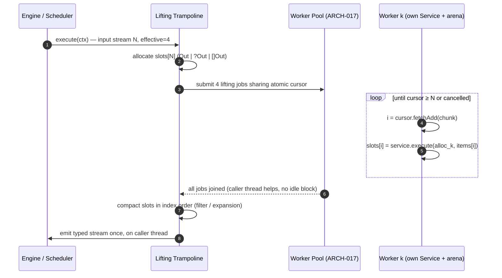
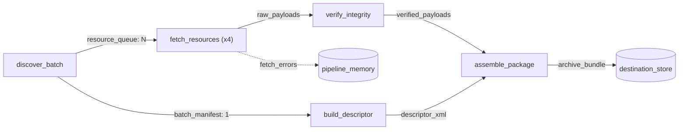

# 016 — Typed Payload Contract, Multi-Channel I/O & Elemental Auto-Lifting

| Metadata | Value |
| :--- | :--- |
| **ID** | `ARCH-016` |
| **Depends On** | [`ARCH-001`](./001-transport-layer-unification.md), [`ARCH-002`](./002-open-kernel-extension-system.md), [`ARCH-011`](./011-pipeline-yaml-specification-and-orchestration.md), [`ARCH-014`](./014-inbound-emitter-datasources-and-reactive-dispatch.md), [`ARCH-015`](./015-declarative-task-services-and-comptime-di.md) |
| **Related** | [`ARCH-017`](./017-concurrent-dag-scheduler-and-host-concurrency-contract.md) — concurrent DAG scheduler & host concurrency contract (required for parallel lifting, §8.5) |
| **Area** | `src/plugin/types/`, `src/plugin/sdk/`, `src/plugin/loader/`, `src/engine/`, `src/dataflow/`, `src/yaml/`, `src/ast/` |
| **Status** | `DESIGN & ARCHITECTURE SPECIFICATION` (rev. 2) |

> [!NOTE]
> **Revision 2** rewrites the original specification after auditing it against the codebase. The original assumed a typed, zero-copy, thread-safe data model that does not exist yet. This revision (1) defines that data model explicitly (the *Typed Payload Contract*), (2) specifies multi-channel **input and output**, (3) makes auto-lifting explicit and opt-in, and (4) moves inter-step parallelism and the host concurrency contract to [`ARCH-017`](./017-concurrent-dag-scheduler-and-host-concurrency-contract.md).

---

## 1. Context & Motivation

Flowdata is meant to be a **declarative, reactive dataflow microkernel**. Developers write small, pure tasks that transform **one item**. The framework is responsible for:

1. **Expanding data in parallel (auto-lifting)** over collections of items.
2. **Bifurcation (fan-out):** several downstream steps consume the same channel.
3. **Multi-input binding (fan-in):** an aggregation step receives several named channels at once.

Without this, developers write monolithic batch tasks that manage their own threads:

```zig
// ANTI-PATTERN: application task managing threads, synchronization, and batch iteration manually
pub fn execute(self: *HeavyBatchService, alloc: Allocator, batch: []const WorkItem) ![]WorkResult {
    var pool: std.Thread.Pool = undefined;
    try pool.init(.{ .allocator = alloc });
    defer pool.deinit();
    // Manual mutexes, atomics, slicing, error grouping...
}
```

This duplicates concurrency bugs across tasks, makes tasks non-composable (batch vs. single item), and pushes developers to stage intermediate state in databases only to coordinate steps.

---

## 2. Current State Audit

The capabilities this ADR needs, checked against the code at commit `043e19f`:

| # | Area | Current behavior | Consequence |
|---|---|---|---|
| G1 | Task input ([`task_executor.zig`](../../src/plugin/loader/task_executor.zig)) | `defineTaskService` tasks only see `get_param` (static `params:`) and `stream_read_at` (raw bytes). `next_row` always returns `end_of_stream` | A task **cannot iterate items** of its input |
| G2 | Task output | `emitTypedRow` serializes every field to `Value_ABI`; the host `dupe`s each field into a `DynamicRecord` | Output is always `[]DynamicRecord`: no typed data, no zero-copy, one allocation per field per row |
| G3 | Elemental detection ([`define_task_service.zig`](../../src/plugin/sdk/define_task_service.zig)) | `deduceServiceInputsType` picks the first non-`Allocator` param, which must be a struct | `item: Request` and `inputs: Inputs` are **indistinguishable** |
| G4 | Workers propagation | `workers` only reaches `execute_blackbox` via `ExecutionOptions_ABI`. `TaskContext_ABI` has no equivalent | Service tasks cannot know their concurrency budget |
| G5 | Multi-input ([`engine.zig`](../../src/engine/engine.zig)) | YAML already parses named `inputs:` into `InputBindingSpec[]`, but the engine only evaluates `inputs[0]` | Fan-in impossible |
| G6 | Multi-output | Every declared output channel receives **the same** `task_output` (except `from:` projections). `emit_row` ignores its `channel_name` argument | A task cannot emit a stream *and* a metadata record |
| G7 | Empty output | When a task emits zero rows, `executeTask` returns **the input payload** as output | Filtering every item away yields the unfiltered input |
| G8 | Type identity | `PayloadHandle_ABI` carries no type information. `asSlice(T)` is an unchecked cast. `fromAbiPayload` labels the output with the **input's** `type_name` | Type confusion is silent UB |
| G9 | Stream algebra | `.zip` / `.join` operators exist in the AST but return `sub_streams[0]` | Pipelines using them silently compute the wrong thing |
| G10 | Thread-safety | No `Mutex` / atomics anywhere in `src/`. Arenas are shared across `parallelFor` workers | Any parallel lifting is a data race (addressed in ARCH-017) |
| G11 | `parallelFor` ([`parallel.zig`](../../src/dataflow/parallel.zig)) | Static contiguous chunks. The original error is replaced by `WorkerTaskFailed`. No cancellation | Poor load balance for I/O and lost diagnostics |

---

## 3. Scope

### In scope
1. **Typed Payload Contract** (§5): a hybrid of typed and `DynamicRecord` payloads with a schema fingerprint and host-owned memory.
2. **Multi-channel input binding** (§6).
3. **Multi-channel output emission** (§7).
4. **Task cardinality and elemental auto-lifting** (§8): explicit, opt-in, deterministic, with an item-level error policy.
5. **Core reusable tasks** `core/download_resource` and `core/validate_payload` (§9).

### Out of scope (moved to [`ARCH-017`](./017-concurrent-dag-scheduler-and-host-concurrency-contract.md))
- Concurrent execution of independent steps (the DAG scheduler).
- The thread-safety contract for host services (network, rate limiter, repositories, telemetry, allocators).
- Payload lifetime / reference counting and memory backpressure.

### Non-goals
- A cross-language columnar format (Arrow-like). Possible future ADR.
- Implementing the `zip` / `join` stream operators. Until they are implemented, the loader **rejects** them (§6.5).

---

## 4. Core Design Principles

1. **Tasks are elemental and thread-agnostic.** Business logic is written for one item. No task contains thread, lock, or batching code.
2. **Explicit over inferred.** Cardinality (elemental / filter / expansion / collection) is *declared*, not guessed from signatures.
3. **Typed data plane, dynamic control plane.** Large and hot data travels as typed, zero-copy payloads. Generic consumers (predicates, sinks, telemetry) see `DynamicRecord` views.
4. **Fail at load time, not at item 937.** Schemas, bindings, and cardinalities are validated when the pipeline is loaded, whenever both sides are statically known.
5. **Immutability after publication.** Once a channel is emitted, it is read-only. This makes fan-out zero-copy and safe under ARCH-017's concurrent scheduler.
6. **Opt-in parallelism.** Nothing runs in parallel unless the step requests `concurrency > 1` **and** the task declares that it is safe.

---

## 5. Typed Payload Contract

### 5.1. Two Representations

| Representation | Plane | When | Cost |
|---|---|---|---|
| **Typed** (`repr = .typed`) | Data plane | Default for `defineTaskService` outputs | Zero-copy, contiguous, comptime-checked |
| **Dynamic** (`repr = .dynamic`, `[]DynamicRecord`) | Control plane | Generic consumers (`where:`, `from:`, predicates, SQL sinks, telemetry), legacy `emitRow` tasks, structurally compatible but non-identical schemas | One allocation per field, lookup by name |
| **Bytes** (`repr = .bytes`) | Raw input | `stream`/`file` inputs, blackbox tasks | Zero-copy |

### 5.2. Layout Stability: `Lowered(T)`

Plain Zig `struct`s have **no guaranteed layout**: the compiler may reorder fields. Since host and plugins are compiled separately, sharing raw `[]const T` across the boundary is UB. On the other hand, `extern struct` cannot contain slices, which would ruin the ergonomics.

**Solution:** developers keep writing plain Zig DTOs. The SDK derives an ABI-stable mirror at compile time:

```zig
// src/plugin/types/lowered.zig  (lives in flowdata_plugin: no dataflow/engine imports — invariant #2)
pub fn Lowered(comptime T: type) type // -> extern struct
```

| Zig field type | Lowered representation |
|---|---|
| `bool`, `iN`/`uN` (≤ 64), `f32`/`f64` | Same (`bool` → `u8`) |
| `enum(TagT)` with explicit tag type | `TagT` |
| `[]const u8` | `Slice_ABI` (`ptr`, `len`) |
| `[]const U` | `extern struct { ptr: ?[*]const Lowered(U), len: usize }` |
| `?U` | `extern struct { present: u8, value: Lowered(U) }` |
| nested `struct` | `Lowered(Nested)` |
| anything else (unions, untagged enums, `anytype`, function pointers…) | `@compileError` |

- **Storage** is always `[]const Lowered(T)`.
- Services receive a `T` **view** built by a shallow repack (pointer and length copies only, never byte copies). The repack costs O(fields) per item and is independent of the size of payloads like `body`.

### 5.3. Schema Fingerprint

```zig
pub fn schemaId(comptime T: type) u64 // comptime Wyhash over Lowered(T):
                                      // field names, lowered type tags, offsets, size, alignment (recursive)
```

`PayloadHandle_ABI` is extended (and `FLOWDATA_ABI_VERSION` bumped):

```zig
pub const PayloadRepr_ABI = enum(u8) { bytes = 0, typed = 1, dynamic = 2 };

pub const PayloadHandle_ABI = extern struct {
    ptr: ?*const anyopaque = null,
    len: usize = 0,
    element_size: usize = 0,
    element_align: u32 = 1,
    is_stream: bool = false,
    reflect_fn: ?ReflectFn_ABI = null,
    // --- ARCH-016 ---
    repr: PayloadRepr_ABI = .bytes,
    schema_id: u64 = 0,                       // 0 = unknown / untyped
    type_name_ptr: ?[*]const u8 = null,       // diagnostics only, never used for identity
    type_name_len: usize = 0,
};
```

The native `dataflow.PayloadHandle` gets the same `repr` and `schema_id` fields. `asSlice(T)` becomes **checked** in debug and safe builds (`schema_id == schemaId(T)` and `element_size == @sizeOf(Lowered(T))`). `fromAbiPayload` uses the payload's own `type_name` instead of the input's, which fixes G8.

### 5.4. Schema Declaration & Load-Time Validation

`TaskDescriptor_ABI` already exports `output_fields` (`computeOutputFields`). It is extended with:

- `inputs_ptr/len`: for each input channel, `{ name, schema_id, cardinality: scalar|stream, fields }`.
- `outputs_ptr/len`: for each output channel, `{ name, schema_id, cardinality, fields }` (§7).
- `flags`: `lift_mode`, `concurrency_safe` (§8).

When loading the pipeline, the engine checks every binding `producer.channel → consumer.input`:

| Check | Result |
|---|---|
| `schema_id` equal | ✅ **Zero-copy** hand-off |
| `schema_id` differs, but every consumer field exists in the producer with a compatible type | ⚠️ **Structural bridge**: one conversion when the channel is resolved, logged at `debug` |
| A required consumer field is missing or the type is incompatible | ❌ Load-time error naming the step, the channel, and the field |
| Producer schema unknown (dynamic, repository read, blackbox) | Deferred to runtime. A mismatch reports `TypeMismatch` with the **item index** and **field name** |

### 5.5. Ownership & Lifetime

The current trampoline allocates `execute` results in a `step_arena` that dies when the trampoline returns. Typed outputs would dangle. New rules:

1. The `Allocator` passed to `Service.execute` is the **host output allocator**, exposed through a new `get_output_allocator` vtable entry that returns a `MemContext_ABI` (this type already exists for blackbox tasks). Anything returned from `execute` must be allocated with it.
2. Temporary memory comes from an injectable `sdk.Scratch` (a step-local arena, freed when the step ends).
3. Published payloads are **immutable**. Their lifetime is owned by the engine (today: the run arena; under ARCH-017: per-producer arenas released by reference counting).

### 5.6. Bridging

- **Typed → dynamic**: `reflect_fn` already covers primitive fields. It is extended to cover every lowered type and to reflect item `i`, not just `[0]`. Predicates, `from:` projections, and SQL sinks use this. They never copy unless they persist.
- **Dynamic → typed**: the input injector deserializes `DynamicRecord` rows into `T` by field name, applying the same conversions as `convertValue`. This fully covers legacy `emitRow` producers.

---

## 6. Multi-Channel Input Binding

> Formerly called "join". It is renamed to **multi-input binding** so it does not collide with the relational `join` stream operator (G9).

### 6.1. YAML

The syntax is already accepted by `parseInputs`:

```yaml
- id: assemble_package
  uses: core/build_zip_archive
  inputs:
    payloads: verified_payloads      # stream channel
    manifest: descriptor_xml         # scalar channel
  params:
    compression: store
```

Long form, for per-binding options:

```yaml
  inputs:
    payloads:
      from: verified_payloads
      where: "size > 0"              # per-binding filter
```

### 6.2. Engine Resolution

```zig
// src/engine/engine.zig
pub const BoundInput = struct { name: []const u8, payload: PayloadHandle };

var bound = try alloc.alloc(BoundInput, task_spec.inputs.len);
for (task_spec.inputs, 0..) |binding, i| {
    var p = try self.resolveStreamExpr(binding.expr, current_input, outputs);
    if (binding.where_filter) |f| p = try dataflow.predicate.filterPayload(alloc, p, f);
    bound[i] = .{ .name = binding.param_name, .payload = p };
}
```

Semantics:
- **Step-level `where:`** is only allowed when the step has exactly one input. With several inputs it is a load-time error that points to the per-binding form.
- **`current_input`** after the step is the step's *primary output* (the first declared output channel, as today).
- **Telemetry**: `step_start.input_count` becomes the sum, plus a new `inputs: []{name, count, repr}` attribute.

### 6.3. ABI

New `HostApiVTable_ABI` entries:

```zig
input_count:   *const fn (ctx: *TaskContext_ABI) callconv(.c) usize,
input_payload: *const fn (ctx: *TaskContext_ABI, name: [*:0]const u8, out: *PayloadHandle_ABI) callconv(.c) HostError_ABI,
```

The existing `next_row(cursor_name, out_row)` gets implemented over the named input. This gives row-by-row access for dynamic payloads without a new entry point.

### 6.4. Injector Rules

For each field of `Inputs` (resolved in this order):

| Field type | Source |
|---|---|
| `BoundedStreamReader` | Raw `stream` input (unchanged) |
| `[]const T` (`T` a DTO struct) | Named input `field.name`, whole stream (zero-copy if `schema_id` matches) |
| `sdk.Rows(T)` | Named input, lazy iterator (for large dynamic inputs) |
| `T` (DTO struct) **matching a bound input name** | Named input, **scalar**. A stream of length ≠ 1 is an error |
| `T` (struct) not matching an input | Nested params struct (unchanged) |
| primitive / `[]const u8` / enum / optional | `params:` (unchanged) |

A name that is **both** a bound input and a `params:` key is a load-time error.

### 6.5. Loader Validations

- Every bound channel name must resolve to a declared output, a datasource, `stream`/`file`, or `jobs`. Today unknown refs silently fall back to `active_input`; this becomes an error.
- `zip(...)` / `join(...)` expressions are rejected with `UnsupportedStreamOperator` until implemented.
- **Implicit chaining** (a step without `inputs:` consumes the previous step's output) is kept for linear pipelines. Once any channel has more than one consumer, the loader emits a warning for steps that rely on implicit chaining. `runtime.strict_bindings: true` turns the warning into an error. ARCH-017 turns implicit chaining into an explicit edge to the previous step.

---

## 7. Multi-Channel Output Emission

### 7.1. Service API

A service returns several channels by returning a struct marked with `sdk.Channels`:

```zig
pub const DiscoverOutput = sdk.Channels(struct {
    resource_queue: []const ResourceRequest,   // stream channel
    batch_manifest: BatchManifest,             // scalar channel
});

pub fn execute(self: *DiscoverService, alloc: Allocator, inputs: DiscoverInputs) !DiscoverOutput { ... }
```

- Each field is a channel: a slice is a stream, a struct is a scalar.
- Channel names and schemas are exported in the descriptor (§5.4). Every YAML `outputs:` key must match an exported channel or use `from:`. Otherwise it is a load-time error.
- Single-output services (returning `T` or `[]const T`) export one channel named `out`, which binds to the **first** YAML output, as today. Fully backward compatible.

### 7.2. Low-Level API

`emit_row(ctx, channel_name, ...)` starts honoring `channel_name` (`null` → `out`). The SDK gets `ctx.emitTypedRowTo(channel, row)` and `ctx.emitTypedSlice(channel, []const T)` (the typed, zero-copy path).

### 7.3. Empty Output (fixes G7)

A task that emits nothing produces an **empty stream with the declared schema**, never the input payload. Tasks that really want passthrough must declare it (`.passthrough = true` in the spec).

> [!WARNING]
> **Breaking change.** Pipelines that relied on the implicit passthrough of side-effect-only tasks must add `.passthrough = true` to those tasks. The loader can detect them (tasks with no output fields that are followed by steps without `inputs:`) and print a migration hint.

---

## 8. Task Cardinality & Elemental Auto-Lifting

### 8.1. Declared Lift Mode (fixes G3)

```zig
pub const fetch_resources = defineTaskService(DownloadResourceService, .{
    .name = "download_resource",
    .lift = .elemental,                 // .none (default) | .elemental
});
```

With `.lift = .elemental`, the first non-`Allocator` parameter of `execute` is the **item type**, and the return type selects the cardinality:

| `execute` returns | Cardinality | Over a stream of N |
|---|---|---|
| `!Out` | **Map** 1 → 1 | N outputs, same order |
| `!?Out` | **Filter** 1 → 0..1 | ≤ N outputs, relative order preserved |
| `![]const Out` | **Expansion** 1 → M | Flattened, in input order |

With `.lift = .none` (the default, current behavior), `execute` receives the whole `Inputs` struct (§6.4). This is the **collection** cardinality (N → M), used for aggregations such as `build_zip_archive`.

Inconsistent declarations are `@compileError`s, for example `.lift = .elemental` with an `Inputs` struct containing slices.

### 8.2. Lifting Semantics

- An elemental step binds **exactly one** input channel (named or implicit). More bindings → load-time error. Broadcasting extra scalar inputs to each item is a future extension (§13).
- Only the `is_stream` flag decides: `is_stream == false` → one invocation, scalar output (map) or stream output (filter/expansion). `is_stream == true` → lifted, stream output. A stream of length 1 stays a stream.
- An empty stream produces an empty stream (zero invocations).

### 8.3. Effective Concurrency (opt-in)

```
effective = min(step.concurrency orelse 1, runtime.workers)
```

- `runtime.workers` is **no longer** an implicit per-step default. It is the global pool size (ARCH-017).
- `concurrency > 1` requires the task's `concurrency_safe` flag (§8.4). Otherwise loading fails with a clear message.
- The budget reaches the plugin through a new `get_execution_options` vtable entry (fixes G4). It returns the `ExecutionOptions_ABI` already used by blackbox tasks.

### 8.4. Per-Worker Isolation

| Object | Sharing | Requirement |
|---|---|---|
| `Service` instance | **One per worker** (DI injection runs per worker) | None: `self` is never shared |
| `ContextImpl` (app DI container) | Shared, initialized once per step | Must declare `pub const concurrency_safe = true` (`EmptyContext` is trivially safe). Sets the descriptor flag |
| Output allocator | **One child arena per worker**, adopted by the step's output owner afterwards | Provided by host (ARCH-017 §4) |
| `sdk.Scratch` | One per worker | — |
| Logger, `NetworkBridge`, telemetry | Shared host services | Thread-safe per ARCH-017 §4 |

### 8.5. Execution Algorithm



- **Dynamic chunking**: a shared atomic cursor. The default chunk is `max(1, N / (effective * 8))`, overridable with `chunk_size:`. This fixes the static-chunk imbalance (G11) for I/O-bound tasks.
- **Determinism**: results are written by index into pre-allocated slots and emitted **once, after the join, on the caller thread**. Output order is always `0..N-1`, whatever the number of workers or the timing.
- **No emission from workers**: workers never call `emit_row`, so the host emission buffers need no synchronization.

> [!IMPORTANT]
> **Delivery dependency.** Until ARCH-017 Phase 1 (host concurrency contract + worker pool) lands, the lifting trampoline runs **sequentially** even when `concurrency > 1`, and the loader prints a warning. The semantics (ordering, error policy, isolation) are identical. Only the throughput changes.

### 8.6. Item-Level Error Policy

```yaml
- id: fetch_resources
  uses: core/download_resource
  concurrency: 8
  on_item_error: collect           # fail_fast (default) | skip | collect
  retry: { max_attempts: 3, backoff_ms: 250, backoff: exponential }
  outputs:
    raw_payloads: { datasource: pipeline_memory }
    fetch_errors: { from: errors, datasource: pipeline_memory }
```

| Policy | Behavior |
|---|---|
| `fail_fast` | The first failure sets a shared cancel flag that workers check before each item. In-flight items finish or are cancelled cooperatively (`ctx.isCancelled()`, also honored by `NetworkBridge`). The step fails reporting the **lowest failing index** (deterministic), the original error name, and the message |
| `skip` | Failed items are dropped. `step_end` telemetry gets `items_failed` |
| `collect` | Failed items go to an implicit `errors` channel of `ItemError { index: u64, error_name: []const u8, message: []const u8 }`. Successful items continue on the primary channel |

- `retry` applies per item, before the policy takes effect.
- `parallelFor` is fixed to keep the original error and to support cancellation (G11).

---

## 9. Core Reusable Tasks

The tasks live in a new built-in module `core`, under `src/plugin/builtin/core/` and registered statically by `ModuleRegistry`. They use only the public SDK, so they also serve as reference implementations.

### 9.1. `core/download_resource` (elemental map)

```zig
pub const KeyValue = struct { key: []const u8, value: []const u8 };

pub const ResourceRequest = struct {
    url: []const u8,
    method: []const u8 = "GET",
    headers: []const KeyValue = &.{},
    timeout_ms: u32 = 15_000,
};

pub const ResourceResponse = struct {
    url: []const u8,
    status_code: u16,
    content_type: []const u8,
    body: []const u8,
    latency_ms: u64,
};

pub const DownloadResourceService = struct {
    pub const Params = struct { fail_on_http_error: bool = true, network: ?[]const u8 = null };

    net: NetworkBridge,       // injected, non-optional; host-provided, thread-safe (ARCH-017 §4)
    logger: Logger,
    params: Params,

    pub fn execute(self: *DownloadResourceService, alloc: Allocator, req: ResourceRequest) !ResourceResponse {
        self.logger.debug("GET {s}", .{req.url});
        // Routed through the step's virtual network adapter: ACLs, proxy, RateLimitMiddleware, capture, tracing.
        const res = try self.net.request(alloc, .{
            .network = self.params.network,
            .url = req.url,
            .method = req.method,
            .headers = req.headers,
            .timeout_ms = req.timeout_ms,
        });
        if (self.params.fail_on_http_error and res.status_code >= 400) return error.HttpStatus;
        return .{
            .url = req.url,
            .status_code = res.status_code,
            .content_type = res.content_type,
            .body = res.body,                 // allocated by host output allocator: zero extra copy
            .latency_ms = res.latency_ms,
        };
    }
};

pub const descriptor = defineTaskService(DownloadResourceService, .{
    .name = "download_resource",
    .lift = .elemental,
});
```

### 9.2. `core/validate_payload` (elemental filter)

The signatures are **data, not code**, to keep the core domain-agnostic (acceptance criterion 1):

```yaml
- id: verify_integrity
  uses: core/validate_payload
  params:
    field: body
    signatures:                       # name -> { offset, hex }
      jpeg: { offset: 0, hex: "FFD8FF" }
      png:  { offset: 0, hex: "89504E470D0A1A0A" }
      webp: { offset: 8, hex: "57454250" }
    on_mismatch: drop                 # drop | error
```

```zig
pub fn execute(self: *ValidatePayloadService, _: Allocator, item: sdk.DynamicItem) !?sdk.DynamicItem
```

Image-oriented default tables can ship in an app-level library (`apps/mangadex/lib/`), never in `src/`.

---

## 10. End-to-End Example

```yaml
version: 2

runtime:
  workers: 8                       # global pool size (ARCH-017)
  strict_bindings: true

datasources:
  pipeline_memory: { driver: memory }
  destination_store: { driver: filesystem, path: ./out }

networks:
  egress_net:
    driver: egress
    rate_limit: { requests_per_second: 10, burst: 20 }

pipelines:
  main:
    steps:
      # 1. Multi-output: one stream + one scalar (§7)
      - id: discover_batch
        uses: provider/discover_items
        outputs:
          resource_queue: { datasource: pipeline_memory }
          batch_manifest: { datasource: pipeline_memory }

      # 2. Branch A — elemental map, lifted over 4 workers (§8)
      - id: fetch_resources
        uses: core/download_resource
        network: egress_net
        concurrency: 4
        on_item_error: collect
        retry: { max_attempts: 3, backoff_ms: 250 }
        inputs:
          input: resource_queue
        outputs:
          raw_payloads: { datasource: pipeline_memory }
          fetch_errors: { from: errors, datasource: pipeline_memory }

      # 3. Branch A — elemental filter (§9.2)
      - id: verify_integrity
        uses: core/validate_payload
        inputs:
          input: raw_payloads
        params: { field: body, on_mismatch: drop }
        outputs:
          verified_payloads: { datasource: pipeline_memory }

      # 4. Branch B — scalar transformation (independent of Branch A; concurrent under ARCH-017)
      - id: build_descriptor
        uses: provider/format_descriptor
        inputs:
          input: batch_manifest
        outputs:
          descriptor_xml: { datasource: pipeline_memory }

      # 5. Multi-input binding (§6)
      - id: assemble_package
        uses: core/build_zip_archive
        inputs:
          payloads: verified_payloads
          metadata: descriptor_xml
        outputs:
          archive_bundle: { datasource: destination_store }
```



---

## 11. ABI Changes Summary (`FLOWDATA_ABI_VERSION` bump)

| Type | Change |
|---|---|
| `PayloadHandle_ABI` | `+ repr`, `+ schema_id`, `+ type_name_ptr/len` |
| `HostApiVTable_ABI` | `+ input_count`, `+ input_payload`, `+ get_output_allocator`, `+ get_execution_options`, `+ is_cancelled`. `next_row` implemented over named inputs. `emit_row` honors `channel_name`. `+ emit_typed_slice` |
| `TaskDescriptor_ABI` | `+ inputs_ptr/len`, `+ outputs_ptr/len` (channel schemas), `+ flags` (`lift_mode`, `concurrency_safe`, `passthrough`) |
| `ReflectFn_ABI` | `+ item_index` parameter. Covers all lowered types |

Plugins built against the previous ABI are rejected by the existing version check, with a message that points to the rebuild.

---

## 12. Implementation Plan

| Phase | Deliverable | Depends on | Risk |
|---|---|---|---|
| **16.1** | Typed Payload Contract: `Lowered(T)`, `schemaId`, `PayloadHandle(_ABI)` extensions, checked `asSlice`, host output allocator, fix of G8 | — | Medium |
| **16.2** | Multi-input binding: engine `BoundInput[]`, `input_count`/`input_payload`/`next_row`, injector rules, loader validations (§6.5) | 16.1 | Low |
| **16.3** | Multi-output: `sdk.Channels`, `emit_row` channel routing, descriptor channel schemas, empty-output fix (G7) + migration hint | 16.1 | Low/medium |
| **16.4** | Lift modes (`.elemental` map/filter/expansion), slot-based trampoline, error policy, retry, **sequential** execution | 16.2 | Medium |
| **16.5** | Parallel lifting over the shared worker pool, per-worker isolation, cancellation | 16.4 + **ARCH-017 P1** | High |
| **16.6** | `core` builtin module: `download_resource`, `validate_payload` | 16.4 | Low |

---

## 13. Testing Strategy

- **Unit (`src/plugin/types`)**: `Lowered(T)` layout for every supported field type. `schemaId` stability (golden values) and sensitivity (reordering or renaming a field changes the id).
- **Unit (`src/plugin/sdk`)**: lift-mode `@compileError` cases. Injector precedence (input vs. param collision). Dynamic → typed deserialization.
- **Engine integration**:
  - Multi-input fan-in mixing stream + scalar.
  - Multi-output fan-out.
  - Load-time schema mismatch error.
  - Structural bridge.
  - Empty output (G7 regression).
  - Unknown channel ref is rejected.
  - `zip`/`join` are rejected.
- **Lifting**: N = 0, 1, 2, 1000. Map / filter / expansion ordering equals sequential ordering for `concurrency ∈ {1, 2, 7, 32}`. `fail_fast` reports the lowest index. `skip` / `collect` counts. Retry.
- **Concurrency (after ARCH-017 P1)**: stress test with randomized per-item latency, run under ThreadSanitizer (`-fsanitize-thread`).
- **Memory**: zero leaks with `std.testing.allocator` across all of the above.

---

## 14. Acceptance Criteria

1. **Zero domain coupling**: `src/dataflow/`, `src/engine/`, `src/plugin/` contain no application-domain references (no hardcoded media signatures).
2. **Zero application thread pools**: lifted services contain no thread, lock, or batching code.
3. **Deterministic ordering**: lifted outputs keep index order `0..N-1` for map (and relative order for filter/expansion), independent of `concurrency`.
4. **Load-time type safety**: a schema-incompatible binding between statically typed tasks fails at load time, naming step, channel, and field.
5. **Zero-copy typed hand-off**: a typed channel consumed by a task with the same `schema_id` is passed without copying (verified by pointer identity in tests).
6. **In-memory fork/join**: the §10 topology runs fully in RAM via `pipeline_memory`, without database or disk staging.
7. **Rate-limit compliance** (with ARCH-017 P1): parallel workers sharing a network adapter never exceed the configured `requests_per_second` (measured over a 100-request burst).
8. **No silent passthrough**: a task emitting zero items yields an empty stream.

---

## 15. Open Questions

1. **Broadcast inputs for elemental tasks**: should an elemental step get read-only scalar inputs (e.g. `auth_token`) next to its stream (`inputs: { each: queue, token: auth }`)? This ADR proposes a follow-up.
2. **`sdk.Rows(T)` vs. full materialization** for very large dynamic inputs. Is lazy iteration needed in v1?
3. **Schema evolution policy**: should optional/new fields count as structurally compatible both ways (consumer has extra optional fields → defaults)? The proposal is yes.
