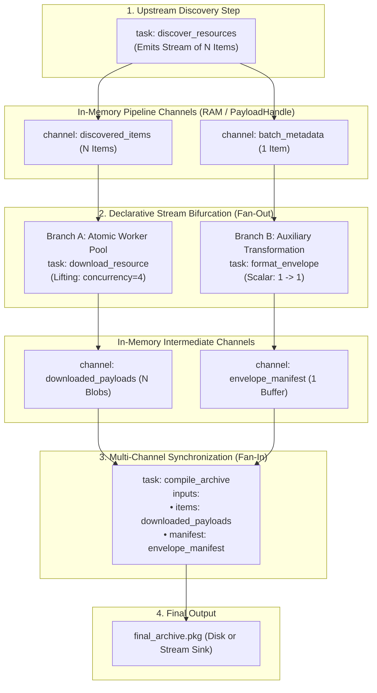
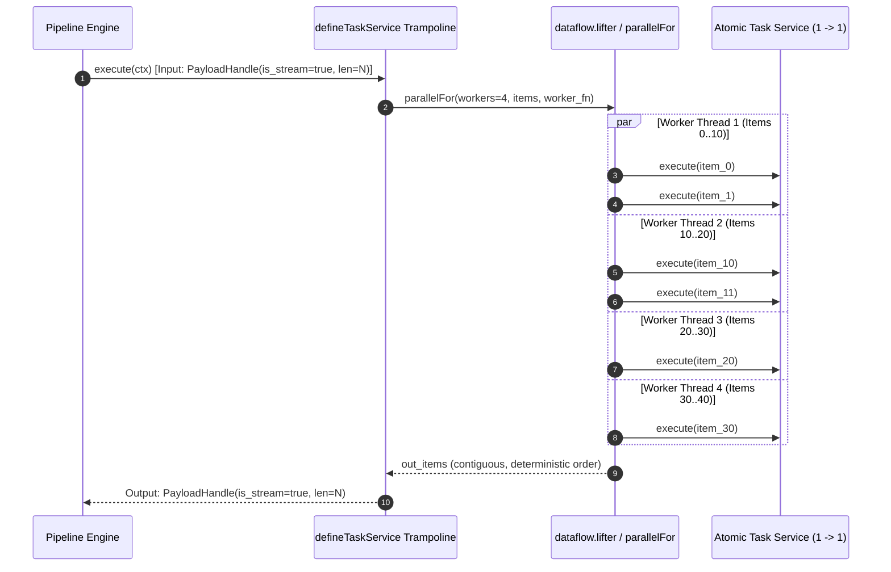

# 016 — Reactive Stream Bifurcation, Parallel Task Expansion & Multi-Channel Join

| Metadata | Value |
| :--- | :--- |
| **ID** | `ARCH-016` |
| **Depends On** | [`ARCH-001`](./001-transport-layer-unification.md), [`ARCH-002`](./002-open-kernel-extension-system.md), [`ARCH-011`](./011-pipeline-yaml-specification-and-orchestration.md), [`ARCH-014`](./014-inbound-emitter-datasources-and-reactive-dispatch.md), [`ARCH-015`](./015-declarative-task-services-and-comptime-di.md) |
| **Area** | `src/dataflow/`, `src/engine/`, `src/plugin/sdk/`, `src/ast/`, `src/yaml/` |
| **Status** | `DESIGN & ARCHITECTURE SPECIFICATION` |

---

## 1. Context & Motivation

Flowdata is fundamentally designed as a **declarative, reactive dataflow microkernel**. In dataflow architectures (such as Apache Beam, Flink, or Rx), developers write concise, pure functional tasks focusing exclusively on single-item domain transformations. The framework itself assumes full responsibility for:
1. **Parallel Data Expansion (Auto-Lifting)** over collections of items.
2. **Stream Bifurcation (Fan-Out)** allowing downstream branches to process identical streams or metadata in parallel.
3. **Multi-Channel Synchronization (Fan-In / Join / Collect)** uniting disparate streams and side-channel metadata into aggregation barriers.

### The Architectural Anti-Pattern: Manual Application Thread Pools

When developers need to process batches of items (e.g., retrieving dozens of network payloads, hashing large artifact lists, or normalizing binary buffers), they often fall into the trap of writing ad-hoc, monolithic tasks:

```zig
// ANTI-PATTERN: Application task managing threads, synchronization, and batch iteration manually
pub fn execute(self: *HeavyBatchService, alloc: Allocator, batch: []const WorkItem) ![]WorkResult {
    var pool: std.Thread.Pool = undefined;
    try pool.init(.{ .allocator = alloc });
    defer pool.deinit();

    var results = try alloc.alloc(WorkResult, batch.len);
    // Manual mutexes, atomics, slicing, error grouping...
    ...
    return results;
}
```

This violates the separation of concerns:
* **Framework Devaluation**: If tasks must manually orchestrate threads, locks, rate limits, and batch slicing, the pipeline engine is reduced to a procedural step runner rather than a reactive dataflow engine.
* **Code Bloat & Fragility**: Concurrency bugs, race conditions, memory leaks, and error-handling complexities duplicate across every task.
* **Zero Composability**: A batch task cannot be easily reused for single items, and an atomic task cannot be easily parallelized without rewriting it.
* **Database Dependency Trap**: Intermediate states are frequently dumped into relational tables (e.g. SQLite) merely to coordinate steps, creating unnecessary I/O overhead when the data could flow entirely in RAM.

---

## 2. Core Design Principles

1. **Atomic Elemental Tasks (`1 -> 1` and `1 -> N`)**:
   Tasks declare business logic for a **single elemental item**. Tasks remain 100% thread-agnostic and synchronous.
2. **Engine-Driven Auto-Lifting & Data Parallelism**:
   When an atomic task configured with `concurrency: N` receives a stream of $M$ items from the pipeline, the **engine automatically lifts execution** across $N$ worker threads via `dataflow.parallel`, preserving deterministic output ordering without application thread code.
3. **Pure In-Memory Zero-Copy Flow**:
   Intermediate outputs pass through `pipeline_memory` as type-erased fat pointers (`PayloadHandle`). Zero database reads/writes are required to coordinate steps.
4. **Declarative Bifurcation (Fan-Out)**:
   A single upstream stream or in-memory channel can be consumed independently by multiple downstream steps.
5. **Declarative Multi-Channel Join (Fan-In)**:
   Downstream aggregation tasks can declare multiple named input channels (`inputs: { stream_a: ..., metadata_b: ... }`), allowing parallel branches to converge at a barrier.



---

## 3. Detailed Architecture

### 3.1. Atomic Tasks vs. Stream Auto-Lifting

Under `ARCH-015`, task services are declared as plain Zig structs with an `execute` method. Under `ARCH-016`, `defineTaskService` introspects the signature of `Service.execute` to distinguish between **Elemental** and **Collection** tasks:

```zig
// Elemental Task Signature (Processes 1 item at a time)
pub fn execute(self: *Self, alloc: Allocator, item: RequestItem) !ResponseItem
```

When compiled via `defineTaskService`, the generated trampoline detects the shape of `step_input` at runtime:
1. **Scalar Input (`is_stream == false` / `len == 1`)**:
   Invokes `service.execute(alloc, input)` directly.
2. **Stream Input (`is_stream == true` / `len == N`)**:
   * Evaluates the concurrency budget: `workers = task_spec.concurrency orelse runtime.workers`.
   * When `workers <= 1` or `N <= 1`, iterates synchronously across items.
   * When `workers > 1` and `N > 1`, leverages `dataflow.parallel.parallelFor` to execute the service across slices of the input chunk in parallel.
   * Pre-allocates a contiguous output slice of size $N$ and places each worker's results at the exact index `i`, **guaranteeing 100% deterministic ordering**.



---

### 3.2. Declarative Stream Bifurcation (Fan-Out)

A pipeline step outputs to one or more declared channels in `pipeline_memory`. Downstream steps can tap into any previously generated channel using standard stream expressions:

```yaml
steps:
  # Step 1: Upstream Discovery
  - id: discover_batch
    uses: provider/discover_items
    outputs:
      pending_items:
        datasource: pipeline_memory
      batch_info:
        datasource: pipeline_memory

  # Step 2 (Branch A): Parallel processing of item stream
  - id: process_payloads
    uses: core/download_resource
    concurrency: 4                      # 4 concurrent workers managed by the engine
    inputs:
      input: pending_items              # Consumes Stream of N items
    outputs:
      processed_items:
        datasource: pipeline_memory

  # Step 3 (Branch B): Parallel transformation of metadata
  - id: build_manifest
    uses: format/generate_manifest
    inputs:
      info: batch_info                  # Consumes 1 metadata item
    outputs:
      manifest_doc:
        datasource: pipeline_memory
```

Because `pipeline_memory` stores items as `PayloadHandle` references with an Arena lifetime tied to the subpipeline run, **branching introduces zero copy overhead**. Both Branch A and Branch B read from read-only pointers in RAM.

---

### 3.3. Multi-Channel Input Resolution & Join (Fan-In)

To unite the bifurcated branches, an aggregation task requires access to multiple distinct streams or scalar records simultaneously.

Currently, `src/engine/engine.zig` evaluates only `task_spec.inputs[0].expr`. We extend the Engine and `input_injector.zig` to support **Multi-Channel Keyed Injection**:

#### Declarative YAML Specification:
```yaml
  # Step 4 (Join): Aggregates Branch A (N items) and Branch B (1 metadata record)
  - id: compile_package
    uses: archive/build_package
    inputs:
      payloads: processed_items         # Bound to Inputs.payloads
      manifest: manifest_doc            # Bound to Inputs.manifest
    outputs:
      package_file:
        datasource: destination_store
```

#### Multi-Channel Resolution in `src/engine/engine.zig`:
```zig
// When task_spec.inputs has multiple entries, resolve each expression into a KeyedPayloadMap
var multi_inputs = std.StringHashMapUnmanaged(PayloadHandle).empty;
for (task_spec.inputs) |ch_input| {
    const payload = try self.resolveStreamExpr(ch_input.expr, current_input, outputs);
    try multi_inputs.put(self.allocator, ch_input.param_name, payload);
}
```

#### Compile-Time Struct Mapping in `src/plugin/sdk/input_injector.zig`:
```zig
pub const PackageInputs = struct {
    payloads: []const ResourcePayload, // Injected from channel 'payloads'
    manifest: ManifestRecord,          // Injected from channel 'manifest'
};

pub const BuildPackageService = struct {
    pub fn execute(self: *BuildPackageService, alloc: Allocator, inputs: PackageInputs) !PackageOutput {
        // inputs.payloads contains all N parallel-downloaded items
        // inputs.manifest contains the formatted metadata document
        ...
    }
};
```

---

## 4. Reusable Core Task: `core/download_resource`

Rather than forcing every application to write an ad-hoc HTTP download loop, Flowdata Core provides a built-in, domain-agnostic elemental task service:

```zig
// src/plugin/builtin/download_resource.zig
pub const ResourceRequest = struct {
    url: []const u8,
    method: []const u8 = "GET",
    headers: ?[]const KeyValue = null,
    timeout_ms: u32 = 15000,
};

pub const ResourceResponse = struct {
    url: []const u8,
    status_code: u16,
    content_type: []const u8,
    body: []const u8,
    latency_ms: u64,
};

pub const DownloadResourceService = struct {
    net_bridge: ?NetworkBridge,
    logger: Logger,

    pub fn execute(self: *DownloadResourceService, alloc: Allocator, req: ResourceRequest) !ResourceResponse {
        self.logger.debug("Downloading resource: {s}", .{req.url});
        
        // Dispatches through the Virtual Network Adapter of the active step.
        // Automatically honors ACLs, proxy routing, token-bucket RateLimitMiddleware,
        // and telemetry tracing with zero custom thread code.
        const res = try self.net_bridge.request(...);
        
        return ResourceResponse{
            .url = req.url,
            .status_code = res.status_code,
            .content_type = res.content_type,
            .body = res.body,
            .latency_ms = res.latency_ms,
        };
    }
};
```

### Magic Byte Validation: `core/validate_payload`

A lightweight elemental filtering task verifying binary signatures before downstream aggregation:

```zig
pub const ValidationRule = struct {
    expected_magic: []const u8,
    format_label: []const u8,
};

pub fn checkMagic(bytes: []const u8) ?[]const u8 {
    if (bytes.len >= 3 and std.mem.eql(u8, bytes[0..3], "\xFF\xD8\xFF")) return "jpeg";
    if (bytes.len >= 8 and std.mem.eql(u8, bytes[0..8], "\x89PNG\r\n\x1a\n")) return "png";
    if (bytes.len >= 12 and std.mem.eql(u8, bytes[0..4], "RIFF") and std.mem.eql(u8, bytes[8..12], "WEBP")) return "webp";
    if (bytes.len >= 4 and std.mem.eql(u8, bytes[0..4], "GIF8")) return "gif";
    return null;
}
```

---

## 5. End-to-End Pipeline Configuration (`pipeline.yaml`)

Here is an example demonstrating pure in-memory reactive dataflow:

```yaml
version: 2

runtime:
  workers: 4
  default_network: egress_net

datasources:
  pipeline_memory:
    driver: memory

networks:
  egress_net:
    driver: egress
    rate_limit:
      requests_per_second: 10
      burst: 20

pipelines:
  main:
    steps:
      # Step 1: Discover pending items
      - id: discover_batch
        uses: provider/discover_items
        outputs:
          resource_queue:
            datasource: pipeline_memory
          batch_manifest:
            datasource: pipeline_memory

      # Step 2: Atomic parallel download (Fan-Out Branch A)
      # The engine expands 'download_resource' over the 'resource_queue' stream using 4 worker threads.
      - id: fetch_resources
        uses: core/download_resource
        concurrency: 4
        inputs:
          input: resource_queue
        outputs:
          raw_payloads:
            datasource: pipeline_memory

      # Step 3: Validate and normalize items (Fan-Out Branch A pipeline extension)
      - id: verify_integrity
        uses: core/validate_payload
        inputs:
          input: raw_payloads
        outputs:
          verified_payloads:
            datasource: pipeline_memory

      # Step 4: Metadata envelope generation (Fan-Out Branch B)
      # Operates on the scalar batch_manifest in memory
      - id: build_descriptor
        uses: provider/format_descriptor
        inputs:
          input: batch_manifest
        outputs:
          descriptor_xml:
            datasource: pipeline_memory

      # Step 5: Multi-Channel Join (Fan-In)
      # Merges verified_payloads (Stream) and descriptor_xml (Scalar) into a consolidated archive
      - id: assemble_package
        uses: core/build_zip_archive
        inputs:
          payloads: verified_payloads
          metadata: descriptor_xml
        outputs:
          archive_bundle:
            into: destination_store
```

---

## 6. Implementation Plan & Deliverables

1. **Engine Multi-Channel Input Resolution (`src/engine/engine.zig`)**:
   * Support evaluating multiple named inputs in `task_spec.inputs` into a keyed collection of `PayloadHandle`s.
   * Provide keyed lookup across `TaskContext_ABI` for input injection.
2. **SDK Auto-Lifting (`src/plugin/sdk/define_task_service.zig`)**:
   * Enhance `defineTaskService` to inspect whether `Service.execute` takes a single scalar `Item` or a slice `[]Item`.
   * When `Service.execute` is elemental and input is a stream (`PayloadHandle.is_stream`), invoke `dataflow.lifter.wrapElemental` with `concurrency`.
3. **Core Reusable Tasks (`src/plugin/builtin/` or SDK library)**:
   * Implement `download_resource` with `ResourceRequest` $\to$ `ResourceResponse`.
   * Implement `validate_payload` for magic-byte sanity checks.
4. **Verification & Testing**:
   * Unit test in `dataflow`: multi-thread elemental lifting preserving deterministic index ordering.
   * Integration test in `engine`: multi-channel join combining stream items + scalar metadata.
   * Zero leaks with `std.testing.allocator`.

---

## 7. Acceptance Criteria

1. **Zero Domain Coupling**:
   * Core modules (`src/dataflow/`, `src/engine/`, `src/plugin/sdk/`) must contain zero references to application domains.
2. **Zero Application Threadpools**:
   * Application services must define elemental `(self, alloc, item)` signatures with zero thread-management code.
3. **Deterministic Stream Ordering**:
   * Stream results from parallel-lifted execution must maintain exact index correspondence with the input stream ($0 \dots N-1$).
4. **Complete In-Memory Operation**:
   * The pipeline must execute fork-and-join topologies completely in RAM via `pipeline_memory`, without requiring database writes or disk staging.
5. **Rate-Limiting Compliance**:
   * Parallel worker requests must transparently route through `RateLimitMiddleware`, ensuring concurrent requests throttle without manual sleeps.
