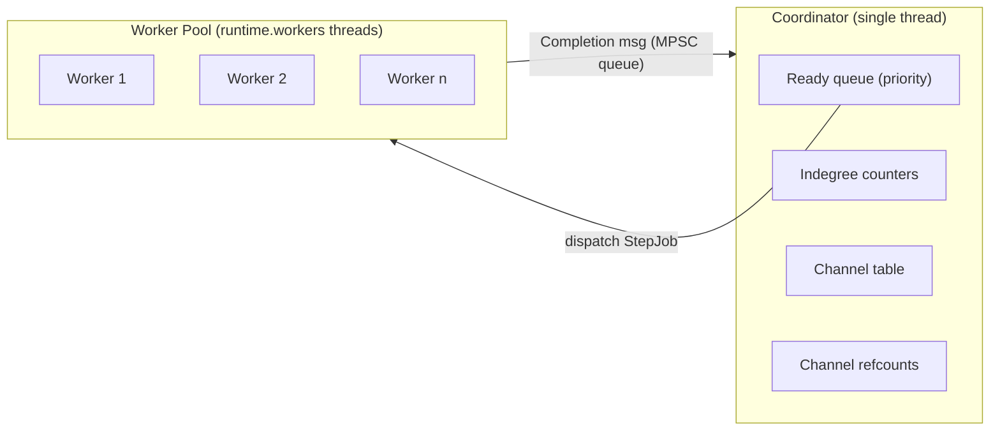

# 017 — Concurrent DAG Scheduler & Host Concurrency Contract

| Metadata | Value |
| :--- | :--- |
| **ID** | `ARCH-017` |
| **Depends On** | [`ARCH-002`](./002-open-kernel-extension-system.md), [`ARCH-004`](./004-observability-otel-and-dag-visualizer.md), [`ARCH-011`](./011-pipeline-yaml-specification-and-orchestration.md), [`ARCH-016`](./016-reactive-bifurcation-parallel-expansion-and-join.md) (Typed Payload Contract, multi-channel I/O) |
| **Unblocks** | `ARCH-016` Phase 16.5 (parallel elemental lifting) |
| **Area** | `src/engine/`, `src/dataflow/`, `src/transport/outbound/`, `src/repository/`, `src/kernel/`, `src/plugin/loader/` |
| **Status** | `DESIGN & ARCHITECTURE SPECIFICATION` |

---

## 1. Context & Motivation

`PipelineEngine.executeSubPipeline` runs steps as a **linear `for` loop**. With ARCH-016, pipelines express real topologies (fan-out, fan-in). But two independent branches, such as downloading N resources and building a metadata descriptor, still run one after the other. For a general-purpose dataflow framework, that is a pseudo-parallelism users notice at once.

Key observation: **most of the concurrency work is unavoidable anyway.** ARCH-016's intra-step lifting already needs a thread-safe network stack, rate limiter, telemetry, logger, and allocators. Once those exist, running independent *steps* concurrently only adds:

1. A **plan compiler** that builds the dependency graph.
2. A **single-threaded coordinator** that owns all scheduling state, so the graph needs no locks.
3. A **shared worker pool** that serves both step jobs and lifting jobs.
4. **Write-once, immutable channels** with explicit lifetimes.

This ADR specifies those pieces and the **Host Concurrency Contract** both features rely on.

---

## 2. Goals & Non-Goals

### Goals
- Concurrent execution of independent steps, from data dependencies declared in YAML.
- A single bounded worker pool shared by inter-step (DAG) and intra-step (lifting) parallelism, with no starvation or deadlock.
- A formal, tested thread-safety contract for every host service a task can reach.
- **Deterministic outputs**: for pure tasks, the channel contents are identical in every scheduling mode.
- **Bounded memory**: payloads are released once their consumers finish, plus an optional in-flight memory budget.
- A `sequential` scheduler mode that keeps the current behavior bit-for-bit, for debugging and reproducibility.

### Non-goals
- Distributed / multi-process execution.
- Item-level pipelining between steps (streaming micro-batches from producer to consumer before the producer finishes). Steps still materialize their channels. This is a possible future ADR.
- Async I/O. Workers do blocking I/O. The interaction with `std.Io` is an open question (§10).

---

## 3. Execution Model

### 3.1. Plan Compilation (load time)

The YAML AST is compiled into an `ExecutionPlan` per pipeline:

```zig
pub const ExecutionPlan = struct {
    nodes: []const PlanNode,            // task steps and router barriers
    edges: []const PlanEdge,            // producer -> consumer
    channels: []const ChannelSlot,      // write-once slots, indexed by ChannelId
};

pub const PlanEdge = struct {
    from: NodeId,
    to: NodeId,
    kind: enum { data, implicit_chain, ordering, router_barrier },
};
```

Edge sources:

| Kind | Origin |
|---|---|
| `data` | `inputs:` binding → node that produces the channel (ARCH-016 §6) |
| `implicit_chain` | Step without `inputs:` → previous step (keeps today's semantics) |
| `ordering` | Explicit `after: [step_id, ...]`, **or** two steps writing to the same non-memory datasource (serialized in declaration order) |
| `router_barrier` | Every step after a `router` depends on it (§3.4) |

Validations (load-time errors):
- **Cycles**, reported with the cycle path.
- **Single-writer rule**: each channel name has exactly one producer in a pipeline.
- Unknown channel references (already required by ARCH-016 §6.5).
- Unused outputs → warning (unless they target a persistent datasource).

The plan is also exported to `extensions/dag_viz` (ARCH-004), which can now draw the *real* graph instead of the declaration order.

### 3.2. Coordinator



- The coordinator thread is the **only** owner of the ready queue, indegree counters, the channel table, and refcounts. Workers never touch them.
- Workers report through a lock-free **MPSC completion queue** (`StepCompleted { node, outputs, status, arena }`).
- On completion the coordinator: publishes the output channels → decrements successor indegrees → enqueues nodes that become ready → releases channels whose consumers are all done (§3.5).
- Publication is a happens-before edge: the worker writes its payloads, then pushes (release); the coordinator pops (acquire), then dispatches the consumers. Payloads need no further synchronization because they are **immutable** (ARCH-016 principle 5).

**Ready-queue priority** (deterministic tie-break by declaration index):
1. Nodes that release the most memory when they finish (consumers of large channels), so memory peaks drop.
2. Nodes on the critical path (longest remaining path, estimated statically).
3. Declaration order.

### 3.3. Worker Pool & Nested Parallelism

- One global pool with `runtime.workers` threads, created once per engine.
- Two job types: `StepJob` (run one task) and `LiftChunkJob` (a lifting worker from ARCH-016 §8.5).
- **Help-while-waiting**: a step that spawns lifting jobs never blocks idle. Its thread runs chunks from its own lifting batch until the batch finishes. This removes the classic nested-pool deadlock, where every thread waits on children that cannot be scheduled.
- **Budgets**:
  - A step's lifting parallelism ≤ `step.concurrency`.
  - Total running jobs ≤ `runtime.workers`.
  - Per-resource caps (§3.6) apply on top.

### 3.4. Routers & Sub-Pipelines

- A `router` is a **barrier node**. It becomes ready when its inputs are published (today: `current_input` and any `count(x)` references).
- When it resolves to `goto: sub_pipeline`, the coordinator instantiates the sub-pipeline's plan as a **nested sub-graph**. Its nodes join the same ready queue and see the parent's channel table (current semantics: shared `outputs` namespace).
- Steps after the router depend on the router barrier **and** on the completion of the chosen sub-graph.
- `continue` completes the barrier immediately.

### 3.5. Channel Lifetime & Memory

**Ownership.** Each `StepJob` runs with its **own output arena** (backed by a thread-safe allocator, §4). Lifting workers' child arenas are adopted by it (ARCH-016 §8.4). The arena owns every channel the step publishes.

**Reference counting.** At plan time each channel gets `consumers = number of data edges + routers referencing it`. When a consumer finishes, the coordinator decrements. When every channel owned by an arena reaches zero and none of them is `retain`ed, the arena is freed.

A channel is retained when:
- it was written to a persistent datasource that does not copy (the memory driver keeps its own reference),
- `retain: true` is set on the output (debugging), or
- the run is in `sequential` mode with `runtime.retain_all: true` (legacy behavior: everything lives until the end of the run).

**Backpressure.** With `runtime.max_inflight_bytes` set, the coordinator stops dispatching **producers** while the live payload bytes exceed the budget. Consumers keep being dispatched, which guarantees progress: a consumer always eventually releases memory, so the budget never causes a deadlock. A single payload larger than the budget is allowed but logged as a warning.

### 3.6. Per-Resource Concurrency Caps

```yaml
networks:
  egress_net:
    driver: egress
    rate_limit: { requests_per_second: 10, burst: 20 }
    max_concurrent: 6           # semaphore shared by all steps/workers using this adapter
```

`max_concurrent` caps simultaneous in-flight requests across the whole run. Per-host or per-datasource caps follow the same pattern.

### 3.7. Determinism

| Aspect | Guarantee |
|---|---|
| Channel contents | Identical across `dag` / `sequential` and any `workers` value, for pure tasks |
| Lifted outputs | Index-ordered (ARCH-016 §8.5) |
| Side effects on the same datasource | Serialized in declaration order (`ordering` edges) |
| Side effects on different datasources | May interleave; use `after:` if order matters |
| Telemetry | Span **tree** is exact (parent = DAG predecessor/root). Span **timestamps / emission order** are not deterministic |
| Failure reporting | When several nodes fail concurrently, the summary reports the one with the lowest declaration index first |

### 3.8. Errors, Halting & Cancellation

| Task status | Coordinator behavior |
|---|---|
| `ok` / `recoverable_warning` | Normal completion |
| `halt_pipeline` | **Graceful drain**: no new nodes are dispatched, running nodes finish, `summary.halted_early = true` |
| `fatal_error` | **Cancel**: set the run cancel token (checked by lifting cursors, `NetworkBridge`, `ctx.isCancelled()`), wait for running nodes, mark not-started nodes `skipped` |

`ExecutionSummary` gets `nodes_failed`, `nodes_skipped`, and per-node status, which `dag_viz` uses to colour the graph.

---

## 4. Host Concurrency Contract

Every object a task or the engine can reach from a worker thread must meet one of these classes:

- **Immutable**: frozen after initialization, read-only afterwards.
- **Confined**: owned by one job, never shared.
- **Synchronized**: explicitly thread-safe, with a documented mechanism.

| Component | Today | Class | Mechanism |
|---|---|---|---|
| Backing allocator | `std.heap.page_allocator` / engine allocator | Synchronized | `std.heap.smp_allocator` (or a GPA with `thread_safe = true`) as the default backing allocator |
| Step / worker arenas | Shared `outputs_alloc`, shared `step_arena` | **Confined** | One arena per `StepJob` and per lifting worker. Never shared |
| `ModuleHostState` (emit buffers, params) | Per task invocation | **Confined** | One per `StepJob`. Lifting workers never emit (ARCH-016 §8.5) |
| `ModuleRegistry`, `NetworkRegistry`, `RepositoryRegistry` lookups, `PipelineAST`, `ExecutionPlan` | Mutable after init | **Immutable** | `freeze()` after load. Debug builds assert no mutation afterwards |
| `EngineNetworkController` stream-handle table | Unsynchronized | Synchronized | `std.Thread.Mutex` around the handle map |
| Network capture (`capture_middleware`, `collectStepEvents`) | Global list + `records_before` index | Confined + merge | Per-step capture buffer, handed to the coordinator in the completion message. Removes the `records_before` index trick, which breaks under concurrency |
| Token-bucket rate limiter | Unsynchronized | Synchronized | Mutex-protected refill + take, with **timed waits** outside the lock. Waits honor the cancel token |
| `max_concurrent` (§3.6) | n/a | Synchronized | Counting semaphore (mutex + condition) |
| Repositories (`writePayload` / `readPayload`) | Unsynchronized | Synchronized | Memory driver: `RwLock` on the channel map. SQLite: one writer connection behind a mutex (WAL lets readers proceed), or a connection per thread for reads |
| `TelemetryBus.emit` | Synchronous, unsynchronized | Synchronized | Lock-free MPSC queue drained by the coordinator. The zero-subscriber fast path stays a single branch (roadmap invariant #4) |
| Span / trace ID generation (`global_prng`) | Global, unsynchronized | Confined | Thread-local PRNG seeded from the run seed + thread index |
| ABI logger | Unsynchronized | Synchronized | Line-buffered per call, emitted under a mutex |
| Plugin `ContextImpl` | n/a | Declared | `pub const concurrency_safe = true` (ARCH-016 §8.4) |

> [!IMPORTANT]
> The contract is enforced by **tests, not documentation alone**. Every Synchronized component gets a dedicated stress test, and CI runs the concurrency suite under ThreadSanitizer.

---

## 5. Configuration

```yaml
runtime:
  workers: 8                      # global pool size (default: CPU count, min 1)
  scheduler: dag                  # dag (default after P3) | sequential
  max_inflight_bytes: 512MiB      # optional memory budget (§3.5)
  strict_bindings: true           # ARCH-016 §6.5
  retain_all: false               # keep all channels until run end (debug / legacy)

pipelines:
  main:
    steps:
      - id: notify
        uses: core/webhook
        after: [assemble_package]  # explicit ordering edge without data dependency
```

---

## 6. Observability

- **Spans**: each node's span parent is its DAG predecessor (or the root for sources), so OpenTelemetry traces show the real fork/join structure.
- **Metrics**:
  - `flowdata.scheduler.ready_queue_depth`
  - `flowdata.scheduler.inflight_bytes`
  - `flowdata.pool.busy_workers`
  - `flowdata.step.queue_wait_ns`
  - `flowdata.lift.items_failed`
- **`dag_viz`**: renders `ExecutionPlan` with live node states (pending / running / done / failed / skipped) and channel sizes.

---

## 7. Testing Strategy

1. **Mode equivalence (property test)**: for a corpus of pipelines (linear, diamond, wide fan-out, nested routers), outputs under `sequential` and under `dag` with `workers ∈ {1, 2, 8}` must be byte-identical. Task latencies are randomized.
2. **Plan compiler**: cycle detection, single-writer violations, implicit-chain edges, ordering edges on shared datasources.
3. **Host contract stress tests**: one per Synchronized component (rate limiter accuracy under 32 threads, repository concurrent writes, telemetry ordering per span tree…).
4. **ThreadSanitizer**: concurrency suite built with `-fsanitize-thread` in CI.
5. **Fault injection**: random `fatal_error` / `halt_pipeline` in nodes. Assert cancellation, `skipped` reporting, no leaks, no hangs (watchdog timeout).
6. **Memory**: peak RSS stays below `max_inflight_bytes` + largest single payload for a wide fan-out of large blobs. Arenas are freed according to refcounts (verified via a counting allocator).
7. **Nested parallelism**: a pool of 2 workers running 4 concurrent lifted steps must finish (no deadlock).

---

## 8. Implementation Plan

| Phase | Deliverable | Behavior change | Risk |
|---|---|---|---|
| **P1** | Host Concurrency Contract (§4) + worker pool with help-while-waiting + thread-safe backing allocator | None (still sequential). **Unblocks ARCH-016 16.5** | **High** |
| **P2** | Plan compiler (`ExecutionPlan`, validations, `after:`), executed in topological order in `sequential` mode | Stricter load-time validation only | Medium |
| **P3** | Coordinator + concurrent dispatch (`scheduler: dag`), MPSC completions, deterministic failure reporting | Independent steps run concurrently | High |
| **P4** | Per-step arenas, channel refcounting, `max_inflight_bytes` backpressure, `max_concurrent` caps | Lower memory peaks | Medium |
| **P5** | Routers / sub-pipelines as sub-graphs, halt/cancel semantics, `dag_viz` live states | Routers participate in the DAG | Medium |

`scheduler: sequential` stays the default until P5 passes the mode-equivalence suite. After that, `dag` becomes the default.

---

## 9. Acceptance Criteria

1. **Real concurrency**: in the ARCH-016 §10 example, `build_descriptor` runs while `fetch_resources` is still in flight (verified through span overlap).
2. **Mode equivalence**: §7.1 passes for the whole corpus.
3. **Race-free**: the concurrency suite passes under ThreadSanitizer with zero reports.
4. **Bounded resources**: never more than `runtime.workers` threads. Memory budget respected (§7.6). No deadlock with nested lifting (§7.7).
5. **Rate-limit compliance**: concurrent steps and lifted workers sharing an adapter respect `requests_per_second` and `max_concurrent`.
6. **Clean failure**: on `fatal_error`, every running node observes cancellation within one item / one request timeout. Not-started nodes are reported as `skipped`. Zero leaks.
7. **Zero cost when idle**: the telemetry fast path with no subscribers stays a single branch (roadmap invariant #4).

---

## 10. Risks & Open Questions

1. **Zig 0.16 concurrency primitives**: build the pool on `std.Thread` + `std.Thread.Mutex` / `Condition` / atomics, or adopt the `std.Io` threaded implementation? A custom pool gives control over help-while-waiting and priorities. `std.Io` may become the idiomatic path for I/O cancellation. Proposal: a custom pool for P1, re-evaluated before P3.
2. **Blocking I/O vs. CPU work in one pool**: I/O-bound lifted steps (downloads) can occupy every worker while waiting on the network or the rate limiter. Option: a separate `io_workers` pool and a task flag `.workload = .io | .cpu`. Deferred until profiling shows contention.
3. **SQLite under concurrency**: one writer connection serializes writes. That is acceptable for the current workloads (ARCH-009 uses WAL), but needs a benchmark.
4. **Side-effect ordering defaults**: serializing writes to the *same* datasource is conservative. Should memory-driver datasources be exempt, since channels are write-once anyway? The proposal is yes.
5. **Reproducible debugging**: should `scheduler: dag` accept a `seed` that fixes tie-breaking and lifting chunk assignment, to replay a problematic schedule?
