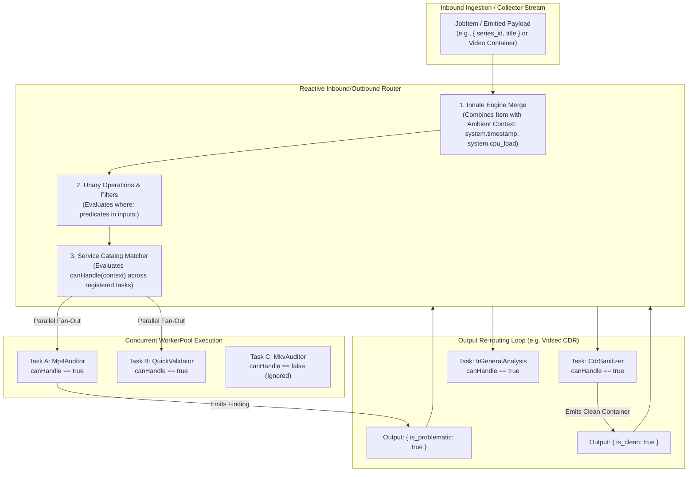
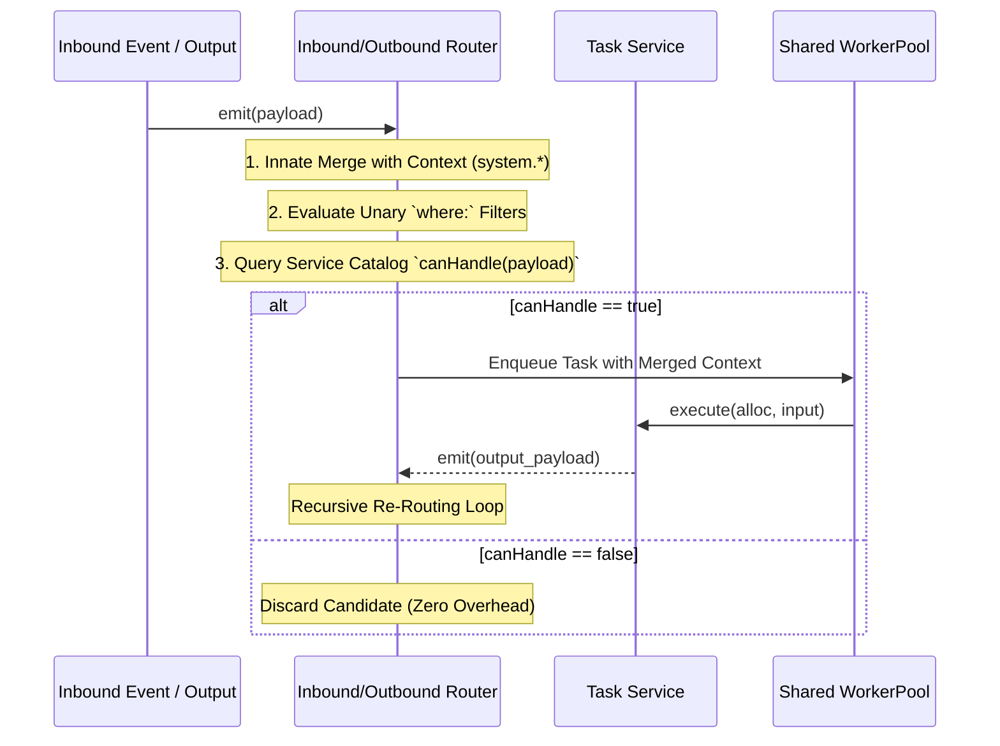

# 018 — Type-Driven Reactive Inbound/Outbound Router, Service Catalog with `canHandle`, and Unary Input Transformations

| Metadata | Value |
| :--- | :--- |
| **ID** | `ARCH-018` |
| **Depends On** | [`ARCH-014`](./014-inbound-emitter-datasources-and-reactive-dispatch.md), [`ARCH-016`](./016-reactive-bifurcation-parallel-expansion-and-join.md), [`ARCH-017`](./017-concurrent-dag-scheduler-and-host-concurrency-contract.md) |
| **Area** | `src/engine/`, `src/plugin/`, `src/dataflow/`, `src/yaml/` |
| **Status** | `DESIGN & ARCHITECTURE SPECIFICATION` |

---

## 1. Context & Motivation

In previous iterations:
* `ARCH-014` unified datasources with reactive event emission (`RecordEmitter`), local file watching/hot-reloading, and core push dispatch.
* `ARCH-016` introduced multi-channel bifurcations and typed lowered representations (`Lowered(T)` + `schema_id`).
* `ARCH-017` implemented concurrent DAG execution with single-writer channels and a shared `WorkerPool`.

However, the existing routing model relies on **static nominal wiring** in `pipeline.yaml`:
```yaml
steps:
  - id: fetch_details
    uses: manga_catalog/fetch_series_details
    inputs:
      input: tracked_targets # <-- Explicit nominal binding
```

This nominal approach presents three fundamental operational limitations:

1. **Rigid Point-of-Entry Coupling**:
   Execution must always start at the fixed root task of a pipeline. If an external collector, webhook, or upstream step produces an intermediate item (e.g., chapter metadata or a raw video frame), the engine cannot naturally re-enter the DAG mid-stream; it is forced to execute redundant upstream steps or require dedicated, fragmented pipelines.
2. **Configuration Bloat for Identical Schemas**:
   When multiple concurrent pipelines or tasks share the same transport context / stream (e.g., in `vidsec` where format-specific auditors, vulnerability checkers, and anomaly detectors all evaluate the incoming container), each step must explicitly wire the same datasource name over and over.
3. **Recompilation for Simple Input Adaptations**:
   If an incoming payload's fields differ slightly from a task's struct or require environmental filtering (e.g., night-time scheduling or CPU load throttling), requiring hardcoded adapter tasks in Zig forces code changes and recompilation for what should be simple declarative configuration.

`ARCH-018` introduces a **Type-Driven Reactive Inbound/Outbound Router**, a **Service Catalog** with `canHandle` predicates, **Innate Engine Input Merging**, and **Unary Declarative Input Transformations**.

---

## 2. Conceptual Model: Type-Driven Router & Service Catalog

Rather than dispatching records purely by explicit step or datasource names, Flowdata elevates **Schema Compatibility** and **Service Predicates** (`canHandle`) as the primary dispatch mechanism.



---

## 3. Detailed Architecture

### 3.1. The Service Catalog Contract (`IService` / `canHandle`)

Every task service registered in the engine can declare (or automatically inherit) an affinity predicate:

```zig
pub const ServicePredicateFn = *const fn (ctx: *anyopaque, payload: PayloadHandle) bool;
```

In the SDK (`src/plugin/sdk/define_task_service.zig`), `canHandle` operates in two modes:

1. **Automatic (Structural Compatibility)**:
   If the service does not define a custom `canHandle`, the compiler inspects the task's `Inputs` struct via comptime reflection:
   * Verifies that the incoming payload contains all required fields of `Inputs` (or matches `schema_id`).
   * Returns `true` if compatible, `false` otherwise.
2. **Explicit Override (Domain Logic Predicate)**:
   The service can implement its own `canHandle`:
   ```zig
   pub const CdrSanitizerService = struct {
       pub fn canHandle(self: *CdrSanitizerService, payload: PayloadHandle) bool {
           if (payload.getReflected("is_problematic")) |val| {
               return val.asBool() orelse false;
           }
           return false;
       }

       pub fn execute(self: *CdrSanitizerService, alloc: Allocator, in: ProblemMedia) !CleanMedia {
           // Surgical hole punching / sanitization
       }
   };
   ```

### 3.2. Innate Engine Merge & Ambient Context

The engine innately merges incoming payload fields with available runtime contextual properties before dispatching to tasks:

* **`system.timestamp`**: Epoch nanoseconds / ISO-8601 string.
* **`system.hour`**: Local system hour ($0 \dots 23$).
* **`system.cpu_load`**: Current host CPU utilization percentage.
* **`env.*`**: Host environment variables.

All available inputs form a unified `AvailableInputsContext`. Tasks do not need to re-declare these fields if they already require them in their native Zig struct.

### 3.3. Unary Operations in `inputs:` (Zero Recompilation)

To prevent code recompilation when configuring thresholds, environments, or scheduling windows, the `inputs:` section in `pipeline.yaml` supports **Unary Operations**:

```yaml
steps:
  - id: heavy_video_audit
    uses: vidsec/deep_audit
    inputs:
      # Unary filter 1: CPU throttling
      cpu_usage:
        from: system.cpu_load
        where: "< 80"
        
      # Unary filter 2: Operating hours constraint
      timestamp:
        from: system.timestamp
        where: "hour >= 8 and hour <= 20"
```

#### Evaluation Rules:
1. **Short-Circuit Rejection**: Unary `where:` conditions are evaluated in sequence. If any unary condition fails, the candidate task is dismissed immediately ($O(1)$) before allocating memory, waking worker threads, or invoking C-ABI boundaries.
2. **No Schema Duplication**: The YAML does not re-declare the task's native fields. It only specifies additional ambient inputs and their unary constraints.

---

### 3.4. Nested Field Navigation & Scope Shadowing (Cero MapStruct)

To modify or filter on nested schemas without dynamic runtime struct mutations (which would violate C-ABI alignment and degrade zero-copy performance):

1. **Zero-Copy Nested Navigation**:
   Paths like `container.header.codec_id` are navigated directly via pointer offsets in $O(1)$:
   ```zig
   payload.getReflectedPath("container.header.codec_id");
   ```
2. **Scope Shadowing (Local Overrides)**:
   If a field is transformed via a unary expression in YAML, the engine places the transformed value into a lightweight local **Shadow Layer**:
   * The original binary struct remains intact and un-mutated.
   * When `input_injector` populates the task struct, it checks the shadow layer first, resolving the transformed value with priority.

---

### 3.5. Intermediate DAG Re-Entry (Dynamic Sub-DAGs)

Because the router matches by schema compatibility, external inputs can re-enter the execution graph at any depth:

| Emitted Item Signature | Matched Task | DAG Execution Path |
| :--- | :--- | :--- |
| `{ series_id }` | `fetch_details` (Step 1) | Full DAG: Step 1 $\to$ 2 $\to$ 3 $\to$ 4 |
| `{ series_id, chapter_id }` | `fetch_pages` (Step 3) | Sub-DAG: Step 3 $\to$ 4 (Steps 1 & 2 skipped) |
| `{ page_url, chapter_id }` | `download_page` (Step 4) | Elemental Step 4 only |

### 3.6. Disambiguation, Provenance & Multi-Branch Joins

When automatic schema matching is insufficient:

1. **Explicit Provenance (`from:`)**:
   ```yaml
   inputs:
     video:
       from: cdr_sanitizer.clean_output # Only consumes from this specific producer step
   ```
2. **Multi-Branch Join Synchronization**:
   When a task requires outputs from multiple parallel branches (e.g., Step 4 download and Step 7 metadata):
   * The Router tracks completion keyed by `correlation_id` / `trace_id`.
   * A barrier holds activation until all required inputs are present in the correlation mailbox.
   * The combined inputs are innately merged and dispatched to the join task.

---

## 4. Execution Lifecycle in Core Engine



---

## 5. Specification Roadmap & Phase Deliverables

| Phase | Milestone | Deliverables |
| :--- | :--- | :--- |
| **Phase 1** | **ABI & SDK Predicates** | Add `can_handle_fn` to `TaskDescriptor_ABI`; implement auto-reflection and explicit `canHandle` in `defineTaskService`. |
| **Phase 2** | **Innate Merge & Ambient Provider** | Core context provider for `system.timestamp`, `system.cpu_load`, and host metrics. |
| **Phase 3** | **Unary Operations & Shadowing** | Unary `where:` evaluator inside `inputs:`; scope shadowing in `input_injector`. |
| **Phase 4** | **Inbound/Outbound Reactive Router** | Router component in `src/engine/` managing catalog matching, provenance filtering, and output re-entry loops. |
| **Phase 5** | **Integration & Verification** | End-to-end tests validating multi-branch fan-out, sub-DAG re-entry, and Vidsec triage $\to$ CDR $\to$ IR cycle. |
