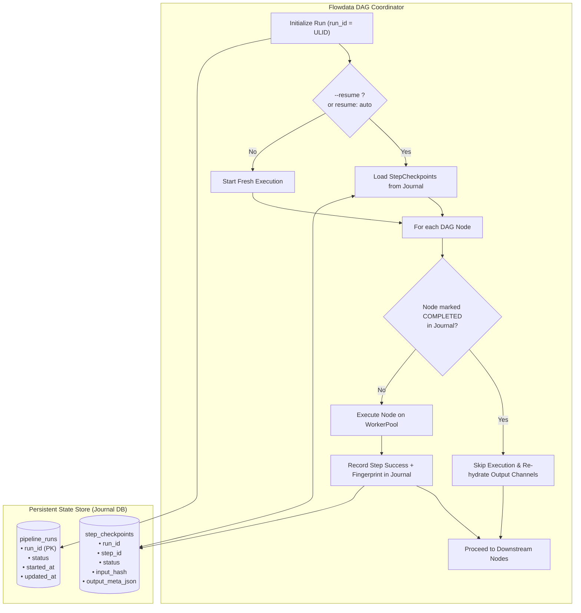

# 020 — Pipeline Run Journaling, Checkpointing & Crash Resume

| Metadata | Value |
| :--- | :--- |
| **ID** | `ARCH-020` |
| **Depends On** | [`ARCH-009`](./009-unified-sqlite-storage-and-schema.md), [`ARCH-017`](./017-concurrent-dag-scheduler-and-host-concurrency-contract.md), [`ARCH-018`](./018-type-driven-inbound-router-and-service-catalog.md) |
| **Area** | `src/engine/`, `src/repository/`, `src/kernel/` |
| **Status** | `SPECIFICATION` |

---

## 1. Context & Motivation

Long-running pipelines—such as downloading 100 chapters across multiple sources, analyzing 10 GB video containers with deep sample extraction, or processing high-resolution media archives—are vulnerable to interruptions:
1. **Host Outages & Crashes**: Unhandled panics, OS reboots, or OOM killer events terminate the engine.
2. **Network Drops & Timeouts**: Transient upstream outages abort the pipeline mid-execution.
3. **Intentional Termination**: Operators stop the process via SIGINT / SIGTERM to apply configuration updates or maintenance.

### The Problem
Currently, restarting the engine requires **re-running the entire pipeline from step 0**. While individual application tasks may implement ad-hoc deduplication checks (e.g. querying SQLite to see if a chapter exists), this moves state management into domain plugins, introduces redundant boilerplate, and fails to handle intermediate in-memory channel artifacts.

`ARCH-020` introduces engine-level **Pipeline Run Journaling, Checkpointing, and Crash Resume**, allowing interrupted runs to seamlessly resume from their last verified milestone.

---

## 2. Conceptual Model & Execution Lifecycle



---

## 3. Detailed Architecture

### 3.1. Journal Schema (`pipeline_journal.sqlite`)

The engine manages a lightweight, dedicated SQLite journal:

```sql
CREATE TABLE IF NOT EXISTS pipeline_runs (
    run_id TEXT PRIMARY KEY,
    pipeline_name TEXT NOT NULL,
    status TEXT NOT NULL,          -- 'running', 'completed', 'failed', 'interrupted'
    started_at INTEGER NOT NULL,
    updated_at INTEGER NOT NULL,
    error_message TEXT
);

CREATE TABLE IF NOT EXISTS step_checkpoints (
    run_id TEXT NOT NULL,
    step_id TEXT NOT NULL,
    status TEXT NOT NULL,          -- 'pending', 'running', 'completed', 'failed', 'skipped'
    input_hash TEXT NOT NULL,      -- SHA-256 of bound input channels / config
    output_meta_json TEXT,         -- Channel names, record counts, and stored payload keys
    completed_at INTEGER NOT NULL,
    PRIMARY KEY (run_id, step_id),
    FOREIGN KEY (run_id) REFERENCES pipeline_runs(run_id) ON DELETE CASCADE
);

CREATE INDEX IF NOT EXISTS idx_step_checkpoints_lookup 
ON step_checkpoints(run_id, status);
```

### 3.2. Step Fingerprinting & Validation

A checkpoint is considered valid for skip/resume if and only if:
1. `status == 'completed'`.
2. The current `input_hash` matches the checkpointed `input_hash`. The hash incorporates:
   * The task's static YAML parameters (`step.params`).
   * The input channel payload digest / metadata.
   * If parameters or inputs change between runs, the engine invalidates the checkpoint and re-executes the node.

### 3.3. Output Channel Re-hydration

When a step is skipped:
* If the task's output channel was bound to a persistent datasource (e.g. `catalog_db` in SQLite or disk file), the engine links downstream consumers directly to the existing table/file.
* If the output channel was in `pipeline_memory`, the journal stores serialized channel references or prompts dependent steps to read directly from the persistent checkpoint store.

### 3.4. Declarative YAML Configuration

```yaml
runtime:
  workers: 4
  scheduler: dag
  journal:
    enabled: true
    path: "./output/journal.sqlite"
    mode: auto                     # auto | explicit | disabled
    retention_runs: 20             # Automatically prunes older run history
    checkpoints:
      - id: fetch_details
        checkpoint: true
      - id: fetch_chapters
        checkpoint: true
      - id: build_cbz
        checkpoint: true
```

### 3.5. CLI Integration
```bash
# Start a new pipeline with explicit run tracking
flowdata run configs/pipeline.yaml

# Resume an interrupted or failed execution
flowdata run configs/pipeline.yaml --resume 01HC8A5Z00XYZ1234567890ABC

# Auto-resume the latest unfinished run
flowdata run configs/pipeline.yaml --resume latest
```

---

## 4. Implementation Plan

| Phase | Deliverable | Risk | Status |
|---|---|:---:|:---:|
| **20.1** | `RunJournal` engine component wrapping SQLite with `pipeline_runs` and `step_checkpoints` | Low | **PENDING** |
| **20.2** | Step input hashing (`input_hash`) and fingerprint validation in DAG Coordinator | Medium | **PENDING** |
| **20.3** | Skip logic and output channel re-hydration for completed milestones | Medium | **PENDING** |
| **20.4** | CLI `--resume <run_id \| latest>` and YAML `runtime.journal` integration | Low | **PENDING** |

---

## 5. Acceptance Criteria

1. **Zero Repeated Work**: In a pipeline with steps `A -> B -> C`, if the process crashes during `C`, restarting with `--resume` does not invoke `A` or `B`; execution resumes immediately at `C`.
2. **Fingerprint Sensitivity**: Modifying a parameter of `B` in `pipeline.yaml` causes `B` and all downstream nodes to invalidate their checkpoints and re-execute.
3. **Crash Safety**: Journal entries are written with SQLite `WAL` mode and explicit transactions (`BEGIN IMMEDIATE`); an abrupt kill never leaves corrupted journal state.
4. **Clean Retention**: Old runs past `retention_runs` are automatically evicted along with their associated temp tables without locking the engine.
