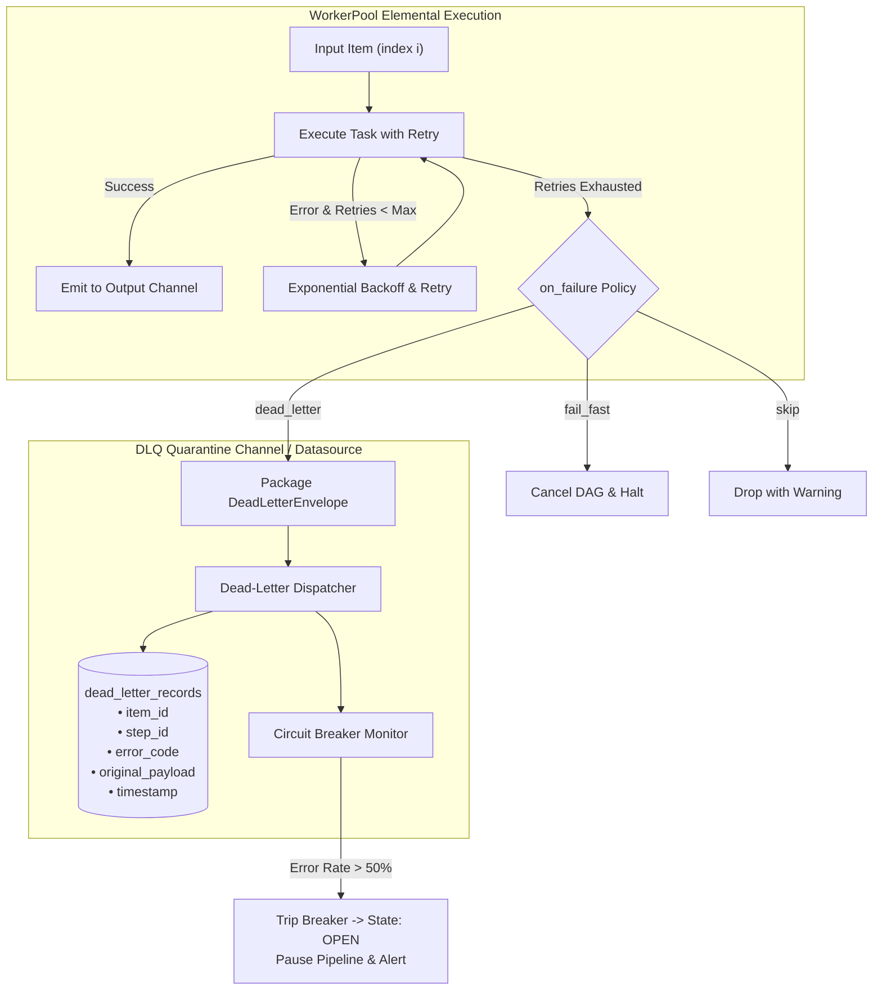

# 021 — Dead-Letter Queue (DLQ), Error Quarantine & Circuit Breaker

| Metadata | Value |
| :--- | :--- |
| **ID** | `ARCH-021` |
| **Depends On** | [`ARCH-016`](./016-reactive-bifurcation-parallel-expansion-and-join.md), [`ARCH-017`](./017-concurrent-dag-scheduler-and-host-concurrency-contract.md), [`ARCH-018`](./018-type-driven-inbound-router-and-service-catalog.md) |
| **Area** | `src/engine/`, `src/plugin/`, `src/dataflow/` |
| **Status** | `SPECIFICATION` |

---

## 1. Context & Motivation

With elemental auto-lifting (`ARCH-016`), tasks execute concurrently over collections of items (e.g., hundreds of chapter pages or streaming video packets). Current error handling provides three policies:
* `fail_fast`: Halts the entire pipeline upon the first item error (unacceptable for batch pipelines where 1 bad page shouldn't kill 99 good ones).
* `skip`: Silently discards the failed item and proceeds (dangerous for production: work items disappear without audit trails).
* `collect`: Collects all errors and aborts at the end of the step.

### The Problem
When network blips, corrupted headers, or CDN 404s cause individual items to fail permanently:
1. **Silent Data Loss**: With `skip`, failed items are lost from downstream workflows without structured diagnostic records.
2. **Cascading Hammering**: Without an automated **Circuit Breaker**, a failing remote endpoint (e.g., MangaDex CDN down or IP rate-limited) causes hundreds of concurrent workers to repeatedly fail, exhaust retry budgets, and trigger IP bans.

`ARCH-021` introduces **Dead-Letter Queues (DLQ)** for structured error quarantine and a **Circuit Breaker** to protect both local resources and upstream endpoints.

---

## 2. Conceptual Model



---

## 3. Detailed Architecture

### 3.1. The `DeadLetterEnvelope` Contract

When an item fails unrecoverably, the engine captures its exact state:

```zig
pub const DeadLetterEnvelope = struct {
    run_id: []const u8,
    step_id: []const u8,
    item_index: usize,
    error_code: []const u8,
    error_message: []const u8,
    attempt_count: u32,
    failed_at_ns: u64,
    payload_type: []const u8,
    original_payload_raw: []const u8,
};
```

### 3.2. Declarative Step Configuration in YAML

```yaml
steps:
  - id: download_pages
    uses: manga_fetcher/download_chapter_page
    lift: elemental
    inputs:
      input: discovered_pages
    error_policy:
      on_failure: dead_letter           # dead_letter | fail_fast | skip | collect
      max_retries: 3
      backoff_initial_ms: 500
      backoff_multiplier: 2.0
      dead_letter:
        datasource: catalog_db          # Relational sink or isolated file
        table: quarantine_failures
    circuit_breaker:
      enabled: true
      window_size: 20                  # Monitor rolling window of 20 items
      failure_threshold: 0.5           # Trip if >= 50% fail in window
      cooldown_seconds: 30             # Cooldown before trying half-open
```

### 3.3. Circuit Breaker States & Transitions

The circuit breaker adheres to the classic 3-state state machine:

| State | Behavior |
| :--- | :--- |
| **CLOSED** (Normal) | All items dispatch to workers. Failures count toward rolling window error rate. |
| **OPEN** (Tripped) | Threshold exceeded (e.g. 10/20 failed). Engine immediately suspends dispatching, enters cooldown, and logs high-priority alert. |
| **HALF-OPEN** (Probe) | After `cooldown_seconds`, allows 1 probe item. If successful -> resets to `CLOSED`; if failed -> returns to `OPEN`. |

---

## 4. Implementation Plan

| Phase | Deliverable | Risk | Status |
|---|---|:---:|:---:|
| **21.1** | `DeadLetterEnvelope` contract and serialization in `src/dataflow/` | Low | **PENDING** |
| **21.2** | DLQ routing in `task_executor.zig` and Coordinator upon retry exhaustion | Medium | **PENDING** |
| **21.3** | Dedicated `quarantine_failures` schema and auto-provisioning | Low | **PENDING** |
| **21.4** | Rolling window `CircuitBreaker` with Closed/Open/Half-Open state transitions | Medium | **PENDING** |

---

## 5. Acceptance Criteria

1. **Zero Data Loss**: In an elemental step of 100 items where 5 fail all retries, exactly 95 items appear in the output channel and exactly 5 items appear in the DLQ table with their original payload and stack trace intact.
2. **Circuit Protection**: If a mock endpoint returns HTTP 500 on the first 10 items of a 20-item window (50% failure rate), the circuit breaker transitions to `OPEN` and prevents the remaining 80 items from hitting the network.
3. **Telemetry & Observability**: DLQ routing emits standard OTel span events (`span.addEvent("dead_letter.quarantined")`) with structured error attributes.
