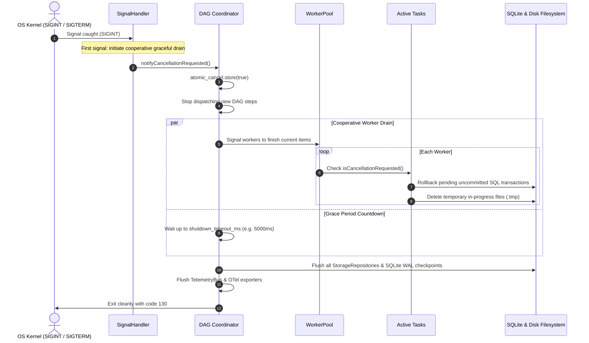

# 022 — POSIX Signal Handling, Graceful Worker Pool Draining & Clean Termination

| Metadata | Value |
| :--- | :--- |
| **ID** | `ARCH-022` |
| **Depends On** | [`ARCH-002`](./002-open-kernel-extension-system.md), [`ARCH-017`](./017-concurrent-dag-scheduler-and-host-concurrency-contract.md) |
| **Area** | `src/transport/`, `src/engine/`, `src/kernel/` |
| **Status** | `SPECIFICATION` |

---

## 1. Context & Motivation

In high-concurrency dataflow environments (`WorkerPool` running up to 32 parallel tasks across CPU and network workloads), terminating the engine via `SIGINT` (Ctrl+C), `SIGTERM` (Docker / Kubernetes shutdown), or systemd service stops currently causes abrupt process exit.

### The Risks of Ungraceful Abrupt Termination
1. **Database Lock & Journal Corruption**: An abrupt kill in the middle of a SQLite write locks WAL files and triggers lengthy recovery routines upon subsequent restarts.
2. **Corrupted Output Files**: Writing a `.cbz` archive or large media file leaves partial, corrupted zero-byte or incomplete archives on disk that corrupt downstream readers.
3. **Telemetry & Trace Loss**: In-flight OpenTelemetry spans, audit logs, and metrics buffers are dropped before they can be flushed to collectors or JSONL sinks.
4. **Leaked System Resources**: Sockets, temporary working files, and IPC pipes remain uncollected.

`ARCH-022` specifies a robust, cooperative **POSIX Signal Coordinator, Graceful Worker Pool Drain, and Atomic File Finalization Contract**.

---

## 2. Conceptual Model: Cooperative Termination Lifecycle



---

## 3. Detailed Architecture

### 3.1. POSIX Signal Trapping (`src/transport/common/signals.zig`)

The host installs signal handlers using `std.posix.sigaction` for:
* `SIGINT` (Interactive Ctrl+C)
* `SIGTERM` (Container / orchestration shutdown request)
* `SIGHUP` (Optional configuration reload)

```zig
pub const SignalCoordinator = struct {
    canceled: std.atomic.Value(bool) = std.atomic.Value(bool).init(false),
    force_exit_count: std.atomic.Value(u32) = std.atomic.Value(u32).init(0),

    pub fn handleSignal(sig: c_int) void {
        const count = instance.force_exit_count.fetchAdd(1, .monotonic);
        if (count == 0) {
            std.debug.print("\n[Engine] Received termination signal ({d}). Initiating graceful drain (Press Ctrl+C again to force exit)...\n", .{sig});
            instance.canceled.store(true, .release);
        } else {
            std.debug.print("\n[Engine] Force exit requested. Terminating immediately.\n", .{});
            std.posix.exit(130);
        }
    }
};
```

### 3.2. Two-Signal Safety Valve
* **Signal 1**: Initiates cooperative drain. The engine gives active workers up to `shutdown_timeout_ms` to wrap up their active item.
* **Signal 2**: If the user presses Ctrl+C a second time (or Kubernetes issues a follow-up `SIGKILL`), the handler aborts immediately (`force exit`).

### 3.3. Atomic File Finalization Pattern (`.tmp` Staging)
To guarantee that archives and output files are never left in a partial state:
1. All file writers (e.g. `cbz_packager`, `file_sink`) must write to a temporary path: `<output_path>.tmp.<ULID>`.
2. Once the write succeeds and checksums are verified, execute an atomic filesystem rename:
   `std.posix.rename(tmp_path, final_path)`.
3. If cancellation occurs during writing, the temporary file is deleted before the process exits.

### 3.4. Transaction Rollback & SQLite WAL Checkpoint
Upon shutdown initiation:
1. Workers holding uncommitted database transactions issue `ROLLBACK;`.
2. The main thread calls `PRAGMA wal_checkpoint(TRUNCATE);` to ensure the database file is clean and free of pending locks.

---

## 4. Implementation Plan

| Phase | Deliverable | Risk | Status |
|---|---|:---:|:---:|
| **22.1** | `SignalCoordinator` with `sigaction` handlers and atomic cancellation flags | Low | **PENDING** |
| **22.2** | WorkerPool cooperative drain loop and `shutdown_timeout_ms` guard | Medium | **PENDING** |
| **22.3** | Atomic `.tmp` rename pattern in file writers (`build_cbz_archive.zig`) | Low | **PENDING** |
| **22.4** | Clean repository flushing and exit code standardization (130 / 143) | Low | **PENDING** |

---

## 5. Acceptance Criteria

1. **Clean Exit Code**: Terminating a running pipeline via SIGINT exits with code `130`; SIGTERM exits with code `143`.
2. **Zero Corrupted Files**: Sending SIGINT while writing a 50MB CBZ archive leaves either the previous complete archive or nothing (no zero-byte or corrupt `.cbz` files).
3. **Zero Orphaned Locks**: Restarting `flowdata run` immediately after a SIGINT shutdown opens the SQLite database without encountering `SQLITE_BUSY` or `database is locked`.
4. **Flushed Traces**: The JSONL trace file contains a final `run_interrupted` event and all completed spans prior to exit.
