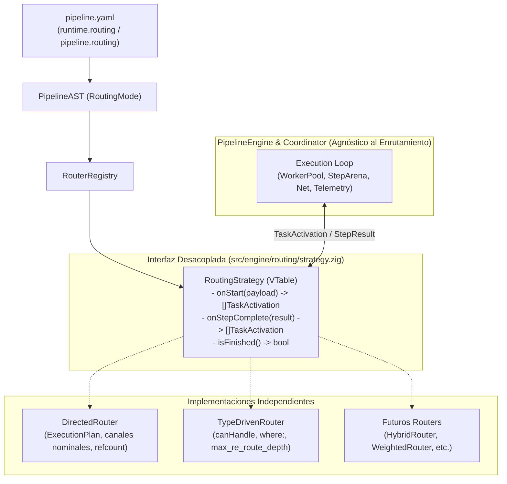

# 023 — Pluggable Routing Strategy & Engine Decoupling

| Metadata | Value |
| :--- | :--- |
| **ID** | `ARCH-023` |
| **Depends On** | [`ARCH-017`](./017-concurrent-dag-scheduler-and-host-concurrency-contract.md), [`ARCH-018`](./018-type-driven-inbound-router-and-service-catalog.md) |
| **Area** | `src/engine/`, `src/ast/`, `src/yaml/` |
| **Status** | `SPECIFICATION` |

---

## 1. Context & Motivation

Actualmente en [`src/engine/`](../../src/engine) conviven dos paradigmas válidos de enrutamiento de tareas:

1. **Enrutamiento Dirigido / Nominal (`directed`)**: Sigue la topología declarada en `pipeline.yaml` mediante orden de pasos, `after:` y canales explícitos (`inputs:` / `outputs:`), garantizando determinismo y refcounting estático de memoria ([`ARCH-017`](./017-concurrent-dag-scheduler-and-host-concurrency-contract.md)).
2. **Enrutamiento Guiado por Tipos (`type_driven`)**: Determina qué tareas activar dinámicamente inspeccionando las firmas de entrada (`canHandle`) y filtros unarios `where:` ([`ARCH-018`](./018-type-driven-inbound-router-and-service-catalog.md)).

### Problema Arquitectónico Actual
Hoy la lógica de **decisión de enrutado** (qué tarea sigue y con qué inputs) está mezclada con la **mecánica de ejecución** (hilos, `WorkerPool`, `StepArena`, telemetría y red) repartida entre cuatro archivos:
* [`src/engine/plan.zig`](../../src/engine/plan.zig): Calcula aristas nominales (`inputs:`, `after:`, `implicit_chain`).
* [`src/engine/coordinator.zig`](../../src/engine/coordinator.zig): Ejecuta el `WorkerPool` y gestiona `StepArena`, pero también resuelve `resolveStreamExpr`, merge ambiental y filtros unarios `where:`.
* [`src/engine/router.zig`](../../src/engine/router.zig): Evalúa `canHandle` y bucles de re-enrutado, pero envuelve directamente a `Coordinator` y `executeSubPipelineSelective`.
* [`src/engine/engine.zig`](../../src/engine/engine.zig): Mantiene una ruta de ejecución secuencial paralela con lógica duplicada de binding de inputs.

Si añadimos nuevas formas de enrutar (como selección en YAML o enrutado híbrido) mediante `if/else` sobre esta estructura, el motor derivará en código espagueti difícil de mantener y testear.

### Objetivo
Desacoplar completamente **cómo se decide qué ejecutar (`RoutingStrategy`)** de **cómo se ejecuta y gestiona la memoria (`PipelineEngine` / `Coordinator`)**, permitiendo:
1. Estrategias independientes entre sí (`DirectedRouter`, `TypeDrivenRouter`, futuras estrategias).
2. Motor agnóstico al tipo de enrutamiento.
3. Tests unitarios puros de cada router (sin levantar `WorkerPool`, red ni SQLite) y tests del motor con un `MockRouter`.
4. Selección declarativa en YAML mediante `routing:`.

---

## 2. Target Architecture



### Separación Estricta de Responsabilidades

| Componente | Responsabilidad Única | Qué NO debe conocer |
| :--- | :--- | :--- |
| **`PipelineEngine` / `Coordinator`** | Ciclo de vida, `WorkerPool`, `StepArena` (creación y `freeArena`), `NetworkController`, `AmbientContext`, telemetría. | Cómo se emparejan inputs, `canHandle`, `ExecutionPlan` interno o profundidad de re-enrutado. |
| **`DirectedRouter`** | Grafo nominal (`ExecutionPlan`), resolución de canales `inputs:`/`outputs:`, barreras Join y conteo de consumidores. | `WorkerPool`, hilos, sockets, SQLite o `canHandle`. |
| **`TypeDrivenRouter`** | Coincidencia estructural `canHandle`, filtros unarios `where:`, control de ciclos (`visited_mask`, `max_re_route_depth`). | `WorkerPool`, `StepArena` o aristas nominales de `plan.zig`. |

---

## 3. Declarative YAML Contract (`routing:`)

Separar `scheduler` (concurrencia/recursos) de `routing` (topología/despacho):

```yaml
runtime:
  workers: 4
  scheduler: dag          # Cómo se ejecuta: sequential | dag
  routing: directed       # Cómo se enlaza: directed | type_driven | hybrid (default: directed)
  max_inflight_bytes: 512MiB
```

También sobreescribible a nivel de cada pipeline individual:

```yaml
pipelines:
  manga_sync:
    routing: directed     # ETL estricto con Fork/Join explícito
    steps: [...]

  security_triage:
    routing: type_driven  # Malla de eventos basada en firmas (canHandle)
    steps: [...]
```

### Matriz de Ortogonalidad

| `scheduler` \ `routing` | `directed` | `type_driven` | `hybrid` (futuro) |
| :--- | :--- | :--- | :--- |
| **`sequential`** | Ejecución 1-a-1 en el orden topológico del grafo. | Bucle reactivo en un único hilo por cada emisión. | Igual que `sequential` con auto-binding 1:1. |
| **`dag`** | Pool concurrente con canales nominales y backpressure. | Pool concurrente disparando todas las tareas con `canHandle == true` en paralelo. | Pool concurrente con inferencia automática donde falte `inputs:`. |

---

## 4. Contrato Core en Zig (`RoutingStrategy`)

Ubicación propuesta: `src/engine/routing/strategy.zig`.

```zig
pub const TaskActivation = struct {
    node_id: NodeId,
    step_input: PayloadHandle,
    bound_inputs: []const BoundInput,
    /// Opcional: canales consumidos para decrementar refcount en modo directed.
    consumed_channels: []const ChannelId = &.{},
};

pub const StepOutcomeEvent = struct {
    node_id: NodeId,
    status: TaskStatus,
    output: PayloadHandle,
    channel_outputs: []const NamedPayload,
};

pub const RoutingStrategy = struct {
    ptr: *anyopaque,
    vtable: *const VTable,

    pub const VTable = struct {
        /// Inicializa el estado de enrutado para una ejecución y devuelve las activaciones raíz.
        onPipelineStart: *const fn (
            ptr: *anyopaque,
            alloc: Allocator,
            initial_input: PayloadHandle,
        ) anyerror![]TaskActivation,

        /// Procesa la finalización de una tarea y devuelve nuevas activaciones desbloqueadas.
        onStepComplete: *const fn (
            ptr: *anyopaque,
            alloc: Allocator,
            event: StepOutcomeEvent,
        ) anyerror![]TaskActivation,

        /// Indica si quedan nodos pendientes de activar o barreras activas.
        hasPendingWork: *const fn (ptr: *anyopaque) bool,

        deinit: *const fn (ptr: *anyopaque) void,
    };
};
```

> **Nota sobre aislamiento:** Este contrato solo depende de tipos de datos (`PayloadHandle`, `BoundInput`, `NodeId`, `Allocator`). No importa nada de `WorkerPool`, `NetworkController` ni `RepositoryRegistry`.

---

## 5. Plan de Implementación Paso a Paso (Incremental y Sin Roturas)

Cada fase es autocontenida y debe dejar todas las suites de tests en verde antes de pasar a la siguiente.

### Fase 1: Directiva `routing:` en AST y Loader YAML
* **Archivos:** [`src/ast/ast.zig`](../../src/ast/ast.zig), [`src/yaml/ast_loader.zig`](../../src/yaml/ast_loader.zig).
* **Cambios:**
  1. Añadir `pub const RoutingMode = enum { directed, type_driven, hybrid };`.
  2. Añadir `routing: RoutingMode = .directed` a `RuntimeSpec` y `routing: ?RoutingMode = null` a `PipelineDecl` (si es `null`, hereda `runtime.routing`).
  3. Parsear el campo `routing` en `ast_loader.zig` manteniendo `.directed` por defecto para 100% de retrocompatibilidad.
* **Verificación:** Tests unitarios de AST y YAML comprobando valores por defecto y override por pipeline.

### Fase 2: Definir `RoutingStrategy` y `RouterRegistry`
* **Archivos nuevos:** `src/engine/routing/strategy.zig`, `src/engine/routing/registry.zig`.
* **Cambios:**
  1. Definir `RoutingStrategy`, `TaskActivation`, `StepOutcomeEvent` y `RoutingContext` (solo vistas de solo lectura de AST, descriptores `canHandle`, repositorios de lectura e `AmbientContext`).
  2. Crear `RouterRegistry` (patrón idéntico a `RepositoryRegistry`) para instanciar estrategias por `RoutingMode` o nombre personalizado.
* **Verificación:** Compilación limpia y test con un `MockRouter` en memoria.

### Fase 3: Extraer `DirectedRouter`
* **Archivos:** `src/engine/routing/directed.zig` (extraído desde [`plan.zig`](../../src/engine/plan.zig), [`coordinator.zig`](../../src/engine/coordinator.zig) y [`engine.zig`](../../src/engine/engine.zig)).
* **Cambios:**
  1. Encapsular `ExecutionPlan`, tracking de `indegree` restante, resolución de `inputs:` (`resolveStreamExpr`), filtros unarios `where:` y mapeo de `consumed_channels`.
  2. Exponer `RoutingStrategy` sin depender de `WorkerPool`.
* **Verificación:** Suite unitaria pura de `DirectedRouter`: pasar un `PipelineDecl` (lineal, fork, join) + payloads simulados y validar la secuencia exacta de `TaskActivation` devuelta en microsegundos y sin hilos.

### Fase 4: Aislar `TypeDrivenRouter`
* **Archivos:** Refactorizar [`src/engine/router.zig`](../../src/engine/router.zig) hacia `src/engine/routing/type_driven.zig`.
* **Cambios:**
  1. Implementar `RoutingStrategy` usando exclusivamente `TaskDescriptor_ABI.canHandle`, evaluación de `where:` unario, `visited_mask` y límite `max_re_route_depth`.
  2. Eliminar de `TypeDrivenRouter` cualquier invocación directa a `Coordinator.runSelective` o `executeSubPipelineSelective`: el router solo emite `[]TaskActivation` y deja que el motor ejecute.
* **Verificación:** Migrar los casos de [`tests/core/reactive_router_test.zig`](../../tests/core/reactive_router_test.zig) para validar `TypeDrivenRouter` en aislamiento y en integración con el motor.

### Fase 5: Unificar el Bucle de Ejecución en `Coordinator` y `PipelineEngine`
* **Archivos:** [`src/engine/coordinator.zig`](../../src/engine/coordinator.zig), [`src/engine/engine.zig`](../../src/engine/engine.zig).
* **Cambios:**
  1. Hacer que `Coordinator` reciba una `RoutingStrategy` creada desde `RouterRegistry` según `pipeline.routing orelse runtime.routing`.
  2. Reemplazar la lógica inline de `dispatchTask` (resolución de `inputs:`, `where:`, `indegree` ad-hoc) por llamadas a `strategy.onPipelineStart(...)` y `strategy.onStepComplete(...)`.
  3. Unificar la ejecución `sequential` usando el mismo ciclo con `strategy` (simplemente ejecutando `TaskActivation`s en el hilo actual en lugar de encolar en `WorkerPool`), eliminando la duplicación en `engine.zig`.
* **Verificación:**
  * Nuevo test unitario de `Coordinator` usando `MockRouter` para probar backpressure (`max_inflight_bytes`), cancelación y `freeArena` de forma aislada.
  * Todas las suites existentes (`zig build test`, `apps/mangadex`, `apps/vidsec`) pasando al 100%.

### Fase 6 (Opcional / Futura): `HybridRouter` (`auto_bind`)
* **Archivos:** `src/engine/routing/hybrid.zig`.
* **Cambios:**
  1. Reutilizar el grafo de `DirectedRouter`, pero cuando un paso omita `inputs:`, inspeccionar `canHandle` frente a los canales ya declarados por pasos anteriores.
  2. Si existe exactamente un canal compatible, crear la arista de datos y sumar al `consumers_count` automáticamente; si hay ambigüedad o es un Join multi-rama, exigir `inputs:` explícito.

---

## 6. Criterios de Aceptación

1. **Cero dependencias cruzadas:** `directed.zig` y `type_driven.zig` no se importan entre sí ni importan `WorkerPool` / `Coordinator`.
2. **Testabilidad pura:** Cada estrategia de enrutado dispone de tests unitarios que se ejecutan sin hilos, sin red y sin acceso a disco.
3. **Motor desacoplado:** `Coordinator` tiene tests unitarios verificando gestión de arenas y `WorkerPool` contra un `MockRouter`.
4. **Retrocompatibilidad total:** Pipelines sin `routing:` siguen comportándose como `directed` sin requerir cambios en [`apps/mangadex/configs/pipeline.yaml`](../../apps/mangadex/configs/pipeline.yaml) ni [`apps/vidsec/configs/pipeline.yaml`](../../apps/vidsec/configs/pipeline.yaml).
