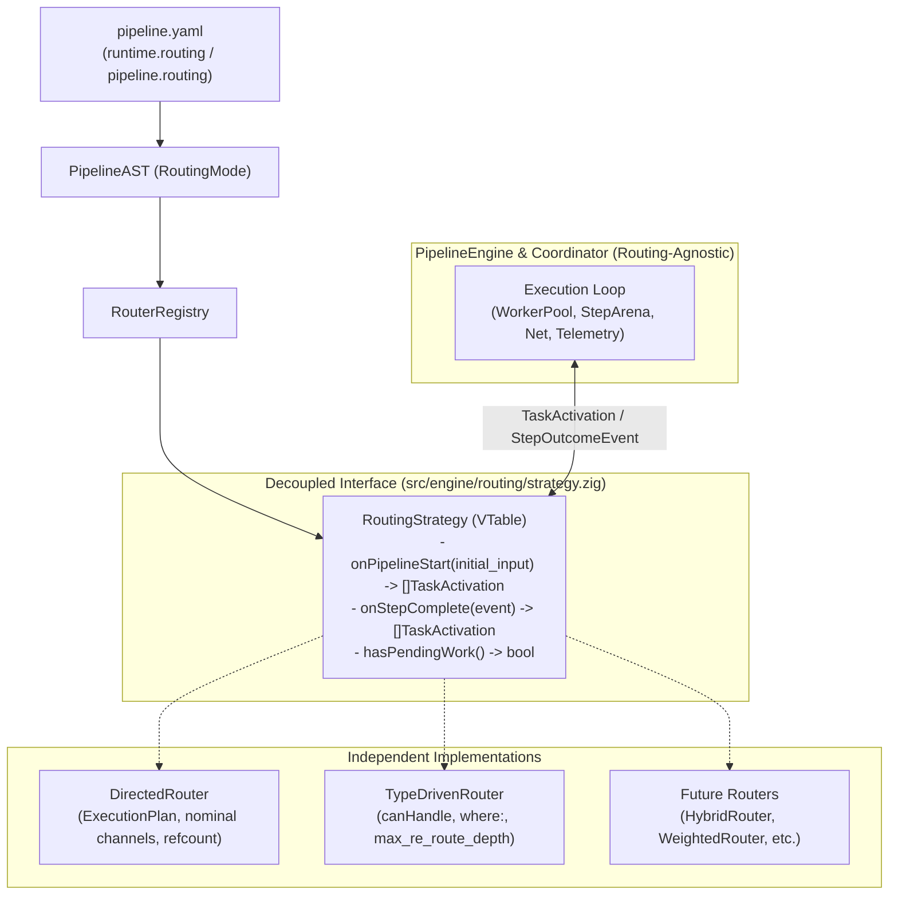

# 023 — Pluggable Routing Strategy & Engine Decoupling

| Metadata | Value |
| :--- | :--- |
| **ID** | `ARCH-023` |
| **Depends On** | [`ARCH-017`](./017-concurrent-dag-scheduler-and-host-concurrency-contract.md), [`ARCH-018`](./018-type-driven-inbound-router-and-service-catalog.md) |
| **Area** | `src/engine/`, `src/ast/`, `src/yaml/` |
| **Status** | `COMPLETED` |

---

## 1. Context & Motivation

Currently in [`src/engine/`](../../src/engine), two valid task routing paradigms coexist:

1. **Directed / Nominal Routing (`directed`)**: Follows the topology declared in `pipeline.yaml` via step ordering, `after:`, and explicit channels (`inputs:` / `outputs:`), guaranteeing determinism and static memory refcounting ([`ARCH-017`](./017-concurrent-dag-scheduler-and-host-concurrency-contract.md)).
2. **Type-Driven Routing (`type_driven`)**: Dynamically determines which tasks to activate by inspecting input signatures (`canHandle`) and unary `where:` filters ([`ARCH-018`](./018-type-driven-inbound-router-and-service-catalog.md)).

### Current Architectural Problem
Today, the **routing decision logic** (which task runs next and with which inputs) is mixed with the **execution mechanics** (threads, `WorkerPool`, `StepArena`, telemetry, and networking) across four files:
* [`src/engine/plan.zig`](../../src/engine/plan.zig): Computes nominal edges (`inputs:`, `after:`, `implicit_chain`).
* [`src/engine/coordinator.zig`](../../src/engine/coordinator.zig): Runs the `WorkerPool` and manages `StepArena`, but also resolves `resolveStreamExpr`, ambient merging, and unary `where:` filters.
* [`src/engine/router.zig`](../../src/engine/router.zig): Evaluates `canHandle` and re-routing loops, but directly wraps `Coordinator` and `executeSubPipelineSelective`.
* [`src/engine/engine.zig`](../../src/engine/engine.zig): Maintains a parallel sequential execution path with duplicated input-binding logic.

Adding new routing modes (such as YAML selection or hybrid routing) via `if/else` on top of this structure would turn the engine into hard-to-maintain, hard-to-test spaghetti code.

### Goal
Completely decouple **how we decide what to run (`RoutingStrategy`)** from **how it is executed and how memory is managed (`PipelineEngine` / `Coordinator`)**, enabling:
1. Mutually independent strategies (`DirectedRouter`, `TypeDrivenRouter`, future strategies).
2. A routing-agnostic execution engine.
3. Pure unit tests for each router (without spinning up `WorkerPool`, networking, or SQLite) and engine tests using a `MockRouter`.
4. Declarative YAML selection via `routing:`.

---

## 2. Target Architecture



### Strict Separation of Concerns

| Component | Single Responsibility | What It Must NOT Know |
| :--- | :--- | :--- |
| **`PipelineEngine` / `Coordinator`** | Lifecycle, `WorkerPool`, `StepArena` (creation and `freeArena`), `NetworkController`, `AmbientContext`, telemetry. | How inputs are matched, `canHandle`, internal `ExecutionPlan`, or re-routing depth. |
| **`DirectedRouter`** | Nominal graph (`ExecutionPlan`), `inputs:`/`outputs:` channel resolution, Join barriers, and consumer counting. | `WorkerPool`, threads, sockets, SQLite, or `canHandle`. |
| **`TypeDrivenRouter`** | Structural matching (`canHandle`), unary `where:` filters, cycle control (`visited_mask`, `max_re_route_depth`). | `WorkerPool`, `StepArena`, or nominal edges from `plan.zig`. |

---

## 3. Declarative YAML Contract (`routing:`)

Separate `scheduler` (concurrency/resources) from `routing` (topology/dispatch):

```yaml
runtime:
  workers: 4
  scheduler: dag          # How it executes: sequential | dag
  routing: directed       # How it binds: directed | type_driven | hybrid (default: directed)
  max_inflight_bytes: 512MiB
```

Also overridable per individual pipeline:

```yaml
pipelines:
  manga_sync:
    routing: directed     # Strict ETL with explicit Fork/Join
    steps: [...]

  security_triage:
    routing: type_driven  # Signature-based event mesh (canHandle)
    steps: [...]
```

### Orthogonality Matrix

| `scheduler` \ `routing` | `directed` | `type_driven` | `hybrid` (future) |
| :--- | :--- | :--- | :--- |
| **`sequential`** | 1-to-1 execution in graph topological order. | Reactive single-threaded loop per emission. | Same as `sequential` with 1:1 auto-binding. |
| **`dag`** | Concurrent pool with nominal channels and backpressure. | Concurrent pool firing all tasks with `canHandle == true` in parallel. | Concurrent pool with automatic inference where `inputs:` is omitted. |

---

## 4. Core Zig Contract (`RoutingStrategy`)

Location: `src/engine/routing/strategy.zig`.

```zig
pub const TaskActivation = struct {
    node_id: NodeId,
    step_input: PayloadHandle,
    bound_inputs: []const BoundInput,
    /// Optional: consumed channels for decrementing refcount in directed mode.
    consumed_channels: []const ChannelId = &.{},
};

pub const StepOutcomeEvent = struct {
    node_id: NodeId,
    status: TaskStatus,
    output: PayloadHandle,
    channel_outputs: []const NamedPayload,
};

pub const RoutingStrategy = struct {
    ptr: *anyopaque,
    vtable: *const VTable,

    pub const VTable = struct {
        /// Initializes routing state for a run and returns root activations.
        onPipelineStart: *const fn (
            ptr: *anyopaque,
            alloc: Allocator,
            initial_input: PayloadHandle,
        ) anyerror![]TaskActivation,

        /// Processes task completion and returns newly unlocked activations.
        onStepComplete: *const fn (
            ptr: *anyopaque,
            alloc: Allocator,
            event: StepOutcomeEvent,
        ) anyerror![]TaskActivation,

        /// Indicates whether pending nodes or active barriers remain.
        hasPendingWork: *const fn (ptr: *anyopaque) bool,

        deinit: *const fn (ptr: *anyopaque) void,
    };
};
```

> **Note on isolation:** This contract only depends on data types (`PayloadHandle`, `BoundInput`, `NodeId`, `Allocator`). It imports nothing from `WorkerPool`, `NetworkController`, or `RepositoryRegistry`.

---

## 5. Step-by-Step Implementation Plan (Incremental & Non-Breaking)

Each phase is self-contained and must leave all test suites green before moving to the next.

### Phase 1: `routing:` Directive in AST & YAML Loader
* **Files:** [`src/ast/ast.zig`](../../src/ast/ast.zig), [`src/yaml/ast_loader.zig`](../../src/yaml/ast_loader.zig).
* **Changes:**
  1. Add `pub const RoutingMode = enum { directed, type_driven, hybrid };`.
  2. Add `routing: RoutingMode = .directed` to `RuntimeSpec` and `routing: ?RoutingMode = null` to `PipelineDecl` (when `null`, inherits `runtime.routing`).
  3. Parse the `routing` field in `ast_loader.zig`, keeping `.directed` as default for 100% backward compatibility.
* **Verification:** AST and YAML unit tests verifying defaults and per-pipeline overrides.

### Phase 2: Define `RoutingStrategy` & `RouterRegistry`
* **New files:** `src/engine/routing/strategy.zig`, `src/engine/routing/registry.zig`.
* **Changes:**
  1. Define `RoutingStrategy`, `TaskActivation`, `StepOutcomeEvent`, and `RoutingContext` (read-only views of AST, `canHandle` descriptors, read repositories, and `AmbientContext`).
  2. Create `RouterRegistry` (same pattern as `RepositoryRegistry`) to instantiate strategies by `RoutingMode` or custom name.
* **Verification:** Clean build and in-memory test with a `MockRouter`.

### Phase 3: Extract `DirectedRouter`
* **Files:** `src/engine/routing/directed.zig` (extracted from [`plan.zig`](../../src/engine/plan.zig), [`coordinator.zig`](../../src/engine/coordinator.zig), and [`engine.zig`](../../src/engine/engine.zig)).
* **Changes:**
  1. Encapsulate `ExecutionPlan`, remaining `indegree` tracking, `inputs:` resolution (`resolveStreamExpr`), unary `where:` filters, and `consumed_channels` mapping.
  2. Expose `RoutingStrategy` without depending on `WorkerPool`.
* **Verification:** Pure unit suite for `DirectedRouter`: pass a `PipelineDecl` (linear, fork, join) + simulated payloads and validate the exact `TaskActivation` sequence returned in microseconds with no threads.

### Phase 4: Isolate `TypeDrivenRouter`
* **Files:** Refactor [`src/engine/router.zig`](../../src/engine/router.zig) into `src/engine/routing/type_driven.zig`.
* **Changes:**
  1. Implement `RoutingStrategy` using exclusively `TaskDescriptor_ABI.canHandle`, unary `where:` evaluation, `visited_mask`, and `max_re_route_depth` limit.
  2. Remove any direct invocation of `Coordinator.runSelective` or `executeSubPipelineSelective` from `TypeDrivenRouter`: the router only emits `[]TaskActivation` and lets the engine execute.
* **Verification:** Migrate cases from [`tests/core/reactive_router_test.zig`](../../tests/core/reactive_router_test.zig) to validate `TypeDrivenRouter` both in isolation and integrated with the engine.

### Phase 5: Unify Execution Loop in `Coordinator` & `PipelineEngine`
* **Files:** [`src/engine/coordinator.zig`](../../src/engine/coordinator.zig), [`src/engine/engine.zig`](../../src/engine/engine.zig).
* **Changes:**
  1. Have `Coordinator` receive a `RoutingStrategy` created from `RouterRegistry` using `pipeline.routing orelse runtime.routing`.
  2. Replace inline `dispatchTask` logic (`inputs:` resolution, `where:`, ad-hoc `indegree`) with calls to `strategy.onPipelineStart(...)` and `strategy.onStepComplete(...)`.
  3. Unify `sequential` execution using the same loop with `strategy` (simply running `TaskActivation`s on the current thread instead of enqueueing into `WorkerPool`), eliminating duplication in `engine.zig`.
* **Verification:**
  * New `Coordinator` unit test using `MockRouter` to test backpressure (`max_inflight_bytes`), cancellation, and `freeArena` in isolation.
  * All existing suites (`zig build test`, `apps/mangadex`, `apps/vidsec`) passing 100%.

### Phase 6 (Optional / Future): `HybridRouter` (`auto_bind`)
* **Files:** `src/engine/routing/hybrid.zig`.
* **Changes:**
  1. Reuse `DirectedRouter`'s graph, but when a step omits `inputs:`, inspect `canHandle` against channels already declared by upstream steps.
  2. If exactly one compatible channel exists, automatically create the data edge and increment `consumers_count`; if ambiguous or a multi-branch Join, require explicit `inputs:`.

---

## 6. Acceptance Criteria

1. **Zero cross-dependencies:** `directed.zig` and `type_driven.zig` do not import each other and do not import `WorkerPool` / `Coordinator`.
2. **Pure testability:** Every routing strategy has unit tests that run without threads, networking, or disk I/O.
3. **Decoupled engine:** `Coordinator` has unit tests verifying arena management and `WorkerPool` against a `MockRouter`.
4. **Full backward compatibility:** Pipelines without `routing:` continue behaving as `directed` with no changes required in [`apps/mangadex/configs/pipeline.yaml`](../../apps/mangadex/configs/pipeline.yaml) or [`apps/vidsec/configs/pipeline.yaml`](../../apps/vidsec/configs/pipeline.yaml).
