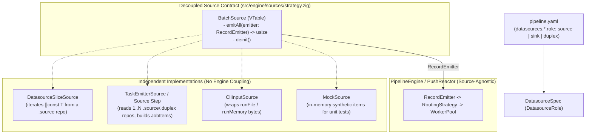

# 025 — Datasource Roles & Decoupled Batch `jobItem` Emission

| Metadata | Value |
| :--- | :--- |
| **ID** | `ARCH-025` |
| **Depends On** | [`ARCH-014`](./014-inbound-emitter-datasources-and-reactive-dispatch.md), [`ARCH-023`](./023-pluggable-routing-strategy-decoupling.md), [`ARCH-024`](./024-type-driven-multi-input-accumulation.md) |
| **Area** | `src/ast/`, `src/yaml/`, `src/repository/`, `src/engine/` |
| **Status** | `PHASES 1-3 DONE / PHASE 4 VIA ARCH-026` |

---

## 1. Context & Motivation

Currently, [`CliTransport`](../../extensions/inbound_cli/src/cli_transport.zig) -> [`InboundDispatcher.handleRun`](../../src/transport/inbound/dispatcher.zig) -> [`PipelineRunner.runMemory`](../../src/engine/runner.zig) passes an empty byte slice (`&.{}`) as `initial_input` when `req.input == .none` (offline batch CLI mode):

* In **`directed`** mode, this only works when the first step explicitly pulls a datasource via `inputs: { input: tracked_targets }`, causing [`DirectedRouter`](../../src/engine/routing/directed.zig) to call `repo.readPayload(...)` on [`YamlFileRepository`](../../extensions/datasource/yaml_file/src/yaml_file_repository.zig) (which returns the entire `[]const JobSpec` slice at once).
* In **`type_driven`** mode (without `inputs:` in `pipeline.yaml`), `initial_input` is empty and **nothing reads or emits `jobItem`s from `tracked_targets`**, unlike daemon/collector mode where `flowdata-collector-filewatcher` pushes individual `JobEnvelope` items via [`RecordEmitter`](../../src/engine/reactor.zig).

### Why a Naive `emit: true` Flag Is Not Enough
Simply adding `emit: true` to a datasource works for a flat `yaml_file` list (`jobs.yaml`), but breaks down in real-world pipelines:
1. **Complex Schemas:** In a relational database (`sqlite`), no single table necessarily matches the exact `Inputs` struct of any downstream task.
2. **Multi-Datasource Assembly:** A real pipeline often needs to read from **two or more datasources** (for example, target subscriptions from `tracked_targets` + sync cursors/state from `catalog_db`) to construct each real `JobItem` before dispatching the main workflow.
3. **Engine Coupling:** Reading/iterating datasources should be decoupled from `PipelineEngine`, `Coordinator`, and `CliTransport`—using the same VTable isolation pattern as [`RoutingStrategy`](../../src/engine/routing/strategy.zig) (`ARCH-023`)—so sources and engine loops can be unit-tested independently.

---

## 2. Target Architecture



### Key Design Principles
1. **Explicit `role:` on `DatasourceSpec`:**
   * `source`: Read-only input datasource (writes fail early at pre-flight or `writePayload`).
   * `sink`: Write-only output destination (cannot be used as a batch source).
   * `duplex` (default, for 100% backward compatibility): Can act as both source and sink (e.g., `pipeline_memory`, `catalog_db`).
2. **Pragmatic Multi-Datasource Assembly via Pseudo-Emission Task / Router:**
   * For simple single-datasource lists (`yaml_file`), a lightweight `DatasourceSliceSource` emits each `JobSpec` item into `RecordEmitter`.
   * For complex or **multi-datasource** assembly (e.g., combining `tracked_targets` + `catalog_db`), a dedicated **emitter task** (normal plugin task or source step) queries the `source`/`duplex` datasources, constructs the real `JobItem`s, and emits them as downstream items—leaving `PipelineEngine` and `TypeDrivenRouter` completely unaware of SQL queries or file formats.
3. **Pure Unit Testability:**
   * `BatchSource` depends only on `PayloadHandle`, `RecordEmitter`, and `Allocator` (zero imports of `WorkerPool`, `Coordinator`, or `CliTransport`).
   * Engine tests can inject a `MockSource` to test batch dispatching, backpressure, and `TypeDrivenRouter` without touching disk, YAML, or SQLite.

---

## 3. Declarative YAML Contract (`role:`)

```yaml
datasources:
  tracked_targets:
    driver: yaml_file
    role: source              # source | sink | duplex (default: duplex)
    path: "${MANGADEX_JOBS_PATH:-./configs/jobs.yaml}"

  pipeline_memory:
    driver: memory
    role: duplex

  catalog_db:
    driver: sqlite
    role: duplex
    path: "${MANGADEX_DB_PATH:-./output/mangadex.db}"

  komga_library:
    driver: file_store
    role: sink
    directory: "${KOMGA_LIBRARY_DIR:-./output/cbz/}"
```

### Multi-Datasource Pseudo-Emission Pattern
When `JobItem`s require combining multiple datasources, an initial task (or `source_step`) acts as the batch producer:

```yaml
pipelines:
  manga_sync:
    routing: type_driven
    steps:
      # Optional pseudo-emitter task combining tracked_targets + catalog_db
      - id: emit_pending_jobs
        uses: manga_catalog/build_pending_jobs
        # Reads tracked_targets + catalog_db, emits individual JobItem records

      - id: fetch_details
        uses: manga_catalog/fetch_series_details
        where: "enabled == true"
        networks: [mangadex_api]
```

---

## 4. Core Zig Contract (`BatchSource`)

Proposed location: `src/engine/sources/strategy.zig` (with `src/engine/sources/registry.zig`).

```zig
pub const BatchSource = struct {
    ptr: *anyopaque,
    vtable: *const VTable,

    pub const VTable = struct {
        /// Emits all available items for this run into `emitter` and returns the count emitted.
        emitAll: *const fn (
            ptr: *anyopaque,
            alloc: Allocator,
            emitter: RecordEmitter,
        ) anyerror!usize,

        deinit: *const fn (ptr: *anyopaque) void,
    };
};
```

> **Isolation invariant:** `BatchSource` implementations never import `Coordinator`, `WorkerPool`, or `DirectedRouter`/`TypeDrivenRouter`. Likewise, `PipelineEngine` only interacts with `BatchSource` through `emitAll`.

---

## 5. Step-by-Step Implementation Plan

### Phase 1: `role:` Directive in AST, YAML Loader & Pre-Flight Validation
* **Files:** [`src/ast/ast.zig`](../../src/ast/ast.zig), [`src/yaml/ast_loader.zig`](../../src/yaml/ast_loader.zig), pre-flight validator.
* **Changes:**
  1. Add `pub const DatasourceRole = enum { source, sink, duplex };` and `role: DatasourceRole = .duplex` to `DatasourceSpec`.
  2. Parse `role:` in `ast_loader.zig` (default `.duplex` for full backward compatibility).
  3. Validate role constraints during pre-flight (e.g., forbid configuring an output sink on a `role: source` datasource, and forbid reading inputs from a `role: sink` datasource).
* **Verification:** Unit tests for AST parsing and pre-flight role validation errors.

### Phase 2: `BatchSource` VTable, `DatasourceSliceSource` & `MockSource`
* **New files:** `src/engine/sources/strategy.zig`, `src/engine/sources/datasource_slice.zig`, `src/engine/sources/cli_input.zig`.
* **Changes:**
  1. Define `BatchSource` with `comptime` `assertImplements(@This())` check.
  2. Implement `DatasourceSliceSource`: inspects `role: source` repositories; when `readPayload` yields a typed slice (`[]const T`, `T != u8`), iterates and emits each element individually into `RecordEmitter` (or the whole payload if scalar).
  3. Implement `CliInputSource` for explicit file/memory CLI inputs.
* **Verification:** Pure unit tests of `DatasourceSliceSource` and `MockSource` verifying item-by-item emission without `WorkerPool` or `CliTransport`.

### Phase 3: Wire `BatchSource` into `PipelineRunner` / `PushReactor`
* **Files:** [`src/engine/runner.zig`](../../src/engine/runner.zig), [`src/engine/reactor.zig`](../../src/engine/reactor.zig), [`src/engine/engine.zig`](../../src/engine/engine.zig).
* **Changes:**
  1. When `runMemory(&.{})` is invoked in CLI/batch offline mode (`req.input == .none`), resolve active `.source` `BatchSource`s and stream each emitted `jobItem` through the same `RecordEmitter` -> `RoutingStrategy` path used by daemon/collector mode.
  2. Ensure `directed` pipelines with explicit `inputs: { input: tracked_targets }` remain 100% backward compatible.
* **Verification:** Integration test running a `type_driven` pipeline offline against a `yaml_file` (`role: source`) datasource without `inputs:` in YAML.

### Phase 4: Multi-Datasource Pseudo-Emission Task Support
* **Files:** [`src/engine/routing/type_driven.zig`](../../src/engine/routing/type_driven.zig) / [`src/engine/coordinator.zig`](../../src/engine/coordinator.zig).
* **Changes:**
  1. Allow a dedicated source/emitter task returning a slice of `JobItem`s (or emitting multiple rows via `emit_row` / channel outputs) to fan out each emitted item as an independent reactive `jobItem` into the pipeline.
  2. Test assembling `JobItem`s from **two distinct datasources** (e.g., `yaml_file` + `sqlite` or two in-memory repositories) and routing each constructed item through a `type_driven` pipeline.

---

## 6. Acceptance Criteria

1. **Unified offline & daemon flow:** Offline CLI batch mode emits `jobItem`s from `role: source` datasources through the same reactive path as collectors/daemons.
2. **Role safety:** Writing to a `role: source` datasource or reading from a `role: sink` datasource is caught cleanly.
3. **Multi-datasource assembly supported:** A dedicated emitter task can combine data from multiple datasources to build and emit `JobItem`s without coupling SQL/file logic into `PipelineEngine`.
4. **Full isolation & backward compatibility:** `BatchSource` implementations have zero imports of `WorkerPool`/`Coordinator`, and all existing `directed` pipelines continue passing without YAML changes.
