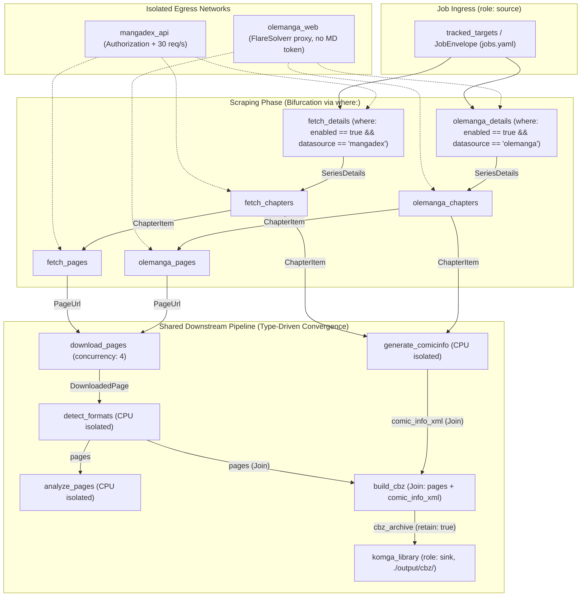

# 027 — Generic HTML Scraper Driver & FlareSolverr Integration (`olemanga.com`)

| Metadata | Value |
| :--- | :--- |
| **ID** | `ARCH-027` |
| **Depends On** | [`ARCH-010`](./010-multisource-architecture-and-scrapers.md), [`ARCH-023`](./023-pluggable-routing-strategy-decoupling.md), [`ARCH-024`](./024-type-driven-multi-input-accumulation.md), [`ARCH-025`](./025-datasource-roles-and-batch-emission-decoupling.md) |
| **Area** | `apps/mangadex/lib/sources/drivers/html_generic/`, `apps/mangadex/plugin/`, `apps/mangadex/configs/` |
| **Status** | `SPECIFICATION` |

---

## 1. Context & Motivation

[`ARCH-010`](./010-multisource-architecture-and-scrapers.md) established the polymorphic [`MangaSource`](../../apps/mangadex/lib/sources/contract.zig) contract and [`SourceRegistry`](../../apps/mangadex/lib/sources/registry.zig), along with a stub [`HtmlGenericSource`](../../apps/mangadex/lib/sources/drivers/html_generic/html_generic_driver.zig). Meanwhile, [`apps/mangadex/configs/pipeline.yaml`](../../apps/mangadex/configs/pipeline.yaml) now uses `routing: type_driven` (`ARCH-023` / `ARCH-024`) and `role: source` batch emission (`ARCH-025`).

We now want to implement the generic HTML scraper driver—using **`olemanga.com`** (behind Cloudflare/anti-bot protection via **FlareSolverr**) as the concrete reference target—and plug it into the **exact same `manga_sync` pipeline** without duplicating the downstream packaging DAG (`generate_comicinfo`, `download_pages`, `detect_formats`, `analyze_pages`, `build_cbz`).

---

## 2. Target Architecture (`type_driven` Convergence + FlareSolverr)

### Key Architectural Decisions
1. **Strict Network Isolation:**
   * `olemanga_web` is a dedicated egress adapter in `pipeline.yaml` (no `MANGADEX_ACCESS_TOKEN` header, conservative rate limit, allows `olemanga.com`, `*.olemanga.com`, and local FlareSolverr `127.0.0.1:8191`).
   * If image CDNs for `olemanga.com` also require Cloudflare cookies, `download_pages` binds `[mangadex_api, olemanga_web]` (or routes by URL host).
2. **Declarative Site Profiles (`configs/scrapers/olemanga.yaml`):**
   * `HtmlGenericSource` reads a declarative profile instead of hardcoding per-site Zig parsers wherever possible:
     * `source_id: "olemanga"`
     * `base_url: "https://olemanga.com"`
     * `anti_bot: { driver: "flaresolverr", endpoint: "${FLARESOLVERR_URL:-http://127.0.0.1:8191/v1}" }`
     * Extraction rules (CSS/attribute/regex selectors) for `details`, `chapters`, and `page_urls`.
3. **Zero Downstream Duplication:**
   * Both `fetch_*` (MangaDex) and `olemanga_*` (or unified `HtmlGenericSource` via `SourceRegistry`) emit the exact same `SeriesDetails`, `ChapterItem`, and `PageUrl` structs, so `generate_comicinfo`, `download_pages`, `detect_formats`, `analyze_pages`, and `build_cbz` execute identically for both sources.

---

## 3. Step-by-Step Implementation Plan

### Phase 1: HTML Extraction Engine & Scraper Profile Schema
* **Files:** `apps/mangadex/lib/sources/drivers/html_generic/` (`html_parser.zig`, `profile.zig`, `html_generic_driver.zig`).
* **Changes:**
  1. Implement lightweight, zero-C-dependency HTML tag/attribute/text extractor in Zig (supporting tag/class/id matching, `href`/`src`/`data-src` attribute extraction, and text trimming).
  2. Define `ScraperProfile` YAML loader (`configs/scrapers/*.yaml`) for declarative site rules (`details`, `chapters`, `pages`).
* **Verification:** Pure unit tests against saved HTML fixture snippets (`olemanga`-style series, chapter list, and reader pages).

### Phase 2: FlareSolverr Sidecar Client
* **Files:** `apps/mangadex/lib/sources/drivers/html_generic/flaresolverr_client.zig`.
* **Changes:**
  1. Implement JSON request/response client for FlareSolverr (`POST /v1` with `{"cmd": "request.get", "url": ..., "maxTimeout": 60000}`), extracting `solution.response` (HTML body), `solution.cookies`, and `solution.userAgent`.
  2. Cache session cookies per host to avoid invoking FlareSolverr on every page request when cookies are still valid.
* **Verification:** Unit tests with mocked FlareSolverr JSON responses verifying HTML extraction and cookie reuse.

### Phase 3: `olemanga.com` Profile & `pipeline.yaml` Integration
* **Files:** `apps/mangadex/configs/scrapers/olemanga.yaml`, `apps/mangadex/configs/pipeline.yaml`, `apps/mangadex/configs/jobs.yaml`, `apps/mangadex/plugin/catalog.zig`.
* **Changes:**
  1. Register `HtmlGenericSource` instances loaded from `configs/scrapers/` in `SourceRegistry`.
  2. Add `olemanga_web` egress network and `where: "enabled == true && datasource == '...'"` predicates in `pipeline.yaml` (or route transparently through `SourceRegistry` if using shared `fetch_*` tasks).
* **Verification:** `pipeline_config_test.zig` + `SourceRegistry` lookup test confirming `"olemanga"` resolves alongside `"mangadex"`.

---

## 4. Acceptance Criteria
1. **Zero downstream duplication:** `generate_comicinfo`, `download_pages`, `detect_formats`, `analyze_pages`, and `build_cbz` are shared between MangaDex and `olemanga.com`.
2. **Credential isolation:** `MANGADEX_ACCESS_TOKEN` is never attached to `olemanga_web` requests.
3. **Offline testability:** All HTML extraction and FlareSolverr parsing tests run deterministically offline using fixtures.
