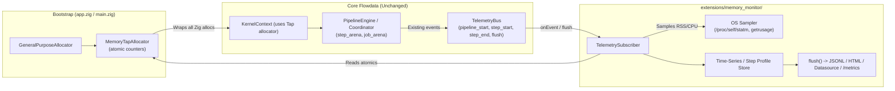
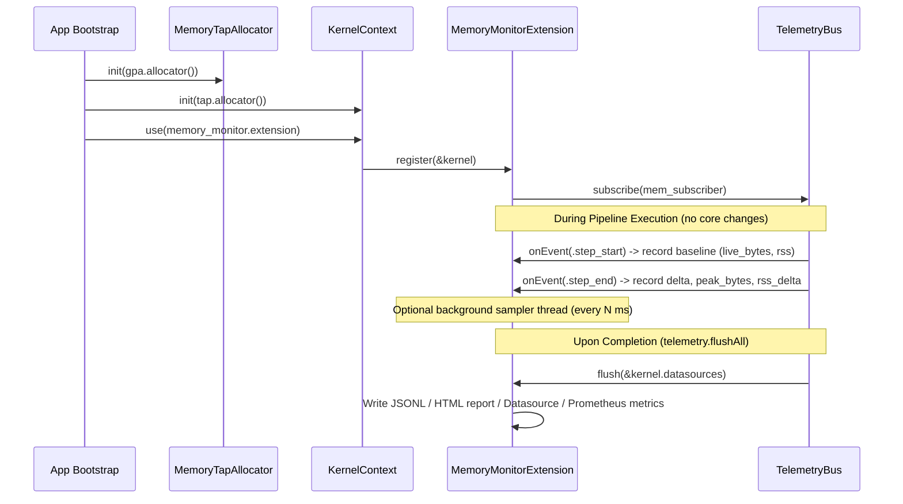

# ARCH-033: Transparent Memory & Resource Monitoring (`extensions/memory_monitor`)

| Metadata | Value |
| :--- | :--- |
| **ID** | `ARCH-033` |
| **Status** | Proposed |
| **Date** | 2026-11-13 |
| **Depends On** | [`ARCH-002`](./002-open-kernel-extension-system.md), [`ARCH-003`](./003-core-debloating-and-pcapng-extraction.md) |
| **Related** | [`ARCH-004`](./004-observability-otel-and-dag-visualizer.md), [`ARCH-032`](./032-typescript-webapp-and-realtime-transport.md) |
| **Affected Modules** | `src/transport/inbound/app.zig` (bootstrap), `extensions/memory_monitor/` *(new)* |

---

## 1. Context and Goal

Just as [`ARCH-003`](./003-core-debloating-and-pcapng-extraction.md) extracted Wireshark-grade network packet capture into `extensions/pcapng/` using `CaptureMiddleware` and `PacketSink` without polluting the core engine, we want a **Datadog-like memory & resource monitor** that is equally transparent:

* **Zero telemetry boilerplate in the Core**: Tasks, plugins, `PipelineEngine`, and `Coordinator` must not import a memory profiler or emit new `TelemetryEvent` types.
* **Zig Heap + OS RSS visibility**: Capture both Zig allocator activity (live bytes, peak bytes, allocation/free counts, leak detection) and OS-level process memory (`VmRSS` / `VmHWM` from `/proc/self/statm` or `getrusage`) to account for C libraries (e.g., SQLite, `libcurl`) and direct `page_allocator` usage.
* **Step & Pipeline Attribution**: Attribute memory deltas and peaks to individual `pipeline_name` and `step_id` executions by piggybacking on existing `TelemetryBus` lifecycle events (`pipeline_start`, `step_start`, `step_end`, `pipeline_end`).

---

## 2. Target Architecture (1:1 Parallel with `extensions/pcapng`)

| Concern | Network ("Wireshark") | Memory ("Datadog") |
| :--- | :--- | :--- |
| **Transparent Tap** | `CaptureMiddleware` (`NetMiddleware`) | `MemoryTapAllocator` (`std.mem.Allocator` VTable) |
| **Single Injection Point** | `k.outbound.registerSinkFactory` | Bootstrap root allocator passed to `KernelContext` |
| **Core Telemetry Changes** | None | None (reuses existing `step_start` / `step_end` events) |
| **Persistence / Export** | `PcapngExtension.flush()` -> `.pcapng` / `datasource` | `MemoryMonitorExtension.flush()` -> `.jsonl` / HTML / `datasource` |



---

## 3. Core Components

### 3.1. `MemoryTapAllocator` (`std.mem.Allocator` VTable Wrapper)

A lightweight, lock-free wrapper around any backing `std.mem.Allocator` (e.g., `GPA` in `src/transport/inbound/app.zig`). Because `KernelContext`, `Coordinator` (`step_arena`), `PipelineRunner` (`job_arena`), and `RepositoryRegistry` inherit this allocator, every Zig allocation flows through it transparently.

```zig
pub const MemoryCounters = struct {
    live_bytes: std.atomic.Value(usize) = std.atomic.Value(usize).init(0),
    peak_bytes: std.atomic.Value(usize) = std.atomic.Value(usize).init(0),
    total_allocated_bytes: std.atomic.Value(usize) = std.atomic.Value(usize).init(0),
    total_freed_bytes: std.atomic.Value(usize) = std.atomic.Value(usize).init(0),
    alloc_count: std.atomic.Value(u64) = std.atomic.Value(u64).init(0),
    free_count: std.atomic.Value(u64) = std.atomic.Value(u64).init(0),
};
```

* `alloc` / `resize` / `remap` / `free` delegate directly to `backing_allocator.vtable.*` and update `MemoryCounters` atomically (using a CAS loop for `peak_bytes`).
* Zero heap allocations inside the tap itself, making it safe for concurrent worker pools.

### 3.2. OS Process Sampler (Linux / POSIX)

To observe memory outside the Zig `Allocator` (SQLite page cache, `libcurl` buffers, `page_allocator` in plugins):

* **Linux `/proc/self/statm`**: Parse resident set size (`rss_pages * std.heap.page_size_min`) with minimal overhead (single `pread` on a cached fd or stack buffer).
* **POSIX `std.posix.getrusage(.SELF)`**: Capture `maxrss`, `utime`, `stime`, and page faults (`minflt`, `majflt`) at pipeline boundaries.

### 3.3. `MemoryMonitorExtension` (`extensions/memory_monitor/src/root.zig`)

Implements the standard `kernel.Extension` and `TelemetrySubscriber` interfaces (mirroring `extensions/pcapng/src/root.zig`):



* **Leak Detection**: Comparing `live_bytes` and `alloc_count - free_count` between `pipeline_start` and `pipeline_end` immediately flags steps or jobs that retain memory after completion.
* **Export Targets**:
  * **Datasource**: Write structured memory samples to a configured `RepositoryRegistry` channel (e.g., `memory_samples` in SQLite or `file_store`).
  * **File**: Export `.jsonl` time-series or a self-contained HTML timeline/flame-chart (similar to `extensions/dag_viz`).
  * **Optional HTTP/OTLP bridge**: Expose `/metrics` (Prometheus/OpenMetrics text format) in `extensions/inbound_http` or forward snapshots to `extensions/opentelemetry` if enabled, allowing Datadog Agent / Grafana scraping with zero core coupling.

---

## 4. Implementation Plan

1. **Create `extensions/memory_monitor/`**:
   * `src/tap_allocator.zig`: `MemoryTapAllocator` implementing `std.mem.Allocator` VTable + atomic `MemoryCounters`.
   * `src/os_sampler.zig`: `/proc/self/statm` + `getrusage` reader (with safe fallbacks on non-Linux targets).
   * `src/root.zig`: `MemoryMonitorExtension` implementing `Extension` + `TelemetrySubscriber` (`onEvent` on `pipeline_start`/`step_start`/`step_end`/`pipeline_end` + `flush`).
2. **Wire in Bootstrap & `extensions/mod.zig`**:
   * Export `memory_monitor` in `extensions/mod.zig`.
   * Wrap the root allocator with `MemoryTapAllocator` in `src/transport/inbound/app.zig` (and CLI/runner entrypoints) when memory monitoring is enabled via config/env (e.g., `FLOWDATA_MEMORY_MONITOR=1`).
3. **Tests**:
   * Add `tests/core/memory_monitor_extension_test.zig` verifying:
     * `MemoryTapAllocator` accurately tracks `live_bytes`, `peak_bytes`, and detects intentional leaks.
     * `MemoryMonitorExtension` attributes memory deltas to `step_id` without modifying any engine/pipeline code.
     * `flush()` persists samples to a `memory` or `file_store` datasource.

