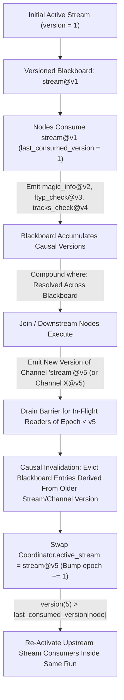

# ARCH-036: Causal Re-Routing, `StreamEmitter` (Piece-Table / Spill), and Chunked Sinks

| Metadata | Value |
| :--- | :--- |
| **ID** | `ARCH-036` |
| **Status** | `PROPOSED` |
| **Depends On** | [`ARCH-023`](./023-pluggable-routing-strategy-decoupling.md), [`ARCH-024`](./024-type-driven-multi-input-accumulation.md), [`ARCH-034`](./034-filesystem-stream-and-slice-datasource.md), [`ARCH-035`](./035-vidsec-libs-extraction-and-rebuild-plan.md) |
| **Area** | `src/engine/`, `src/plugin/`, `drivers/file_store/`, `apps/vidsec/` |

---

## 1. Executive Summary

Two coupled architectural gaps in `flowdata` currently prevent any mid-pipeline transformation task from cleanly updating a binary stream and triggering upstream pipeline stages to re-run:

1. **Non-Reentrant `TypeDrivenRouter`**: [`src/engine/routing/type_driven.zig`](../../src/engine/routing/type_driven.zig) locks every executed node behind a permanent `visited_mask: []bool` because its accumulated input pool has no versioning. Once Stage 0 or Stage 1 runs, no downstream task can emit an updated input or updated `stream` to re-run upstream checks within the same pipeline execution.
2. **Whole-File RAM Materialization for Stream Outputs**: While tasks read huge streams lazily in bounded windows via `abi.BoundedStreamReader`, they can only emit a modified stream by allocating a contiguous `[]const u8` slice in RAM—causing OOM risk on multi-gigabyte artifacts or forcing an artificial workaround that copies the entire file to a new datasource and launches a separate external job.

This specification fixes **both problems generically at the `flowdata` engine level** (equally applicable to `vidsec`, `mangadex`, `pcapng`, `zip_archive`, or any future domain):

* **Part I — Causal Input Versioning & Stream Separation in `TypeDrivenRouter` / `Coordinator`**: Replaces `visited_mask: []bool` with monotonically versioned channels (`version: u64`), per-node consumption watermarks (`last_consumed_version: []u64`), causal downstream invalidation when an upstream channel or `"stream"` is re-emitted, blackboard-wide `where:` evaluation, and decoupling `active_stream` from triggering event payloads (`step_input`).
* **Part II — Generic `abi.StreamEmitter` & Three-Mode `StreamBacking`**: Makes streams first-class outputs backed by `.memory`, `.spilled_file` (for generative tasks exceeding RAM budget via `writeChunk`), or `.piece_table` (zero-copy `splice` + `padZeroes` composition in $O(1)$ RAM and $0$ intermediate disk I/O), paired with bounded chunked materialization in persistent sinks (`file_store`).
* **Part III — Concrete Application in `apps/vidsec`**: Shows how `apply_truncate` and `apply_zero_out` use `StreamEmitter` (`splice` + `padZeroes`) to emit `stream@v(k+1)` in $O(1)$ RAM and trigger a full bounded Stage 0 -> Stage 1a -> Stage 1b -> Stage 2 re-verification loop before committing to `artifacts` or escalating to `quarantine`.

---

## 2. Root-Cause Diagnosis in the Current `flowdata` Engine

A line-level audit of [`src/engine/routing/type_driven.zig`](../../src/engine/routing/type_driven.zig), [`src/engine/coordinator.zig`](../../src/engine/coordinator.zig), [`src/plugin/loader/task_executor.zig`](../../src/plugin/loader/task_executor.zig), and [`src/plugin/sdk/define_task_service.zig`](../../src/plugin/sdk/define_task_service.zig) reveals four concrete engine bugs:

### Bug 1: Static `visited_mask: []bool` Lock ([`type_driven.zig:40, 228, 284`](../../src/engine/routing/type_driven.zig#L40))
In [`onStepComplete`](../../src/engine/routing/type_driven.zig#L127-L186), `TypeDrivenRouter` appends outputs into flat unversioned structures (`accumulated_named`, `accumulated_payloads`) and then scans all nodes in the pipeline. Because entries have no version or freshness metadata, removing `visited_mask[node_id]` would cause already-completed Stage 0 steps to re-fire infinitely on every unrelated completion. Using `visited_mask: []bool` prevents infinite loops only by **forbidding legitimate cycles and upstream re-entry altogether**—rendering `max_re_route_depth` unusable for iterative workflows (such as retry after auth challenge, decompression chains, or sanitize-and-reverify).

### Bug 2: Single-Payload `where:` Evaluation ([`type_driven.zig:338`](../../src/engine/routing/type_driven.zig#L338-L356) & [`coordinator.zig:373`](../../src/engine/coordinator.zig#L373-L375))
* `passesUnaryFilters` evaluates `task_spec.where_filter` solely against the single just-arrived `payload` rather than the router's accumulated blackboard. Consequently, multi-source predicates such as:
  ```yaml
  where: "detected_family == 'isobmff' and is_video == true and ftyp_valid == true and tracks_valid == true"
  ```
  fail because no single upstream output struct contains all four fields at once (`detect_magic` produces `detected_family` and `is_video`; `check_mp4_ftyp` produces `ftyp_valid`; `check_mp4_tracks` produces `tracks_valid`).
* Worse, `Coordinator.dispatchTask` (`coordinator.zig:373-375`) runs `filterPayload(step_input, filter_expr)` *again* at execution time on `step_input`, discarding `step_input` if any field in `where_filter` lives in another accumulated channel.

### Bug 3: `step_input` Clobbering `BoundedStreamReader` ([`coordinator.zig:380`](../../src/engine/coordinator.zig#L380-L384) & [`define_task_service.zig:714`](../../src/plugin/sdk/define_task_service.zig#L714-L725))
* When a task is triggered by a non-stream struct (for instance `TruncateOrder`, `ZeroOutOrder`, or an upstream metadata struct), `act.step_input` is that struct. `Coordinator.dispatchTask` derives `input_bytes` directly from `step_input` (`step_input.ptr[0..byte_count]`), which overwrites `ModuleHostState.input_slice` (`task_executor.zig:562`)—meaning `BoundedStreamReader.readAt()` reads struct memory instead of the active binary stream!
* Separately, `defineTaskService.canHandle` (`define_task_service.zig:716-722`) iterates all required fields of `Inputs` without skipping `abi.BoundedStreamReader` fields (e.g., `stream: abi.BoundedStreamReader`). Unless the struct happens to carry a reflected `"stream"` field, automatic `canHandle` returns `false`.

### Bug 4: No First-Class Output `StreamHandle` (`[]const u8` Materialization Bottleneck)
[`TaskContext_ABI`](../../src/plugin/types/) provides `stream_size` and `stream_read_at` for lazy *inputs*, yet output channels only emit scalar/struct/slice values (`[]const u8` or `[]const Row`). Any task producing or editing a multi-gigabyte binary file must allocate the full buffer in heap RAM, triggering OOM or forcing domain-specific file-copy hacks.

---

## 3. Part I: Generic Engine Solution — Causal Versioned Routing

To allow safe, deterministic backward re-entry in **any** `type_driven` pipeline without spawning external jobs, `TypeDrivenRouter` and `Coordinator` are upgraded from boolean visitation locks to **Causal Versioned Blackboards**.



### 3.1 Versioned Blackboard Entries (`VersionedEntry`)
Inside [`src/engine/routing/type_driven.zig`](../../src/engine/routing/type_driven.zig), `accumulated_named` and `accumulated_payloads` are unified into a monotonic versioned store:

```zig
pub const ChannelEpoch = u64;

pub const VersionedEntry = struct {
    name: []const u8,
    payload: PayloadHandle,
    version: u64,
    stream_epoch: u64,
    producer_node: ?NodeId,
    /// Bitmask (or dynamic bitset) of dependency channels/nodes whose output fed this entry.
    causal_deps: std.DynamicBitSetUnmanaged = .empty,
};
```

Every emitted payload in `onPipelineStart` and `onStepComplete` increments `self.version_seq += 1`.

### 3.2 Watermark Activation & Cycle Guard (`last_consumed_version`)
Replace `visited_mask: []bool` on `TypeDrivenRouter` with three lightweight per-node tracking arrays (`len == pipeline.steps.len`):
* `last_consumed_version: []u64` (initialized to `0`): highest dependency version seen by this node on its most recent execution.
* `in_flight_mask: []bool`: prevents concurrent double-firing of the same node while an activation is still running on a worker thread.
* `activation_count: []u32`: total times `node_id` has run in the current pipeline execution, bounded by `options.max_activations_per_node` (default `8`, or overridable per step/pipeline in YAML, e.g., `max_reverify_rounds`).

**Node Eligibility Rule:** A task `node_id` activates if and only if:
1. `!self.in_flight_mask[node_id]`
2. `self.activation_count[node_id] < self.options.max_activations_per_node`
3. Every required field in `desc.inputFields()` is resolvable from active `VersionedEntry` slots (with `BoundedStreamReader` satisfied automatically whenever `active_stream != null`), OR `desc.canHandle(&new_abi_payload)` matches an unconsumed incoming payload.
4. **Blackboard-Wide `where:` Satisfaction**: Every symbol referenced in `task_spec.where_filter` is present in active `VersionedEntry` reflected fields or ambient state (`system.*`/`env.*`), and evaluating the AST predicate across the combined blackboard returns `true`.
5. **Freshness Proof**:

$$\max_{d \in \text{BoundDependencies}(\text{node\_id}) \cup \text{PredicateVars}(\text{node\_id})} d.\text{version} \;>\; \text{last\_consumed\_version}[\text{node\_id}]$$

**Why this generalizes:**
* In an acyclic DAG, once a node runs at `version = V`, none of its upstream inputs get a version $> V$, so it runs **at most once** with zero spurious re-runs.
* Whenever a downstream node emits a new value to an existing channel `X` (e.g., an updated HTTP auth token or a transformed `stream`), `X.version` jumps past `last_consumed_version`, **automatically unlocking only the nodes that read `X` (or fields derived from `X`)**.

### 3.3 Causal Downstream Invalidation & Epoch Drain Barrier
When step $P$ emits a new payload to a channel name `C` that already existed at older version $V_{\text{old}}$:
1. **Evict Stale Downstream Facts**: Every entry in the blackboard whose `causal_deps` includes $C$ (or whose `stream_epoch < new_stream_epoch` when `C == "stream"`) is invalidated/removed so Join nodes **cannot mix Round 0 findings with Round 1 inputs**.
2. **Epoch Barrier for `"stream"` Replacement**: If a step emits an updated `stream` (`out_ch.name == "stream"` and `payload.is_stream`), `TypeDrivenRouter` queues the stream swap (`pending_stream_swap`) until `in_flight == 0` for tasks still reading the prior `stream_epoch`. Once drained, `Coordinator` updates `self.active_stream = new_stream`, increments `stream_epoch += 1`, evicts old-epoch entries, and calls `activateEligibleNodes()`—cleanly restarting Stage 0 inside the **same `Coordinator` invocation and `trace_id`**.
3. **Max-Cycle Handling**: If `activation_count[node_id] >= max_activations_per_node` when a re-entry trigger fires, the router emits an `EpochLimitReached` routing signal (or routes to a `when_reverify_exhausted` fallback branch such as `quarantine` in `vidsec`) rather than looping infinitely or failing silently.

### 3.4 Decoupling `active_stream` from `step_input`
* Add `stream_payload: PayloadHandle` alongside `step_input: PayloadHandle` on [`TaskActivation`](../../src/engine/routing/strategy.zig) and `stream_bytes` / `stream_backing` on [`TaskExecutionRequest`](../../src/plugin/loader/task_executor.zig).
* `Coordinator` preserves `self.active_stream` across the entire epoch. Even when a downstream step is activated by a struct payload (e.g., `TruncateOrder`), `BoundedStreamReader` (`streamSize`, `streamReadAt`) always targets `self.active_stream`, while `step_input` supplies the typed triggering order.
* Remove the redundant `dataflow.predicate.filterPayload` call inside [`Coordinator.dispatchTask`](../../src/engine/coordinator.zig#L373-L375) when routing mode is `type_driven` and the payload is scalar metadata—the router has already verified the composite `where:` guard against the blackboard. (Slice element-filtering still applies when filtering a slice channel via `out_ch.filter`.)

---

## 4. Part II: Generic SDK & Runtime Solution — `StreamEmitter` & Three-Mode `StreamBacking`

Solving control-flow re-entry without solving large-stream emission would still force tasks to allocate multi-gigabyte `[]u8` buffers in RAM. `flowdata` therefore introduces a unified, domain-agnostic **`StreamBacking`** in the host runtime (`TaskExecutor`) and a **`StreamEmitter`** injectable in the plugin SDK (`defineTaskService`).

### 4.1 Unified `StreamBacking` Union (`TaskExecutor` + `ARCH-034`)
A stream passed between steps—whether from disk source (`ARCH-034`), an in-memory buffer, a generative archive builder, or a surgical splice transform—is represented uniformly on the host by `StreamBacking`:

```zig
pub const StreamPiece = union(enum) {
    /// Zero-copy view into `[offset, offset + length)` of an existing immutable StreamBacking.
    source_range: struct {
        base: *const StreamBacking,
        offset: u64,
        length: u64,
    },
    /// Small inline bytes (e.g., rebuilt container header, patched CRC, manifest).
    inline_bytes: []const u8,
    /// Virtual zero-filled run (zero RAM allocated, zero disk written until sink flush).
    zero_fill: u64,
};

pub const StreamBacking = union(enum) {
    /// Contiguous in-memory slice or read-only mmap (`ARCH-034`).
    memory: []const u8,
    /// Random-access file handle (`std.fs.File`) queried safely via positional `pread`.
    file_pread: struct {
        file: std.fs.File,
        size: u64,
        owns_fd: bool,
    },
    /// Spill-backed temporary file created automatically when `StreamEmitter.writeChunk`
    /// exceeds `max_in_memory_bytes`.
    spilled_file: struct {
        file: std.fs.File,
        temp_path: []const u8,
        size: u64,
    },
    /// Rope / Piece-Table composition of slices, zero ranges, and small inline edits.
    piece_table: struct {
        pieces: []const StreamPiece,
        cumulative_ends: []const u64, // monotonic prefix sums for O(log P) binary search in streamReadAt
        total_size: u64,
    },
};
```

Because every piece inside `.piece_table` maintains sorted `cumulative_ends`, serving arbitrary random-access reads `streamReadAt(offset, dest)` for Stage 0/1/2 parsers works in **$O(\log P + \text{len})$** time (where $P$ is the number of edits—typically $P \in [1, 10]$) with **zero full-file allocation and zero intermediate disk writes**.

### 4.2 Plugin SDK Contract: `abi.StreamEmitter`
Just as any `Service` can request `stream: abi.BoundedStreamReader` in its `Inputs`, a `Service` that generates or transforms binary streams accepts an injected **`emitter: abi.StreamEmitter`** (or outputs `abi.StreamOutput`):

```zig
pub const StreamEmitter = struct {
    /// Appends generated bytes (for builders such as ZIP/CBZ, JSON/CSV exporters, decoders).
    /// Accumulates in RAM up to `max_in_memory_bytes`, then transparently spills to temp storage.
    pub fn writeChunk(self: *StreamEmitter, bytes: []const u8) HostError!void;

    /// Appends a zero-copy slice `[offset, offset + length)` referencing `src`.
    /// Uses `.piece_table` without reading or copying `src` bytes!
    pub fn splice(self: *StreamEmitter, src: BoundedStreamReader, offset: u64, length: u64) HostError!void;

    /// Appends `length` logical 0x00 bytes without allocating heap memory.
    pub fn padZeroes(self: *StreamEmitter, length: u64) HostError!void;

    /// Finalizes the immutable StreamHandle (`is_stream = true`) ready for emission to a channel or sink.
    pub fn finish(self: *StreamEmitter) HostError!StreamOutput;
};
```

**Dual Generality:**
* **Generative workloads** (`zip_archive`, transcoders, report exporters) call `emitter.writeChunk(...)` inside streaming loops without caring whether output is 50 KB or 15 GB.
* **Surgical transform workloads** (`vidsec` truncate/zero-out, HTTP range assembly, `pcapng` packet slicing, `zip_archive` central-directory stripping) call `emitter.splice(...)` + `emitter.padZeroes(...)` + `emitter.writeChunk(...)` and produce a valid `StreamHandle` in microseconds using negligible memory.

### 4.3 Chunked Sink Materialization (`drivers/file_store/` & `Coordinator`)
When an output channel holding a `StreamHandle` routes to a persistent sink datasource (`driver: file_store` or `ssh_store`), `Coordinator.writeChannelToRepo` checks `payload.is_stream` and invokes `repo.writeStream(key, stream_reader, meta)`:
* Reads the `StreamBacking` sequentially in fixed **256 KiB** stack/scratch buffers (never materializing a multi-GB contiguous buffer).
* Uses atomic temp-file + rename semantics so incomplete writes never corrupt `artifacts/` or `quarantine/`.
* Optionally uses Linux `copy_file_range(2)` fast paths for contiguous `.file_pread` segments when emitting a `.piece_table` onto the same filesystem.

---

## 5. Part III: Concrete Application in `apps/vidsec` — Post-Sanitization Re-Verification

### 5.1 Why Re-Running From Stage 0 After Sanitization Matters
Applying a Content Disarm & Reconstruction (CDR) mutation (`TruncateOrder` or `ZeroOutOrder`) modifies the binary bytes of an untrusted container. Relying blindly on "we stripped the overlay so it must be safe" leaves two critical blind spots:

1. **Sanitization Regression**: What if a buggy offset calculation truncated a trailing `moov` box positioned at the end of an MP4 (`ftyp` + `mdat` + `moov` *faststart-disabled* layout), or what if zeroing an interior slack gap accidentally touched an adjacent sample boundary or an EBML `CRC-32` / RIFF chunk header? Re-running Stage 0 -> Stage 1a -> Stage 1b -> Stage 2 on the disarmed stream **mathematically proves** the final file still parses cleanly and satisfies all 4 Structural Invariant Families.
2. **Nested / Onion Polyglots & Chained Defects**: An attacker may append a fake `.rar` archive at byte offset $N$, hiding a `.zip` EOCD record or secondary trailing stub immediately before it, or inject multiple malicious slack regions inside `mdat`. Iterative re-verification catches and neutralizes each layer sequentially within bounded rounds (`max_reverify_rounds`), escalating to `quarantine` if defects persist past the budget.

### 5.2 Refactoring `apply_truncate` and `apply_zero_out` in `vidsec`
With `abi.StreamEmitter`, [`apply_truncate.zig`](../../apps/vidsec/src/tasks/remediation/apply_truncate.zig) and [`apply_zero_out.zig`](../../apps/vidsec/src/tasks/remediation/apply_zero_out.zig) lose their 64 MiB `max_in_memory_bytes` failure limit and execute in **$O(1)$ RAM and $0$ intermediate disk copies**:

```zig
// Example: apply_zero_out with StreamEmitter (.piece_table mode)
pub const Inputs = struct {
    stream: abi.BoundedStreamReader,
    offset: u64,
    length: u64,
    rule_id: []const u8,
};

pub const OutputsData = struct {
    stream: abi.StreamOutput,
    remediation_outcomes: orders.RemediationOutcome,
};
pub const Outputs = abi.Channels(OutputsData);

pub const Service = struct {
    pub fn execute(_: *const Service, emitter: *abi.StreamEmitter, inputs: Inputs) !Outputs {
        const total = inputs.stream.len();
        const start = @min(inputs.offset, total);
        const len = @min(inputs.length, total - start);
        const end = start + len;

        if (start > 0) try emitter.splice(inputs.stream, 0, start);
        if (len > 0) try emitter.padZeroes(len);
        if (end < total) try emitter.splice(inputs.stream, end, total - end);

        return .{ .data = .{
            .stream = try emitter.finish(),
            .remediation_outcomes = .{
                .action = "zero_out",
                .rule_id = inputs.rule_id,
                .offset = start,
                .length = len,
                .new_size = total,
                .applied = len > 0,
                .requires_reverify = len > 0,
            },
        } };
    }
};
```

### 5.3 Declarative `pipeline.yaml` Re-Verification Lifecycle
Inside [`apps/vidsec/configs/pipeline.yaml`](../../apps/vidsec/configs/pipeline.yaml), the entire multi-round verify -> disarm -> re-verify -> commit loop stays inside a single `vidsec` pipeline run:

```yaml
runtime:
  workers: auto
  scheduler: dag
  routing: type_driven
  max_activations_per_node: 3   # Round 0 initial + up to 2 sanitization re-verify rounds

steps:
  # ... Stage 0, Stage 1a, Stage 1b, Stage 2 (identical, stateless over active_stream) ...

  - id: sanitize_truncate
    uses: analyzer/apply_truncate
    outputs:
      stream:
        datasource: pipeline_memory   # Feeds back new stream@v(k+1), triggers epoch drain + Stage 0
        when: "requires_reverify == true"
      remediation_outcomes:
        datasource: audit_db

  - id: sanitize_zero_out
    uses: analyzer/apply_zero_out
    outputs:
      stream:
        datasource: pipeline_memory   # Feeds back piece-table stream@v(k+1), triggers Stage 0 re-run
        when: "requires_reverify == true"
      remediation_outcomes:
        datasource: audit_db

  # Runs only when an epoch reaches Stage 2 cleanly with ZERO active remediation/quarantine orders
  - id: commit_verified_stream
    uses: analyzer/verify_and_publish
    where: "topology_valid == true and entropy_clean == true and active_orders_count == 0"
    outputs:
      stream:
        datasource: artifacts          # StreamBacked sink flush in 256 KiB chunks
```

**Trace of a 10 GB Malicious MP4 (with Interior Slack + Appended ZIP Polyglot):**
1. **Epoch 0 (`stream@v1`, `file_pread`)**: Stage 0 `scan_tail_archives` detects a 2 MB trailing ZIP EOCD past `mdat` end and emits `TruncateOrder`. Stage 0/1a complete; `sanitize_truncate` emits `stream@v2` (a single `.piece_table` slice `[0, 10_000_000_000)`) and triggers an epoch transition. Zero bytes copied on disk.
2. **Epoch 1 (`stream@v2`, `.piece_table`)**: Stage 0 re-runs on the truncated stream -> `scan_tail_archives` is now clean. Stage 1a -> Stage 1b -> Stage 2 `scan_entropy` detects a 64 KB high-entropy slack gap inside `mdat` at `[5_000_000, 5_065_536)` and emits `ZeroOutOrder`. `sanitize_zero_out` emits `stream@v3` (3-piece `.piece_table`) and advances to Epoch 2. Still zero gigabyte copies on disk!
3. **Epoch 2 (`stream@v3`, 3-piece `.piece_table`)**: Stage 0 -> Stage 1a -> Stage 1b -> Stage 2 all pass with **zero violations** and `active_orders_count == 0`.
4. **Final Commit**: `commit_verified_stream` flushes `stream@v3` to `artifacts/` in 256 KiB streamed blocks—performing **exactly one sequential write** of the verified clean video and **zero redundant writes** of intermediate rounds. If any unrecoverable defect had remained at Epoch 2, the overflow rule escalates to `quarantine/` without writing to `artifacts/`.

---

## 6. Fragmented Implementation Plan (`TASK-036.1` to `TASK-036.6`)

To keep diffs focused and every intermediate commit green, execute the refactor across six self-contained tasks:

### `TASK-036.1`: Fix Composite `where:` Evaluation & `BoundedStreamReader` `canHandle`
* **Scope:**
  * [`src/plugin/sdk/define_task_service.zig`](../../src/plugin/sdk/define_task_service.zig): Skip `BoundedStreamReader` fields (and injected host interfaces such as `StreamEmitter`) when synthesizing automatic `canHandle` reflection checks.
  * [`src/engine/routing/type_driven.zig`](../../src/engine/routing/type_driven.zig): Evaluate `task_spec.where_filter` predicates against the full accumulated blackboard (`accumulated_named` / `accumulated_payloads`) + ambient context rather than only the single arriving payload.
  * [`src/engine/coordinator.zig`](../../src/engine/coordinator.zig): Remove destructive `filterPayload(step_input, where_filter)` on non-slice scalar `step_input` inside `dispatchTask`.
* **Verification:** Unit tests in `tests/core/routing_strategy_test.zig` confirming a step with `where: "a == true and b == true"` activates once `step_a` (`a = true`) and `step_b` (`b = true`) have both completed.

### `TASK-036.2`: Decouple `active_stream` from `step_input` in Coordinator & TaskExecutor
* **Scope:**
  * [`src/engine/routing/strategy.zig`](../../src/engine/routing/strategy.zig): Add `stream_payload: ?PayloadHandle = null` to `TaskActivation`.
  * [`src/engine/coordinator.zig`](../../src/engine/coordinator.zig) & [`src/plugin/loader/task_executor.zig`](../../src/plugin/loader/task_executor.zig): Track `active_stream` on `Coordinator` and pass it into `TaskExecutionRequest.stream_bytes` / backing separately from `step_input`.
* **Verification:** Integration test where a task triggered by a typed struct (`TruncateOrder`) still reads the original binary video via `abi.BoundedStreamReader`.

### `TASK-036.3`: Causal Input Versioning, Watermarks & Epoch Drain in `TypeDrivenRouter`
* **Scope:**
  * [`src/engine/routing/type_driven.zig`](../../src/engine/routing/type_driven.zig) & [`src/ast/ast.zig`](../../src/ast/ast.zig):
    * Replace `visited_mask: []bool` with `last_consumed_version: []u64`, `in_flight_mask: []bool`, and `activation_count: []u32`.
    * Store `VersionedEntry` with `version`, `stream_epoch`, and `causal_deps` bitset.
    * Implement downstream causal eviction on channel replacement, epoch drain barrier for `"stream"` re-emission, and configurable `max_activations_per_node` (`max_reverify_rounds`).
* **Verification:** Pure unit tests in `tests/core/routing_strategy_test.zig` testing:
  1. Acyclic DAG runs every node at most once.
  2. Cyclic intermediate feedback (`step_2` re-emits channel `X`) re-runs only `step_2`'s consumers.
  3. `"stream"` re-emission drains in-flight tasks, evicts stale epoch state, and re-runs from root consumers up to `max_activations_per_node`.

### `TASK-036.4`: Generic `StreamBacking` (`.piece_table` / `.spilled_file`) & `abi.StreamEmitter` SDK
* **Scope:**
  * [`src/plugin/types/`](../../src/plugin/types/) & [`src/plugin/sdk/`](../../src/plugin/sdk/): Define `StreamOutput` and `StreamEmitter` (`writeChunk`, `splice`, `padZeroes`, `finish`) + host vtable callbacks (`stream_emit_chunk`, `stream_emit_splice`, `stream_emit_zeroes`, `stream_emit_finish`).
  * [`src/plugin/loader/task_executor.zig`](../../src/plugin/loader/task_executor.zig): Implement `StreamBacking` union (`.memory`, `.file_pread`, `.spilled_file`, `.piece_table` with prefix-sum binary search in `streamReadAt`).
* **Verification:** Unit tests verifying `splice` + `padZeroes` + `writeChunk` random reads across piece boundaries and automatic spill-to-temp-file when exceeding `max_in_memory_bytes`.

### `TASK-036.5`: Chunked Sink Materialization in `FileStoreRepository` & `Coordinator`
* **Scope:**
  * [`drivers/file_store/`](../../drivers/file_store/) & [`src/engine/coordinator.zig`](../../src/engine/coordinator.zig): Stream any `PayloadHandle` with `is_stream == true` backed by `StreamBacking` into `file_store` sinks using fixed 256 KiB chunked reads and atomic temp-to-final rename.
* **Verification:** Test writing a multi-segment `.piece_table` stream and a `.spilled_file` stream directly to `FileStoreRepository` and verifying SHA-256 hash equality with low peak RSS.

### `TASK-036.6`: Adopt `StreamEmitter` & Full Re-Verification Loop in `apps/vidsec`
* **Scope:**
  * [`apps/vidsec/src/tasks/remediation/apply_truncate.zig`](../../apps/vidsec/src/tasks/remediation/apply_truncate.zig) & [`apply_zero_out.zig`](../../apps/vidsec/src/tasks/remediation/apply_zero_out.zig): Migrate from heap `alloc.alloc` (`max_in_memory_bytes` guard) to `abi.StreamEmitter` (`splice` + `padZeroes`).
  * [`apps/vidsec/configs/pipeline.yaml`](../../apps/vidsec/configs/pipeline.yaml): Wire sanitized `stream` emission (`when: "requires_reverify == true"`) and final `artifacts` / `quarantine` termination rules.
  * `apps/vidsec/tests/`: End-to-end test validating a synthetic MP4 carrying both a trailing ZIP polyglot and interior `mdat` high-entropy slack -> Epoch 0 truncate -> Epoch 1 zero-out -> Epoch 2 clean Stage 0..2 re-verification -> clean `artifacts/` output.
* **Verification:** Full `zig build test` across both root engine and `apps/vidsec` suites passing 100%.

---

## 7. Acceptance Criteria

1. **100% Domain-Agnostic Engine**: Zero `vidsec` concepts, MP4/MKV boxes, or security rules exist inside `src/engine/` or `src/plugin/`. Cyclic versioned routing and `StreamEmitter` work identically for archives, network captures, scrapers, and media pipelines.
2. **Zero External Job Workarounds**: Sanitizing and re-verifying a file executes cleanly inside one `Coordinator` run under one `trace_id`, without copying gigabytes to launch an external job.
3. **$O(1)$ Sanitization Memory & Zero Intermediate Copies**: Truncating or zero-patching multi-gigabyte streams creates a `.piece_table` in constant memory and writes to disk **at most once** upon final sink commit.
4. **Guaranteed Re-Verification Convergence**: `max_activations_per_node` strictly bounds loops and guarantees escalation/halting if structural violations remain after the allowed remediation rounds.
