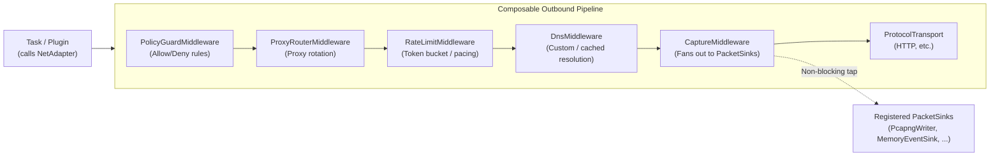
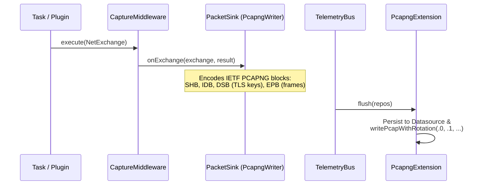

# Composable Outbound Networking & Transparent Wire Capture (`PCAPNG`)

## 1. Overview: Why the Network Layer Is a Standout Feature

In most dataflow engines and scrapers, outbound networking is an afterthought—a raw HTTP client call (`curl`, `fetch`, `http.get`) scattered inside task implementations. When you later need rate limiting, proxy rotation, domain allowlists, deterministic offline testing, or packet-level forensics, you end up rewriting every task or monkey-patching global state.

Flowdata treats outbound networking as a **first-class, composable, zero-intrusion microkernel plane** (`src/transport/outbound/`). Tasks and plugins never touch sockets or HTTP libraries directly, yet every single byte leaving or entering the engine passes through a declarative, VTable-driven pipeline—complete with an **embedded Wireshark-compatible PCAPNG recorder** (`extensions/pcapng/`).

---

## 2. The Core Idea: Everything Is a Composable `MiddlewareChain`

At the heart of `src/transport/outbound/` is a polymorphic **`NetMiddleware`** VTable (`src/transport/outbound/contracts/`) chained via `MiddlewareChain` and `NextHandler`:

### Why This Design Is So Powerful

1. **Tasks Stay 100% Agnostic**:
   A task like `download_cover.zig` simply asks its injected adapter to execute a `NetExchange`. It has no idea whether the request is being routed through a SOCKS5 proxy, throttled by a rate limiter, blocked by a security policy, intercepted by a `SinkholeAdapter` in a test, or recorded to a `.pcapng` file.
2. **Even Blocked & Rate-Limited Requests Are Captured**:
   Look at `CaptureMiddleware.intercept` in `src/transport/outbound/middleware/capture_middleware.zig`: if `PolicyGuardMiddleware` returns `error.NetworkPolicyDenied` or `RateLimitMiddleware` returns `error.NetworkRateLimited`, `CaptureMiddleware` synthesizes a `NetResult` with `.verdict = .blocked` or `.verdict = .rate_limited` and **still** sends it to every `PacketSink`. You don't just see successful traffic—you get a forensic record of *what was blocked and why*.
3. **Swap the Entire Network Driver Without Touching Tasks**:
   Because `OutboundAdapter` is an abstraction backed by `AdapterDriverContext` (`src/transport/outbound/drivers/`), YAML configuration can switch an adapter between:
   * **`EgressAdapter`**: Real outbound network traffic.
   * **`SinkholeAdapter`**: Captures and drops traffic (ideal for dry-runs, malware triage, or CI tests).
   * **`IsolatedAdapter`**: Strict network isolation.

---

## 3. "Embedded Wireshark": Transparent `PCAPNG` Capture (`extensions/pcapng/`)

Instead of baking binary packet encoding into the core engine, `extensions/pcapng/` plugs into the kernel via two tiny hooks in `PcapngExtension` (`extensions/pcapng/src/root.zig`):

1. `k.outbound.registerSinkFactory(&globalSinkFactory)` — whenever an adapter with `capture.enabled = true` is instantiated, `PcapngExtension` hands `CaptureMiddleware` a `PacketSink` VTable backed by `PcapngWriter`.
2. `k.telemetry.subscribe(ext.subscriber())` — when a pipeline finishes, `TelemetryBus.flushAll()` triggers `PcapngExtension.flush()`.

### Real IETF PCAPNG, Not Just Text Logs
`PcapngWriter` (`extensions/pcapng/src/pcapng_writer.zig`) implements the actual **IETF PCAPNG binary specification**:
* **SHB** (`0x0A0D0D0A`): Section Header Block.
* **IDB** (`0x00000001`): Interface Description Block (one per `adapter_id`, so Wireshark shows each configured adapter as a distinct interface).
* **DSB** (`0x0000000A`): Decryption Secrets Block (`TLSK` / `CLIENT_RANDOM`) when `include_tls_keys` is enabled.
* **EPB** (`0x00000006`): Enhanced Packet Block with timestamps, `snaplen` truncation, and comments.

And on `flush()`, `PcapngExtension` can **both** persist the raw PCAPNG stream into any configured `Datasource` (e.g., SQLite or `file_store`) **and** write rotating `.pcapng` files on disk (`writePcapWithRotation`) ready to be opened directly in Wireshark or `tshark`.

---

## 4. The Architectural Pattern to Replicate

What makes this feature truly special is not just that it produces `.pcapng` files—it is the **pattern** it establishes for the rest of Flowdata:

* **Intercept at the boundary** (`NetMiddleware` / `PacketSink` for network, `std.mem.Allocator` VTable for memory in [`ARCH-033`](../development/033-transparent-memory-and-resource-monitoring.md)).
* **Zero coupling in the core** (the engine doesn't know `pcapng` exists).
* **Opt-in via `KernelContext.use(...)` and YAML** (`capture.enabled`, `max_file_size_mb`, `max_files`, `datasource`).
* **Unified lifecycle** (`TelemetryBus.flushAll()` handles persistence cleanly at the end of execution).

This means you get production-grade observability, security enforcement, and forensic packet capture across every plugin and pipeline in the system—with **zero** observability code inside your business logic.

