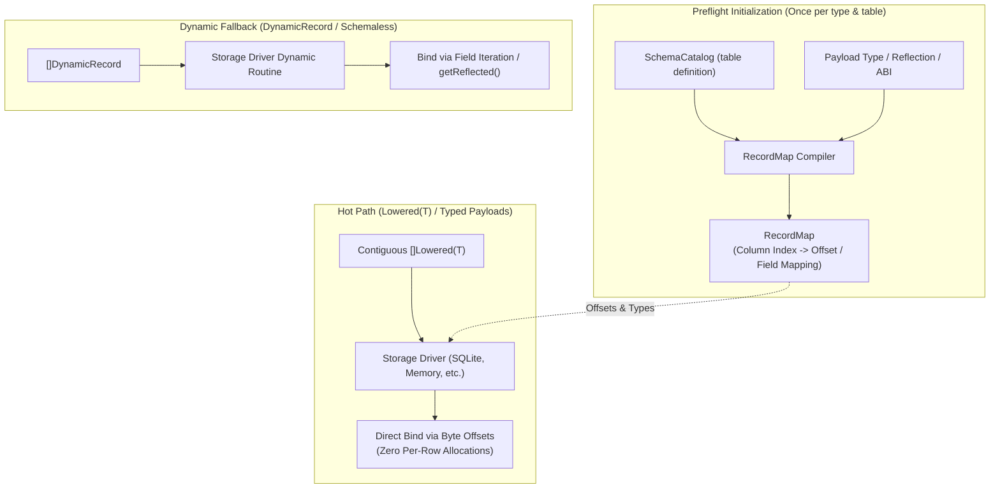
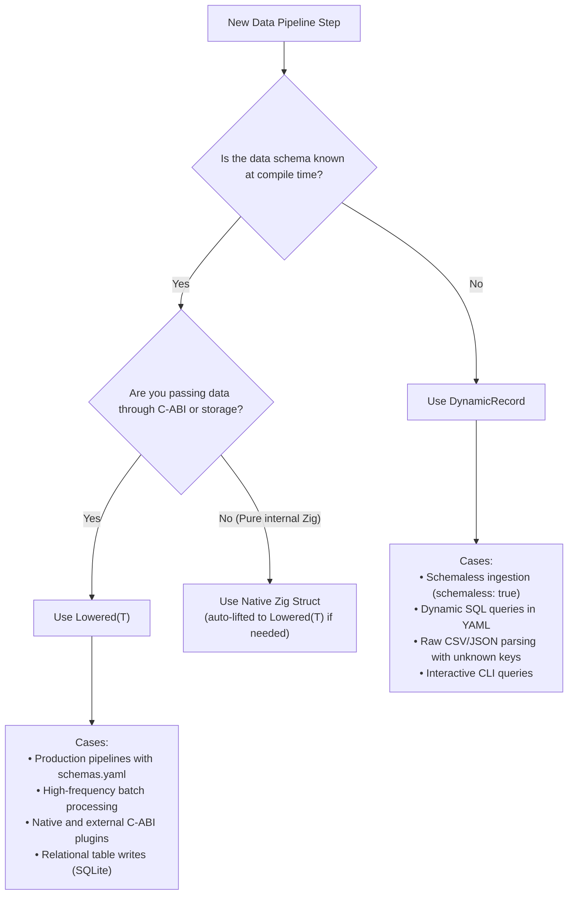

# Dual-Payload Storage Architecture: `Lowered(T)` vs. `DynamicRecord`

## 1. Overview & Motivation

Flowdata is a high-performance reactive dataflow microkernel designed to bridge two contrasting execution worlds:
1. **High-throughput, type-safe compiled pipelines:** Native Zig tasks, C-ABI external plugins (`.so`), and zero-copy message passing with strict layout guarantees.
2. **Declarative, dynamic pipeline orchestration:** Schemaless ingestion, dynamic YAML queries, ad-hoc CLI inspections, and runtime-defined data structures.

To support both worlds without compromising performance or flexibility, Flowdata's storage repository contract (`src/repository/`, `ARCH-009`) and storage drivers (such as `extensions/datasource/sqlite/` and `extensions/datasource/memory/`) implement a **Dual-Payload Architecture**.

This document outlines the design, memory representations, execution trade-offs, and decision rules for **`Lowered(T)`** (the static hot-path) and **`DynamicRecord`** (the runtime fallback).

---

## 2. Fundamental Concepts

### 2.1. `Lowered(T)` — The Static C-ABI Native Layout (`ARCH-016`)

`Lowered(comptime T: type) type` is a compile-time type generator that transforms any idiomatic Zig struct into a standard C-ABI compliant `extern struct` with guaranteed binary layout stability:

* **Integers & Floats:** Kept as primitive C scalar types (`i64`, `u64`, `f64`, etc.).
* **Slices (`[]const U`):** Transformed into `extern struct { ptr: ?[*]const Lowered(U), len: usize }`.
* **Optionals (`?U`):** Transformed into `extern struct { present: u8, value: Lowered(U) }`.
* **Nested Structs:** Recursively lowered into nested `extern struct`s.
* **Type Identification (`schema_id`):** Each `Lowered(T)` has a deterministic 64-bit Wyhash calculated at `comptime` covering all field names, types, and offsets.

```zig
// Contiguous memory buffer of N records
const batch: []const Lowered(MangaChapter) = ...;
const payload = PayloadHandle.fromSlice(Lowered(MangaChapter), batch);
```

**Key Characteristics:**
* **Contiguous memory:** Stored as a flat, single memory block `[*]const Lowered(T)`.
* **Zero allocation per row:** Adding 100,000 items requires exactly 1 allocation (the array itself).
* **Direct pointer arithmetic:** Reading a field at column index `i` is an `O(1)` memory access (`base_ptr + (row_idx * stride) + field_offset`).

---

### 2.2. `DynamicRecord` — The Runtime Tagged-Union Representation

`DynamicRecord` is a runtime container holding an array of named dynamic fields:

```zig
pub const DynamicRecord = struct {
    fields: []const DynamicField,
};

pub const DynamicField = struct {
    name: []const u8,
    value: ReflectedValue, // tagged union(int, float, string, bytes, boolean, none)
};
```

**Key Characteristics:**
* **Fully dynamic:** Fields, names, and types can vary per row and are discovered at runtime.
* **Heap heavy:** Each record allocates a slice of `DynamicField`. For string names and text values, separate heap allocations are typically retained.
* **Linear search:** Reading a field by name requires iterating through `fields` (`O(N)` field lookups).

---

## 3. Side-by-Side Comparison

| Dimension | `Lowered(T)` (Hot Path) | `DynamicRecord` (Fallback) |
| :--- | :--- | :--- |
| **Resolution Time** | **`comptime`** (Compile-time) | **Runtime** (Execution-time) |
| **Memory Layout** | Flat, contiguous `extern struct` array | Dispersed pointer array (`[]DynamicField`) |
| **Allocations for 100K Rows** | **1 allocation** (contiguous slice buffer) | **~800K+ allocations** (slices, names, boxed values) |
| **Cache Locality** | **L1/L2 cache optimal** (sequential stride) | High cache thrashing (pointer chasing) |
| **Field Access Cost** | **`O(1)`** direct memory offset | **`O(F)`** linear scan over field slice |
| **Type Verification** | Hardware-level stability + `schema_id` hash check | String-based tag checks at runtime |
| **C-ABI Boundary** | 100% stable; directly passable across C / `.so` | Requires serialization or custom bridge |
| **Schema Flexibility** | Rigid; structure must match `T` | Completely fluid; schemaless / variable columns |

---

## 4. The Architectural Bridge: `RecordMap`

To prevent drivers from having to guess or re-reflect types on every query, `ARCH-009` introduces the **`RecordMap`**. A `RecordMap` is compiled **once** per `(type_name, table)` during preflight initialization:



### 4.1. Write Operations (`WriteSpec`)
When `Repository.write(spec: WriteSpec)` is invoked:
1. The driver checks the payload representation (`payload.repr`).
2. **If `.typed` (`Lowered(T)`):**
   * The driver reads row bytes using `spec.record_map.column_offsets`.
   * Values are bound directly to the prepared statement parameters (`sqlite3_bind_int64(stmt, col, *(@ptrCast(...)))`).
   * **Result:** Blazing fast batch ingestion with zero intermediate heap allocations.
3. **If `.dynamic` (`DynamicRecord`):**
   * The driver iterates over `fields` and binds values via `ReflectedValue`.
   * **Result:** Safe execution for ad-hoc and schemaless pipelines.

### 4.2. Read Operations (`ReadSpec`)
When `Repository.read(spec: ReadSpec)` is executed:
* **Target Schema Specified (`spec.target_schema_id != null`):**
  The driver knows downstream tasks expect a concrete `Lowered(T)`. It allocates a single contiguous buffer `[]Lowered(T)` and populates the struct fields directly from column values as it steps through the cursor.
* **Target Schema Absent (`spec.target_schema_id == null`):**
  Downstream has not bound a static struct (e.g. ad-hoc query or schemaless export). The driver materializes `DynamicRecord` objects.

---

## 5. Scope: Is this limited to SQLite?

**No.** The dual-payload storage contract is a universal pattern applicable to all Flowdata repository implementations:

1. **Relational Databases (SQLite, PostgreSQL, DuckDB):**
   * *`Lowered(T)`:* Direct parameter binding from struct offsets for parameterized batch statements (`INSERT INTO ... VALUES (?, ?)`).
   * *`DynamicRecord`:* Parameter binding via dynamic field iteration.
2. **In-Memory & Embedded Storage (`extensions/datasource/memory/`):**
   * *`Lowered(T)`:* Stored as typed memory segments, enabling SIMD-friendly vector filtering and instant projection slicing.
   * *`DynamicRecord`:* Stored as an array of heap-allocated dynamic maps.
3. **Columnar & Analytical Stores (Apache Arrow, Parquet):**
   * *`Lowered(T)`:* Trivial transposition into contiguous Arrow arrays with known column sizes.
4. **Document / Key-Value Stores (Redis, RocksDB, FileStore, S3):**
   * *`Lowered(T)`:* Flat binary serialization without reflection overhead.
   * *`DynamicRecord`:* Dynamic JSON/MessagePack key-value serialization.

---

## 6. When to Use Which: Decision Matrix



### Summary of Rules
1. **Always default to `Lowered(T)` for production pipelines:** Whenever the structure of the data is declared in `schemas.yaml` and known to pipeline tasks, use typed structs. It ensures memory safety, eliminates GC/allocation pressure, and maximises CPU throughput.
2. **Reserve `DynamicRecord` for runtime uncertainty:** Use it when the schema cannot be known ahead of time, such as generic exploratory tools, variable CSV imports, or schemaless document stores.

