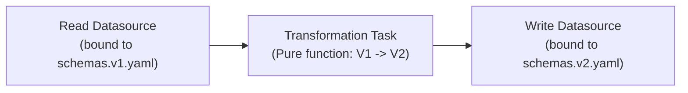
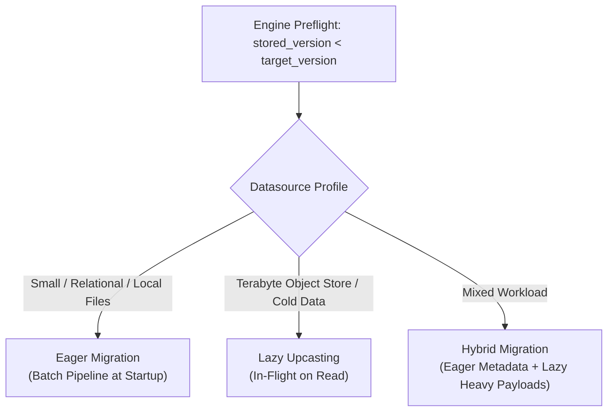
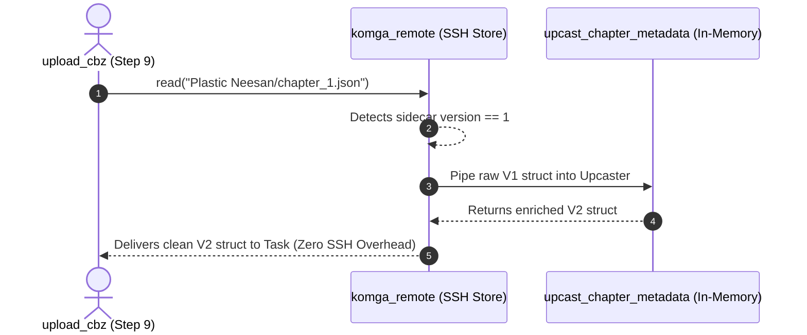
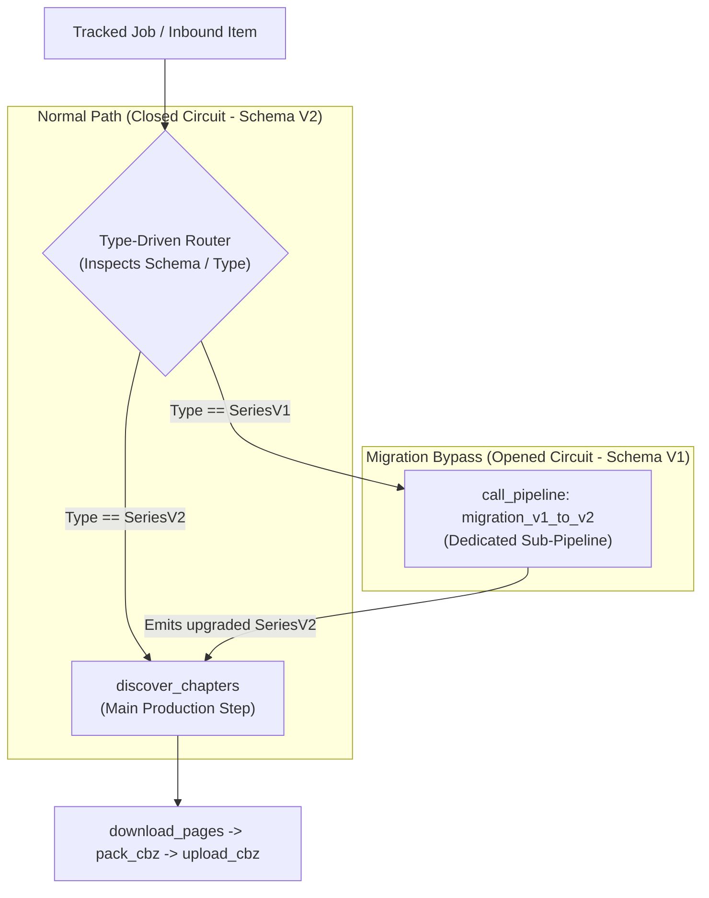

# Pipeline-Driven Universal Schema Evolution: Eager, Lazy & Hybrid

## 1. The Dilemma: State-Based vs. Migration-Based in Universal Storage

Modern data systems traditionally approach schema evolution in one of two ways:

1. **State-Based Declarative Schemas (e.g., `schemas.yaml`, Terraform, Prisma):**
   * *Concept:* You declare the target state of your data. The engine diffs the current state against the target and generates changes automatically.
   * *Advantage:* Zero boilerplate for simple additive changes (adding a column, creating an index or table).
   * *Limitation:* It cannot deduce complex data transitions (e.g., renaming a column, merging fields, splitting names, or backfilling computed values).
2. **Delta Migration Scripts (e.g., Flyway, Liquibase):**
   * *Concept:* Developers write sequential delta scripts (`V1__init.sql`, `V2__rename_title.sql`).
   * *Advantage:* Precise control over how data moves from version $N$ to $N+1$.
   * *Fatal Flaw for Flowdata:* **It completely breaks storage portability.** A SQL script only works on SQL databases. It fails on `yaml_file`, `json_store`, `file_store`, S3, and NoSQL document stores.

Flowdata resolves this dilemma by leveraging its own fundamental nature: **a data migration is nothing more than a reactive dataflow pipeline.**

---

## 2. Core Insight: Migrations Are Pipelines

In Flowdata, transforming a dataset from schema version 1 to schema version 2 follows the exact anatomy of any standard task pipeline:



Because Flowdata already provides:
* **Compile-time type contracts (`Lowered(T)` & `schema_id`)**,
* **DAG scheduling and worker concurrency (`ARCH-017`)**,
* **Memory backpressure and flow control (`max_inflight_bytes`)**,
* **Dead-letter queues and error recovery (`ARCH-021`)**, and
* **Transactional write safety (`ARCH-009`)**,

re-implementing an ad-hoc SQL migration tool inside Flowdata would violate the Unix philosophy. Instead, **the engine reuses its own pipeline orchestration primitives to execute schema evolution.**

---

## 3. Schema Versioning Convention

Schemas are stored as declarative, engine-agnostic contracts versioned by convention:

```text
configs/schemas/
├── catalog.v1.yaml
└── catalog.v2.yaml
```

Each schema file defines the state of tables, collections, or document shapes for that specific epoch:

```yaml
# configs/schemas/catalog.v1.yaml
version: 1
schemas:
  catalog:
    catalog_series:
      columns:
        series_id: { type: text, pk: true }
        title:     { type: text }
```

```yaml
# configs/schemas/catalog.v2.yaml
version: 2
schemas:
  catalog:
    catalog_series:
      columns:
        series_id:    { type: text, pk: true }
        series_title: { type: text } # Renamed from 'title'
        status:       { type: text, default: "'ongoing'" } # New field with default
```

During engine preflight:
1. The engine queries the storage datasource for its currently applied version (e.g., `PRAGMA user_version` in SQLite, `schema_version` in YAML/JSON header, or bucket metadata in S3).
2. The engine checks the highest available schema version in `configs/schemas/`.
3. If `stored_version < target_version`, a migration path is scheduled.

---

## 4. Execution Modes: Eager, Lazy & Hybrid

Storage engines have fundamentally different volume and latency profiles. A one-size-fits-all migration strategy fails across diverse datasources. Flowdata supports three execution modes:



### 4.1. Eager Migration (Startup Batch)
* **Best suited for:** `sqlite`, `postgres`, small `yaml_file`, and `json_store`.
* **Mechanism:**
  1. The engine constructs a dedicated migration DAG step before the application pipeline starts.
  2. The step streams old records using `readStream()`, runs the transformation task, and writes back using `upsert` or `replace_all` within a transaction.
  3. Once committed, the engine updates the datasource version stamp and boots the main pipeline.
* **Latency:** Sub-second for datasets up to hundreds of thousands of rows.

### 4.2. Lazy Migration (Upcasting on Read)
* **Best suited for:** `file_store`, AWS S3, Ceph, and high-volume append-only event logs.
* **Problem:** Scanning 10 million files or 50 Terabytes in S3 on startup to rename a field would freeze the application for hours.
* **Mechanism:**
  1. No global batch mutation occurs at startup. The bucket version is tagged as `v2`.
  2. When an individual record or object is read via `Repository.read(ReadSpec)`:
     * If the payload metadata indicates `version == 1`, the `InboundRouter` or repository layer pipes the payload through an in-memory **Upcaster Task** ($V1 \to V2$).
     * The downstream task receives a clean, modern $V2$ struct.
  3. (Optional Write-Back): When the object is subsequently updated, it is persisted in the $V2$ format.

### 4.3. Hybrid Mode
* **Best suited for:** Production multimedia pipelines (like MangaDex / Comic catalogs).
* **Mechanism:**
  * Control and analytical tables (`catalog_series`, `discovered_chapters` in SQLite) run **Eagerly** at startup so queries are instantly consistent.
  * Massive payload stores (thousands of archived `.cbz` files or image blobs in `file_store` / `ssh_store`) run **Lazily**, upcasting sidecar metadata only when accessed.

---

## 5. Pragmatic Case Study: MangaDex Pipeline Migration (V1 → V2)

To illustrate how this works in a production environment, consider the **MangaDex Synchronization App** (`apps/mangadex/configs/pipeline.yaml`).

### 5.1. The Migration Scenario
A new version of the app refactors two key datasources:
1. **`catalog_db` (SQLite):**
   * *Old (V1):* Table `catalog_series` has `title: text` and `last_synced_at: int64`.
   * *New (V2):* Renamed to `series_title: text`, and added a required enum field `sync_state: text` (which must be backfilled to `'synced'` for existing rows).
2. **`komga_remote` (Remote SSH FileStore):**
   * *Old (V1):* Remote chapters have legacy sidecar metadata (`{"ch": "1", "uploaded": true}`).
   * *New (V2):* Upgraded to standard ComicInfo metadata (`{"chapter_number": "1.0", "volume": "1", "status": "verified"}`).
   * *The Catch:* There are 15,000 chapters stored remotely on the Komga host. Scanning every remote file over SSH during engine startup would take 30 minutes!

---

### 5.2. Eager Migration in Action: External API Enrichment (SQLite `catalog_db`)

A frequent anti-pattern in legacy migrations is writing one-off, throwaway migration scripts that duplicate production business logic. In Flowdata, **a migration pipeline can simply compose and chain existing production tasks**.

#### The Scenario: Enriching Legacy Series via MangaDex API
* **Schema V1 (Legacy):** `catalog_series` only contained minimal identifying info: `{ series_id: text, title: text }`.
* **Schema V2 (Modern):** Upgraded to support rich analytical metadata: `{ author: text, artist: text, summary: text, genres_json: text, cover_url: text }`.
* **The Challenge:** To populate the new columns, we cannot simply cast data in memory; we must fetch canonical metadata from the upstream MangaDex REST API.

#### Step 1: Schemas Definition
```yaml
# configs/schemas/catalog.v1.yaml
version: 1
schemas:
  catalog:
    catalog_series:
      columns:
        series_id:      { type: text, pk: true }
        title:          { type: text }
```

```yaml
# configs/schemas/catalog.v2.yaml
version: 2
schemas:
  catalog:
    catalog_series:
      columns:
        series_id:      { type: text, pk: true }
        title:          { type: text }
        author:         { type: text, nullable: true }
        artist:         { type: text, nullable: true }
        summary:        { type: text, nullable: true }
        genres_json:    { type: text, nullable: true }
        cover_url:      { type: text, nullable: true }
        last_synced_at: { type: int64, nullable: true }
```

#### Step 2: The Eager Migration Pipeline in `pipeline.yaml`
Instead of writing a custom migration task in Zig, the developer wires an eager preflight pipeline that **reutilizes standard production tasks** (`fetch_series_details`):

```yaml
pipelines:
  # ---------------------------------------------------------------------------
  # MIGRATION PIPELINE V1 -> V2: API Enrichment
  # Automatically executed at boot before 'manga_sync' if user_version < 2
  # ---------------------------------------------------------------------------
  migration_v1_to_v2:
    schedule: on_schema_upgrade # Executed during preflight
    steps:
      # Step 1: Read existing series using V1 schema projection
      - id: read_legacy_catalog
        inputs:
          series_records:
            datasource: catalog_db
            schema: catalog.v1

      # Step 2: REUSE existing production task 'fetch_series_details'
      # Inherits rate-limiting (30 req/s), token buckets, and auth headers!
      - id: enrich_via_api
        uses: manga_catalog/fetch_series_details
        networks:
          - mangadex_api # Principle of least privilege: egress network bound
        inputs:
          job: steps.read_legacy_catalog.output

      # Step 3: Write enriched records to catalog_db under Schema V2
      - id: persist_v2_catalog
        inputs:
          enriched: steps.enrich_via_api.output
        outputs:
          saved:
            datasource: catalog_db
            schema: catalog.v2 # Enriched V2 struct
            mode: upsert
```

#### Why This Is a Paradigm Shift:
1. **Zero Throwaway Code:** Zero lines of custom migration code written. The pipeline reuses the exact same, thoroughly-tested `manga_catalog/fetch_series_details` task used by the main application.
2. **Automatic Rate Limiting & Network Safety:** Because it routes through the `mangadex_api` egress adapter, the migration automatically complies with MangaDex rate limits (`requests_per_second: 30`, `burst: 60`), preventing IP bans during upgrades.
3. **Built-in Resilience:** If MangaDex returns a 503 or 429 on any series, Flowdata's standard retry mechanisms and dead-letter queues (`ARCH-021`) isolate the fault without corrupting the local database.
4. **Atomic Batched Writes:** Results are written back to SQLite inside a single `BEGIN IMMEDIATE ... COMMIT` batch, incrementing `PRAGMA user_version = 2` upon successful completion.

---

### 5.3. Lazy Migration (Upcasting) in Action: SSH `komga_remote`

For the 15,000 remote `.cbz` sidecars in `komga_remote`, running an eager batch over SSH is prohibitive. Instead, the developer configures an **Upcaster**:

```yaml
datasources:
  komga_remote:
    driver: ssh_store
    role: sink
    host: "${KOMGA_SSH_HOST:-localhost}"
    directory: "${KOMGA_SSH_DIR:-/data/komga}"
    # Lazy migration: applied on-the-fly when reading remote metadata
    upcasters:
      - from_version: 1
        to_version: 2
        uses: manga_catalog/upcast_chapter_metadata_v1_to_v2
```

#### Runtime Execution Flow:


1. Step 9 (`upload_cbz`) inspects whether chapter 1 already exists on the remote Komga host.
2. The `ssh_store` driver reads the small sidecar JSON file over SSH.
3. It detects `version: 1`. Instead of failing or forcing a pre-batch, it pipes the payload through `upcast_chapter_metadata_v1_to_v2` in memory.
4. `upload_cbz` receives an up-to-date `V2` struct.
5. If the step updates the chapter, it writes back `version: 2` to the remote host. Untouched chapters remain as-is without wasting bandwidth.

---

### 5.4. Opening the Circuit: Pipeline Interception vs. In-Line Clutter

A critical architectural dilemma when applying migrations is **where** to place the migration steps without polluting the production application pipeline.

#### The Anti-Pattern: In-Line Clutter (Spaghetti DAG)
Hardcoding temporary migration tasks directly inside the main `manga_sync` pipeline:
```yaml
# AVOID: Polluting the main pipeline with legacy conditional branches
pipelines:
  manga_sync:
    steps:
      - id: check_if_v1 # Technical debt!
      - id: migrate_if_v1 # Clutter!
      - id: normal_step_1
      - id: normal_step_2
```
*Why this fails:* Once the migration is complete, the production pipeline remains polluted with obsolete steps, dead conditionals, and branching cognitive overhead.

#### The Clean Pattern: Circuit Opening & Sub-Pipeline Delegation
Instead of inlining tasks, the main pipeline treats the migration as a **temporary circuit bypass**:



#### How to Declare the Circuit Opening:

1. **Option A: Explicit Sub-Pipeline Delegation (`call_pipeline`)**:
   *Mechanism:* The main pipeline declares a single preflight gate step that calls an external sub-pipeline.
   *Trade-off:* While decoupled, it still requires touching the existing production YAML to insert the gate step (violating the Open-Closed Principle).

2. **Option B: Type-Driven Router Bifurcation (`ARCH-018` / `ARCH-023`) — The Preferred Architecture**:
   *Mechanism:* Strictly **additive** (Open for extension, Closed for modification). The existing `pipeline.yaml` is **100% untouched**.
   *How it works:*
   * The developer includes an additional file (`migrations/v1_to_v2.yaml` or declares the pipeline alongside).
   * A legacy item is stamped with `schema_id` corresponding to `SeriesV1`.
   * The `TypeDrivenRouter` detects that the downstream step (`discover_chapters`) expects `SeriesV2`, but `migration_v1_to_v2` accepts `SeriesV1`.
   * The router **automatically diverts** the `SeriesV1` item into the migration pipeline, which emits `SeriesV2`.
   * The freshly emitted `SeriesV2` now satisfies the input contract of `discover_chapters` and seamlessly re-enters the main production flow.

---

### 5.5. The Debugging Challenge: Making Type-Driven Routing 100% Observable

A common pitfall with implicit type-driven routing is the *"magic behavior"* problem: if a record is diverted automatically based on type signatures, developers may ask:
> *"Where did my record go? Why did step X execute instead of step Y?"*

To prevent debugging nightmares, Flowdata provides three explicit observability pillars:

#### 1. Preflight DAG Visualizer (`ARCH-004` & `dag_viz`)
Before running any data, the engine's graph command (`flowdata graph` or `apps/mangadex graph`) generates the complete visual DAG. The visualizer explicitly draws the **Bifurcation Branch**:
```text
[Input: SeriesV1] ──(diverted)──> [migration_v1_to_v2] ──(SeriesV2)──> [discover_chapters]
[Input: SeriesV2] ───────────────────────────────────────────────────> [discover_chapters]
```
The developer can visually verify the exact path both V1 and V2 records will take before a single packet moves.

#### 2. OpenTelemetry Span Tracing (`ARCH-004` & `TelemetryBus`)
Every payload carries a W3C `traceparent` context. When the `TypeDrivenRouter` performs a bifurcation, it emits an explicit span event on the `TelemetryBus`:
```json
{
  "event": "router.bifurcation",
  "router": "type_driven",
  "incoming_type": "SeriesV1",
  "incoming_schema_id": "0x8a12f9b4c0e1",
  "target_step_expected": "SeriesV2",
  "diverted_to_pipeline": "migration_v1_to_v2",
  "trace_id": "4bf92f3577b34da6a3ce929d0e0e4736"
}
```
In Jaeger, Grafana, or local `.jsonl` trace viewers, developers see the exact hop where the circuit opened.

#### 3. Preflight Routing Dry-Run (`--explain-routing`)
The CLI provides an explanation flag that prints the routing resolution table at startup:
```text
[ROUTING RESOLUTION]
  Type: SeriesV1 (v1) -> Matched Step: migration_v1_to_v2 (Resolution: Auto-Upcast Bypass)
  Type: SeriesV2 (v2) -> Matched Step: discover_chapters  (Resolution: Direct Happy Path)
```

**Conclusion:** By combining strict Open-Closed additive pipelines with preflight visualization and OpenTelemetry tracing, type-driven schema evolution provides maximum architectural cleanliness without sacrificing debuggability.

---

## 6. Architectural Benefits

1. **100% Storage-Agnostic:** No SQL syntax leaks into `schemas.yaml`. The exact same transformation task can migrate a table in SQLite, an array in `jobs.yaml`, or a series of JSON documents.
2. **Reusability of Flowdata Primitives:** Migrations inherit concurrency limits, worker pools, metrics, tracing, and crash-resume checkpoints for free.
3. **Type Safety Across Versions:** The Zig compiler verifies both the input struct (`Lowered(SeriesV1)`) and output struct (`Lowered(SeriesV2)`), catching migration bugs at compile time.
4. **Optimized I/O via Hybrid Execution:** Fast local stores migrate in milliseconds on boot; heavy distributed stores migrate on-demand without latency spikes.


