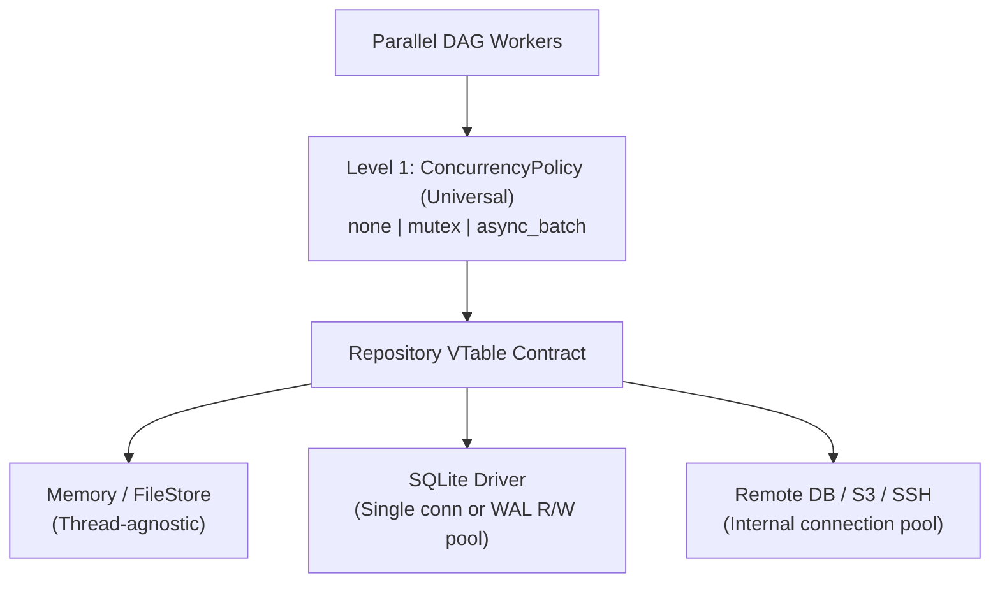

# Repository Concurrency Policies & Driver Resource Management

## 1. The Two Levels of Storage Concurrency

When a parallel DAG scheduler (`ARCH-017`) shares a storage datasource across multiple worker threads, concurrency breaks into **two distinct responsibilities** that should never be mixed:

1. **Access Policy (Universal — `src/repository/`):** Controls *how engine workers invoke the `Repository` VTable* (`none`, `mutex`, `async_batch`). It is 100% engine-agnostic and applies identically to `memory`, `sqlite`, `file_store`, `yaml_file`, and `ssh_store`.
2. **Internal Resource Policy (Driver-Specific — `drivers/<engine>/`):** Controls *how a specific backend manages its own connections, file handles, or network sessions* (e.g., SQLite WAL read-only connection pools, Postgres TCP pools, or SSH/HTTP session semaphores).

---

## 2. Level 1 — Universal Access Policies (`ConcurrencyPolicy`)

Rather than hiding ad-hoc mutexes inside storage drivers or leaving thread-safety implicit, Flowdata requires callers to choose a [`ConcurrencyPolicy`](../../src/repository/concurrency_policy.zig) explicitly via `ManagedRepository.init(allocator, inner, policy)`:

| Policy | Wrapper | Behavior | When to Use |
| :--- | :--- | :--- | :--- |
| `.none` | Direct `Repository` | Zero overhead; no locking. | Single-threaded pipelines, tests, or drivers that already manage internal thread-safe pools. |
| `.mutex` | `SynchronizedRepository` | Serializes all `Repository` VTable calls behind a single `Mutex`. | Default for thread-agnostic single-connection drivers (`memory`, `sqlite` single-connection, `yaml_file`) under `scheduler: dag`. |
| `.async_batch` | `AsyncBatchRepository` | Bounded MPSC write queue + dedicated background writer thread flushing batches inside `beginTx`/`commit`. Reads flush pending writes for read-your-own-writes consistency. | Write-heavy pipelines where batching transactions amortizes disk/fsync latency (e.g., SQLite WAL bulk ingestion). |

> **Why explicit selection matters:** Making `ConcurrencyPolicy` a required argument at instantiation forces the engine or app author to consciously decide whether the repository is single-threaded, mutex-serialized, or async-batched.

---

## 3. Level 2 — Driver-Specific Resource Policies

Some concurrency optimizations cannot be expressed universally at the `Repository` boundary because they depend on how the underlying engine handles connections:

### 3.1. SQLite: Single Connection vs. WAL Read/Write Split
* **Baseline (`009B`):** `libs/sqlite/` and `SqliteRepository` operate on a single `*c.sqlite3` connection with zero internal locks. Wrapping it in `.mutex` (`SynchronizedRepository`) or `.async_batch` is simple, prevents `SQLITE_BUSY`, and guarantees read-your-own-writes.
* **Anti-pattern to avoid:** Never try to get concurrent reads on a *single* `*c.sqlite3` handle by nesting separate read/write mutexes — SQLite connection handles are not safe for concurrent multi-thread calls without serialized access, and nested locks add latency and deadlock risk.
* **Future optimization (WAL Read Pool):** Under `PRAGMA journal_mode = WAL`, SQLite natively supports **1 writer + N concurrent readers** at the file/WAL level as long as each reader uses its **own** `openReadOnly` connection handle. If read contention is ever measured under a parallel DAG, the driver can route `write*`/`beginTx` to 1 writer connection and `read*`/`readStream` to a small read-only connection pool, while the engine selects `ConcurrencyPolicy.none` on top.

### 3.2. Networked & Remote Stores (Future)
* **Postgres / MySQL:** The database server handles concurrency itself; the driver maintains a TCP connection pool (`max_connections`) and the engine can use `ConcurrencyPolicy.none`.
* **HTTP / SSH (`ssh_store`):** Concurrency is bounded by remote rate limits or session semaphores inside the transport/driver layer.

---

## 4. Decision Matrix

1. **Is the driver thread-agnostic (single connection / in-memory map / local file)?**
   * Sequential execution → `.none`
   * Parallel DAG workers → `.mutex` (or `.async_batch` for high-throughput writes)
2. **Does the driver already manage its own thread-safe connection pool (e.g., WAL read pool, TCP pool)?**
   * Use `.none` at the `ManagedRepository` layer so the engine does not add a redundant outer `Mutex`.

