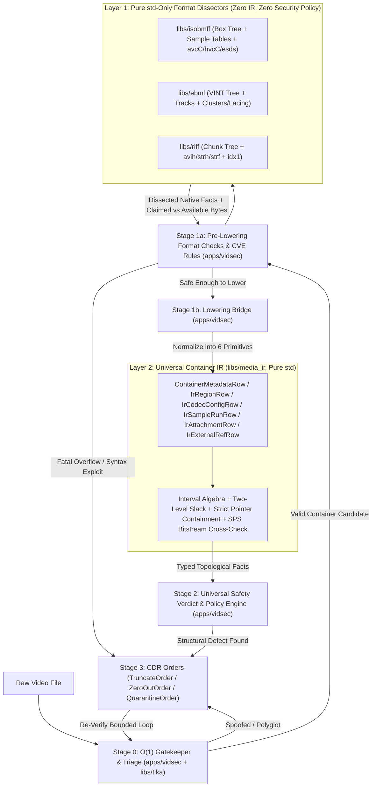

# Universal Container IR Decoupling & Format-Agnostic Forensics

> [!NOTE]
> This guide documents the compiler-inspired 3-layer architecture formalized in [`035-vidsec-libs-extraction-and-rebuild-plan.md`](file:///home/ubuntu/.gemini/antigravity/scratch/vidsec/docs/development/035-vidsec-libs-extraction-and-rebuild-plan.md) (`ARCH-035`). It explains **why** `vidsec` isolates pure binary container dissectors from universal topological forensics, **how** lowering translates incompatible formats into a single interval algebra, and **how** researchers can hunt newly disclosed CVEs without recompiling the engine.

---

## 1. The $N \times M$ Combinatorial Problem in Media Forensics

Every digital video file is a *structured container* wrapping multiplexed elementary bitstreams (video frames, audio packets, subtitles, metadata, and chapters). Although `MP4`, `MKV`, `AVI`, and `MPEG-TS` serve the exact same purpose at the player level, their binary syntaxes share almost nothing:

* **ISOBMFF (`.mp4`, `.mov`, `.m4a`)**: Big-endian nested *Boxes* (`Atoms`) with 32-bit or 64-bit `largesize` headers, `FullBox` version/flags prefixes, and flat sample lookup matrices (`stsc`, `stts`, `ctts`, `stsz`, `stco`, `co64`).
* **EBML / Matroska (`.mkv`, `.webm`)**: Variable-Size Integer (`VINT`) element IDs and payload lengths, unknown-size streaming blocks (`0x01FFFFFFFFFFFFFF`), clustered interleaved blocks (`SimpleBlock`, `BlockGroup`), and Xiph/EBML/fixed frame lacing.
* **RIFF / AVI (`.avi`, `.webp`, `.wav`)**: Little-endian chunks (`FourCC` + `u32 LE` size) with mandatory 2-byte word alignment padding, `LIST` super-chunks, and legacy relative-or-absolute `idx1` indices.

If a security tool implements $M$ forensic analyses—such as **unreferenced byte-gap detection**, **overlapping region detection**, **sample pointer containment**, **codec-vs-container resolution checks**, and **trailing overlay truncation**—directly inside each format parser across $N$ formats, the codebase degenerates into **$O(N \times M)$ duplicated, fragile logic**. Worse, fixing a subtle interval-overlap bug in the MP4 analyzer does not fix the exact same bug in the Matroska or AVI analyzers.

Conversely, a naive "normalize everything up front" parser creates two opposite failures:

1. **Wasted I/O & CPU on Malicious Garbage**: Parsing and normalizing millions of sample entries across a multi-gigabyte file before running cheap header sanity checks lets malformed containers waste massive resources (or crash the normalizer itself).
2. **Loss of Format-Specific Exploit Syntax**: Certain CVEs exploit byte-level quirks that disappear once normalized into a container-neutral representation (e.g., an overlong EBML `VINT`, an `stsc` table claiming $4\text{ GB}$ inside a 28-byte box, an odd-sized RIFF chunk missing its pad byte, or an `esds` 7-bit continuation descriptor loop).

`vidsec` resolves this tension by adopting the architecture of a modern compiler frontend/middle-end/backend (`Clang`/`LLVM`).

---

## 2. The 3-Layer Compiler-Inspired Architecture (`ARCH-035`)

Rather than building monolithic container inspectors, `vidsec` enforces strict dependency boundaries across three layers:



### Strict Dependency Rules

| Layer | Packages | Allowed Dependencies | Forbidden Dependencies | Primary Responsibility |
| :--- | :--- | :--- | :--- | :--- |
| **Layer 1: Dissectors** | `libs/isobmff`, `libs/ebml`, `libs/riff`, `libs/tika` | Zig `std` only | `libs/media_ir`, `flowpipe`, `vidsec`, CVE rules, severity verdicts | Pure, lossless binary dissection into hierarchical paths, native tables, and physical boundary measurements (`claimed_bytes`, `available_bytes`). |
| **Layer 2: Universal IR** | `libs/media_ir` | Zig `std` only | `libs/isobmff`, `libs/ebml`, `libs/riff`, `flowpipe`, YAML/UI strings | Canonical IR tables, coalesced sample-run representation, interval set algebra, slack calculation, and Exp-Golomb codec parameter cross-checking returning typed facts. |
| **Layer 3: Application** | `apps/vidsec` | Layer 1 + Layer 2 + `flowpipe` | Direct bypass of Layer 1 binary framing inside Stage 2 | Stage 0 triage, Stage 1a format checks & CVE field queries, Stage 1b lowering bridge, Stage 2 safety policy, and Stage 3 CDR sanitization (`TruncateOrder`, `ZeroOutOrder`, `QuarantineOrder`). |

### Why Stage 1a Runs *Before* Stage 1b Lowering

Placing format-specific inspections *before* lowering to `libs/media_ir` is deliberate:

1. **Early Short-Circuiting**: Lowering hundreds of thousands of sample extents and walking deep cluster trees on a 10 GB file takes non-trivial CPU and I/O. If Stage 1a detects that `moov/.../stsc` declares an `entry_count` whose byte requirement overflows `u64` or exceeds the enclosing box payload, or if `ftyp` violates specification brands, `vidsec` terminates analysis and triggers quarantine immediately without constructing the IR.
2. **Zero-Information-Loss CVE Hunting**: When a CVE depends on format-local bit encodings—such as MP4 `ctts` version/signed-offset edge cases, EBML VINT width mismatches, or RIFF `BITMAPINFOHEADER` field arithmetic—Stage 1a exposes the raw dissected `IrRegionRow` paths and byte ranges directly to `inspect_region_field` rules declared in YAML, before IR normalization abstracts away format-specific quirks.

---

## 3. The 6 Canonical Primitives of `libs/media_ir`

Once a container passes Stage 1a sanity gates, the lowering bridge in `apps/vidsec` projects the native dissector output into six format-agnostic IR tables.

### 3.1 `ContainerMetadataRow`
Captures global container-level declarations used as ground truth when checking consistency against individual tracks and codec headers:
* `format_family`: Enum (`.isobmff`, `.ebml`, `.riff`, `.mpeg_ts`, `.unknown`)
* `major_brand`: Normalized brand/doc-type identifier (e.g., `"isom"`, `"mp42"`, `"matroska"`, `"webm"`, `"AVI "`)
* `file_size`: Exact physical size of the container file in bytes (`u64`)
* `timescale` & `duration_ms`: Container-declared playback timescale and duration
* `declared_width` & `declared_height`: Top-level or primary video track canvas dimensions
* `track_count`: Total declared elementary streams

### 3.2 `IrRegionRow`
Represents any physical structural element (MP4 box, EBML element, RIFF chunk) as a half-open byte interval $[ \text{offset}, \text{end\_offset} )$:

```text
|<---------------------------- IrRegionRow ----------------------------->|
|<- header_size ->|<------------------- payload_size ------------------->|
^                 ^                                                      ^
offset            payload_offset                                         end_offset
```

Key fields carried on every lowered region:
* **Identity & Tree Linkage**: `region_id: u64`, `parent_region_id: ?u64`, `raw_tag: []const u8` (e.g., `"moov"`, `"stsc"`, `"Cluster"`, `"hdrl"`), and canonical normalized path (`"moov/trak[0]/mdia/minf/stbl/stsc"`).
* **Physical Coordinates**: `offset: u64`, `header_size: u64`, `payload_offset: u64`, `payload_size: u64`, `end_offset: u64` (`= offset + header_size + payload_size`, checked against arithmetic overflow).
* **Semantic Normalization (`SemanticRole`)**:
  * `.file_header`: Top-level format signature (`ftyp`, `EBML`, `RIFF`)
  * `.metadata_container`: Structural grouping nodes (`moov`, `trak`, `Segment`, `Tracks`, `LIST:hdrl`)
  * `.track_header`: Stream geometry and timing declarations (`tkhd`, `mdhd`, `Video`, `avih`, `strh`)
  * `.sample_table`: Frame-to-byte mapping tables (`stts`, `stsc`, `stsz`, `stco`, `co64`, `ctts`, `Cues`, `idx1`)
  * `.codec_config`: Decoder initialization bitstreams (`avcC`, `hvcC`, `esds`, `vpcC`, `av1C`, `CodecPrivate`, `strf`)
  * `.media_data`: Regions legitimately holding elementary stream payloads (`mdat`, `Cluster`, `LIST:movi`)
  * `.index_table`: Seek tables (`sidx`, `Cues`, `idx1`, `indx`)
  * `.padding_free`: Explicit filler spaces (`free`, `skip`, `Void`, `JUNK`, `PAD `)
  * `.attachment`: Embedded arbitrary files (`Attachments`/`AttachedFile`, `meta`/`ilst` cover art)
  * `.unknown`: Unrecognized/custom boxes or chunks
* **Internal Containment Telemetry**: `claimed_bytes: ?u64`, `available_bytes: u64`, and `has_arith_overflow: bool`, propagated directly from Layer 1 dissectors so Stage 2 can flag structural lies uniformly across formats.

### 3.3 `IrCodecConfigRow`
Extracts raw out-of-band codec initialization blobs alongside the container's claimed track parameters:
* `track_id: u32`, `codec_tag: []const u8` (e.g., `"avc1"`, `"hvc1"`, `"mp4a"`, `"V_MPEG4/ISO/AVC"`)
* `source_region_id: u64`, `source_offset: u64`
* `raw_config_bytes: []const u8` (the raw `avcC`, `hvcC`, `CodecPrivate`, or `BITMAPINFOHEADER` bytes)
* `declared_width: u32`, `declared_height: u32`, `declared_sample_rate: u32`, `declared_channels: u16`

### 3.4 `IrSampleRunRow` (Coalesced Sample Byte Runs)
A critical scaling invariant of `ARCH-035` is **run coalescing**.

Consider a standard 2-hour 60 fps movie with 48 kHz AAC audio:
* Video frames: $2 \times 3600 \times 60 = 432,000$ samples.
* Audio frames: $2 \times 3600 \times 46.875 = 337,500$ samples.
* **Total individual samples**: $\approx 770,000$ samples (and over $1.5 \times 10^6$ in high-framerate or multi-audio streams).

Emitting an individual `IrSampleExtentRow` per frame wastes tens of megabytes of arena/channel memory and slows interval sorting on every file. Yet demuxers and muxers almost always group consecutive samples from the same track into contiguous interleaved chunks (e.g., 15–60 video frames back-to-back inside one MP4 `stco` chunk, followed by a contiguous run of audio frames).

When lowering sample tables, if two consecutive samples $A$ and $B$ belong to the same track and meet cleanly in the file (`A.end_offset == B.offset`), `vidsec` merges them into a single **`IrSampleRunRow`**:
* `track_id: u32`
* `first_sample_index: u64`
* `sample_count: u64`
* `offset: u64` (start byte of the first sample in the run)
* `end_offset: u64` (`offset + total_bytes`)
* `total_bytes: u64` (sum of sample sizes in the contiguous run)

**Result**: $\sim 7.7 \times 10^5$ frame entries collapse into $O(10^2\text{--}10^3)$ `IrSampleRunRow` intervals while preserving **100% exact byte-range identity** for spatial and slack forensics:

$$\bigcup_{i=1}^{770,000} [\text{sample}_i.\text{offset},\; \text{sample}_i.\text{end}) \;\equiv\; \bigcup_{j=1}^{K} [\text{run}_j.\text{offset},\; \text{run}_j.\text{end})$$

### 3.5 `IrUnreferencedSlackRow`
Emitted by Layer 2 interval algebra whenever unaccounted byte intervals are discovered either *between* container regions or *inside* media payload regions:
* `offset: u64`, `end_offset: u64`, `size: u64`
* `slack_kind: enum { external_inter_region, trailing_overlay, interior_media_data }`
* `enclosing_region_id: ?u64` (set for `.interior_media_data`, e.g., inside `mdat` or `Cluster`)
* `preceding_tag: []const u8`, `following_tag: []const u8`
* `is_zero_filled: bool`, `shannon_entropy: ?f32`

### 3.6 `IrAttachmentRow` & `IrExternalRefRow`
Uniformly surfaces non-media payloads and out-of-band references across containers:
* **`IrAttachmentRow`**: Covers Matroska `AttachedFile` elements, MP4 `meta`/`ilst` cover images or binary items, and AVI custom chunks (`attachment_name`, `mime_type`, `payload_offset`, `payload_size`, `magic_prefix`).
* **`IrExternalRefRow`**: Covers MP4 `dref` (`url ` / `urn ` boxes where `self_contained == false`), Matroska `SegmentFilename` / `PrevFilename` / `NextFilename` / `ChapterTranslate`, and any UNC/HTTP/file URI pointing outside the container (`ref_kind`, `uri_string`, `source_region_id`).

---

## 4. Cross-Format Lowering Matrix (`ISOBMFF` vs. `EBML` vs. `RIFF`)

The table below shows how the lowering bridge maps incompatible container structures into uniform `SemanticRole`s and IR tables:

| Universal IR Concept / `SemanticRole` | ISOBMFF (`MP4` / `MOV`) | EBML (`Matroska` / `WebM`) | RIFF (`AVI` / `WebP`) |
| :--- | :--- | :--- | :--- |
| `.file_header` | `ftyp` | `EBML` (`0x1A45DFA3`) | `RIFF` + form type (`"AVI "`) |
| `.metadata_container` | `moov`, `trak`, `mdia`, `minf`, `stbl`, `edts` | `Segment`, `Info`, `Tracks`, `TrackEntry` | `LIST:hdrl`, `LIST:strl` |
| `.track_header` | `mvhd`, `tkhd`, `mdhd`, `vmhd`, `smhd` | `Video`, `Audio`, `DefaultDuration` | `avih`, `strh` |
| `.sample_table` | `stts`, `ctts`, `stsc`, `stsz`, `stz2`, `stco`, `co64`, `stss` | `Cues`, `CuePoint`, plus block directory inside `Cluster` | `idx1`, `indx`, `ix00`..`ixNN` |
| `.codec_config` | `stsd` child boxes: `avcC`, `hvcC`, `esds`, `vpcC`, `av1C`, `dac3` | `CodecID` + `CodecPrivate` | `strf` (`BITMAPINFOHEADER` / `WAVEFORMATEX`) |
| `.media_data` | `mdat`, `moof`/`traf`/`trun` | `Cluster` (`SimpleBlock`, `BlockGroup`) | `LIST:movi` |
| `.padding_free` | `free`, `skip`, `wide` | `Void` (`0xEC`), `CRC-32` (`0xBF`) | `JUNK`, `PAD ` (and odd-byte chunk pad) |
| `.attachment` | `meta`/`iinf`/`idat` items, `udta`/`meta`/`ilst` cover art | `Attachments` -> `AttachedFile` (`FileData`) | `LIST:INFO`, embedded vendor chunks |
| `IrExternalRefRow` | `dref` (`url `, `urn `) with `flags & 1 == 0` | `SegmentFilename`, `PrevFilename`, `NextFilename` | OpenDML external RIFF segment lists |

### Byte-Level Offset Normalization Edge Cases

Correct lowering requires careful preservation of physical vs. logical offsets:

1. **ISOBMFF (`libs/isobmff` -> `lower_mp4_container`)**:
   * **Header Widths**: Standard boxes have an 8-byte header (`u32 size + 4cc`). Extended boxes (`size == 1`) have a 16-byte header (`u32(1) + 4cc + u64 largesize`). Boxes extending to EOF have `size == 0` (`payload_size = file_size - payload_offset`). `FullBox` containers add 4 extra bytes (`version` + `flags`) inside the payload before semantic fields begin.
   * **Deriving `IrSampleRunRow` from Sample Tables**: ISOBMFF separates sample counts (`stsz`), sample-to-chunk grouping (`stsc`), and physical file offsets (`stco`/`co64`). The lowering bridge reconstructs each chunk's byte start from `stco`/`co64`, assigns consecutive samples via `stsc` run-length rules, sums their individual byte sizes from `stsz`, and directly yields one coalesced `IrSampleRunRow` per contiguous track slice inside a chunk (merging consecutive chunks if adjacent and belonging to the same track).

2. **EBML / Matroska (`libs/ebml` -> `lower_ebml_container`)**:
   * **Variable-Width Headers**: Every EBML element's `header_size = vint_len(id) + vint_len(data_size)`. Overlong VINTs (e.g., encoding ID width using extra zero-padding) or unknown-size elements (`is_unknown_size = true`) must record the exact physical boundary where the next sibling element or parent end terminates the stream.
   * **`Cluster` Interior Coordinates**: Unlike MP4 (`mdat` holds raw bytes and `moov` holds all offsets), Matroska places packet framing (`Timecode`, `SimpleBlock`, `BlockGroup`) *inside* `Cluster` elements. During lowering, each `Cluster` registers as `.media_data`, and each decoded `SimpleBlock` / `Block` header identifies the exact byte slice of codec payload after its track-number VINT, signed 16-bit relative timecode, flags byte, and optional lacing header—adjacent same-track slices are then coalesced into `IrSampleRunRow`.

3. **RIFF / AVI (`libs/riff` -> `lower_riff_container`)**:
   * **Mandatory 2-Byte Word Alignment**: On disk, any RIFF chunk with odd `chunk_size` occupies `8 + chunk_size + 1` bytes. The dissector tracks both logical `payload_size` and physical `padded_end_offset = offset + 8 + chunk_size + (chunk_size & 1)` so alignment bytes are recognized as standard `.padding_free` padding rather than false-positive malicious slack.
   * **Relative vs. Absolute `idx1` Offsets**: Legacy AVI muxers store `dwChunkOffset` relative to offset `movi.payload_offset` (or `movi.payload_offset - 4`, pointing at `"movi"`), whereas some writers store absolute file offsets from byte `0`. Lowering resolves the base convention unambiguously by probing whether `movi_base + first_idx_offset` lands on a matching chunk FourCC header (`00dc`, `01wb`).

---

## 5. Mathematical Interval Algebra on the Universal IR

With every container translated into half-open physical intervals over $[0, \text{file\_size})$, Stage 2 forensic analyses execute once in `libs/media_ir` with mathematical precision across all formats.

### 5.1 Tree Containment & Sibling Disjointness
In any structurally valid file tree, every child region $c$ nested inside parent $p$ must fit strictly inside $p$'s payload, and no two regions at the same hierarchy level may share bytes:

$$\forall c, p \text{ where } c.\text{parent\_region\_id} = p.\text{region\_id}: \quad [c.\text{offset},\; c.\text{end\_offset}) \;\subseteq\; [p.\text{payload\_offset},\; p.\text{end\_offset})$$

$$\forall a, b \in \text{Siblings}(p), \; a \neq b: \quad [a.\text{offset},\; a.\text{end\_offset}) \;\cap\; [b.\text{offset},\; b.\text{end\_offset}) \;=\; \emptyset$$

A violation where $c.\text{end\_offset} > p.\text{end\_offset}$ proves container truncation or an oversized child length claim; an overlap between siblings $a$ and $b$ is a hallmark of *parser-differential* polyglots (where Parser A reads region $a$ and skips to $a.\text{end}$, while Parser B stops inside overlapping region $b$).

### 5.2 Two-Level Unreferenced Slack Algebra
Earlier prototypes only scanned gaps between *root-level* containers (`ftyp`, `moov`, `mdat`). Attackers routinely bypass root-only scanners by hiding arbitrary payloads **inside** `mdat` (between valid audio/video chunks), inside a `Cluster` between blocks, or inside `LIST:movi` chunks unreferenced by `idx1`.

`libs/media_ir` performs a complete **Two-Level Slack Sweep**:

1. **Level 1 — External Inter-Region Slack & Trailing Overlays**:
   Let $R = \bigcup_{r \in \text{RootRegions}} [r.\text{offset},\; r.\text{end\_offset})$ sorted by `offset`.
   The uncovered byte complement in the file is:

   $$\text{Slack}_{\text{external}} = [0,\; \text{file\_size}) \setminus R$$

   * Any interval inside $[0, \max r.\text{end\_offset})$ is an **inter-region gap** (bytes sitting between boxes/chunks with no container header).
   * Any interval $[\max r.\text{end\_offset},\; \text{file\_size})$ is a **trailing overlay** (e.g., an appended `ZIP`, `RAR`, `PE`, or encrypted payload past logical EOF).

2. **Level 2 — Interior Media Data Slack**:
   Let $M$ be the union of all media-data payload intervals and $S$ be the union of all coalesced sample runs:

   $$M = \bigcup_{r.\text{role} = \text{media\_data}} [r.\text{payload\_offset},\; r.\text{end\_offset}), \qquad S = \bigcup_{s \in \text{SampleRuns}} [s.\text{offset},\; s.\text{end\_offset})$$

   Subtracting all accounted packet headers and sample runs $S$ (plus explicit `.padding_free` / framing overhead inside $M$) from $M$ yields interior slack:

   $$\text{Slack}_{\text{interior}} = M \setminus S$$

   Every contiguous interval $[g.\text{start}, g.\text{end}) \in \text{Slack}_{\text{interior}}$ longer than expected muxer alignment (e.g., $> 16\text{ bytes}$ in MP4 or unreferenced padding inside `Cluster`/`movi`) is emitted as an `IrUnreferencedSlackRow` with `slack_kind = .interior_media_data`, allowing Stage 2 entropy scans and Stage 3 CDR (`ZeroOutOrder`) to overwrite hidden malware inside `mdat` **without breaking playback or shifting any sample offset**.

### 5.3 Strict Sample Pointer Containment
Even when total sample bytes are smaller than `mdat`, a malicious sample table (`stco`/`co64`/`idx1`/`Cues`) can hijack pointers into non-media regions—for example, feeding `moov` metadata bytes or out-of-bounds offsets directly into a hardware H.264 decoder:

$$\forall s \in \text{SampleRuns}: \quad [s.\text{offset},\; s.\text{end\_offset}) \;\subseteq\; M \quad \land \quad s.\text{end\_offset} \;\le\; \text{file\_size}$$

Notice why checking $s.\text{end\_offset} \le \text{file\_size}$ alone is insufficient: an offset of `64` with size `512` satisfies $576 \le \text{file\_size}$, yet points directly inside `moov` rather than `mdat`! By intersecting `SampleRuns` against the `IrRegionRow` interval tree (`role != .media_data`), `libs/media_ir` flags every **Sample Pointer Escape** identically across MP4, MKV, and AVI.

---

## 6. Further Reading
* **[Video Security & Forensic Analyses](file:///home/ubuntu/.gemini/antigravity/scratch/vidsec/docs/learning/video-security-and-forensic-analyses.md)** — Deep technical manual covering C/C++ video exploitation mechanics, the 4 Structural Invariant Families, format-specific binary attack surfaces, declarative CVE hunting in YAML, and Content Disarm & Reconstruction (CDR).
* **[ARCH-035 Refactor & Rebuild Plan](file:///home/ubuntu/.gemini/antigravity/scratch/vidsec/docs/development/035-vidsec-libs-extraction-and-rebuild-plan.md)** — Concrete task-by-task implementation roadmap for `libs/isobmff`, `libs/ebml`, `libs/riff`, `libs/media_ir`, and `apps/vidsec`.
