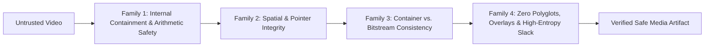
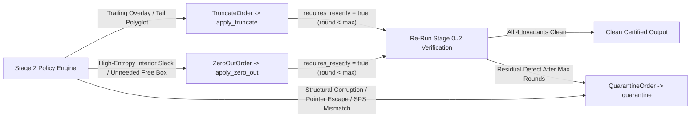

# Video Security & Forensic Analyses: Threat Mechanics, Structural Invariants, and Active Sanitization

> [!NOTE]
> This technical manual serves two goals: explaining **how and why** seemingly passive video files (`.mp4`, `.mkv`, `.avi`, `.ts`) compromise media players and OS thumbnailers, and detailing the **multi-stage detection, zero-recompilation CVE hunting, and non-destructive Content Disarm & Reconstruction (CDR)** pipeline implemented in `vidsec` ([`ARCH-035`](../development/035-vidsec-libs-extraction-and-rebuild-plan.md)). For the compiler-inspired separation between binary dissectors and the Universal Container IR, see [`universal-container-ir-decoupling.md`](./universal-container-ir-decoupling.md).

---

## 1. Why a "Passive" Video File Can Execute Arbitrary Code

A common misconception is that because an `.mp4` or `.mkv` file is not an executable binary (`ELF`, `PE`, `Mach-O`), merely parsing, indexing, or generating a desktop thumbnail for it is harmless.

In practice, media demuxers and hardware/software video decoders (`FFmpeg`/`libavformat`/`libavcodec`, Android `libstagefright`, `GStreamer`, `VLC`, Apple `CoreMedia`, Windows `Media Foundation`) are massive, pointer-heavy **C and C++ state machines** parsing deeply nested untrusted binary lengths, bitstreams, and look-up tables—often inside privileged system services or sandboxed browser renderer processes.

Video exploits do **not** run instructions directly from the container like a shell script. Instead, they craft **structural lies**—contradictions between declared counts, byte boundaries, file offsets, and elementary stream syntax—that force the player's parser into memory corruption or unexpected I/O. Almost all documented media CVEs fall into five root vulnerability classes:

### 1.1 Integer Overflow & Wraparound in Allocation Arithmetic
Demuxers routinely allocate heap arrays proportional to header counts (`entry_count`, `sample_count`, `num_lacing_frames`, `biClrUsed`):

```c
// Classic vulnerable C pattern in legacy demuxers
uint32_t count = read_u32_be(stream);
uint32_t alloc_size = count * sizeof(SampleEntry) + sizeof(TableHeader); // wraps on 32-bit!
Table *tbl = malloc(alloc_size);
for (uint32_t i = 0; i < count; i++) {
    read_bytes(stream, &tbl->entries[i], sizeof(SampleEntry)); // massive heap overflow
}
```

If an MP4 `stsc` box declares `entry_count = 0x15555556` with `sizeof(SampleEntry) = 12`, `0x15555556 * 12 = 0x100000008`, which wraps around 32 bits to an **8-byte `malloc()`**, followed by writing attacker bytes across adjacent heap chunks (`CVE-2015-1538` / Stagefright archetype). Even on 64-bit targets, 32-bit `uint32_t` arithmetic or signed `int32_t` promotions before `size_t` expansion repeatedly reproduce this bug class.

### 1.2 Length-Field vs. Physical-Boundary Desynchronization (Heap OOB Read/Write)
Container boxes nest arbitrary variable-length sub-records inside a parent box header. If the parent MP4 `avcC` box is 40 bytes long, yet an inner `sequenceParameterSetLength` field (`u16 BE`) declares `65,535` bytes, a parser that fails to clamp inner reads against the enclosing box's `available_payload_bytes` either writes past the end of the stack/heap buffer or copies out-of-bounds heap secrets into decoded video state (`CVE-2015-3864` style).

### 1.3 Spatial Pointer & Offset Escapes
Video containers store frame bytes in one region (`mdat`, `Cluster`, `LIST:movi`) and index pointers in another (`stco`/`co64`, `Cues`, `idx1`). By forging offsets that point:
* **Past EOF**: forcing signed offset wraparounds or uninitialized heap buffer reuse,
* **Into metadata headers (`ftyp`, `moov`, `hdrl`)**: tricking hardware codecs or GPU drivers into decoding crafted container metadata as H.264/HEVC slices, or
* **Negative signed offsets** when `u32`/`u64` file offsets are cast to `int32_t`/`off_t`,

attackers corrupt decoder DMA rings or bypass container sandboxing.

### 1.4 Container-vs-Bitstream Semantic Confusion
Media players operate in two decoupled phases:
1. **The Demuxer** reads container track headers (`tkhd` in MP4, `Video` in Matroska, `avih`/`strf` in AVI) declaring frame dimensions (e.g., $1280 \times 720$, 8-bit 4:2:0) and allocates frame output surfaces of size $W \times H \times 1.5 \approx 1.38\text{ MB}$.
2. **The Codec Decoder** subsequently parses the Sequence Parameter Set (`SPS`) inside `avcC`/`hvcC` or in-band NAL units. If the attacker embeds a forged `SPS` claiming $4096 \times 4096$ or re-sizes mid-stream via an injected IDR NAL unit without updating the container dimensions, naive decoders write macroblocks/CTUs far beyond the pre-allocated $1280 \times 720$ picture buffer.

### 1.5 Polyglots, Parser Differentials & External Reference Abuse (SSRF / NTLM Leak)
* **Polyglots**: Because MP4 parsers stop reading at `moov` + `mdat`, whereas `ZIP` extractors search *backward from EOF* for the End of Central Directory (`EOCD`), a single file can simultaneously be a valid MP4 video and a valid `ZIP`/`JAR`/`APK`/`RAR` archive, or hide a `PE`/`ELF` payload in trailing overlays or unreferenced interior slack.
* **Parser Differentials**: Overlapping sibling regions or odd-byte unaligned chunks cause Inspecting Proxy A and Target Player B to walk completely different offset chains inside the exact same file.
* **External References (`dref`, `NextFilename`)**: Non-self-contained media references (`file://`, `http://`, `\\attacker\share\clip.mp4`) trigger unintended network requests (SSRF), internal port scanning, or Windows SMB Net-NTLMv2 credential leaks merely by indexing the video.

---

## 2. The 4 Structural Invariant Families (General Media Safety Model)

To answer *"Is this video file structurally safe to play, index, or archive?"*—even against **zero-day vulnerabilities** that do not yet have a published CVE—`vidsec` replaces ad-hoc heuristic blacklists with **four universal mathematical invariants**. Every well-formed video produced by compliant encoders (`FFmpeg`, `GPAC`, `mkvmerge`, camera firmware) satisfies all four families.



| Invariant Family | Stage | Mathematical Law | Primary Vulnerability Classes Blocked |
| :--- | :--- | :--- | :--- |
| **Family 1: Internal Containment & Overflow** | Stage 1a | $\forall \text{region } r:\; \text{claimed\_bytes}(r) \le \text{available\_payload\_bytes}(r) \;\land\; \neg \text{overflow}(\text{count} \times \text{stride})$ | `stsc`/`ctts`/`stsz`/`idx1` integer wraparound (`CVE-2015-1538`), `avcC`/`hvcC`/`esds` OOB reads (`CVE-2015-3864`), VINT & lacing overflows |
| **Family 2: Spatial & Pointer Integrity** | Stage 1b $\to$ 2 | $\forall s \in \text{SampleRuns}:\; [s.\text{offset}, s.\text{end}) \subseteq \bigcup_{r.\text{role}=\text{media\_data}} [r.\text{payload\_offset}, r.\text{end}) \subseteq [0, \text{file\_size})$ and pairwise disjoint siblings | Sample pointer escapes into `moov`/`ftyp`, overlapping box parser differentials, truncated-EOF OOB reads |
| **Family 3: Container vs. Bitstream Consistency** | Stage 1b $\to$ 2 | $\text{Geometry}_{\text{container}}(\text{tkhd}/\text{Video}/\text{avih}) \equiv \text{Geometry}_{\text{bitstream}}(\text{SPS}_{\text{H.264/HEVC}})$ | Framebuffer size confusion, mid-stream resolution bombs, codec header spoofing (`strf` `biWidth*biHeight` overflow) |
| **Family 4: Zero Unaccounted Bytes & Polyglots** | Stage 0 & 2 | $\text{Slack}_{\text{external}} \cup \text{Slack}_{\text{interior}} = \emptyset$ (beyond low-entropy alignment padding) $\land$ no `MZ`/`ELF`/`ZIP`/`URI` smuggling | Appended `ZIP`/`RAR`/`7z` polyglots, steganographic/C2 payloads inside `mdat`/`Cluster`/`movi`, malicious `AttachedFile` fonts/EXEs, `dref` SSRF |

---

## 3. Stage 0: Constant-Time ($O(1)$) Gatekeeper & Polyglot Triage

Video files routinely reach $2\text{--}50\text{ GB}$. Reading an entire file sequentially just to discover it is a renamed Windows executable or has an appended `.zip` archive wastes I/O and delays rejection.

Stage 0 in `vidsec` guarantees **$O(1)$ I/O complexity**: it performs at most three bounded windowed reads totaling **132 KB**, regardless of total file size:

1. **Head Window (`64 KB` at offset `0`)**: Deep enough to inspect initial file magic, extension branding, root header (`ftyp`, `EBML`, `RIFF`), and early padding/metadata injection boxes (`free`, `udta`).
2. **Midpoint Window (`4 KB` at `file_size / 2`)**: Representative interior statistical slice used for rapid entropy screening.
3. **Tail Window (`64 KB` ending at `file_size`)**: Large enough to capture `ZIP` End of Central Directory (`EOCD`) records (up to 65,557 bytes with maximum comment length) and trailing polyglot footers.

```text
Offset 0                                      file_size / 2                        file_size
|==[ 64 KB HEAD ]==|---------------------------|=[ 4 KB MID ]=|-------------------|==[ 64 KB TAIL ]==|
   Magic + Polyglot                            Shannon Entropy                    ZIP EOCD / RAR / 7z
```

### Stage 0 Tasks

* **Magic-Byte vs. Extension Verification (`libs/tika` / `validate_file_magic`)**: Inspects raw signature masks in the head window (`ftyp` at offset `+4`, EBML `1A 45 DF A3` at `+0`, `RIFF....AVI ` at `+0/+8`) and detects extension spoofing—such as a `.mp4` that begins with `7F 45 4C 46` (`ELF`), `4D 5A` (`PE`), `50 4B 03 04` (`ZIP`), or `<html`/`<script`.
* **Chameleon & Header-Injection Polyglots (`scan_polyglot_head`)**: Scans the entire 64 KB head window for secondary executable signatures (`PE\0\0` COFF header pairs, `\x7fELF`, Mach-O `FEEDFACF`/`CAFEBABE`, shebang `#!`) hidden inside `free`/`skip` boxes or unused DOS stub fields at low offsets.
* **Tail-Appended Archive Polyglots (`scan_tail_signatures`)**: Searches the tail 64 KB window for `ZIP` End-of-Central-Directory (`PK\x05\x06`), `ZIP64` EOCD (`PK\x06\x06`), `RAR` (`Rar!\x1a\x07`), `7z` (`37 7A BC AF 27 1C`), `PDF` (`%%EOF`), or embedded shell scripts. If a valid MP4 has an appended archive, `vidsec` immediately computes the root container EOF and dispatches a `TruncateOrder`.
* **Mid-Stream Shannon Entropy Triage (`sample_mid_entropy`)**: Evaluates Shannon entropy in bits per byte over the 4 KB midpoint slice:

  $$H(X) = -\sum_{i=0}^{255} P(x_i)\,\log_2 P(x_i) \quad \in [0.0,\; 8.0]$$

  | Entropy Range | Diagnostic Interpretation |
  | :--- | :--- |
  | $H < 1.5$ | Zero-padded, sparse, or uninitialized dummy payload masquerading as video. |
  | $1.5 \le H < 7.0$ | Uncompressed bitmap frames (`AVI` raw RGB/YUV), ASCII metadata, or low-complexity synthetic video. |
  | $7.0 \le H \le 7.98$ | Typical compressed H.264/HEVC/AV1/AAC bitstreams (which still retain syntax framing bits, slice headers, and CABAC bias). |
  | $H > 7.995$ | Near-perfect uniform randomness ($\chi^2$ flat across 256 byte values)—strong indicator of raw AES/ChaCha20 encrypted blobs or CSPRNG payloads disguised as video containers. |

---

## 4. Stage 1a: Format-Specific Binary Anatomy, Containment & Attack Surfaces

If a file passes Stage 0, `vidsec` dispatches **pure `std`-only binary dissectors** (`libs/isobmff`, `libs/ebml`, `libs/riff`) to inspect format-specific structures *before* IR lowering. Below is the exact binary anatomy and exploit surface per container format.

### 4.1 ISOBMFF / MP4 / QuickTime (`libs/isobmff`)

#### Binary Framing & Boundary Traps
Every MP4 file consists of nested **Boxes** (`ISO/IEC 14496-12`):

```text
Standard Box (header = 8 bytes):    [ size: u32 BE ][ type: 4 ASCII bytes ][ payload (size - 8) ]
Extended Box (header = 16 bytes):   [ size = 1     ][ type: 4 bytes ][ largesize: u64 BE ][ payload (largesize - 16) ]
EOF Box (header = 8 bytes):         [ size = 0     ][ type: 4 bytes ][ payload extends until EOF ]
FullBox Prefix (+4 inside payload): [ version: u8 ][ flags: u24 BE ]
```

**Format-Level Exploits Checked Immediately:**
* **`size` Underflow ($1 < \text{size} < 8$, or `size == 1` with `largesize < 16`)**: Causes `payload_size = size - header_size` unsigned underflow to $\approx 2^{64}$, triggering giant read loops.
* **`size + offset` Overflow**: Checking `std.math.add(u64, offset, box_size)` before stepping to the next box.
* **`ftyp` Consistency (`check_mp4_ftyp`)**: Verifies `ftyp` occurs at offset `0`, its size $\ge 16$ and $(\text{size} - 8) \bmod 4 == 0$, and its `major_brand` / `compatible_brands` match valid ISO families (`isom`, `iso2`..`iso6`, `mp41`, `mp42`, `avc1`, `hvc1`, `qt  `, `M4V `, `dash`, `msdh`).

#### Sample Table (`stbl`) Arithmetic Traps (`check_mp4_tracks`)
Inside `moov/trak[*]/mdia/minf/stbl`, every sample table stores a 32-bit `entry_count` (or `sample_count`) after its `FullBox` header (`version + flags = 4` bytes, total `8` bytes before entries, except `stsz` which has `12` bytes before variable entry table):

| Box | Minimum Claimed Byte Formula | Semantic & Integer-Overflow Hazards |
| :--- | :--- | :--- |
| `stsc` (Sample-to-Chunk) | `8 + entry_count * 12` | `CVE-2015-1538` vector (`entry_count * 12` wraps 32-bit alloc); non-monotonic `first_chunk` (`first_chunk[i] < first_chunk[i-1]`); `first_chunk == 0` (chunks are 1-based). |
| `stts` (Time-to-Sample) | `8 + entry_count * 8` | Large `entry_count` claiming gigabytes of entries in a tiny `stts` box; `sample_delta` overflow accumulating PTS/DTS duration. |
| `ctts` (Composition Offset) | `8 + entry_count * 8` | `version == 0` uses unsigned `sample_offset`; `version == 1` uses signed `i32` negative shifts; mismatch between `entry_count * 8 + 8` and box payload triggers OOB heap reads. |
| `stsz` (Sample Size) | If `sample_size == 0`: `12 + sample_count * 4`, else `12` | Uniform `sample_size > 0` combined with malicious `sample_count` claiming $N \times \text{sample\_size} \gg \text{mdat\_size}$; `sample_size == 0` with `sample_count * 4` overflow. |
| `stco` / `co64` (Chunk Offsets) | `8 + entry_count * 4` (`stco`) or `8 + entry_count * 8` (`co64`) | Offsets outside `mdat` (`offset < mdat_payload_offset`), unsorted/overlapping chunk pointers, or `entry_count * 4` exceeding `stco` payload. |
| `stss` (Sync Samples) | `8 + entry_count * 4` | Out-of-range sample indices (`sample_number > total_samples`) or `0` index. |

#### Codec Configuration Descriptors (`check_mp4_codecs`)
Inside `moov/trak[*]/mdia/minf/stbl/stsd/<entry>/`:

1. **`avcC` (`AVCDecoderConfigurationRecord`, ISO/IEC 14496-15)**:
   * Bytes `0..4`: `[configVersion=1][profile][profileCompat][level][reserved|lengthSizeMinusOne]`.
   * Byte `5`: `numOfSequenceParameterSets = byte[5] & 0x1F`. For each SPS: `[spsLen: u16 BE][spsBytes[0..spsLen]]`.
   * Next byte: `numOfPictureParameterSets`. For each PPS: `[ppsLen: u16 BE][ppsBytes[0..ppsLen]]`.
   * **Containment Rule**: Walking every declared `spsLen` and `ppsLen` must never exceed `avcC.payload_size`. A single forged `spsLen = 0xFFFF` inside a 36-byte `avcC` box exploits unguarded `memcpy(buf, ptr, spsLen)` implementations.

2. **`hvcC` (`HEVCDecoderConfigurationRecord`)**:
   * Requires at least `23` fixed header bytes (`bytes 0..22`), where byte `22` declares `numOfArrays`.
   * Each array repeats `[flags|nalUnitType][numNalus: u16 BE]`, followed by `numNalus` occurrences of `[nalUnitLength: u16 BE][nalBytes]`. Truncation or `nalUnitLength` overrun indicates heap OOB tampering.

3. **`esds` (MPEG-4 Elementary Stream Descriptor, ISO/IEC 14496-1)**:
   * After the 4-byte `FullBox` header, `esds` nests Type-Length-Value (`TLV`) tags (`0x03` ES_Descriptor -> `0x04` DecoderConfigDescriptor -> `0x05` DecoderSpecificInfo / `AudioSpecificConfig`).
   * Lengths use **variable-length 7-bit continuation bytes** (`1..4` bytes where bit `0x80` signals another length byte follows).
   * **Exploit Vector**: Overlong continuation chains (> 4 bytes), inner descriptor declared length larger than outer `esds` box payload, or tag `0x05` declaring invalid AAC `AudioSpecificConfig` sampling frequency indices (`0xF` escape bugs).

4. **`dref` (`DataReferenceBox`) External URI Check**:
   * Scans `url ` and `urn ` sub-boxes. If `(flags & 0x000001) == 0`, the track media is **not self-contained** and instructs the player to fetch an external resource (HTTP/HTTPS SSRF, `smb://` / UNC path Net-NTLM theft, local `file://` read).

---

### 4.2 EBML / Matroska (`.mkv`) / WebM (`libs/ebml`)

#### Variable-Size Integer (`VINT`) Mechanics & Hazards
Unlike MP4's fixed 32/64-bit box headers, EBML encodes both Element IDs and Data Sizes using UTF-8-like **Variable-Size Integers (`VINT`)**:
The position of the first `1` bit in byte 0 determines the total byte length $W \in \{1..8\}$:
* `1xxx xxxx` ($W = 1$, 7 data bits, max payload `126`)
* `01xx xxxx` + 1 byte ($W = 2$, 14 data bits)
* ...
* `0000 0001` + 7 bytes ($W = 8$, 56 data bits)

**Critical EBML Security Hazards Checked in Stage 1a (`check_ebml_header`, `check_mkv_tracks`):**
1. **Reserved Unknown-Size Encoding (`all 1s` payload bits, e.g., `0xFF`, `0x3FFF`, `0x01FFFFFFFFFFFFFF`)**: Standard Matroska allows unknown sizes *only* on live-streamed `Segment` or `Cluster` master elements. An unknown-size marker on bounded elements (`EBML`, `Tracks`, `TrackEntry`, `CodecPrivate`, `AttachedFile`) frequently crashes parsers or turns `size` into `-1` (`SIZE_MAX`).
2. **Non-Canonical / Overlong VINTs**: Encoding value `10` (`0x8A`) as a 4-byte `0x1000000A` or invalid zero-width leading byte `0x00` (no `1` marker bit in the first byte) triggers out-of-bounds VINT shift tables in naive C decoders (`shift = count_leading_zeros` >= 8).
3. **`EBMLMaxIDLength` / `EBMLMaxSizeLength` Violations**: Setting `MaxIDLength > 4` or `MaxSizeLength > 8` in the `EBML` header causes buffer over-reads during subsequent element parsing.
4. **Master Element Containment & Recursive `SeekHead` Loops**: Checking that child elements never overrun parent element bounds (`child_end <= parent_end`), tracking nesting depth (max recursion limit against stack overflow), and ensuring `SeekHead` seek offsets do not create cyclic pointer graphs or point outside `Segment`.

#### `Cluster` Block Lacing & `AttachedFile` Smuggling
* **Lacing Attacks (`SimpleBlock` / `BlockGroup`)**: To pack multiple audio/video frames in one `SimpleBlock`, Matroska supports three lacing modes in bits `1..2` of the block's `Flags` byte:
  * **Xiph lacing (`01`)**: `frame_count - 1` frame sizes coded as sums of `0xFF` bytes terminated by a `< 0xFF` byte (`sum_all_frames` must strictly equal `block_remaining_payload`).
  * **Fixed-size lacing (`11`)**: `remaining_payload % frame_count` **must equal `0`**.
  * **EBML lacing (`10`)**: First frame size is unsigned VINT, subsequent frame sizes are signed VINT *deltas* from the previous frame size (`prev_size + delta` can be manipulated to go **negative** or overflow `u64`!).
* **`AttachedFile` Smuggling**: Matroska explicitly supports arbitrary embedded files (`Attachments` / `AttachedFile` -> `FileName`, `FileMimeType`, `FileData`). Attackers routinely embed malicious `.ttf`/`.otf` fonts targeting `FreeType`/`HarfBuzz`/`libass` parsers alongside `.mkv` subtitle tracks, or hide executables inside `FileData`. Every `AttachedFile` is mapped to `IrAttachmentRow` and scanned against executable magic bytes.

---

### 4.3 RIFF / AVI / WebP (`libs/riff`)

#### Little-Endian Chunk Framing & 2-Byte Word Alignment
RIFF uses `[FourCC: 4 bytes][chunk_size: u32 LE][payload: chunk_size bytes][optional 1-byte NUL pad if chunk_size is odd]`:
* **`LIST` / `RIFF` Container Chunks**: Carry an extra 4-byte `list_type` inside the payload (`"AVI "`, `"hdrl"`, `"strl"`, `"movi"`, `"INFO"`), so child chunks begin at `payload_offset + 4`.
* **Alignment Trap (`check_riff_chunks`)**: When `chunk_size == 0xFFFFFFFF`, adding the 1-byte odd alignment pad (`chunk_size + 1`) wraps a 32-bit unsigned integer back to `0` (`CVE` in countless legacy RIFF parsers causing an infinite zero-step loop over the same chunk!). `vidsec` performs all alignment arithmetic in checked `u64`.

#### `avih`, `strh`, `strf` (`BITMAPINFOHEADER`) & `idx1` Checks
* **`avih` (`MainAVIHeader`, 56 bytes)**: Cross-checks `dwTotalFrames`, `dwStreams`, `dwWidth`, and `dwHeight` against the actual count of `LIST:strl` stream headers.
* **`strf` (`BITMAPINFOHEADER`, $\ge 40$ bytes)**: Classic Windows GDI / FFmpeg heap overflow vector:
  * `biSize` (`u32 LE` at offset `+0`) must be $\ge 40$ and $\le \text{strf.payload\_size}$.
  * `biWidth` (`i32 LE` at `+4`) must be $> 0$; `biHeight` (`i32 LE` at `+8`) may be negative for top-down DIBs, **but `biHeight == INT32_MIN` (`-2147483648`) overflows signed `abs(biHeight)` in C!**
  * Uncompressed stride calculation `u64(biWidth) * abs(biHeight) * u64(biBitCount)` is checked for 32-bit and 64-bit multiplication overflow and compared against `biSizeImage`.
  * `biClrUsed` palette count (`+32`): if `biBitCount <= 8`, checks that `40 + biClrUsed * 4 <= strf.payload_size` so palette reads cannot overflow past `strf`.
* **`idx1` (`AVIOLDINDEX`)**: Each entry is 16 bytes (`dwChunkId`, `dwFlags`, `dwOffset`, `dwSize`). Verifies `idx1.payload_size % 16 == 0` and validates every indexed chunk coordinate against `LIST:movi` bounds during Stage 1b/2.

---

### 4.4 MPEG-2 Transport Stream (`MPEG-TS`) & Broadcast Containers
Unlike tree-structured file formats (`MP4`, `MKV`, `AVI`), broadcast streams (`MPEG-TS`, `.ts`, `.m2ts`) use fixed **188-byte packets** (192-byte with 4-byte timestamp in `M2TS`) starting with sync byte `0x47`:
* **`adaptation_field_length` Overflow**: If `adaptation_field_control` indicates an adaptation field, byte `4` specifies `adaptation_field_length`. Any value `> 183` pushes the payload pointer past the 188-byte packet boundary (`negative payload_len` bug in C TS demuxers).
* **PID Table & PES Length Mismatches**: Corrupted `PAT` (PID `0x0000`) / `PMT` pointer fields or `PES_packet_length` headers exceeding stream boundaries.

---

## 5. Declarative Zero-Recompilation CVE Hunting (`inspect_region_field`)

Historically, security researchers facing a newly disclosed CVE—for example, *"Integer overflow in MP4 `ctts` box when `version == 1` and `entry_count > 10,000,000`"* or *"Out-of-bounds read when custom box `xyz1` field at offset `+12` exceeds region payload"*—had to write new Zig/C code, wire up CLI structs, and recompile the analyzer binary.

Because `vidsec`'s Stage 1 dissectors export every hierarchical path (`moov/trak[*]/mdia/minf/stbl/ctts`, `Segment/Tracks/TrackEntry/CodecPrivate`, `RIFF/LIST:hdrl/LIST:strl/strf`) cleanly **before** lowering, `apps/vidsec` provides a generic declarative primitive task: **`inspect_region_field`**.

### Example: Expressing Structural & CVE Rules in `pipeline.yaml`

Researchers can attach rule entries in YAML directly in their pipeline config (`pipeline.yaml` or an included `cve_compendium.yaml`) with **zero Zig recompilation**:

```yaml
tasks:
  # 1. General containment invariant on MP4 ctss/stts without hardcoding every box
  - id: rule_mp4_ctts_table_bounds
    service: inspect_region_field
    depends_on: [dissect_mp4]
    config:
      rule_id: "INV-MP4-CTTS-BOUNDS"
      target_path_glob: "moov/trak[*]/mdia/minf/stbl/ctts"
      field_offset: 4            # skip 4-byte FullBox version+flags
      field_type: "u32_be"       # entry_count
      header_overhead_bytes: 8   # version+flags(4) + entry_count(4)
      multiplier_stride: 8       # each ctts entry is 8 bytes
      check_overflow: true
      require_fits_in_region_payload: true
      severity: "critical"
      recommended_action: "quarantine"

  # 2. Specific historical CVE signature: AVI strf INT32_MIN biHeight trap
  - id: rule_cve_avi_biheight_min
    service: inspect_region_field
    depends_on: [dissect_riff]
    config:
      rule_id: "CVE-AVI-BIHEIGHT-INTMIN"
      target_path_glob: "RIFF/LIST:hdrl/LIST:strl[*]/strf"
      field_offset: 8            # BITMAPINFOHEADER.biHeight
      field_type: "i32_le"
      disallow_exact_values: [-2147483648]
      severity: "critical"
      recommended_action: "quarantine"
```

Every `inspect_region_field` step emits structured verdict rows consumable by policy gates and Stage 3 CDR subscribers—turning `pipeline.yaml` into a living, researcher-authored exploit compendium.

---

## 6. Stage 2: Universal IR Topological & Bitstream Forensics

Once a file passes Stage 1a and is lowered by Stage 1b (`lower_mp4_container`, `lower_ebml_container`, `lower_riff_container`) into `libs/media_ir`'s six canonical primitives, Stage 2 executes format-agnostic mathematical audits.

### Complete Numerical Walkthrough: Dissecting a 10 MB Malicious MP4

Consider a `10,000,000`-byte suspect file `evidence.mp4` whose Stage 1a `stsc`/`stsz` tables did not overflow 32 bits, so it proceeds to Stage 1b lowering and Stage 2 verification:

```text
0          32        4,096           5,000,000    5,065,536           9,500,000         10,000,000
|--[ftyp]--|--[moov]--|--[ mdat: video/audio runs ... [ C2 PAYLOAD ] ... ]--|--[ TRAILING ZIP ]--|
                             ^                         ^
                       header = 8B               Interior Slack!
                  payload = [4104, 9500000)      65,536 unreferenced bytes
                                                 (H = 7.998 bits/byte)
```

Also suppose `moov/.../stco` contains a corrupted last chunk entry #122 pointing to `[64, 1088)`.

Stage 2 audits run directly on the lowered IR intervals:

1. **Level 1 External Slack & Trailing Overlay Audit (`audit_external_slack`)**:
   * Root `IrRegionRow` coverage: $R = [0, 32) \cup [32, 4096) \cup [4096, 9,500,000) = [0, 9,500,000)$.
   * Complement in $[0, 10,000,000)$ yields **`IrUnreferencedSlackRow`**:
     * `slack_kind = .trailing_overlay`, `[9,500,000, 10,000,000)` (`500,000` bytes).
     * Stage 2 flags a **Trailing Overlay Violation** (`500 KB` past `highest_root_end`). If no interior corruption exists, Stage 3 emits a `TruncateOrder(new_size = 9_500_000)`.

2. **Level 2 Interior Media Data Slack Audit (`audit_interior_slack`)**:
   * Media payload union: $M = [4104, 9,500,000)$.
   * Coalesced `IrSampleRunRow` union: $S = [4104, 5,000,000) \cup [5,065,536, 9,500,000)$.
   * Set difference $M \setminus S$ yields **`IrUnreferencedSlackRow`**:
     * `slack_kind = .interior_media_data`, `enclosing_region_id = mdat`, `[5,000,000, 5,065,536)` (`65,536` bytes).
   * Windowed entropy analysis measures **$H = 7.998\text{ bits/byte}$**—far above normal MP4 zero/pad filler—revealing a **hidden encrypted payload injected directly inside `mdat`** between legitimate chunks without breaking playback!
   * Stage 3 can issue a surgical **`ZeroOutOrder(offset = 5_000_000, length = 65_536)`** to neutralize the steganographic C2 blob while keeping every `stco` sample offset intact.

3. **Strict Sample Pointer Containment (`check_sample_pointer_containment`)**:
   * Evaluates every `IrSampleRunRow` against $M$ and against non-media regions.
   * Chunk #122 (`[64, 1088)`) passes the naive check $1088 \le 10,000,000$, **but violates $[64, 1088) \subseteq [4104, 9,500,000)$** because it points directly inside `moov`!
   * Stage 2 flags a **Sample Pointer Escape** (`CRITICAL`), prompting Stage 3 to emit a **`QuarantineOrder`**.

4. **Exp-Golomb SPS Bitstream vs. Container Geometry Cross-Check (`check_codec_container_consistency`)**:
   * `ContainerMetadataRow` and MP4 `tkhd` (fixed-point `16.16` width/height) declare `1280 x 720`.
   * Stage 2 parses `IrCodecConfigRow` (`avcC`), extracts the first H.264 SPS NAL unit (`nal_unit_type == 7`), removes `emulation_prevention_three_byte` (`00 00 03 -> 00 00`), and decodes unsigned Exponential-Golomb (`ue(v)`) syntax elements:
     * `pic_width_in_mbs_minus1 = 239` $\implies (239 + 1) \times 16 = 3840\text{ px}$
     * `pic_height_in_map_units_minus1 = 134` $\implies (134 + 1) \times 16 = 2160\text{ px}$ (adjusted by `frame_cropping_flag`)
   * **Contradiction Detected**: Container declares **720p** (`1280x720`), whereas the H.264 bitstream commands **4K** (`3840x2160`)—a **9x pixel buffer mismatch** and classic Family 3 heap overwrite trigger. Policy immediately escalates to **`QuarantineOrder`**.

---

## 7. Stage 3: Content Disarm & Reconstruction (CDR) & Bounded Re-Verification

`vidsec` does not merely log findings; its v2 reactive Pub/Sub bus (`flowpipe`) lets security pipelines automatically **disarm** remediable threats and mathematically **re-verify** the sanitized file before delivery.



### 7.1 `TruncateOrder` (`apply_truncate`)
* **When Used**: Clean trailing overlays past `highest_root_end` (e.g., appended `ZIP` archives, `RAR` files, trailing payload stubs) where the prefix `[0, highest_root_end)` passes all structural invariants.
* **Mechanism**: Copies `[0, target_size)` cleanly (or truncates the staged output artifact) so trailing bytes disappear while container headers, sample tables, and media playback remain byte-for-byte identical.

### 7.2 `ZeroOutOrder` (`apply_zero_out`)
* **When Used**: Suspicious `free`/`skip`/`Void`/`JUNK` boxes, executable signatures in non-essential padding chunks, or `.interior_media_data` unreferenced slack inside `mdat`/`Cluster`/`movi`.
* **Why Zeroing Instead of Deleting?**: Deleting `65,536` bytes from the middle of `mdat` shifts every downstream sample offset by `-65,536`, instantly corrupting `stco`/`co64`/`idx1` pointers unless the entire file is remuxed. Overwriting the attacker's unreferenced byte interval $[a, b)$ with `0x00` **destroys 100% of executable/encrypted entropy** while leaving every muxed frame offset 100% intact!
* **Memory Safety Guard**: To prevent OOM denial-of-service on multi-gigabyte videos, `apply_zero_out` enforces an explicit `max_in_memory_bytes` limit before loading whole files into heap buffers, and large-file streaming sanitization uses bounded fixed-size chunk copy + seek-free stream patching (`ARCH-036`).

### 7.3 `QuarantineOrder` (`quarantine`)
* **When Used**: Irremediable structural exploits where partial patching cannot guarantee safe player behavior:
  * Arithmetic overflows or containment breaches in `stsc`/`ctts`/`stsz`/`avcC`/`hvcC`/`esds`/`strf`,
  * Sibling/child overlapping container intervals,
  * Sample pointer escapes pointing into `moov`/`ftyp`/EOF,
  * Container-vs-bitstream `SPS` dimension discrepancies, or
  * Active external URI (`dref`) references when external network fetches are prohibited by policy.
* **Mechanism**: Moves or copies the dangerous artifact into an isolated non-executable quarantine directory alongside a structured forensic report detailing the violated invariant family and byte coordinates.

### 7.4 Bounded Re-Verification Loop (`requires_reverify`)
A core defense-in-depth guarantee of `vidsec` is **verify after disarm**:
Every `TruncateOrder` and `ZeroOutOrder` can publish its sanitized artifact path back to the verification ingress with `reverify_round + 1` up to `max_reverify_rounds` (e.g., 2 rounds). If truncation exposed a previously hidden secondary tail signature or zeroing left a secondary violation, `vidsec` applies one bounded cleanup or escalates cleanly to **`QuarantineOrder`**—never risking an infinite remediation loop.
