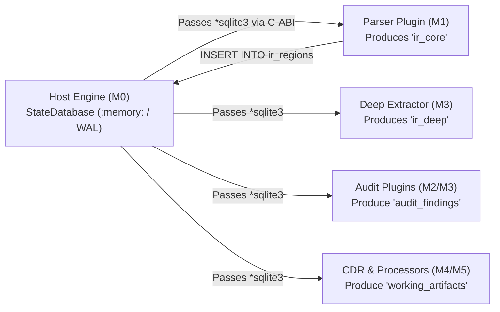

# ADR-001: Relational SQLite3 State Bus and Unified Container Intermediate Representation (`ContainerIR`)

- **Status:** Accepted
- **Date:** 2026-10-27
- **Context:** Core Pipeline Engine (`M0`), Format Parsers (`M1`, `M3`), Audit Rules (`M2`, `M3`), and CDR Sanitizer (`M4`–`M5`)

---

## 1. Context and Problem Statement

A multi-format video security analyzer and Content Disarm & Reconstruction (CDR) pipeline must parse complex hierarchical binary formats (`ISOBMFF` MP4/MOV, `EBML` MKV/WebM, `RIFF` AVI), evaluate cross-cutting structural and heuristic security rules, and pass verified artifact chains to downstream sanitizers and transcoders.

In a modular plugin architecture where pipeline steps are compiled as separate shared libraries (`.so`), passing complex in-memory data structures across the plugin boundary introduces severe engineering hazards:
1. **Lack of ABI Stability for Native High-Level Types:** Zig slices (`[]const u8`), `ArrayList`, `HashMap`, and tagged unions do not have a guaranteed stable C-ABI across separately compiled shared objects. Adding a single field to an in-memory `ContainerIR` struct would break binary compatibility with every existing plugin.
2. **Cross-Boundary Memory Ownership Bugs:** Allocating tree nodes inside one `.so` and freeing or resizing them in another `.so` risks allocator mismatches, use-after-free, and memory leaks.
3. **Complex Interval Joins in Imperative Code:** Validating that hundreds of thousands of sample extents (`stco`/`stsz`) fall strictly within valid media payload boxes (`mdat`/`movi`), or computing unreferenced slack intervals inside `mdat`, requires spatial interval trees and window joins that are error-prone to maintain by hand.
4. **Opaque Post-Mortem Forensics:** In-memory structs vanish when the process exits, forcing analysts to add ad-hoc debug logging when investigating novel 1+ GB malware samples.

---

## 2. Decision

We adopt an **embedded SQLite3 database instance (`*sqlite3`)**—operating in `:memory:` by default or persisted to disk via `--save-db <path>`—as the **sole shared state bus and Intermediate Representation (`ContainerIR`)** across all pipeline stages:

### Mandatory Engineering Invariants

1. **Single Shared `libsqlite3.so` Dynamic Linkage:**
   - Both the host executable (`vidsec`) and all `.so` plugins **must dynamically link against the system's shared `libsqlite3.so`** (`compile_step.linkSystemLibrary("sqlite3")`).
   - Statically compiling `sqlite3.c` separately into the host and individual `.so` plugins is strictly prohibited, as multiple static copies of SQLite's global mutexes and page-cache state operating on the same `*sqlite3` pointer across `dlopen` boundaries cause heap corruption.
2. **Explicit Transactions and Deferred B-Tree Index Creation:**
   - Bulk-insertion plugins (`M1` writing `ir_regions` and `M3` writing `ir_sample_extents`) must wrap all inserts in a single `BEGIN IMMEDIATE TRANSACTION; ... COMMIT;` block, reusing one prepared `sqlite3_stmt` via `sqlite3_reset()`.
   - All `CREATE INDEX IF NOT EXISTS` statements on bulk tables must execute **after** the insertion loop (immediately prior to `COMMIT`) so SQLite builds the B-Tree in a single bottom-up pass rather than rebalancing on every row.
3. **Streaming Sample Extent Coalescing:**
   - Before inserting into `ir_sample_extents`, contiguous adjacent samples belonging to the same track and index table (`next.target_offset == current.end_offset`) are merged in-flight into a single contiguous range, reducing millions of individual frames to a compact set of extents without affecting spatial containment or overlap queries.

---

## 3. Consequences

### Positive
- **Frozen C-ABI:** `PipelineContext_ABI` passes an opaque `*sqlite3` pointer that never changes layout even as new domain tables or columns are introduced in future milestones.
- **Declarative Set & Interval Queries:** Complex security checks (such as `NOT EXISTS` spatial containment in `mdat` or `LAG()` window functions for sample overlap) become concise, indexed SQL queries.
- **Zero-Effort Forensic Snapshots:** Passing `--save-db` dumps the entire execution trace, parsed container tree, quarantined payload metadata, and findings into a single portable `.sqlite` file for inspection in any SQL client.

### Negative / Trade-offs
- **Serialization Overhead vs. Raw Pointers:** Inserting rows into `:memory:` SQLite incurs a small CPU overhead (~2–15 ms per container) compared to raw pointer manipulation, mitigated via single-transaction batching, deferred indexing, and sample extent coalescing.
