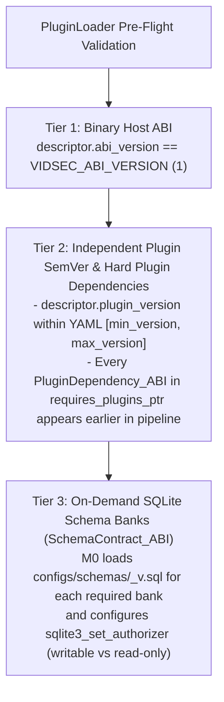

# ADR-002: C-ABI Dynamic Plugin Sideloading, 3-Tier Versioning Matrix, and Hybrid Build Modes

- **Status:** Accepted
- **Date:** 2026-10-27
- **Context:** Pipeline Engine (`M0`), `PluginLoader`, and Build System (`build.zig`)

---

## 1. Context and Problem Statement

A media security and processing suite has two classes of components that evolve at very different speeds:
- **Foundational Parsers and Chassis (`M0`, `M1`):** Change rarely once compliant with `ISO/IEC 14496-12`, `RFC 8794`, and `RIFF`.
- **Detection Rules and Media Processors (`M2`–`M5`):** Evolve rapidly as new malware families, exploit signatures, or transcoding profiles emerge.

If the entire system is coupled through compile-time module imports or a single monolithic version number:
1. Updating a single heuristic rule requires recompiling and redeploying the entire binary.
2. Users cannot selectively skip steps, reorder stages, or sideload custom organization-specific detection plugins via `pipeline.yaml`.
3. Conversely, if plugins only check a single version number, bumping an audit plugin to `v5.2.0` would falsely break compatibility with a stable parser plugin at `v1.0.0`.

---

## 2. Decision

### 2.1. Stable C-ABI Plugin Descriptor (`VidsecPluginABI`)
Every pipeline step is exposed via a C-ABI compatible descriptor symbol (`vidsec_plugin_descriptor`) loaded dynamically via `std.DynLib` after verifying that the `.so` file is not writable by group or others (`mode & 0o022 == 0`).

### 2.2. Three-Tier Pre-Flight Versioning Matrix
To decouple host binary compatibility, plugin release cadence, and database schema evolution, `PluginLoader` validates three independent versioning tiers during pre-flight initialization (before reading a single byte of the input video):

1. **Tier 1 (`abi_version: u32`):** Verifies binary layout compatibility of `PipelineContext_ABI` and `VidsecPluginABI`.
2. **Tier 2 (`plugin_version: SemVer_ABI` & `requires_plugins_ptr: ?[*]const PluginDependency_ABI`):** Allows each `.so` to version its own implementation independently and declare explicit **Hard Dependencies** on upstream plugins (`plugin_id` + `min_version`). Plugins operating directly on raw container bytes via `SafeCursor` can set `requires_plugins_len = 0`.
3. **Tier 3 (`requires_schemas_ptr: ?[*]const SchemaContract_ABI`):** Specifies which versioned SQLite DDL banks (`configs/schemas/<domain>_v<version>.sql`) the host must map into SQLite on plugin load, and whether the plugin requires write (`writable = true`) or read-only (`writable = false`) access (see [`ADR-006`](ADR-006_on_demand_ddl_banks_and_hard_plugin_dependencies.md)).

*(Note: A future enhancement to optionally bundle built-in plugins statically while keeping `std.DynLib` active for external `.so` modules is documented separately in [`../future/F01_hybrid_static_dynamic_plugin_compilation.md`](../future/F01_hybrid_static_dynamic_plugin_compilation.md)).*

---

## 3. Consequences

### Positive
- **Hot-Swappable Detection Rules:** Security teams can drop a newly compiled rule `.so` into `plugins/audit/` and reference it in `pipeline.yaml` without recompiling `M0` or `M1`.
- **Fail-Fast Topology Verification:** Misconfigured pipelines (e.g., placing an audit rule before the IR parser in `pipeline.yaml`, or mixing incompatible SQLite schema versions) are caught instantaneously at startup with descriptive errors (`error.MissingSchemaProducerBeforeConsumer` / `error.SchemaVersionMismatchBetweenPlugins`).
- **No External Build Generator Needed:** `build.zig` handles both dynamic `.so` compilation and optional static bundling natively through `@import("build_options")`.

### Negative / Trade-offs
- **In-Process Memory Space:** Loaded `.so` plugins share the virtual address space of the host process, requiring strict adherence to safe arithmetic, `ReleaseSafe` bounds checks, and kernel/SQLite sandboxing (addressed in `ADR-003` and `ADR-005`).
