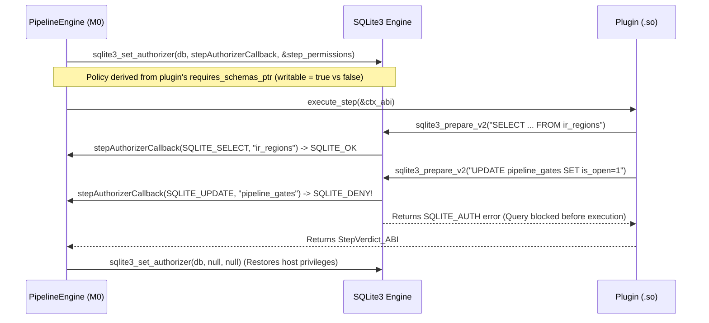

# ADR-003: Capability-Based SQLite Authorizer Firewall (`sqlite3_set_authorizer`)

- **Status:** Proposed / Accepted for `M0` Implementation
- **Date:** 2026-10-27
- **Context:** Pipeline Engine (`M0` — `StateDatabase` and `PipelineEngine`)

---

## 1. Context and Problem Statement

In our architecture (`ADR-001` and `ADR-002`), every dynamically loaded plugin receives the active `*sqlite3` database handle via `PipelineContext_ABI.sqlite_db`. While this provides a fast, zero-serialization relational bus, handing an unrestricted `*sqlite3` pointer to every plugin introduces a privilege-separation risk:
1. **Unauthorized Security Gate Tampering:** A buggy or untrusted third-party audit plugin in `M2`/`M3` could execute `UPDATE pipeline_gates SET is_open = 1 WHERE gate_name = 'sanitized_gate'`, bypassing the `M4` CDR sanitizer and unlocking `M5` media processing on an unsanitized file.
2. **Accidental or Malicious IR Mutation:** A read-only audit rule in `M2` or `M3` is only supposed to `SELECT` from `ir_regions` and `INSERT` into `audit_findings`, but nothing in standard SQLite prevents it from executing `DELETE FROM ir_regions` or `DROP TABLE run_metadata`.

---

## 2. Decision

We leverage SQLite's built-in **Compile-Time Authorizer Hook (`sqlite3_set_authorizer`)** in the host engine (`M0`) to enforce **Capability-Based Access Control** per plugin execution step, derived automatically from the plugin's declared `VidsecPluginABI` schema contracts.

### Access Control Matrix Enforced by `stepAuthorizerCallback`

| Target SQLite Table / Domain | Host Engine (`M0`) | Plugin Declaring Bank `X` with `writable = true` | Plugin Declaring Bank `X` with `writable = false` | Undeclared Domain Bank |
| :--- | :---: | :---: | :---: | :---: |
| **Engine Governance Tables** (`run_metadata`, `schema_registry`, `pipeline_gates`, `pipeline_trace`) | **Full R/W** | `SELECT` only *(Gate changes must use `ctx.set_gate_state`)* | `SELECT` only (`SQLITE_DENY` on write/DDL) | `SELECT` only |
| **Domain Bank Tables `X`** (`ir_core`, `ir_deep`, `audit_findings`, `working_artifacts`) | **Full R/W** | `INSERT`, `UPDATE`, `SELECT`, `CREATE INDEX` (`SQLITE_DENY` on `DROP TABLE`) | **`SELECT` only** (`SQLITE_DENY` on `INSERT`/`UPDATE`/`DELETE`/`DROP`) | **`SQLITE_DENY`** (Even `SELECT` is blocked if not declared) |
| **Dangerous SQLite Operations** (`SQLITE_ATTACH`, `SQLITE_DETACH`, `PRAGMA` mutation) | Allowed at init | **`SQLITE_DENY`** | **`SQLITE_DENY`** | **`SQLITE_DENY`** |

---

## 3. Consequences

### Positive
- **Zero Runtime Overhead on Loops:** `sqlite3_set_authorizer` is invoked by SQLite **only during `sqlite3_prepare_v2`** (when compiling a SQL statement), never during `sqlite3_step()`. Thus, inserting 100,000 rows in a loop incurs **zero** extra callback calls.
- **Cryptographic-Grade Gate Integrity:** No plugin can forge a `pipeline_gates` row via raw SQL; gate transitions can only occur through the host callback `ctx.set_gate_state`, where `M0` logs the caller step identity and enforces policy.
- **Guaranteed Immutability of `ContainerIR`:** Once `M1` finishes building `ir_regions`, no downstream plugin in `M2`–`M5` can alter or delete the structural IR.

### Negative / Trade-offs
- **Table-to-Domain Mapping (~30 lines of Zig in `M0`):** The authorizer callback in `M0` needs a simple prefix/table lookup (e.g., blocking writes to `run_metadata`, `schema_registry`, `pipeline_gates`, `pipeline_trace` while a plugin is active).
