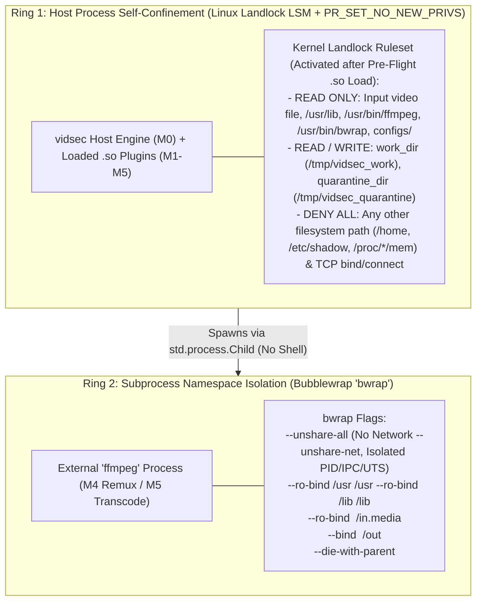

# ADR-005: Defense-in-Depth Sandboxing via Unprivileged Linux Landlock LSM and Bubblewrap

- **Status:** Proposed / Accepted
- **Date:** 2026-10-27
- **Context:** Host Process (`M0`) and Subprocess Isolation (`M4`, `M5`)

---

## 1. Context and Problem Statement

Processing hostile multimedia files involves two distinct execution domains:
1. **In-Process Parsing and Auditing (`M0`–`M4`):** Written in memory-safe Zig (`ReleaseSafe` with checked arithmetic), but loading external `.so` plugins via `std.DynLib` and linking against system `libc` and `libsqlite3`.
2. **External Media Subprocesses (`M4` Remuxing and `M5` Transcoding):** Invoking complex C/Assembly media tools (`ffmpeg`) that contain millions of lines of legacy codec and demuxer code.

Relying solely on container-level Docker isolation is insufficient if multiple jobs share a worker container or if a vulnerability in an external tool or plugin attempts to read local secrets (`/etc`, `$HOME/.ssh`), write outside the working directory, or initiate outbound network connections (`SSRF` / `C2` callbacks).

---

## 2. Decision

We implement a **Two-Ring Unprivileged Sandboxing Architecture** that requires **zero `root` privileges (`CAP_SYS_ADMIN` is NOT required)**:

### 2.1. Ring 1: In-Process Self-Confinement with Linux Landlock LSM (`M0`)
Once `PluginLoader` has opened all declared `.so` files and `YamlPipelineParser` has loaded the configuration files during the pre-flight phase, `M0` invokes:
1. `prctl(PR_SET_NO_NEW_PRIVS, 1, 0, 0, 0)` so neither the host process nor any child process can ever gain privileges.
2. **Linux Landlock LSM** (`landlock_create_ruleset`, `landlock_add_rule`, `landlock_restrict_self` — available unprivileged since Linux 5.13):
   - Restricts the `vidsec` process's own filesystem view to **Read-Only** on the input media file and system binaries/libraries, and **Read-Write** strictly on `work_dir`, `quarantine_dir`, and the optional `--save-db` file.
   - If the host kernel is older than Linux 5.13 and returns `ENOSYS` or `EOPNOTSUPP`, `M0` logs a warning event (`"LANDLOCK_UNSUPPORTED_KERNEL"`) and continues gracefully.

### 2.2. Ring 2: Subprocess Isolation with Bubblewrap (`M4` & `M5`)
Whenever `M4` (`SandboxedRemuxPlugin`) or `M5` invokes `ffmpeg`:
- Arguments are passed directly as an `argv` slice to `std.process.Child` (**never** via `/bin/sh -c`).
- When `use_bwrap` is enabled, `ffmpeg` is wrapped in `bwrap --unshare-all --die-with-parent`, which completely removes network interfaces (`--unshare-net`, defeating any `dref`/HLS SSRF bypass at the kernel namespace level) and mounts only the single input artifact (read-only) and output directory.

---

## 3. Consequences

### Positive
- **Zero-Root Defense-in-Depth:** Both Landlock LSM and Bubblewrap operate entirely in unprivileged user space, making them compatible with rootless Docker containers, Kubernetes pods, and developer workstations.
- **Kernel-Enforced SSRF and LFI Prevention:** Even if a novel 0-day in `ffmpeg` or a malicious `.so` plugin attempts to open a network socket or read `/etc/passwd`, the Linux kernel blocks the syscall with `EACCES` / `ENETUNREACH`.

### Negative / Trade-offs
- **Initialization Ordering Requirement:** Landlock must be activated in `M0` **after** `PluginLoader` loads the `.so` files and **after** `work_dir` / `quarantine_dir` directories are created on disk.
