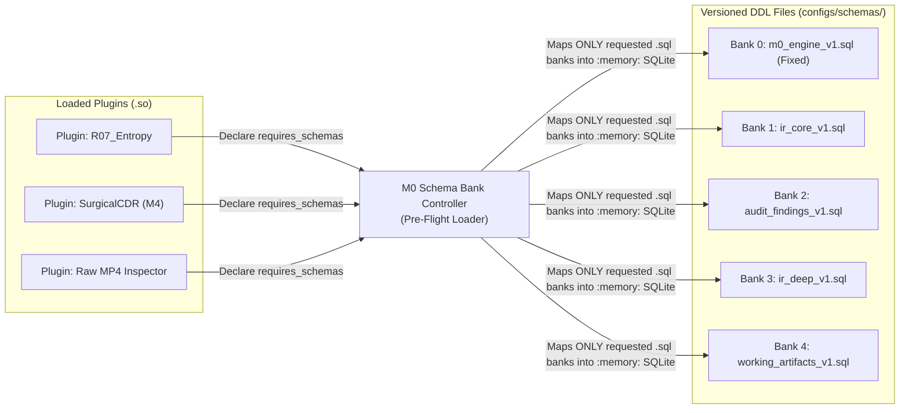

# ADR-006: On-Demand SQLite Schema Banks, Hard vs. Soft Plugin Dependencies, and Natural Nested-Set Containment

- **Status:** Accepted
- **Date:** 2026-10-27
- **Context:** Core Engine (`M0` — `PluginLoader`, `StateDatabase`, `plugin_abi.zig`) and Domain Plugins (`M1`–`M5`)

---

## 1. Context and Problem Statement

As the plugin ecosystem is segregated into independent shared libraries (`.so`) that users can freely enable, disable, or reorder in `configs/pipeline.yaml`, three architectural challenges arise:

1. **Fragility of Plugin-Embedded DDL (`CREATE TABLE` inside `.so` files):**
   - If a specific plugin (e.g., `R01` in `M2` or `DeepExtractor` in `M3`) is responsible for executing `CREATE TABLE` at runtime, skipping that plugin in `pipeline.yaml` causes downstream plugins that query those tables (such as `R07` inserting into `audit_findings`, or `M4` querying `ir_unreferenced_slack`) to crash with `SQLite: no such table`.
2. **Conflation of Data Schema Availability vs. Execution Order Dependencies:**
   - Having a SQLite table mapped in memory is not the same as requiring a specific upstream plugin to have populated it.
   - Furthermore, while universal rules operate on the `ContainerIR` (`M1`), **specialized plugins may need to inspect raw MP4/MOV/H.264 bytes directly via `ctx.cursor_read_at`** without running `M1` at all, or may have a strict hard dependency on another specific plugin.
3. **Hierarchical Containment Without Filesystem Inode Pointers:**
   - Media containers contain multiple tracks (`trak` 1 for video, `trak` 2 for audio), each enclosing its own `tkhd`, `avcC`, `stsz`, and `stco` boxes several levels deep. Adding `parent_region_id` pointers (like an OS filesystem inode table) forces consumers to write slow, complex `WITH RECURSIVE` SQL queries just to determine which `stco` and `stsz` belong to the same `trak`.

---

## 2. Decision

### 2.1. "Memory Bank Controller" Pattern for Versioned SQLite DDLs (`configs/schemas/*.sql`)
Instead of hardcoding `CREATE TABLE` statements inside `.so` binaries, all SQLite schemas are physically separated into versioned SQL files under `configs/schemas/`:
- `configs/schemas/m0_engine_v1.sql` (Always mapped at Bank 0 by `M0`)
- `configs/schemas/ir_core_v1.sql` (`container_metadata`, `ir_regions`)
- `configs/schemas/audit_findings_v1.sql` (`audit_findings`)
- `configs/schemas/ir_deep_v1.sql` (`ir_sample_extents`, `ir_unreferenced_slack`, `ir_codec_configs`, `ir_attachments`, `ir_external_refs`)
- `configs/schemas/working_artifacts_v1.sql` (`working_artifacts`, `quarantined_payloads`)

During the pre-flight phase, as `PluginLoader` loads each plugin declared in `pipeline.yaml`, it inspects the plugin's `requires_schemas_ptr` (`SchemaContract_ABI`). Like a Game Boy Memory Bank Controller (MBC) mapping ROM/RAM banks on demand, **`M0` automatically loads and executes `configs/schemas/<domain>_v<version>.sql` once for every requested schema bank**, and verifies that the plugin's tables exist before pipeline execution begins.



### 2.2. Orthogonal Separation: Schema Banks (`SchemaContract_ABI`) vs. Hard Plugin Dependencies (`PluginDependency_ABI`)
In `src/core/plugin_abi.zig`, `VidsecPluginABI` separates **what SQLite tables must be mapped** from **which upstream plugins must execute first**:

```zig
/// 1. SQLite Schema Bank to be mapped by M0 from configs/schemas/<domain>_v<version>.sql
pub const SchemaContract_ABI = extern struct {
    domain: [*:0]const u8,          // e.g., "ir_core", "ir_deep", "audit_findings", "working_artifacts"
    version: u32,                   // e.g., 1 -> loads configs/schemas/<domain>_v1.sql
    writable: bool = false,         // true = Authorizer grants INSERT/UPDATE; false = SELECT only
};

/// 2. Hard Plugin Dependency: Upstream plugin that MUST appear earlier in the pipeline execution order
pub const PluginDependency_ABI = extern struct {
    plugin_id: [*:0]const u8,       // e.g., "vidsec.m1.ir_builder" or "vidsec.m3.deep_extractor"
    min_version: SemVer_ABI,
};
```

This enables three distinct operational patterns:
1. **Hard Plugin Dependency (`requires_plugins`):** Rule `R04_SampleTableOverflow` declares a hard dependency on `vidsec.m3.deep_extractor >= 1.0.0`. If the user omits `deep_extractor` from `pipeline.yaml`, `M0` aborts at pre-flight with `error.MissingHardPluginDependency`.
2. **Soft / Optional Dependency via Mapped Schema Bank:** `SurgicalCdrPlugin` (`M4`) declares a hard dependency **only** on `vidsec.m1.ir_builder`, while requesting both `"ir_core"` and `"ir_deep"` schema banks. If the user skips `M3` in `pipeline.yaml`, `M0` still maps `ir_deep_v1.sql` (so `ir_unreferenced_slack` exists as an empty table with `0` rows), allowing `M4`'s `UNION ALL` query to run without error!
3. **Standalone Format-Specific Plugins (Direct MP4/MOV/Bitstream Inspection):** A specialized plugin that parses custom MP4 atoms directly via `ctx.cursor_read_at` declares `requires_plugins_len = 0` and only requests the `"audit_findings"` schema bank (`writable = true`). It can run completely independently of `M1` and `ContainerIR`.

### 2.3. Natural Nested-Set Containment Using Byte Offsets
Because every child box or element in a binary media container physically resides within the byte interval `[payload_offset, effective_end_offset]` of its ancestor box, **physical byte offsets naturally form a Nested Set (`lft` = `header_offset`, `rgt` = `effective_end_offset`)**.
- Grouping `tkhd`, `avcC`, `stsz`, and `stco` under their enclosing `trak` (or `Stream`) in SQL requires zero `parent_region_id` columns and zero recursive CTEs:
  ```sql
  child.header_offset >= trak.payload_offset
  AND child.effective_end_offset <= trak.effective_end_offset
  ```

---

## 3. Consequences

### Positive
- **Zero `no such table` Errors When Skipping Optional Stages:** Because schema banks are provisioned from `configs/schemas/<domain>_v<ver>.sql` whenever any loaded plugin requests them, skipping optional producers leaves valid empty tables rather than broken SQL queries.
- **No DDL Boilerplate in `.so` Plugins:** Plugins only contain prepared `SELECT` and `INSERT` statements; schema creation is managed declaratively by `M0`.
- **Automatic Authorizer Configuration (`ADR-003`):** The `writable: bool` flag in `SchemaContract_ABI` tells `M0`'s `sqlite3_set_authorizer` callback exactly which schema banks the current plugin is allowed to write to (`writable = true`) versus read-only (`writable = false`).
- **First-Class Support for Direct Binary Plugins:** Format-specific plugins can bypass `ContainerIR` whenever raw byte access via `SafeCursor` is more appropriate.
